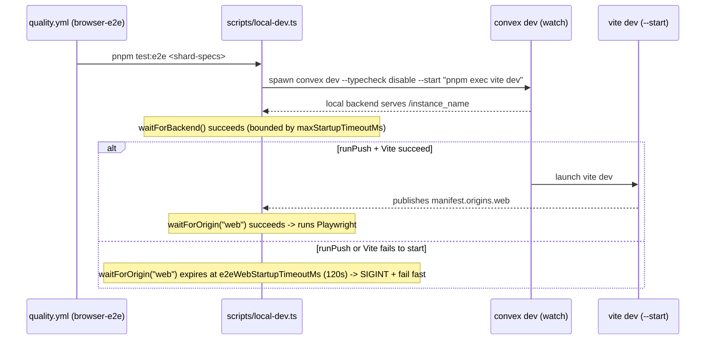

# Technical Design: CI Pipeline Optimization

Inputs: [01-request-ci-pipeline-optimization.md](./01-request-ci-pipeline-optimization.md), [03-research-ci-pipeline-optimization.md](./03-research-ci-pipeline-optimization.md).

## System Design

### 1. `test:e2e` delegates Convex typechecking to `quality` and bounds post-backend web startup

In `quality.yml`, the `quality` job already owns `pnpm typecheck` (`tsc --noEmit && tsc --noEmit -p convex/tsconfig.json`). Repeating TypeScript compilation inside each of the four `browser-e2e` shards adds 20-30s per shard and triggers a 10-minute hang whenever `convex dev` stays alive in watch mode after a push failure without launching `--start "pnpm exec vite dev"`.

In the target flow:
- `quality.yml` keeps `pnpm exec convex dev --once --typecheck disable` before `pnpm test:e2e` because `selectedLocalDeployment(root)` (`scripts/local-dev.ts:892-897`) requires `.env.local` and `.convex/local/default/config.json` to exist.
- `scripts/local-dev.ts test:e2e` passes `--typecheck disable` to `convex dev` (leaving `dev` and `convex:dev` with default typechecking unchanged).
- Because `waitForOrigin("web")` covers both `convex dev`'s initial `runPush` (15-35s in CI) and cold `vite dev` SSR startup (15-37s), `LOCAL_RUNTIME_POLICY` adds `e2eWebStartupTimeoutMs = 120_000` (2 minutes — 5x faster than 600s on a hang, with safe headroom for cold push + Vite).
- When `LOCAL_RUNTIME_STARTUP_TIMEOUT_MS` is explicitly set (as in `src/__tests__/config/local-runtime.test.ts:830`), `local-dev.ts` honors that override; otherwise `runE2e` uses `e2eWebStartupTimeoutMs` in both `runNativeWatcher` and `runWeb`.



### 2. Vitest separates Node (`.test.ts`) and jsdom (`.test.tsx`) projects and latches `input-otp` mounts

Today, `vitest.config.ts` applies `environment: "jsdom"` and `setupFiles: ["./src/__tests__/setup/cleanup.ts"]` globally across all 348 files, even though all 286 `.test.ts` files are DOM-free and only `src/components/workspace/invitation-access-drawer.tsx` renders `input-otp`.

In Vitest 4.1.10, inline `test.projects` do not inherit root `resolve.tsconfigPaths`, `plugins`, `exclude`, `isolate`, or `testTimeout` unless `extends: true` is used, and `extends: true` merges array options like `setupFiles` via Vite `mergeConfig`. Additionally, `vitest.live.config.ts` spreads `vitest.config.ts` and would inherit `test.projects` (silently ignoring its own `include`) unless `projects` is omitted or cleared.

In the target design:
- Shared base options (`resolve: { tsconfigPaths: true }`, `plugins: [viteReact()]`, `exclude: [...configDefaults.exclude, "src/__tests__/live/**"]`, `isolate: true`, `maxWorkers: 4`, `testTimeout: 15_000`) are defined without `environment` or `setupFiles` on root `test`.
- `vitest.config.ts` defines two inline projects using `extends: true`:
  - `node`: `include: ["src/__tests__/**/*.test.ts"]` (286 files), `environment: "node"`, `setupFiles: []`. Keeping `viteReact()` on `node` ensures `.test.ts` files that import `.tsx` route/component modules (`source-review-search.test.ts`, `agent-identities.test.ts`) still transform cleanly.
  - `jsdom`: `include: ["src/__tests__/**/*.test.tsx"]` (62 files), `environment: "jsdom"`, `execArgv: ["--no-experimental-webstorage"]`, `setupFiles: ["./src/__tests__/setup/cleanup.ts"]`.
- `vitest.live.config.ts` explicitly sets `projects: undefined` and `environment: "node"` (with `resolve: { tsconfigPaths: true }`, `testTimeout: 15_000`) so `pnpm test:live` runs only `src/__tests__/live/**/*.contract.test.ts`.
- `src/__tests__/setup/cleanup.ts` latches a per-test boolean (`inputOtpMounted`) whenever `[data-slot="input-otp"]` is added to `document.body` during a test (via a `MutationObserver` started in `beforeEach` and disconnected in `afterEach`, catching components even if unmounted before `afterEach`). `afterEach` runs `cleanup()`, resets the latch, and awaits `setTimeout(resolve, 60)` only when `inputOtpMounted` is true.

```text
vitest.config.ts (root: tsconfigPaths, viteReact, exclude live/**, isolate: true, maxWorkers: 4, testTimeout: 15_000)
├── project "node" (extends: true)
│   ├── include: ["src/__tests__/**/*.test.ts"] (286 files)
│   ├── environment: "node"
│   └── setupFiles: []
└── project "jsdom" (extends: true)
    ├── include: ["src/__tests__/**/*.test.tsx"] (62 files)
    ├── environment: "jsdom", execArgv: ["--no-experimental-webstorage"]
    └── setupFiles: ["./src/__tests__/setup/cleanup.ts"]
        ├── beforeEach: observe document.body -> latch inputOtpMounted if [data-slot="input-otp"] appears
        └── afterEach: disconnect observer, cleanup(), await 60ms ONLY if inputOtpMounted

vitest.live.config.ts -> projects: undefined, environment: "node", include: ["src/__tests__/live/**/*.contract.test.ts"]
```

### 3. CI consolidates setup, installs headless Chromium shell, halves `workbench-ui` shards, and round-robins `browser-e2e`

Today, `.github/workflows/quality.yml` runs 10 jobs (43.7 runner-minutes on green HEAD `45811442776`), duplicates setup across 3 job definitions, installs full Chromium across 8 jobs, runs 4 `workbench-ui` shards where setup nearly equals test time (325s vs 363s), and relies on Playwright's contiguous `--shard=N/4` in `browser-e2e`, clustering the heaviest `src/__tests__/e2e/` specs into shard 4 (433s vs 165s in shard 1).

In the target topology (8 jobs total):

```text
.github/workflows/quality.yml (8 jobs total, down from 10)
├── quality (1 runner) ─────────▶ ./.github/actions/setup-node-pnpm ─▶ pnpm check (node + jsdom Vitest projects)
├── preview-service (1 runner) ─▶ unchanged (npm ci + --only-shell chromium + preview-egress.spec.ts)
├── workbench-ui (2 shards) ────▶ ./.github/actions/setup-node-pnpm (chromium: true -> --only-shell)
│                                 └─▶ pnpm workbench-ui:check --shard=${{ matrix.shard }}/2 --reporter=list
└── browser-e2e (4 shards) ─────▶ ./.github/actions/setup-node-pnpm (chromium: true -> --only-shell)
                                  ├─▶ pnpm invitations:generate + convex dev --once --typecheck disable
                                  └─▶ pnpm test:e2e --pass-with-no-tests <anchored round-robin spec patterns for shard N of 4>
```

Key behaviors:
- **Local composite action (`.github/actions/setup-node-pnpm/action.yml`)** owns `pnpm/action-setup`, `actions/setup-node` (with `cache: pnpm`), `pnpm install --frozen-lockfile`, and optional `pnpm exec playwright install --with-deps --only-shell chromium`. Callers still run `actions/checkout` first.
- **Chromium headless shell (`--only-shell chromium`)** replaces full Chromium in both `workbench-ui` and `browser-e2e`, matching `preview-service` (`quality.yml:58`). Verified against Playwright 1.62.1: headless launches with no `channel` override (`playwright.config.ts:63-68`, `workbench-ui.playwright.config.ts:1-24`, `e2e/global-setup.ts:117`) resolve to `chromium-headless-shell` directly.
- **`workbench-ui` drops from 4 shards to 2 shards**, eliminating 2 runners per PR and reducing queue contention while finishing in ~3.5-4 min (off the critical path).
- **`browser-e2e` stays at 4 shards using deterministic round-robin file selection** (`index % totalShards === shard - 1` over sorted spec files). The `testMatch` and `testIgnore` patterns live in one shared module imported by both `playwright.config.ts` and the shard selector so discovery cannot drift. Because Playwright converts positional CLI arguments via `forceRegExp`, the selector emits regex-escaped, end-anchored file patterns (and CI passes `--pass-with-no-tests` so an empty shard never errors). Every shard automatically mixes `e2e/` and `src/__tests__/e2e/` specs (~3.5-4.5 min per shard) with zero manual spec table.

## Program Design

### 1. `LOCAL_RUNTIME_POLICY` owns the post-backend E2E web timeout and `local-dev.ts` skips Convex typecheck in `test:e2e`

`convex/resourcePolicy.ts:484-502` adds `e2eWebStartupTimeoutMs: 120_000` alongside `maxStartupTimeoutMs: 600_000`. In `scripts/local-dev.ts`, `E2E_WEB_STARTUP_TIMEOUT_MS` honors an explicit `LOCAL_RUNTIME_STARTUP_TIMEOUT_MS` override (preserving `src/__tests__/config/local-runtime.test.ts:830`), falling back to `LOCAL_RUNTIME_POLICY.e2eWebStartupTimeoutMs`.

```diff
// convex/resourcePolicy.ts
 export const LOCAL_RUNTIME_POLICY = {
     maxStartupTimeoutMs: 600_000,
+    e2eWebStartupTimeoutMs: 120_000,
     portReservationTimeoutMs: 20_000,
```

```diff
// scripts/local-dev.ts
 const STARTUP_TIMEOUT_MS = positiveInteger(
     process.env.LOCAL_RUNTIME_STARTUP_TIMEOUT_MS,
     LOCAL_RUNTIME_POLICY.maxStartupTimeoutMs,
 );
+const E2E_WEB_STARTUP_TIMEOUT_MS = positiveInteger(
+    process.env.LOCAL_RUNTIME_STARTUP_TIMEOUT_MS,
+    LOCAL_RUNTIME_POLICY.e2eWebStartupTimeoutMs,
+);
```

Inside `runNativeWatcher` (`scripts/local-dev.ts:288-346`):
- When `runE2e` is true and Convex is already running without web, `runWeb` receives `E2E_WEB_STARTUP_TIMEOUT_MS` instead of `STARTUP_TIMEOUT_MS`.
- When spawning `convex dev`, `runE2e` appends `["--typecheck", "disable"]`.
- `waitForOrigin(root, "web", child, exit, runE2e ? E2E_WEB_STARTUP_TIMEOUT_MS : STARTUP_TIMEOUT_MS)` bounds the `runPush + cold vite dev` phase for `test:e2e` while keeping `dev` at `STARTUP_TIMEOUT_MS`.

```diff
// scripts/local-dev.ts (runNativeWatcher)
     if (startWeb && !startup.ready.has("web"))
         return runWeb(
             root,
             [],
             runE2e ? () => runE2eTests(root, args) : undefined,
+            runE2e ? E2E_WEB_STARTUP_TIMEOUT_MS : STARTUP_TIMEOUT_MS,
         );
...
     const child = spawn(
         process.execPath,
         [
             cli,
             "dev",
+            ...(runE2e ? ["--typecheck", "disable"] : []),
             ...backendVersionArgs,
             "--local-cloud-port",
             String(ports.convex),
             "--local-site-port",
             String(ports.site),
             ...(startWeb && !startup.ready.has("web")
                 ? ["--start", "pnpm exec vite dev"]
                 : []),
             ...nativeArgs,
         ],
...
     await waitForBackend(root, deploymentName, child, runId, exit);
     if (startWeb)
-        await waitForOrigin(root, "web", child, exit, STARTUP_TIMEOUT_MS);
+        await waitForOrigin(
+            root,
+            "web",
+            child,
+            exit,
+            runE2e ? E2E_WEB_STARTUP_TIMEOUT_MS : STARTUP_TIMEOUT_MS,
+        );
```

`src/__tests__/config/local-runtime.test.ts:845-855` updates its expected `test:e2e` Convex argv to include `"--typecheck", "disable"`, and a new focused test verifies that `test:e2e` exits at `e2eWebStartupTimeoutMs` (via `LOCAL_RUNTIME_STARTUP_TIMEOUT_MS` / mock watcher staying alive without starting Vite) instead of hanging.

### 2. Vitest splits `node` and `jsdom` projects cleanly without breaking `vitest.live.config.ts`, and `cleanup.ts` latches `input-otp` mounts

`vitest.config.ts` removes `environment` and `setupFiles` from root `test` so `extends: true` inherits `resolve.tsconfigPaths`, `plugins: [viteReact()]`, `exclude`, `isolate`, and `testTimeout` without concatenating `setupFiles` onto the `node` project.

```ts
// vitest.config.ts
import viteReact from "@vitejs/plugin-react";
import { configDefaults, defineConfig } from "vitest/config";

export default defineConfig({
    resolve: { tsconfigPaths: true },
    plugins: [viteReact()],
    test: {
        exclude: [...configDefaults.exclude, "src/__tests__/live/**"],
        isolate: true,
        maxWorkers: 4,
        // Concurrent UI, CLI and workflow integration tests exceed Vitest's 5s default.
        testTimeout: 15_000,
        projects: [
            {
                extends: true,
                test: {
                    name: "node",
                    environment: "node",
                    include: ["src/__tests__/**/*.test.ts"],
                    setupFiles: [],
                },
            },
            {
                extends: true,
                test: {
                    name: "jsdom",
                    environment: "jsdom",
                    // Browser storage belongs to jsdom, not Node's optional disk-backed globals.
                    execArgv: ["--no-experimental-webstorage"],
                    include: ["src/__tests__/**/*.test.tsx"],
                    setupFiles: ["./src/__tests__/setup/cleanup.ts"],
                },
            },
        ],
    },
});
```

```diff
// vitest.live.config.ts
     test: {
         ...base.test,
+        projects: undefined,
+        environment: "node",
+        setupFiles: [],
         include: ["src/__tests__/live/**/*.contract.test.ts"],
         exclude: [...configDefaults.exclude],
     },
```

In `src/__tests__/setup/cleanup.ts:77-82`, a `MutationObserver` on `document.body` latches `inputOtpMounted = true` whenever any element matching `[data-slot="input-otp"]` is mounted during the test (even if closed/unmounted before `afterEach`).

```ts
// src/__tests__/setup/cleanup.ts (lifecycle hooks)
let inputOtpMounted = false;
let inputOtpObserver: MutationObserver | undefined;

beforeEach(() => {
    inputOtpMounted = false;
    if (typeof document === "undefined" || !document.body) return;
    if (document.body.querySelector('[data-slot="input-otp"]')) {
        inputOtpMounted = true;
        return;
    }
    inputOtpObserver = new MutationObserver(() => {
        if (document.body.querySelector('[data-slot="input-otp"]')) {
            inputOtpMounted = true;
            inputOtpObserver?.disconnect();
            inputOtpObserver = undefined;
        }
    });
    inputOtpObserver.observe(document.body, { childList: true, subtree: true });
});

afterEach(async () => {
    inputOtpObserver?.disconnect();
    inputOtpObserver = undefined;
    const shouldDrainInputOtp = inputOtpMounted;
    inputOtpMounted = false;
    cleanup();
    if (shouldDrainInputOtp) {
        // input-otp schedules 0/10/50 ms synchronization callbacks without a
        // cleanup handle. Keep jsdom alive until those callbacks have drained.
        await new Promise((resolve) => setTimeout(resolve, 60));
    }
});
```

### 3. `scripts/e2e-shards.ts` owns E2E spec discovery, `local-dev.ts` expands `--round-robin-shard=N/M`, and `.github/actions/setup-node-pnpm` centralizes CI setup

#### Shared E2E spec discovery and round-robin selector (`scripts/e2e-shards.ts`)

Both `playwright.config.ts` and `scripts/local-dev.ts` import from one module so `testMatch` and `testIgnore` cannot drift. `selectE2eShardPatterns` sorts discovered POSIX relative paths deterministically, picks `index % total === shard - 1`, and returns regex-escaped, end-anchored patterns (matching Playwright's `forceRegExp` positional matching).

```ts
// scripts/e2e-shards.ts
import { globSync } from "node:fs";

export const E2E_TEST_MATCH = [
    "e2e/**/*.spec.ts",
    "src/__tests__/e2e/**/*.spec.ts",
] as const;
export const E2E_TEST_IGNORE = ["archive/**"] as const;

function escapeRegExp(value: string): string {
    return value.replace(/[.*+?^${}()|[\]\\]/g, "\\$&");
}

export function discoverE2eSpecFiles(root: string): string[] {
    const files = new Set<string>();
    for (const pattern of E2E_TEST_MATCH) {
        for (const match of globSync(pattern, {
            cwd: root,
            exclude: [...E2E_TEST_IGNORE],
        })) {
            files.add(match.replaceAll("\\", "/"));
        }
    }
    return [...files].sort();
}

export function selectE2eShardPatterns(
    root: string,
    shard: number,
    total: number,
): string[] {
    if (!Number.isInteger(shard) || !Number.isInteger(total) || total < 1 || shard < 1 || shard > total) {
        throw new Error(`Invalid round-robin shard "${shard}/${total}".`);
    }
    return discoverE2eSpecFiles(root)
        .filter((_, index) => index % total === shard - 1)
        .map((relPath) => `(?:^|/)${escapeRegExp(relPath)}$`);
}

export function expandRoundRobinShardArgs(root: string, args: string[]): string[] {
    // Parses --round-robin-shard=N/M (or --round-robin-shard N/M), strips it,
    // and returns ["--pass-with-no-tests", ...selectE2eShardPatterns(root, shard, total), ...rest].
    // Returns args unchanged when the flag is absent.
}
```

```diff
// playwright.config.ts
 import { join } from "node:path";
 import { defineConfig, devices } from "@playwright/test";
+import { E2E_TEST_IGNORE, E2E_TEST_MATCH } from "./scripts/e2e-shards.ts";
 import { resolveLocalRuntime } from "./scripts/local-runtime.ts";
...
     testDir: ".",
-    testMatch: ["e2e/**/*.spec.ts", "src/__tests__/e2e/**/*.spec.ts"],
-    // Retired specs are kept verbatim outside the build.
-    testIgnore: ["archive/**"],
+    testMatch: [...E2E_TEST_MATCH],
+    // Retired specs are kept verbatim outside the build.
+    testIgnore: [...E2E_TEST_IGNORE],
```

```diff
// scripts/local-dev.ts (runE2eTests)
 async function runE2eTests(root: string, args: string[]): Promise<number> {
     const runtime = await resolveLocalRuntime(root, {
         requiredOrigins: ["convex", "web"],
     });
-    return runCommand("pnpm", ["exec", "playwright", "test", ...args], root, {
+    const playwrightArgs = expandRoundRobinShardArgs(root, args);
+    return runCommand("pnpm", ["exec", "playwright", "test", ...playwrightArgs], root, {
```

#### Local composite action (`.github/actions/setup-node-pnpm/action.yml`)

```yaml
name: Setup Node and pnpm
description: Install pnpm, Node.js with pnpm store cache, frozen dependencies, and optional Chromium headless shell.
inputs:
  install-chromium-shell:
    description: Install Playwright Chromium headless shell with system deps
    required: false
    default: "false"
runs:
  using: composite
  steps:
    - name: Install pnpm
      uses: pnpm/action-setup@f40ffcd9367d9f12939873eb1018b921a783ffaa # v4
      with:
        version: 12.16.0
    - name: Install Node.js
      uses: actions/setup-node@49933ea5288caeca8642d1e84afbd3f7d6820020 # v4
      with:
        node-version-file: .node-version
        cache: pnpm
    - name: Install dependencies
      shell: bash
      run: pnpm install --frozen-lockfile
    - name: Install Chromium headless shell
      if: inputs.install-chromium-shell == 'true'
      shell: bash
      run: pnpm exec playwright install --with-deps --only-shell chromium
```

#### Workflow updates (`.github/workflows/quality.yml`)

```diff
   quality:
     steps:
       - uses: actions/checkout@11d5960a326750d5838078e36cf38b85af677262 # v4
-      - (pnpm + setup-node + pnpm install)
+      - uses: ./.github/actions/setup-node-pnpm
       - run: pnpm check

   workbench-ui:
     strategy:
       matrix:
-        shard: [1, 2, 3, 4]
+        shard: [1, 2]
     steps:
       - uses: actions/checkout@11d5960a326750d5838078e36cf38b85af677262 # v4
-      - (pnpm + setup-node + pnpm install + playwright install --with-deps chromium)
+      - uses: ./.github/actions/setup-node-pnpm
+        with:
+          install-chromium-shell: "true"
-      - run: pnpm workbench-ui:check --shard=${{ matrix.shard }}/4 --reporter=list
+      - run: pnpm workbench-ui:check --shard=${{ matrix.shard }}/2 --reporter=list

   browser-e2e:
     strategy:
       matrix:
         shard: [1, 2, 3, 4]
     steps:
       - uses: actions/checkout@11d5960a326750d5838078e36cf38b85af677262 # v4
-      - (pnpm + setup-node + pnpm install + playwright install --with-deps chromium)
+      - uses: ./.github/actions/setup-node-pnpm
+        with:
+          install-chromium-shell: "true"
       - run: pnpm invitations:generate --output=invitation-otp-codes.local
       - run: pnpm exec convex dev --once --typecheck disable
-      - run: pnpm test:e2e --shard=${{ matrix.shard }}/4
+      - run: pnpm test:e2e --round-robin-shard=${{ matrix.shard }}/4
       - if: always()
         run: pnpm dev:stop
```

#### Planned Test & Documentation Updates

- `src/__tests__/config/e2e-shards.test.ts` (new, `node` project): verifies deterministic round-robin partitioning (union equals full discovered set, pairwise disjoint, balanced counts, regex escaping/anchoring, `--pass-with-no-tests` on empty shard, invalid shard rejection).
- `src/__tests__/config/local-runtime.test.ts`: copies `scripts/e2e-shards.ts` into its temp-repo fixture alongside `scripts/local-dev.ts`, updates expected `test:e2e` `convex dev` argv to include `"--typecheck", "disable"`, adds coverage for `--round-robin-shard=1/4` forwarding, and verifies fast failure when `convex dev` stays alive without starting Vite.
- `AGENTS.md:238` and `context/TECH.md`: update documented `workbench-ui` shard count (4 -> 2) and `browser-e2e` round-robin sharding / headless shell install.

## Patterns to Follow

- Centralize local-runtime timeouts in `convex/resourcePolicy.ts` (`LOCAL_RUNTIME_POLICY`) so `scripts/check-resource-policy.ts` remains green.
- Preserve `scripts/local-dev.ts` contracts verified by `src/__tests__/config/local-runtime.test.ts` (startup lock, fixed worktree ports, backend version pinning, `SIGINT` shutdown).
- Keep `AGENTS.md` and `context/TECH.md` synchronized when CI sharding or runner contracts change (`AGENTS.md:238`).

## Scope

In scope:
1. `scripts/local-dev.ts` and `convex/resourcePolicy.ts`: `--typecheck disable` in `test:e2e` and dedicated post-backend web-readiness timeout (`e2eWebStartupTimeoutMs = 120_000`).
2. `vitest.config.ts`, `vitest.live.config.ts`, and `src/__tests__/setup/cleanup.ts`: `node` (`.test.ts`) vs `jsdom` (`.test.tsx`) projects (preserving `test:live`) and latched `input-otp` 60ms drain.
3. `.github/actions/setup-node-pnpm/action.yml`, `.github/workflows/quality.yml`, shared Playwright `testMatch`/`testIgnore` + round-robin E2E shard selector, and `AGENTS.md:238` / `context/TECH.md` sync.

Out of scope:
- Optimizing individual test runtimes inside `src/__tests__/config/local-runtime.test.ts` (199s) or individual E2E spec durations (tracked as separate follow-up work if needed after measuring post-change CI timings).
- Disabling Vitest isolation (`isolate: false`).
- Changing `preview-service` or caching Playwright browser binaries across GitHub Actions runs (can be revisited only if `--only-shell` install times remain material).
