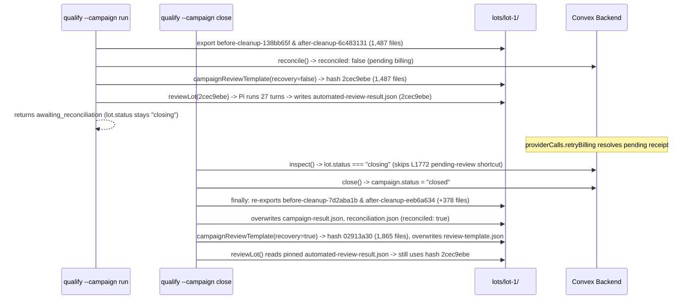

# Research: Evaluation Review and Closeout

## Research Question

1. **Pi automated review loop, inputs, and context growth:** In `scripts/evaluations/workbench-browser/campaign-review.ts`, what prompt, tools, and frozen files does the Pi reviewer receive, how does its turn loop handle tool results and provisional `automated-review-report.md` writes, and what caused the `sources-efficiency-ce843ce-20261125-ready` review to spend 27 turns, 5 report revisions, and 1.27 MB on a lot where 8 of 12 scenarios did not run?
2. **Reviewer model, reasoning effort, and authority configuration:** Across `scripts/evaluations/workbench-browser/campaign-review.ts`, `convex/qualificationCampaignPolicy.ts`, and `scripts/evaluations/workbench-browser/campaign.ts`, how are the Pi reviewer's model, reasoning effort, request/cost allowance, and timeout configured and validated, and which parts are frozen in the campaign manifest versus overridable per invocation?
3. **End-of-lot observation export (`before-cleanup-*`):** In `scripts/evaluations/workbench-browser/campaign.ts` (around line 2301) and its Convex query owners, what queries, pagination loops, and file writes run during `before-cleanup-*` export and cleanup, and what accounts for the 4 min 46 s duration between `23:41:21` and `23:46:07` UTC?
4. **Evidence indexing, template freezing, and hash drift:** In `scripts/evaluations/workbench-browser/campaign.ts` (around lines 132–210 and 976–1045), what files are hashed into `evidence-index-<hash>.json` and `review-template-<hash>.json`, when does re-indexing occur, and why did `sources-efficiency-ce843ce-20261125-ready` produce two distinct hashes (`2cec9ebe...` before review and `02913a30...` during closeout)?
5. **Assessment adoption and `--campaign close` recovery:** In `scripts/evaluations/workbench-browser/campaign.ts` (`runCampaignReviewStage` and `submit-assessment` around lines 976–1050 and 1588–1640) and `convex/qualificationCampaigns.ts`, how does assessment adoption interact with the local Convex backend, what state is persisted before and after `submit-assessment`, and what fails when the backend stops mid-closeout?
6. **Existing test coverage and protected invariants:** Across `src/__tests__/config/qualification-campaign.test.mjs`, `src/__tests__/config/qualification-v2.test.mjs`, and `src/__tests__/convex/execution/qualification-campaign.test.ts`, what behaviors and integrity invariants are currently asserted for Pi automated review, observation export, evidence hashing, and closeout recovery?

## Research Methodology

This document describes the current system using facts from live source code, test files, and the recorded campaign artifacts in `/home/abdwhb/.cache/workbench-evaluations/sources-efficiency-ce843ce-20261125-ready`. No test suites were executed during this research phase; every test reference below reflects tests read from source.

## Summary

The Pi automated review spent $3.356172 across 27 turns (95.7% of total campaign spend) primarily because `runPiCampaignReview` disables OpenAI prompt caching (`cacheRetention: "none"`) and appends a dynamic per-attempt `system` message on every turn. As tool results accumulated across 27 turns from 6,056 to 114,548 input tokens, the reviewer paid full uncached input rates ($2.00/M vs. $0.10/M cached) on 1,615,311 input tokens ($3.2306, or 96.3% of review spend) with `cacheRead = 0` on every request. The 1.27 MB file on turn 27 (`automated-review-response-analysis-2cec9ebe2a198e37-27.json`) is the raw persisted SSE delta stream for 4,218 output tokens rather than prompt bloat, and the 5 report revisions (turns 10, 15, 19, 26, plus final turn 27) follow the mission prompt's instruction to publish provisional handoffs before continuing investigation.

End-of-lot observation export (`inspectCampaignScenarios`) accounted for 4 min 38 s of the 4 min 46 s gap (`before-cleanup-138bb65f`: 171.28 s; `after-cleanup-6c483131`: 106.84 s). The exporter iterates sequentially over all 12 scenarios, 7 paginated table kinds, and every `agentInvocations` row at `numItems: 1`, then hydrates fragmented transcripts one fragment at a time (`numItems: 1`). Every Convex query ran serially on a loaded local backend immediately after the live lot, taking 0.5–1.7 s per empty query and up to 8.3 s per fragmented invocation, whereas the same 188-file export took 1.32 s on a quiet backend during closeout.

The two `evidence-index` / `review-template` hashes (`2cec9ebe...` and `02913a30...`) occurred because the lot finished `run` with `reconciled: false` and status `"closing"`. When `--campaign close` ran later, the early `pending` review branch only matched lots in `"review"` or `"finished"` status, so `close` fell through to the `finally` cleanup block, exported two more observation directories (378 new files), updated `campaign-result.json`, `reconciliation.json`, and `progress.jsonl`, and called `campaignReviewTemplate(lotRoot, { recovery: true })`. Because `reviewLot` still pinned `automated-review-result.json` (`2cec9ebe...`), assessment adoption proceeded against the original frozen snapshot until `client.mutation(internal.qualificationCampaigns.assess)` failed with `operation_failed` when the local Convex backend stopped; re-running `close` after restarting the backend safely re-adopted the same assessment hash without re-running Pi.

## Detailed Findings

### 1. Pi automated review disables prompt caching and accumulates uncached tool history across turns

`runPiCampaignReview` in `scripts/evaluations/workbench-browser/campaign-review.ts:1160-1987` creates an in-memory Pi `AgentSession` (`createAgentSession`, lines 1613–1627) backed by four custom tools operating on the frozen evidence snapshot (`evidenceRoot`):

- `read` (`campaign-review.ts:1411-1446`): reads bounded UTF-8 byte windows (`defaultReadBytes: 8192`, `maxPageBytes: 51200` from `REVIEW_EVIDENCE_POLICY` in `convex/resourcePolicy.ts:360-373`) via `readCampaignReviewEvidenceWindow`.
- `ls` (`campaign-review.ts:1447-1479`): paginates the frozen inventory (`inventoryPageSize: 50`, `maxInventoryPageSize: 100`) via `listCampaignReviewEvidence`.
- `grep` (`campaign-review.ts:1480-1541`): runs literal text search across at most `maxSearchFiles: 100` files per cursor page (`maxSearchResults: 100`, `maxPageBytes: 51200`) via `searchCampaignReviewEvidence`.
- `write` (`campaign-review.ts:1542-1612`, enabled under `investigator_v2`): writes only `automated-review-report.md`, calling `retainCampaignReviewReport(reportRoot, template, content, calls, { provisional: true })` which saves immutable `automated-review-report-<attempt>-<sha256>.md` files outside the frozen evidence snapshot.

The system prompt (`campaign-review.ts:1403-1404`) concatenates `.agents/skills/workbench-evaluation/references/reviewer-mission.md` (3,901 bytes), the allowed verdict strings, and a JSON payload containing `context` (12,987 bytes: manifest objective, capability, mode, executionSurface, all 12 scenario definitions, `milestoneEvidence` presence flags, `campaign-result.json`, `reconciliation.json`, `archivedSourcePrefix: "code/"`) plus the full `template` (all 12 scenarios and their check keys). The initial user prompt is `"Investigate the captured evaluation using its required frozen context and assessment template."` (`campaign-review.ts:1908-1909`).

Two implementation details in `session.agent.streamFunction` (`campaign-review.ts:1665-1886`) drive token cost in multi-turn reviews:

1. **Prompt caching is hardcoded off:** Line 1771 passes `cacheRetention: "none"` on every non-mock transport call.
2. **Every investigation turn appends a changing `system` message:** Lines 1700–1718 append a new `{ role: "system", content: "Review request <attempt>. Remaining calls under the original lot ceiling: <N>. Absolute analysis deadline: ... Publish useful provisional findings before further investigation rather than waiting for assessment completion.", timestamp: 0 }` message at the tail of `context.messages` on every `investigator_v2` call.

In the recorded `sources-efficiency-ce843ce-20261125-ready` lot (`gpt-6.1-sol`, `reasoning: high`, `input: $2.00/M`, `cacheRead: $0.10/M`, `output: $10.00/M`):

| Metric | Recorded Value | Source / Explanation |
| --- | --- | --- |
| Total requests | 27 | `progress.jsonl` (`analysis-2cec9ebe2a198e37-1` .. `-27`) |
| Total input tokens (uncached) | 1,615,311 | Starts at 6,056 (turn 1), grows monotonically to 114,548 (turn 27) |
| Total cached input tokens | 0 | `cacheRead === 0` on all 27 receipts (`cacheRetention: "none"`) |
| Total output tokens | 12,555 | Includes reasoning tokens; 4,218 on final turn 27 |
| Total review cost | $3.356172 | $3.2306 uncached input (96.3%) + $0.1256 output (3.7%) |
| Provisional report writes | 4 (`write` tool) + 1 (final) | Turns 10 (2.0 KB), 15 (3.9 KB), 19 (6.8 KB), 26 (10.7 KB), 27 (final) |
| Turn 26 / Turn 27 response file size | 550 KB / 1,243 KB | Persisted raw OpenAI SSE delta streams (`automated-review-response-*.json`), not prompt context |

Why the reviewer took 27 turns despite 8 of 12 scenarios never running:

- **Inventory paging overhead (turns 1, 3–6, 12, 14):** Because `evidence-index` contains 1,487 files (including archived `code/` and 188 files per observation pass) and `ls` returns at most 100 paths per call, the model spent 5 early turns paging `ls` (`0`, `500`, `700`, `1000`, `1200`) just to locate `observations/before-cleanup-*` files.
- **Unbound investigation across 4 executed scenarios + archived `code/` (turns 7–25):** Although `milestoneEvidence` showed `savedFraming: false` for the 8 unrun scenarios, the model still inspected `ccc-balanced`, `ccc-first-party-depth`, `ccc-independent-scrutiny`, `sources-partial-reading`, and multiple `code/convex/*.ts` files across 15+ read/grep turns, growing its in-memory conversation history to 114,548 tokens (below `gpt-6.1-sol`'s 272,000 context window, so Pi compaction never triggered).
- **Repeated provisional report writes (turns 10, 15, 19, 26):** Both `reviewer-mission.md:19` and the per-turn system message (`campaign-review.ts:1712`) explicitly instruct the model to publish provisional findings before continuing investigation. Each `write` call adds the full Markdown report into assistant tool-call history for all subsequent turns.

#### Testing Patterns

`src/__tests__/config/qualification-campaign.test.mjs` covers the Pi review loop with deterministic mock transports (`transport: "mock"` and `transport: { kind: "mock-openai", fetch }`) and real filesystem fixtures:

- Inventory paging, bounded reads, and literal search: lines 1956, 2045, 2098, 2154, 2176, 2239, 2304, 2335.
- Per-turn authority message and `investigator_v2` report writes: lines 2675 (`Pi receives its original remaining request authority on every investigation call`), 2758 (`native report writes preserve revisions outside frozen evidence and refuse other paths`), 2859 (`retained investigator v1 keeps its read-only request contract and original deadline`).
- Report retention, format retry, and settlement: lines 2920, 2984, 3039, 3166, 3221, 3302.
- No existing test asserts prompt cache retention (`cacheRetention`) or measures multi-turn input token growth.

---

### 2. Reviewer model, pricing, and allowances are frozen in the v3 manifest while reasoning effort is resolved at first review start

Configuration and validation span three owners:

| Setting | Frozen in Manifest? | Where Validated / Pinned | Runtime Override / Behavior |
| --- | --- | --- | --- |
| `routes` (provider + model) | Yes (`manifest.analysis.routes`) | `analysisMandateSchema` (`convex/qualificationCampaignPolicy.ts:803-934`), `prepareCampaignReviewer` (`campaign-review.ts:260-303`) | Single route required for `api_cost` (`openai`) or `native_subscription` (`openai-codex`). `opencode-go` is refused at admission and execution. |
| `accounting` & `pricing` | Yes (`manifest.analysis.accounting`, `.pricing`, `.settlementPolicy`) | `campaignPreparationSchema` (`qualificationCampaignPolicy.ts:976-1007`), `verifiedPricingHash` (`campaign-review.ts:305-328`) | Under `api_cost`, `pricing` must match Pi's runtime model `cost`, `contextWindow`, `maxTokens`, and `serviceTier: "default"`. `settlementPolicy` is pinned to `"verified_usage_v1"`. |
| `perLot` / `total` requests & `costMicros` | Yes (`manifest.analysis.perLot`, `.total`, `.maxRequestCostMicros`) | `analysisMandateSchema` (L820-934), `reserveAnalysis` (`convex/qualificationCampaigns.ts:380-497`) | `maxRequestCostMicros` must cover worst-case single-request capacity (`analysisPricingAuthority`, L653-678): for `gpt-6.1-sol`, `272,000 * $2.50/M + 128,000 * $10/M` (or tiered ceiling) = `3,280,000` micros ($3.28). Each `reserveAnalysis` reserves `maxRequestCostMicros`; `settleAnalysis` releases `reservationMicros - charge`. |
| `timeoutMs` | Yes (`manifest.analysis.timeoutMs`) | `analysisMandateSchema` (L825-829, max `MAX_REVIEW_AUTHORITY_DURATION_MS = 15 * 60_000` in `convex/resourcePolicy.ts:536`) | At first review start, `deadlineAt = Math.min(startedAt + limits.timeoutMs, manifest.expiresAt)` is pinned in `automated-review-mission.json` (`campaign-review.ts:1373-1375, 1650-1655`). |
| `reasoning` (`thinkingLevel`) | **No** (not in manifest) | `reviewerSetting("WORKBENCH_REVIEW_REASONING")` (`campaign-review.ts:186-233, 1382-1385`) | Defaults to `"high"` unless `WORKBENCH_REVIEW_REASONING` is set in `process.env` or the main worktree's `.env.local`. Once the first review starts, `{ requested, effective }` is pinned in `automated-review-mission.json` (L1653) and cannot change on resume (`reviewer_reasoning_changed`, L1640-1649). |

In `sources-efficiency-ce843ce-20261125-ready/campaign.json`, the frozen `manifest.analysis` granted `perLot: { requests: 60, costMicros: 10000000 }` ($10.00), `maxRequestCostMicros: 3280000`, `timeoutMs: 900000` (15 min), and `WORKBENCH_REVIEW_REASONING` defaulted to `"high"`.

#### Testing Patterns

- `src/__tests__/config/qualification-campaign.test.mjs` validates pricing authority, overflow rejection, subscription vs. API cost constraints (lines 28–170), `prepareCampaignReviewer` API key preference (line 3442), and `WORKBENCH_REVIEW_REASONING` default/shared `.env.local` loading (lines 3873, 3897).
- `src/__tests__/convex/execution/qualification-campaign.test.ts` tests `reserveAnalysis` and `settleAnalysis` in `convex-test`: reservation bounds, `verified_usage_v1` release of unspent reservation, unresolved dispatch blocking, and OpenCode Go refusal (lines 430–748).

---

### 3. End-of-lot observation export runs all scenarios, tables, invocations, and text fragments sequentially and repeats twice per lot

During `runCampaign`'s `finally` block (`scripts/evaluations/workbench-browser/campaign.ts:2278-2501`), `inspectCampaignScenarios` (`scripts/evaluations/workbench-browser/scenarios.ts:167-316`) is called twice per lot:

1. `before-cleanup-<uuid>` (`campaign.ts:2295-2303`), immediately after `beginCleanup` and before `closeCampaignContext`.
2. `after-cleanup-<uuid>` (`campaign.ts:2341-2346`), immediately after `closeCampaignContext` and before `restoreCampaignConfiguration`.

Call tree inside `inspectCampaignScenarios(client, root, destination)`:

```text
inspectCampaignScenarios (scenarios.ts:167)
  for each scenario in prepared.json [12 scenarios, SEQUENTIAL]
    query: qualificationSnapshot (snapshot-before-inspection.json)
    for each kind in [receipts, missions, requests, sources, tasks, captures, messages] [7 kinds, SEQUENTIAL]
      loop while !isDone:
        query: inspectQualificationPage (numItems = PERSISTENCE_PAGE_SIZE.qualificationFixtures = 32)
        if kind === "captures":
          for each download [SEQUENTIAL]: fetch(download.url) -> sha256 -> writeFileSync
    loop while !isDone: [SEQUENTIAL, numItems = 1 (enforced by server)]
      query: inspectSourcesInvocations (fixtures.ts:1899-1961)
      hydrateSourcesTranscriptPage (sources.ts:403-465):
        for each fragmented part (input, request, reply, visible):
          loop while !isDone: [SEQUENTIAL, numItems = 1]
            query: inspectSourcesTextFragments (fixtures.ts:1964-2034)
    query: qualificationSnapshot (snapshot.json)
```

Server-side constraints in `convex/execution/fixtures.ts`:
- `inspectQualificationPage` (`fixtures.ts:2284-2365`) enforces `numItems` in `1..32` and runs one indexed `.paginate(o)` query per call.
- `inspectSourcesInvocations` (`fixtures.ts:1899-1961`) explicitly enforces `args.paginationOpts.numItems === 1` (`"Sources transcript inspection requires one invocation per page"`, lines 1912–1915).
- `hydrateSourcesTranscriptPage` (`sources.ts:403-465`) fetches each fragment with `paginationOpts: { cursor, numItems: 1 }` (line 421).

Measured breakdown from `sources-efficiency-ce843ce-20261125-ready/lots/lot-1/observations/`:

| Export Pass | Window (UTC) | Duration | Files | Invocations (`numItems: 1`) | Key Contributors |
| --- | --- | --- | --- | --- | --- |
| `before-cleanup-138bb65f` (`run`) | `23:41:23` – `23:44:14` | **171.28 s** | 188 | 78 (35 in `sources-partial-reading`, 1 each in 8 unrun scenarios) | `sources-partial-reading`: 63.82 s (`invocations-1.json` 1.70 MB = 8.30 s, `invocations-2.json` 800 KB = 8.09 s); 8 empty/unrun scenarios: **56.66 s** total (0.7–1.7 s per empty Convex HTTP query) |
| `after-cleanup-6c483131` (`run`) | `23:44:18` – `23:46:05` | **106.84 s** | 188 | 78 | `sources-partial-reading`: 32.01 s; 3 CCC scenarios: 47.26 s; 8 unrun scenarios: 20.96 s |
| `before-cleanup-7d2aba1b` (`close`) | `23:53:49` – `23:54:32` | **42.59 s** | 188 | 78 | `sources-partial-reading`: 15.93 s; 8 unrun scenarios: 13.49 s |
| `after-cleanup-eeb6a634` (`close`) | `23:54:32` – `23:54:33` | **1.32 s** | 188 | 78 | Quiet backend after context already closed (~7 ms per query) |

The 4 min 46 s window (`23:41:21` to `23:46:07` UTC) at the end of `run` consisted almost entirely of the two sequential observation exports (`171.28 s + 106.84 s = 278.12 s`), plus ~4 s for `closeCampaignContext` (`23:44:14`–`23:44:18`) and ~2 s for `restoreCampaignConfiguration` (`23:46:05`–`23:46:07`). Notably, `after-cleanup-6c483131` exported the exact same 78 invocations and 1 capture as `before-cleanup-138bb65f` (identical byte sizes across all scenarios except 55 bytes of metadata on `sources-partial-reading`).

#### Testing Patterns

- `src/__tests__/config/qualification-v2.test.mjs`: line 216 (`an unavailable retained capture fails export while preserving its metadata`), lines 844 and 868 (`closeCampaignContext` pagination beyond 25 pages and stalled-cursor refusal), line 1467 (`a first dispatched Sources request is hydrated once and survives blocked preparation`).
- No existing test measures or asserts concurrency, deduplication, or runtime bounds on `inspectCampaignScenarios`.

---

### 4. Re-running `close` on a `closing` lot re-exports observations and generates a second evidence hash while `reviewLot` stays pinned to the first

`campaignReviewTemplate(root, { recovery })` in `scripts/evaluations/workbench-browser/campaign.ts:111-223` builds `evidence-index-<hash>.json` by recursively hashing every file under `lotRoot` except:
- top-level files/directories starting with `automated-review-` (L125–126),
- any file starting with `assessment-` (L129),
- top-level `review-template(-<sha256>)?.json` and `evidence-index(-<sha256>)?.json` (L130–135).

Everything else in `lotRoot`—including `observations/*`, `campaign-result.json`, `reconciliation.json`, `progress.jsonl`, `code/*`, and scenario folders—is hashed into `evidenceHash = candidateHash(evidence)`.

When `options.recovery` is `false` (default), `campaignReviewTemplate` reuses the existing `evidence-index-<currentHash>.json` (or `evidence-index.json`) and asserts that every previously indexed file still has the same SHA-256 (L185–206). When `options.recovery` is `true` (passed at `campaign.ts:2492-2494` whenever `recovering || action === "close"`):
1. It preserves the previous revision's `evidence-index-<currentHash>.json` and `review-template-<currentHash>.json` (L172–183).
2. It re-runs `collect(root)` across the entire `lotRoot` (L190–193), producing a **new** `evidenceHash` if any non-excluded file was added or modified.
3. It writes `evidence-index-<newHash>.json` and `review-template-<newHash>.json` (L207, L221), and the caller at L2495 overwrites `review-template.json` with the new hash (while `evidence-index.json` stays at the original hash because L192 guards with `if (!existsSync(indexPath))`).

In `sources-efficiency-ce843ce-20261125-ready/lots/lot-1`, this produced two hashes:



Diff between `evidence-index-2cec9ebe...json` (1,487 files) and `evidence-index-02913a30...json` (1,865 files):
- **378 added files:** `observations/before-cleanup-7d2aba1b-.../*` (189 files) and `observations/after-cleanup-eeb6a634-.../*` (189 files).
- **3 modified files:** `campaign-result.json` (updated `cleanupObservation` pointer), `reconciliation.json` (`reconciled: false -> true`), and `progress.jsonl` (appended the 27 Pi review attempts).
- **0 removed files.**

The second hash (`02913a30...`) was never used for review or assessment because `reviewLot` (`campaign.ts:1462-1472`) checks `automated-review-result.json` first and keeps `revision = 2cec9ebe...`.

#### Testing Patterns

- `src/__tests__/config/qualification-campaign.test.mjs`: line 297 (`retained automated review survives cleanup updating current evidence`), line 1420 (`automated review rejects an invalid evidence revision before filesystem access`), line 1436 (`retained automated review rejects changed frozen snapshot evidence`), line 1849 (`automated review survives reconciliation delay and hands off only once`).

---

### 5. Assessment adoption persists the local assessment file before calling Convex `assess`, and fails cleanly when the backend stops mid-closeout

Inside `reviewLot` (`scripts/evaluations/workbench-browser/campaign.ts:1590-1658`) and `runCampaignReviewStage` (`campaign.ts:976-1144`), assessment adoption follows a strict ordered sequence once `reconciled === true`:

1. **Validate retained review against frozen snapshot** (`campaign.ts:1099-1118`): re-validates `automated-review-result.json` against `automated-review-evidence-<evidenceHash>` and verifies `automated-review-report.json` matches the same hashes.
2. **Write local assessment file** (`assessCampaignLot`, `campaign.ts:933-973, 1121-1124`): computes `verdict`, hashes the assessment JSON into `assessmentHash`, and writes `assessment-<assessmentHash>.json` with `flag: "wx"` (idempotent if already present).
3. **Archive lot before server submission** (`step = "archive-assessment"`, `campaign.ts:1597-1599`): runs `pnpm evaluation:archive --name campaign-<key>-<lot>-assessment --external qualification=<lotRoot>` (synchronous `spawnSync`, up to `backendCommandTimeoutMs = 120_000` ms).
4. **Submit assessment to Convex** (`step = "submit-assessment"`, `campaign.ts:1600-1608`): calls `client.mutation(internal.qualificationCampaigns.assess, { lotId, assessmentHash, verdict })`. In `convex/qualificationCampaigns.ts:691-742`, `assess` requires `lot.status === "review"` (or is idempotent if `lot.status === "finished"` with matching `assessmentHash` and `verdict`), patches the lot to `"finished"`, updates `qualificationCoverage`, and clears `campaign.activeLotId`.
5. **Write local receipt** (`campaign.ts:1136-1140`): writes `automated-review-assessment.json` with `{ assessmentHash, verdict }` (`flag: "wx"`), then `campaignReviewReport` upgrades `automated-review-report.json` from `assessment: "pending"` to `assessment: "assessed"` (`campaign.ts:872-929`).

What happened in `sources-efficiency-ce843ce-20261125-ready` during `--campaign close` (`close.log`, `23:54:51`–`23:55:06` UTC):
- Steps 1–3 succeeded: `assessment-d077ffee...json` was written at `00:54:54` CET (`23:54:54` UTC) and `archive-assessment` completed.
- At step 4 (`submit-assessment`, `00:55:06` CET), the local Convex backend stopped (`watcher exit 143`). `client.mutation(internal.qualificationCampaigns.assess)` threw, which `reviewLot` caught and recorded in `campaign-diagnostic-c3a356ff-cb4b-4a4e-96f1-072349481329.json` as `[{ "step": "submit-assessment", "category": "operation_failed" }]` (sensitive error details stripped by `qualificationDiagnostic`).
- Because step 5 never ran, `automated-review-assessment.json` was not written and `lot.status` remained `"review"` in Convex (from the earlier `reconcile` mutation at `23:54:38` UTC).
- Also note a subtle failure mode in `executeCampaign` (`campaign.ts:1829-1842`): for `action === "close"` when `lot.status === "closing"`, `campaign.ts:1830` calls `qualificationCampaigns.close` (setting `campaign.status = "closed"`) **before** cleanup and reconciliation, and then calls `qualificationCampaigns.close` a **second time** at line 2048. `assess` (`convex/qualificationCampaigns.ts:691-742`) does not require `campaign.status === "active"`, only `lot.status === "review"`, which is why re-running `--campaign close` after restarting the backend hit the L1772 `pending` branch (`lot.status === "review"`), skipped redundant cleanup/re-export, ran `reviewLot(pending, true)` -> `assess` -> wrote `automated-review-assessment.json` at `01:05:04` CET, and succeeded without re-running Pi.
- However, `client.mutation(internal.qualificationCampaigns.assess)` has **no transient retry** and **no pre-flight reachability check** after the potentially long `archive-assessment` subprocess, and `qualificationDiagnostic` collapses transport/connection errors into generic `operation_failed` without distinguishing a stopped local backend from a domain rejection.

#### Testing Patterns

- `src/__tests__/config/qualification-campaign.test.mjs`: line 1478 (`Pi review stage resumes its retained result and completes reconciled assessment`), line 1622 (`assessment handoff rejects a retained receipt without a retained review`), line 1809 (`assessment handoff retries the same retained assessment after interruption`), line 1849 (`automated review survives reconciliation delay and hands off only once`).
- `src/__tests__/convex/execution/qualification-campaign.test.ts`: line 800 (`closing the campaign revokes an otherwise valid paid grant before further dispatch`), line 844 (`reconciliation and a bound review allow two corrected candidates without another authorization`), line 1227 (`cleanup fences a running lot before context cleanup and retains its unresolved allocation`).

---

### 6. Existing tests strictly enforce frozen-evidence immutability, accounting integrity, and idempotent adoption across three suites

| Test File | Lines | Focus & Key Protected Invariants |
| --- | --- | --- |
| `src/__tests__/config/qualification-campaign.test.mjs` | 4,473 | End-to-end campaign review & accounting invariants: manifest schema & `analysisPricingAuthority` overflow/tier math; `campaignReviewTemplate` immutability & recovery hash isolation; symlink-safe Linux `/proc/self/fd` evidence reads (`O_NOFOLLOW`); bounded `ls`/`read`/`grep` cursors; `investigator_v2` provisional report retention outside frozen evidence; per-request authority message & `investigator_v1` compatibility; `WORKBENCH_REVIEW_REASONING` default (`"high"`) & `.env.local` isolation; idempotent `runCampaignReviewStage` handoff after interruption or reconciliation delay; format-error retry inside existing Pi session. |
| `src/__tests__/config/qualification-v2.test.mjs` | 1,981 | v2/v3 campaign preparation, scenario execution, and cleanup invariants: `costAccountingPolicy` pinning; `sourcesReplay` & `framingReplay` hash freezing; capture export failure when retained capture is missing; quiet independent scenario continuation; `closeCampaignContext` pagination beyond 25 pages & stalled-cursor refusal; `configureCampaign` / `restoreCampaignConfiguration` optimistic revision restoration; backend admission & token refresh; first dispatched Sources request hydration. |
| `src/__tests__/convex/execution/qualification-campaign.test.ts` | 1,257 | Server-side Convex mutations (`convex-test`): `authorize`, `admit`, `bind`, `reserveAnalysis`, `settleAnalysis`, `reconcile`, `assess`, `beginCleanup`, `close`; `verified_usage_v1` reservation & release math; unresolved dispatch blocking; OpenCode Go refusal; conservative usage reconciliation; closed/expired campaign admission refusal. |

All three test files were read and indexed; none were executed during this research phase.

## Code References

Coverage: key files owning the Pi automated review loop, observation export, evidence indexing, and closeout lifecycle.

### Evaluation Runner & Review
- `scripts/evaluations/workbench-browser/campaign-review.ts`: `reviewerSetting` (L186–233), `prepareCampaignReviewer` (L260–303), `verifiedPricingHash` (L305–328), `createSseStreamObserver` (L388–621), `runAccountableCampaignReview` (L624–1157), `runPiCampaignReview` (L1160–1987; system prompt L1403–1404; tools L1411–1612; session setup L1613–1660; `streamFunction` wrapper, per-turn system message, and `cacheRetention: "none"` L1665–1774).
- `scripts/evaluations/workbench-browser/campaign.ts`: `campaignReviewTemplate` (L111–223), `readIndexedEvidence` (L225–300), `searchCampaignReviewEvidence` / `readCampaignReviewEvidenceWindow` (L550–672), `validateCampaignReview` (L717–792), `retainCampaignReviewReport` / `campaignReviewReport` (L810–930), `assessCampaignLot` (L933–973), `runCampaignReviewStage` (L976–1144), `closeCampaignContext` (L1147–1166), `reviewLot` (L1438–1659), `executeCampaign` `close`/`run` flow and `finally` cleanup (L1772–2508).
- `scripts/evaluations/workbench-browser/scenarios.ts`: `prepareCampaignScenarios` (L51–164), `inspectCampaignScenarios` (L167–316), `runCampaignScenarios` (L319–800+).
- `scripts/evaluations/workbench-browser/sources.ts`: `hydrateSourcesTranscriptPage` (L403–465).
- `.agents/skills/workbench-evaluation/references/reviewer-mission.md`: Pi reviewer system instructions (L1–25).

### Convex Policy & Campaign State
- `convex/qualificationCampaignPolicy.ts`: `analysisPricingSchema` & `analysisPricingAuthority` (L587–678), `analysisReceiptSchema` & `analysisUsageChargeMicros` (L680–789), `analysisMandateSchema` (L803–934), `campaignPreparationSchema` (L976–1007).
- `convex/qualificationCampaigns.ts`: `authorize` (L66–172), `admit` (L173–338), `reserveAnalysis` (L380–497), `settleAnalysis` (L498–620), `reconcile` (L621–690), `assess` (L691–742), `inspect` (L743–803), `close` (L804–812), `beginCleanup` (L815–826).
- `convex/execution/fixtures.ts`: `inspectSourcesInvocations` (L1899–1961), `inspectSourcesTextFragments` (L1964–2034), `qualificationSnapshot` (L2076–2173), `inspectQualificationPage` (L2284–2365).
- `convex/resourcePolicy.ts`: `REVIEW_REPORT_MAX_BYTES` & `REVIEW_EVIDENCE_POLICY` (L358–373), `QUALIFICATION_TOOLING_POLICY` (L415–446), `PERSISTENCE_PAGE_SIZE` (L465–475), `MAX_REVIEW_AUTHORITY_DURATION_MS` (L536).

### Tests & Recorded Evidence
- `src/__tests__/config/qualification-campaign.test.mjs`
- `src/__tests__/config/qualification-v2.test.mjs`
- `src/__tests__/convex/execution/qualification-campaign.test.ts`
- `/home/abdwhb/.cache/workbench-evaluations/sources-efficiency-ce843ce-20261125-ready` (`campaign.json`, `run.log`, `close.log`, `lots/lot-1/`)

## Architecture Documentation

The evaluation pipeline separates four authority boundaries:

1. **Immutable Mandate & Budget Authority (`convex/qualificationCampaignPolicy.ts`, `convex/qualificationCampaigns.ts`):** Every paid workflow or review request requires prior server-side reservation (`reserveAnalysis`) and verified post-call settlement (`settleAnalysis`). Under `verified_usage_v1`, unused reservation micros are released back to lot and campaign allocations only after provider usage counters match pinned pricing and `service_tier: "default"`.
2. **Frozen Evidence Snapshot (`campaign.ts`):** `campaignReviewTemplate` hashes all lot artifacts into `evidence-index-<hash>.json`, and `runCampaignReviewStage` copies only indexed bytes into `automated-review-evidence-<hash>/` before launching Pi. All Pi evidence tools (`ls`, `read`, `grep`) verify every file's SHA-256 via `O_NOFOLLOW` descriptor walks on Linux, while provisional reports (`automated-review-report*.md`) live in `lotRoot` outside the frozen snapshot.
3. **Journaled Replay Safety (`journal.ts`, `campaign-review.ts`):** Every Pi request is keyed by `analysis-<evidenceHash16>-<attempt>` and persisted to `automated-review-response-<attemptKey>.json` with `flag: "wx"` before settlement. On resume, completed responses replay from disk by `requestHash` match without redispatching the provider.
4. **Reconciliation-Gated Assessment (`campaign.ts`, `qualificationCampaigns.ts`):** Automated review can run while `lot.status === "closing"` (before billing settles), retaining `automated-review-result.json`, but `assessCampaignLot` and `qualificationCampaigns.assess` only run after `reconcile` transitions `lot.status` to `"review"`.

## Open Questions

1. **Pi `cacheRetention` behavior with OpenAI Responses API and `verified_usage_v1`:** How does `@earendil-works/pi-coding-agent` translate `cacheRetention` values (`"none"`, `"short"`, `"long"`, or omitted) into OpenAI Responses API payload fields (`prompt_cache_retention`, `prompt_cache_key`), and does enabling default/short prompt caching produce `cache_write_tokens` or `ttl_12h_tokens` that interact with the `verified_usage_v1` assertion in `campaign-review.ts:1105-1117`?
2. **Convex `after-cleanup` observation necessity:** Which downstream review or audit checks actually compare `before-cleanup-*` against `after-cleanup-*` observations, and does `close` on a `closing` lot need a fresh `before-cleanup` + `after-cleanup` pair when `cleanupCompleted` was already `true` and only billing reconciliation was pending?
