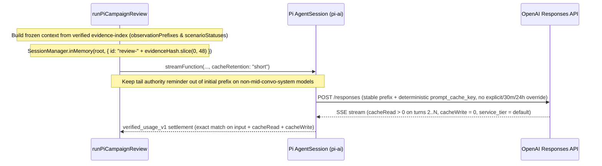
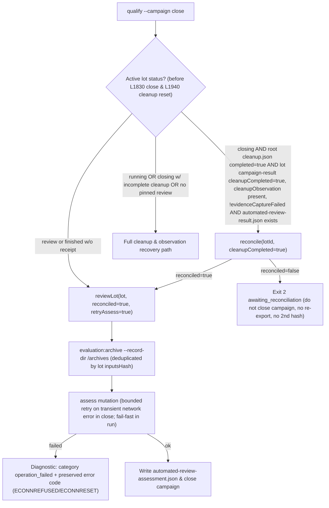

# Technical Design: Evaluation Review and Closeout Improvements

## System Design

### 1. Pi automated review enables short prompt caching with deterministic session identity, prefix stability, and frozen lot navigation hints

Today, `runPiCampaignReview` (`scripts/evaluations/workbench-browser/campaign-review.ts:1665-1774`) passes `cacheRetention: "none"` to OpenAI Responses API, which strips `prompt_cache_key` and sends `prompt_cache_options: { mode: "explicit" }` on `gpt-6.1-sol`, forcing `cacheRead = 0` across all 27 turns. On models without `supportsMidConvoSystemMessages`, appending a changing `role: "system"` message (`Review request N...`) also causes `resolveTranscript` to collapse it into the initial system instructions and invalidate the prefix cache on every turn. Additionally, `SessionManager.inMemory(root)` generates a random UUID per process, and `context` omits `observations/*` prefixes and per-scenario execution status, causing early `ls` paging across 1,487 indexed files.

**Proposed change (Option A, hardened after Oracle review):**



1. **Enable short prompt caching with deterministic `sessionId`:** Pass `cacheRetention: "short"` for non-mock review transports, and initialize `SessionManager.inMemory(root, { id: \`review-${template.evidenceHash.slice(0, 48)}\` })` (55 chars, within `assertValidSessionId` and OpenAI's 64-char `prompt_cache_key` limit). Because `prompt_cache_key` is serialized into the JSON request body when `cacheRetention: "short"`, a deterministic `id` keeps `requestHash = sha256(body)` identical across crash/resume replays (`campaign-review.ts:868-879`).
2. **Keep the cached prefix stable across all OpenAI models:** On models where `model.compat?.supportsMidConvoSystemMessages === true` (such as `gpt-6.1-sol`), Pi preserves mid-conversation `system` messages in place; on models where it is `false`, deliver the per-turn authority reminder (`Review request N. Remaining calls...`) as a tail `user` message so `resolveTranscript` never rewrites the initial system prefix. Preserve the `investigator_v1` read-only contract and `investigator_v2` remaining-call visibility.
3. **Include compact, verified lot navigation hints in frozen `context`:** Add two deterministic fields to `context` (pinned in `automated-review-mission.json` for fresh missions; ignored during `assert.deepEqual(retained.context, context)` only if resuming a pre-upgrade mission that lacks them):
   - `observationPrefixes`: sorted list of `observations/<dir>/` prefixes derived strictly from the verified `evidence-index-<hash>.json`.
   - `scenarioStatuses`: per-scenario execution status (`completed`, `failed`, `started`, or `not_run`) read strictly via `readCampaignReviewEvidence` from indexed `progress.jsonl` (when present) and `<id>/failure.json`, defaulting cleanly when `progress.jsonl` is absent (such as in unit tests or v1 manifests).

### 2. Bounded parallel observation export accelerates capture within Convex limits and omits redundant post-cleanup transcripts

Today, `inspectCampaignScenarios` (`scripts/evaluations/workbench-browser/scenarios.ts:167-316`) iterates sequentially over all scenarios, 7 `inspectQualificationPage` kinds, `inspectSourcesInvocations` (`numItems: 1`), and `inspectSourcesTextFragments` (`numItems: 1` in `scripts/evaluations/workbench-browser/sources.ts:421`). `campaign.ts` invokes it twice per lot (`before-cleanup-*` at L2295 and `after-cleanup-*` at L2341), duplicating ~8.5 MB of identical transcripts and captures in `after-cleanup-*` and taking 4 min 38 s on a loaded local backend.

**Proposed change (Option B+, hardened after Oracle review):**

```text
inspectCampaignScenarios(client, root, destination, options)
  options.mode: "full" (default, before-cleanup) | "post_cleanup" (after-cleanup only when before-cleanup succeeded AND completed === true)
  run scenarios with bounded concurrency = QUALIFICATION_TOOLING_POLICY.observationExportConcurrency (4)
    query: qualificationSnapshot (snapshot-before-inspection.json)
    Promise.all over 7 inspectQualificationPage kinds [receipts, missions, requests, sources, tasks, captures, messages]
      within "captures": download and SHA-256 verify committed capture-*.txt sequentially when mode === "full"
      within "captures": retain captures-*.json metadata only when mode === "post_cleanup"
    if mode === "full":
      paginate inspectSourcesInvocations (numItems: 1)
        hydrateSourcesTranscriptPage using PERSISTENCE_PAGE_SIZE.transcriptFragments (4)
    query: qualificationSnapshot (snapshot.json)
```

1. **Canonical concurrency and fragment batching in `convex/resourcePolicy.ts`:**
   - Add `QUALIFICATION_TOOLING_POLICY.observationExportConcurrency = 4` (bounded concurrent scenario exports).
   - Add `PERSISTENCE_PAGE_SIZE.transcriptFragments = 4` (matching `retainedTextPage`'s hard server ceiling of `1..4` in `convex/execution/retainedText.ts:402-407`, where each fragment is up to `60 * 1024` UTF-16 code units / ~180–240 KB UTF-8).
2. **Parallel per-scenario table reads with sequential capture downloads:** Fetch the 7 independent `inspectQualificationPage` kinds concurrently per scenario while keeping `capture-*.txt` downloads sequential within the `"captures"` task and preserving deterministic file names (`<kind>-<pageNumber>.json`).
3. **Safe `post_cleanup` mode for `after-cleanup-*`:** Run `after-cleanup-*` in `post_cleanup` mode (exporting `snapshot-before-inspection.json`, all 7 table inventories including `captures-*.json` metadata, and `snapshot.json`, without re-exporting `invocations-*` or re-downloading `capture-*.txt`) **only** when `before-cleanup-*` succeeded **and** `completed === true` (all scenarios settled cleanly before `beginCleanup`). If `before-cleanup-*` failed or the lot aborted mid-flight (`completed === false`), fall back to `"full"` mode so late worker completions between `before-cleanup` and `closeCampaignContext` are never lost. `cleanupObservation` continues pointing to `observations/after-cleanup-<uuid>` with `snapshot.json` intact.

### 3. Closeout reconciles already-cleaned lots directly, retries transient assessment submission in `close`, and writes automatic archive records outside Git

Today, three closeout behaviors compound friction and pollute Git:
1. When a lot finishes `run` with `cleanupCompleted: true` but `reconciled: false` (`lot.status === "closing"`), `--campaign close` skips the `pending` review shortcut (`scripts/evaluations/workbench-browser/campaign.ts:1772-1827`), patches `campaign.status = "closed"` early (L1830), overwrites `root/cleanup.json` (L1940), re-runs full cleanup and both observation exports (+378 files), and calls `campaignReviewTemplate(..., { recovery: true })` to mint a second unused `evidenceHash`.
2. `reviewLot` calls `client.mutation(internal.qualificationCampaigns.assess)` (`campaign.ts:1601-1608`) with no transient retry after `archive-assessment`. Existing test `qualification-campaign.test.mjs:783-820` (`retained-assessment-failure`) asserts that `run()` rejects on the first `ECONNRESET` with `{ step: "submit-assessment", category: "operation_failed", code: "ECONNRESET" }`.
3. `campaign.ts` invokes `pnpm evaluation:archive` 3–4 times per lot (`run`, `diagnostic`, `close`, `assessment`), writing untracked record directories into `scripts/evaluations/archives/` inside the Git checkout even though the `.tar.gz` archives already live under `$XDG_DATA_HOME`.

**Proposed change (Option A, hardened after Oracle review):**



1. **Guarded reconcile-only shortcut in `--campaign close`:** Placed **before** L1830 (`qualificationCampaigns.close`) and L1940 (`root/cleanup.json` reset). When `action === "close"` encounters an active lot in `closing` status where `root/cleanup.json` has `completed === true`, `lotRoot/campaign-result.json` has `cleanupCompleted === true && !!cleanupObservation && !evidenceCaptureFailed`, **and** `lotRoot/automated-review-result.json` is already pinned on disk:
   - Call `internal.qualificationCampaigns.reconcile(lotId, { cleanupCompleted: true })` directly without re-opening flags/sessions, re-exporting observations, or running `campaignReviewTemplate(..., { recovery: true })`.
   - Save `reconciliation.json` only after `reconcile` returns `reconciled: true` (safe because `reviewLot` validates against the pinned `automated-review-evidence-<evidenceHash>` snapshot, not live `lotRoot/reconciliation.json`).
   - If `reconciled === true`, invoke `reviewLot(lot, true)` and then `qualificationCampaigns.close`.
   - If `reconciled === false`, leave `campaign.status` untouched (do not close prematurely), log `awaiting_reconciliation`, and exit with code `2`.
   - If cleanup was incomplete, `evidenceCaptureFailed` was set, or `automated-review-result.json` does not exist yet, fall through to the existing full recovery path.
2. **Scoped transient retry on `submit-assessment` preserving diagnostic contracts:** Preserve `category: "operation_failed"` and the transport error `code` (`ECONNREFUSED`, `ECONNRESET`, etc.) in `qualificationDiagnostic` (preserving `qualification-campaign.test.mjs:783-820`). Keep `run()` fail-fast on `assess` failure, and enable bounded transient retry (e.g., `QUALIFICATION_TOOLING_POLICY.assessmentSubmitMaxAttempts = 3` with short backoff) specifically during `--campaign close` for transient transport/connection errors only (never retrying domain/validation errors).
3. **Automatic archive records outside Git (`--record-dir`) + lot-level deduplication:**
   - Add an optional `--record-dir <absolute-path>` flag to `scripts/archive-evaluation.ts`, keeping the default `scripts/evaluations/archives/` unchanged for manual invocations and existing tests. Enforce `isAbsolute(recordDir)`, `inspectPath(recordDir)` (symlink/secret guards), and mutual non-overlap against both `sources` and `archiveDirectory` (`!inside(recordsDirectory, archiveDirectory) && !inside(archiveDirectory, recordsDirectory)`).
   - Pass `--record-dir <campaignRoot>/archives` from `campaign.ts` for all automatic campaign archives (`run` L2469, `diagnostic` L1631, `assessment` L1598, and `action === "assess"` L1735).
   - Deduplicate `assessment` archives with a receipt (`automated-review-assessment-archive.json`) hashing current `lotRoot` files (distinct from end-of-`run`, so `assessment-<hash>.json` is archived once while retries of `close` skip re-archiving identical `lotRoot`). `scripts/evaluations/archives/` remains clean in `git status` and reserved for explicitly curated repository evidence records.

## Program Design

### 1. `runPiCampaignReview` pins a deterministic session ID, enables short caching, and builds navigation hints from verified evidence

```diff
// scripts/evaluations/workbench-browser/campaign-review.ts
- sessionManager: SessionManager.inMemory(root),
+ sessionManager: SessionManager.inMemory(root, {
+     id: `review-${template.evidenceHash.slice(0, 48)}`,
+ }),

  const requestContext =
      protocol === "investigator_v2" && purpose === "investigation"
          ? {
                ...context,
                messages: [
                    ...context.messages,
                    {
-                       role: "system" as const,
+                       role: selected.compat?.supportsMidConvoSystemMessages
+                           ? ("system" as const)
+                           : ("user" as const),
                        content: `Review request ${attempt}. ...`,
                        timestamp: 0,
                    },
                ],
            }
          : context;

  ...(options.transport === "mock"
      ? {}
      : {
            fetch: options.transport.fetch(attempt, purpose),
-           cacheRetention: "none",
+           cacheRetention: "short",
            transport: "sse",
        }),
```

`buildReviewNavigationHints(evidenceRoot, evidenceHash, scenarioIds)` reads `reviewEvidenceIndex(evidenceRoot, evidenceHash)` (exported from `campaign.ts`) to extract sorted `observationPrefixes` (`observations/<dir>/`) and reads indexed `progress.jsonl` and `<id>/failure.json` strictly via `readCampaignReviewEvidence` to compute `scenarioStatuses` (`completed | failed | started | not_run`, defaulting to `{}` when `progress.jsonl` is absent). On resume, if `retained.context` predates these fields, the equality check compares the shared keys so pre-upgrade missions remain resumable.

### 2. `inspectCampaignScenarios` bounds scenario concurrency, batches transcript fragments by 4, and supports `post_cleanup` mode

```diff
// convex/resourcePolicy.ts
  export const QUALIFICATION_TOOLING_POLICY = {
      ...
+     observationExportConcurrency: 4,
+     assessmentSubmitMaxAttempts: 3,
+     assessmentSubmitRetryBaseMs: 500,
  } as const;

  export const PERSISTENCE_PAGE_SIZE = {
      ...
+     transcriptFragments: 4,
  } as const;
```

```ts
// scripts/evaluations/workbench-browser/scenarios.ts
export async function inspectCampaignScenarios(
    client: ConvexHttpClient,
    root: string,
    destination = root,
    options: { mode?: "full" | "post_cleanup" } = {},
): Promise<void>
```

Execution shape:
- `runWithConcurrency(prepared(root).cases, TOOLING_POLICY.observationExportConcurrency, exportScenario)` bounds concurrent scenario exports to 4.
- Inside each scenario, `Promise.all` fetches the 7 `inspectQualificationPage` kinds concurrently; within `"captures"`, `capture-*.txt` downloads stay sequential and run only when `mode === "full"`.
- `inspectSourcesInvocations` (`numItems: 1`) and `hydrateSourcesTranscriptPage` (using `PERSISTENCE_PAGE_SIZE.transcriptFragments` = `4` in `scripts/evaluations/workbench-browser/sources.ts`) run only when `mode === "full"`.
- In `campaign.ts`, `before-cleanup-*` calls `mode: "full"` and `after-cleanup-*` calls `mode: completed && !evidenceCaptureFailed ? "post_cleanup" : "full"`.

### 3. `executeCampaign` reconciles already-cleaned `closing` lots directly and retries transient `assess` network errors only in `close`

```ts
// scripts/evaluations/workbench-browser/campaign.ts
function canReconcileWithoutCleanup(root: string, lotRoot: string): boolean {
    const cleanupPath = join(root, "cleanup.json");
    const resultPath = join(lotRoot, "campaign-result.json");
    const reviewPath = join(lotRoot, "automated-review-result.json");
    if (
        !existsSync(cleanupPath) ||
        !existsSync(resultPath) ||
        !existsSync(reviewPath)
    )
        return false;
    const cleanup = read(cleanupPath) as { completed?: boolean };
    const result = read(resultPath) as {
        cleanupCompleted?: boolean;
        cleanupObservation?: string;
        evidenceCaptureFailed?: boolean;
    };
    return (
        cleanup.completed === true &&
        result.cleanupCompleted === true &&
        Boolean(result.cleanupObservation) &&
        !result.evidenceCaptureFailed
    );
}
```

Placement in `executeCampaign`: right after the existing `pending` review branch (L1772–1827) and strictly **before** L1830 (`qualificationCampaigns.close`) and L1940 (`root/cleanup.json` reset):

```text
if action === "close" && activeLot?.status === "closing" && canReconcileWithoutCleanup(root, lotRoot):
  const reconciled = await client.mutation(reconcile, { lotId: activeLot._id, cleanupCompleted: true })
  if !reconciled.reconciled:
    process.exitCode = 2
    console.log(JSON.stringify({ status: "awaiting_reconciliation", root: lotRoot }))
    return
  save(lotRoot, "reconciliation", reconciled)
  const result = await reviewLot(activeLot, true, undefined, { retryAssessmentSubmit: true })
  await client.mutation(close, { campaignId })
  set process.exitCode from result verdict
  return
```

`submitAssessment(client, args, retry)` in `campaign.ts`:
- `retry === false` (`run`): single fail-fast call, preserving `qualification-campaign.test.mjs:783-820` (`retained-assessment-failure`).
- `retry === true` (`close`): up to `TOOLING_POLICY.assessmentSubmitMaxAttempts` (`3`) with `assessmentSubmitRetryBaseMs * attempt` (`500 ms` base) backoff on transient transport error codes (`ECONNREFUSED`, `ECONNRESET`, `ETIMEDOUT`) only; domain or assertion errors fail immediately.
- `qualificationDiagnostic` in `scripts/evaluations/workbench-browser/qualification.ts:19-32`: add `"ECONNREFUSED"` to `known` while keeping `category: "operation_failed"`.

### 4. `archive-evaluation.ts` accepts `--record-dir` outside Git and `campaign.ts` deduplicates automatic lot archives

```diff
// scripts/archive-evaluation.ts
  const { values } = parseArgs({
      options: {
          name: { type: "string" },
          include: { type: "string", multiple: true },
          external: { type: "string", multiple: true },
+         "record-dir": { type: "string" },
          "dry-run": { type: "boolean" },
          help: { type: "boolean" },
      },
  });
- const recordsDirectory = join(repository, "scripts/evaluations/archives");
+ const recordsDirectory = values["record-dir"]
+     ? resolve(values["record-dir"])
+     : join(repository, "scripts/evaluations/archives");
+ if (values["record-dir"])
+     assert(isAbsolute(values["record-dir"]), "--record-dir must be an absolute path.");
+ assert(
+     !inside(recordsDirectory, archiveDirectory) &&
+         !inside(archiveDirectory, recordsDirectory),
+     "Record storage must not overlap archive storage.",
+ );
```

A shared `archiveCampaignInputs({ name, selected, recordDir, receiptRoot, receiptName, archiveBoundary })` helper in `campaign.ts` replaces all four `spawnSync("pnpm", ["evaluation:archive", ...])` sites (`run`, `diagnostic`, `assessment`, and `action === "assess"`):
- Always passes `--record-dir ${join(root, "archives")}` (outside the Git checkout).
- Hashes all selected files (recursively for directories, excluding the receipt file itself) into `inputsHash` and skips re-running `evaluation:archive` when the receipt (`lot-archive-receipt.json`, `automated-review-diagnostic-archive.json`, `automated-review-assessment-archive.json`) already matches `inputsHash`.

## Patterns to Follow

- Canonical resource limits live in `convex/resourcePolicy.ts` (checked by `pnpm resource-policy:check`); callers must consume named policies rather than duplicating literals.
- Frozen evidence integrity and symlink-safe reading live in `scripts/evaluations/workbench-browser/campaign.ts` (`campaignReviewTemplate`, `readIndexedEvidence`, `runCampaignReviewStage`).
- Accountable Pi review settlement and replay safety live in `scripts/evaluations/workbench-browser/campaign-review.ts` (`runAccountableCampaignReview`, `runPiCampaignReview`) and `convex/qualificationCampaigns.ts` (`reserveAnalysis`, `settleAnalysis`, `reconcile`, `assess`).
- Archive verification and path safety live in `scripts/archive-evaluation.ts` and `src/__tests__/config/evaluation-archive.test.ts`.
- Protocol and campaign tests live in `src/__tests__/config/qualification-campaign.test.mjs`, `src/__tests__/config/qualification-v2.test.mjs`, and `src/__tests__/convex/execution/qualification-campaign.test.ts`.

## Scope

Evaluation-side improvements only: Pi automated review caching/navigation hints, bounded parallel observation export with safe `post_cleanup` mode, guarded `reconcile-only` closeout with scoped `submit-assessment` retry, and external `--record-dir` + deduplication for automatic campaign archives. Excludes product-side `sources-partial-reading` / `documentary-control` fixes.

## Implementation evidence — 2026-11-26

Fresh reviewer missions use the evidence-derived cache key and frozen navigation hints. Pre-upgrade mission pins retain their original cache and transcript settings for request replay. Close uses a fixed policy-owned 500 ms delay between transient retries, with three total attempts. Archive receipts live in the campaign output's `archives/` directory beside record folders, where they cannot change the lot's evidence hash. Assessment deduplication excludes closeout diagnostic logs added after the archive was created.

The external-record regression first failed with `Unknown option '--record-dir'`. Temporarily disabling short caching, close-only retries, reconcile-only close, and metadata-only export each failed its focused boundary test. The code was restored after each check. The simulated Responses transport verifies the emitted cache key and retention fields. Cache hits, export wall-clock impact on a loaded backend, and browser behavior remain unmeasured. The implementation used no paid qualification.

Offline checks passed.

- `node --experimental-strip-types --test src/__tests__/config/qualification-{campaign,v2}.test.mjs` passed 171 tests. The final focused rerun of close recovery, assessment acknowledgement, and reviewer request construction passed four tests.
- `pnpm exec vitest run src/__tests__/config/evaluation-archive.test.ts src/__tests__/convex/execution/qualification-campaign.test.ts` passed 39 tests.
- `pnpm typecheck`, `pnpm resource-policy:check`, `pnpm docs:check`, changed-file Biome checks, and `git diff --check` passed. The documentation check retained the advisory length warning for `context/TECH.md`.

Telegram accepted the `validation-complete` event for project `agentic-resilience-workbench`, sender `Codex`, key `evaluation-review-and-closeout-a51bbc3c574d7bd037541ed1b78f18ae8b5c2537`, implementation diff `a51bbc3c574d7bd037541ed1b78f18ae8b5c2537`, message ID `1115`. Receipt `/home/abdwhb/.local/state/agent-stack/notify/cac6e273220a739e6179872490264e980848651391fe85c717cdc04b4e60a715.json`.

Independent review requested changes on the implementation diff above. The Sources export test reproduced the invocation pagination regression. Oracle also blocked the metadata-only export gate because scenario completion does not prove Sources quiescence, and flagged archive receipts that do not identify the verified archive. The previous offline checks did not include the failing export test.

Telegram accepted the `review-request-changes` event for project `agentic-resilience-workbench`, sender `Codex`, key `evaluation-review-and-closeout-review-a51bbc3c574d7bd037541ed1b78f18ae8b5c2537`, implementation diff `a51bbc3c574d7bd037541ed1b78f18ae8b5c2537`, message ID `1116`. Receipt `/home/abdwhb/.local/state/agent-stack/notify/a1be9114b03fc85bc4dd7cb331558bd4a8bbd29920a39086a0159fdd6a4e6a55.json`.

### Review corrections

Invocation inspection again requests one invocation per page. Fragment hydration requests four and verifies the assembled content and sequence. The cleanup fast path requires acknowledged dispatch revocation and the existing Convex continuation query's quiescence, accounting, and effect checks before the first full export. A missing or corrupt archive invalidates its receipt even if the selected inputs are identical. Pi investigation caching stays enabled, and one-off native compactions retain the SDK's uncached request format for replay.

The Sources transcript export suite reproduced the invalid invocation page size. The focused campaign command test for a missing archive first observed one archive creation where recovery requires two. The focused observation tests initially failed because the exporter produced no quiescence decision. The real Convex lost-compaction-acknowledgement test passed on the branch base and failed on the implementation before the compaction fix, with the retained attempt diagnostic reporting a changed request hash. The installed Pi SDK gives compaction a fresh routing ID and disables caching. Overriding that setting serialized the fresh ID into the request body. Keeping the native compaction setting restored matching request hashes and passed the targeted test.

Final offline verification passed 175 campaign tests and 54 transcript, archive, and Convex review tests. The real archive CLI smoke test published a verified record whose metadata matched the generated tarball and its SHA-256. Typechecking, the 12-file Biome check, resource policy, documentation and whitespace checks passed. The documentation length advisory remains. Live provider cache hits, browser behavior and export latency remain unmeasured.

Telegram accepted the `validation-complete` event for project `agentic-resilience-workbench`, sender `Codex`, key `evaluation-review-and-closeout-7fa114be14332f6412749d492dbf83794b9f0012`, implementation diff `7fa114be14332f6412749d492dbf83794b9f0012`, message ID `1117`. Receipt `/home/abdwhb/.local/state/agent-stack/notify/8a2bd4fa83d00ebedd991ab3af52d0c39872d2b968125938c5a5eaa3d880bfdb.json`.
