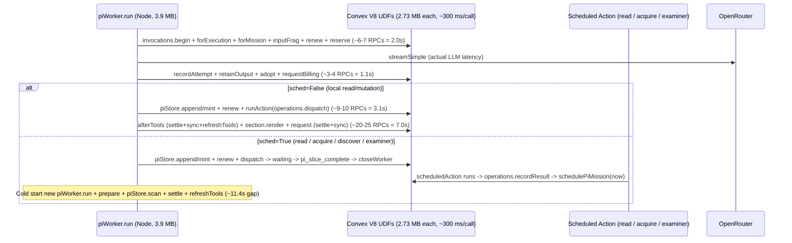

# Research: Qualification Latency Optimization

## Research Question

1. In `convex/execution/piStore.ts`, `piControl.ts`, `invocationLifecycle.ts`, `operations.ts`, `context.ts`, and `providerCalls.ts`, which exact static imports pull in the shared ~703 KB super-chunk, `typebox@1.3.27` (691 KB), `zod@4.4.3` with its locales (425 KB), `@convex-dev/auth` + `jose` (229 KB), and `exa-js` + `zod@3.25.76` (186 KB)? Which of those dependencies are actually needed at runtime by each hot-path module, and how does `convex-local-backend` evaluate or cache V8 modules across calls?
2. Across one full turn (`inv.createdAt -> rec.createdAt -> rec.completedAt -> inv.completedAt -> op.completedAt -> next inv.createdAt`), what is the exact ordered list of `ctx.runQuery`, `ctx.runMutation`, and `ctx.runAction` calls in `convex/integrations/piMission.ts`, `piStorage.ts`, `piNativeInput.ts`, `piInvocation.ts`, and `convex/execution/invokeAgentModel.ts`? Which calls are duplicated within the same turn, and what invariants do they enforce?
3. In `convex/execution/operations.ts` and `convex/integrations/piMission.ts`, why do local non-scheduled operations route through `ctx.runAction(internal.execution.operations.dispatch)` instead of a direct query/mutation path, and what authority, fencing, or adoption checks depend on that boundary?
4. In `convex/integrations/piMission.ts` and `convex/execution/piControl.ts`, how does a `waiting` scheduled operation trigger `pi_slice_complete`, what happens during `piWorker.run` cold restart and `openMissionPiStorage` log replay, and what invariants govern yielding versus waiting?
5. In `scripts/evaluations/workbench-browser/protocol.ts` and `campaign.ts`, what inputs compose `validationIdentity` and `candidateHash`, what causes two lots on the exact same commit to recompute the 245-test Vitest battery (~172 s each), and what contract verifies preflight results?
6. In `scripts/evaluations/workbench-browser/campaign.ts`, `qualify.ts`, `scenarios.ts`, and `convex/qualificationInitialFixtureSetup.ts`, how are scenarios sequenced, how much time goes to export/cleanup, and what mid-workflow entry points already exist?
7. What existing local simulation tests or scripts exercise the full `piWorker` / `piMission` / `operations` loop against `convex-local-backend` (zero paid calls) so before-and-after metrics can be measured deterministically?

## Research Methodology

This document describes the current system using facts from source code, compiled Convex module bundles in `.convex/local/default/convex_local_storage/modules/`, recorded traces from the two-lot CCC requalification (`/home/abdwhb/.cache/workbench-evaluations/ccc-40a65cc1-requalification-20261127/`), and read-only HTTP latency probes against the running `convex-local-backend` on port 3242. No production code or database state was modified.

## Summary

Of the 68m 47s wall time measured across the two CCC qualification lots (`examiner` + `discovery`, commit `40a65cc1`), OpenRouter model receipts accounted for 16m 18s (24%) and SEC/Exa receipts for 23s (<1%). Local Convex harness execution consumed ~32m 24s (47% of total, 66% of the 49m 05s spent in scenarios), automated reviews took 7m 21s, duplicate Vitest preflights took 5m 45s (2 x ~172s), and preflight failure/relaunch plus export/cleanup accounted for 6m 36s.

The ~32m 24s harness overhead is a product of three compounding mechanics: (1) every hot-path V8 Convex module (`piStore`, `piControl`, `invocationLifecycle`, `operations`, `context`, `providerCalls`) transitively pulls an 83–85 module / 2.73–2.79 MB JS closure — including `typebox@1.3.27`, `zod@4.4.3` with 179 locales, and `@convex-dev/auth` + `jose` — causing ~200–300 ms per local V8 RPC compared to 2–3 ms for a 324 KB module (`visitors`); (2) each turn in `piMission.ts` and `invokeAgentModel.ts` executes ~25–35 sequential Convex RPCs, repeating `context.build`, `settleRetainedOperations`, `syncInputs`, and `piStore.renew` multiple times per turn and routing local read/mutation operations through `ctx.runAction(operations.dispatch)`; and (3) every `sched=True` operation triggers `pi_slice_complete`, tearing down the Node worker and cold-starting a new 3.90 MB `piWorker.run` action (+4–6 s per scheduled transition across 48 transitions).

Outside the harness, `verifyQualificationCandidate` in `scripts/evaluations/workbench-browser/protocol.ts` already implements a `validation.json` cache, but misses across lots on the same commit because it stores `validation.json` inside each campaign's private `root` directory and hashes all of `process.env` into `validationIdentity`. Scenarios run serially under a single shared visitor slot (`analyst-4`), and existing `initialFixture` support in `convex/qualificationInitialFixtures.ts` only covers three illustrative simulation fixtures rather than frozen live documentary submissions.

## Detailed Findings

### 1. `convex-local-backend` caches V8 isolates for queries (~2–3 ms) but re-evaluates the full V8 module closure on every mutation and V8 action

An isolated controlled benchmark on the exact `convex-local-backend` binary (`precompiled-2026-11-16-80befbc`, separate port `3398`, throwaway SQLite DB, `"use node"` action calling `ctx.runQuery` / `ctx.runMutation` / `ctx.runAction`) splits the per-RPC cost cleanly between Node-bridge + SQLite overhead and V8 module-closure evaluation:

| Benchmark call (warm Run 2 from `"use node"` action) | Transitive V8 closure | Observed times (ms) | Median | Takeaway |
| --- | --- | --- | ---: | --- |
| `node -> tiny.pingQ` (`ctx.runQuery`) | 2 modules, 79.0 KB | `[3.5, 2.6, 3.4, 2.5, 2.3, 1.7]` | **2.5 ms** | Warm V8 query isolate + Node bridge |
| `node -> heavyA.pingQ` (`ctx.runQuery`) | 3 modules, 686.9 KB | `[3.5, 3.3, 4.4, 3.2, 3.3, 2.8]` | **3.3 ms** | Queries reuse warm V8 isolates (real 84-mod / 2.73 MB `browserPreviewInternals:getPreview` was `219.8 ms` cold, `1.7–2.2 ms` warm) |
| `node -> tiny.pingM` (`ctx.runMutation`) | 2 modules, 79.0 KB | `[22.1, 18.1, 19.9, 20.2, 21.3, 19.6]` | **20.0 ms** | **Base Node-bridge + SQLite mutation floor (~20 ms)** |
| `node -> heavyA.pingM` (`ctx.runMutation`) | 3 modules, 686.9 KB | `[35.1, 40.9, 35.8, 32.8, 32.4, 34.3]` | **34.7 ms** | **Mutations never reuse warm V8 isolates**: +14.7 ms per +608 KB (+~24 ms/MB) on every single call |
| `node -> alt heavyA.Q + heavyB.M` | 686.9 KB + 686.6 KB | `[31.2, 30.4, 29.0, 31.4, 28.0]` | **30.4 ms** | Matches warm Q (~3 ms) + cold M (~28 ms) |
| `node -> v8Action(heavyA: Q+M)` (`ctx.runAction`) | 3 modules, 686.9 KB | `[43.3, 34.5, 50.7, 36.9]` | **40.1 ms** | V8 actions also pay fresh V8 isolate evaluation on top of inner mutations |

Additional falsification probes on the live workspace (`127.0.0.1:3242`, ext4 `/dev/sdf`, deployed archive `d7842581-...blob` = 9.2 MB compressed / 37.4 MB uncompressed):

- **Raw SQLite `DELETE + FULL` commit on `/dev/sdf`**: **6.4 ms** median (`2.8 ms` WAL+FULL) — disk `fsync` is not the bottleneck.
- **In-memory `convex-test` (`pi-mission.test.ts`)**: **463–565 ms** per full multi-turn mission (`4.60 s` total, 6/6 passed) — pure Node/JS CPU (`pi-durable`, `agentToolSchemas`, `zod`) is not the bottleneck.
- **Real 83–85 module / 2.73–2.79 MB hot-path modules (`piStore`, `piControl`, `invocationLifecycle`, `operations`, `context`, `providerCalls`)**: cold V8 load measured on `browserPreviewInternals.js` (84 modules, 2,734 KB) is **219.8 ms**, while warm queries drop to **1.7–2.2 ms**. Because every `ctx.runMutation` and V8 `ctx.runAction` pays a fresh V8 module load (~220 ms+, ~90% of call time) on top of the ~20 ms Node-bridge + SQLite base (~10% of call time), every turn's **~15–20 sequential mutations** (`piStore.append`, `piStore.mint`, `piStore.renew`, `invocations.begin`, `retainRequest`, `recordAttempt`, `recordModelReply`, `invocations.finish`, `invocations.settle`, `operations.claim`, `operations.recordResult`, `piControl.prepare`, `piControl.closeWorker`) dominate the 32m 24s local harness overhead.
- **Node worker bundle (`execution/piWorker.js`)**: 30 modules, **3,903.2 KB** transitive JS, cold-started on every `sched=True` restart.

(Note: unauthenticated HTTP queries that threw `Uncaught Error: Not authenticated` on 2.73 MB modules took 160–235 ms repeatedly due to source-map stack-trace symbolication, whereas non-throwing `browserPreviewInternals:getPreview` dropped to 1.7–2.2 ms after its 219.8 ms cold call.)

Static TypeScript import tracing shows three root edges that force the entire 2.73 MB closure into `piStore.ts`, `piControl.ts`, `operations.ts`, `invocationLifecycle.ts`, `context.ts`, and `providerCalls.ts`:

```text
convex/execution/piStore.ts
├── import schema from "@convex/schema" (lines 18, 628, 642, 805, 807)
│   ├── @convex-dev/auth/server -> @auth/core + jose (229 KB, BDOBAZ2A.js)
│   └── convex/domain/sourceRetrievalPolicy.ts -> zod@4.4.3 + 179 locales (425 KB, VIXPRXL4.js)
└── import { buildMissionContext } from "./context" (lines 31, 764)
    └── convex/integrations/modelInput.ts
        ├── import { Type } from "@earendil-works/pi-ai" (line 9, Type.Unsafe only) -> typebox@1.3.27 (691 KB, ZTG5HRWG.js)
        └── import { z } from "zod" + convex-helpers/server/zod4 (lines 12–13)
```

Because `convex/execution/piStore.ts`, `piControl.ts`, `operations.ts`, and `context.ts` cross-import into the same shared graph, Convex's esbuild bundler merges 42 backend files into one 702.7 KB shared V8 chunk (`modules/_deps/KJDNI7HG.js`), which then pulls `ZTG5HRWG.js` (`typebox@1.3.27`, 691 KB), `VIXPRXL4.js` (`zod@4.4.3`, 425 KB), and `BDOBAZ2A.js` (`@convex-dev/auth` + `jose`, 229 KB). None of `piStore.ts`, `piControl.ts`, `operations.ts`, `context.ts`, or `providerCalls.ts` use `typebox` at runtime: `Type.Unsafe` in `convex/integrations/modelInput.ts:46` is only called from `piToolMetadata`, which is exclusively invoked by the Node worker `convex/integrations/piMission.ts:337`. Similarly, `piStore.ts` only uses `schema` from `@convex/schema` for four `returns:` validator references (`schema.doc("piCommits")` and `schema.tables.agentExecutionEvents.validator.fields`), and `piControl.ts` only uses `schema.doc(...)` for five `returns:` validators.

#### Testing Patterns

No existing test asserts V8 bundle size or transitive import boundaries for `typebox` or `zod`. Static architecture checks live in `scripts/check-imports.ts`, `scripts/check-execution-boundaries.ts`, and `scripts/check-resource-policy.ts`.

### 2. Every mission turn executes ~25–35 sequential Convex RPCs with repeated context and settlement reads

Trace forensics across all 118 live invocations in the four CCC scenarios show consistent, non-network overhead in every sub-phase of a turn:

| Turn segment | Count | Total wall time | Median | Sequential Convex RPCs in code |
| --- | ---: | ---: | ---: | --- |
| `inv.createdAt -> rec.createdAt` | 118 | 207.9 s | 1.96 s | 8 (`piControl.invocation`, `forExecution` x2, `modelConfiguration.forMission`, `executionInputFragment`, `piStore.renew`, `retainRequest`, `providerCalls.recordAttempt`) |
| `rec.completedAt -> inv.completedAt` | 118 | 133.0 s | 1.12 s | 3 (`piControl.nextOperation`, `piControl.invocation`, `invocations.finish`) |
| `op.createdAt -> op.completedAt` (`consult_mission_state`, local read) | 11 | 37.5 s | 3.08 s | ~9–10 (`piStore.append`/`mint` x2, `lookupPiOperation`, `piStore.renew`, `runAction(operations.dispatch)` -> `claim` -> `missionForDispatch` -> read query -> `recordResult`) |
| `op.completedAt -> next inv.createdAt` (`sched=False`, same worker) | 46 | 347.7 s | 7.02 s | ~20–25 (tool commit, `afterTools` hook, `section.render`, `request()` pre-begin checks, `invocations.begin`) |
| `op.completedAt -> next inv.createdAt` (`sched=True`, worker restart) | 48 | 722.8 s (raw) / ~500 s (net of parallel ops) | 11.40 s | ~32–38 + Node action cold start (`closeWorker`, `prepare`, `state`, `forMission`, `piStore.claim`, `piStore.scan`, `settleRetainedOperations`, `root.configure`, `refreshTools`, `syncInputs`, `invocations.begin`) |

Within a single `sched=False` turn transition (`op.completedAt -> next inv.createdAt`), `convex/integrations/piMission.ts` repeats the same Convex queries twice back-to-back:

```text
tool execute() returns
  -> piStorage.append + piStorage.mintId (tool result commit)
  -> GenerationTask hook afterTools() [piMission.ts:562-587]
       1. piControl.terminalCompletionAccepted (query)
       2. settleRetainedOperations() [piMission.ts:652-687]  <-- 1st call
            piControl.nextOperation -> piControl.state -> piControl.invocation -> invocations.settle
       3. syncInputs() [piMission.ts:256-260]                <-- 1st call
       4. refreshTools() [piMission.ts:615-631]
            context.build (query)                            <-- 1st call
            root.configure -> piStorage.append + mintId
  -> Next GenerationTask starts -> section.render() [piMission.ts:499-556]
       5. context.build (query)                              <-- 2nd call (identical state)
  -> request() [piMission.ts:689-839]
       6. settleRetainedOperations() [piMission.ts:760]      <-- 2nd call
       7. syncInputs() [piMission.ts:761]                    <-- 2nd call
       8. invocations.begin (mutation)                       <-- sets next inv.createdAt
```

These duplicate checks exist to defend against state changes between worker startup/recovery and `invocations.begin` (where `invocations.begin` independently enforces `preparedInputHash`, `preparedToolSetKey`, `preparedInstructionsHash`, and `preparedObservationSequence` against live DB state at `piMission.ts:807-844`). Inside `invokeControlledGeneration` (`convex/execution/invokeAgentModel.ts:111-178`), `forExecution`, `modelConfiguration.forMission`, and `executionInputFragment` are also fetched in three separate sequential queries even though `piMission.ts:165` already loaded `configuredModel` and `piMission.ts:852` already loaded the invocation.

#### Testing Patterns

`src/__tests__/convex/execution/pi-mission.test.ts`, `pi-recovery.test.ts`, `pi-correlation.test.ts`, `pi-native-transport.test.ts`, `pi-store.test.ts`, and `pi-storage.test.ts` test these invariants under `convex-test` (in-memory, where each V8 query/mutation takes <1 ms, masking the real `convex-local-backend` 200–300 ms per-RPC cost).

### 3. Local non-scheduled operations route through an `internalAction` (`operations.dispatch`) for uniform claim-execute-adopt fencing

In `convex/integrations/piMission.ts:273-281`, every operation — whether local DB read (`consult_mission_state`, `consult_run_state`, `read_in_context`, `search_available_material`), local DB mutation (`adjust_framing`), or scheduled async job — is dispatched via:

```ts
await storage.renewLease();
return ctx.runAction(internal.execution.operations.dispatch, {
    requestId,
    expectedGeneration: args.expectedGeneration,
});
```

Inside `convex/execution/operations.ts:1621-1736`, `dispatch` is a V8 `internalAction` that performs up to four sequential Convex round-trips for a single local read: (1) `operations.claim` (mutation: checks generation authority, transitions request to `running`, or returns already-recorded outcome/effect for adoption); (2) `operations.missionForDispatch` (query: loads mission doc to resolve `operationFor`); (3) `operation.execute(...)` (which runs another query or mutation); and (4) `operations.recordResult` (mutation: validates result schema via `operation.validateOutcome`, enforces `MAX_OPERATION_RESULT_BYTES`, records `agentExecutionEvents`, and patches `adoptedAt`).

The `internalAction` boundary exists so operations whose `execute` callback performs external I/O or multi-step orchestration share the same claim/adopt state machine and `classifyDispatchFailure` error handling as pure local operations. Pure local operations (`consult_mission_state`, `consult_run_state`, `read_in_context`, `search_available_material`, `adjust_framing`) do no external I/O and could execute inside a single transaction or without an extra `runAction` + `missionForDispatch` hop, provided they preserve `claim` idempotency, `operation.validateOutcome`, `MAX_OPERATION_RESULT_BYTES`, progress accounting, and `operation_completed` event recording.

#### Testing Patterns

`src/__tests__/convex/execution/dispatch.test.ts`, `native-operations.test.ts`, `operation-conformance.test.ts`, `operation-contracts.test.ts`, and `operation-preservation.test.ts` verify claim idempotency, refusal codes, result byte limits, and adoption fencing.

### 4. Every `sched=True` operation forces `pi_slice_complete`, tearing down and cold-starting the 3.90 MB Node worker

When `dispatchRetainedOperation` returns `{ kind: "waiting" }` (which happens for every operation with `scheduledAction`, including `read`, `acquire_document`, `discover_sources_for_need`, `submit_documentary_qualification`, and `request_documentary_check`), `piMission.ts` immediately aborts the worker slice in two places:
- In `waitOperation` (`convex/integrations/piMission.ts:296-309`): sets `resumeAt = Date.now() + PI_OPERATION_WAIT_POLL_MS` (30,000 ms), calls `yieldSleep()`, and waits for `abort.abort(executionError("pi_slice_complete"))` at line 1805.
- In `drainRetainedOperations` (`convex/integrations/piMission.ts:641-644`): sets `resumeAt = Date.now() + PI_OPERATION_WAIT_POLL_MS` and throws `executionError("pi_slice_complete")`.

The `finally` block (`piMission.ts:1924-1956`) closes the Pi harness and calls `piControl.closeWorker`, releasing `leaseUntil` and scheduling a fallback poll at `resumeAt` (30 s). When the scheduled operation finishes, `operations.recordResult` (`convex/execution/operations.ts:1253-1260`) sets `piResultWakePending: true` and calls `schedulePiMission(ctx, mission._id, args.expectedGeneration)` for `Date.now()`, which cancels the 30 s fallback wake and schedules a brand-new `piWorker.run` Node action.

That cold restart accounts for the +4.4 s median gap difference (`11.40 s` for `sched=True` vs. `7.02 s` for `sched=False`): the new Node action loads the 3.90 MB Node bundle, runs `piControl.prepare`, `piControl.state`, `modelConfiguration.forMission`, `openMissionPiStorage` (`piStore.claim` + paginated `piStore.scan` replaying all `piCommits` from sequence 1), `settleRetainedOperations`, `root.configure`, `refreshTools`, and `syncInputs`. Notably, `read` operations complete in a median of **3.10 s** (min 2.75 s), yet still pay the full teardown + 3.90 MB cold restart (~9.38 s median gap after `read`).

The three largest raw gaps in the traces (`75.70 s`, `64.98 s`, `52.37 s`) were **not** lease or 30 s poll stalls: in all three cases a second parallel `request_documentary_check` or `submit_documentary_qualification` operation from the same turn was still running `source_documentary_control` LLM calls, leaving a net post-operation gap of `13.1 s` to `17.8 s`.

#### Testing Patterns

`src/__tests__/convex/execution/pi-deferred-wake.test.ts` and `deferred-operations.test.ts` test `waiting` wake-up, `piResultWakePending`, `unchangedScheduledWait`, and lease fencing.

### 5. Preflight validation misses cache across lots because `validation.json` is per-campaign and hashes all of `process.env`

In `scripts/evaluations/workbench-browser/protocol.ts:370-441`, `verifyQualificationCandidate(root, fingerprints)` already checks for a passing cached `validation.json` matching `validationIdentity`, and `campaign.ts:2400-2412` copies `validation.json` and `checks/` from `<campaign-root>/preflight/<candidateHash>` into `<campaign-root>/lots/lot-1/` so a single lot does not re-run checks twice.

However, across two separate campaigns on the exact same commit (`examiner` and `discovery`), the 245-test Vitest `domain-tests` battery ran twice (`170.73 s` and `174.74 s`, total `5m 45s`) for two exact reasons:
1. **Per-campaign storage path:** `campaign.ts:2120-2127` writes `validationRoot = join(root, "preflight", candidateHash(fingerprints()))`, where `root` is the individual campaign directory (`.../examiner` vs. `.../discovery`), so `discovery` never sees `examiner`'s passing `validation.json`.
2. **Full `process.env` hash in `validationIdentity`:** `protocol.ts:396-402` hashes `Object.entries(process.env).sort(...)`, so any ephemeral or campaign-specific environment variable changes `validationIdentity` even when source fingerprints, tool versions, Node binary, and check commands are identical.

The backend (`convex/qualificationCampaigns.ts`, `convex/qualificationCampaignPolicy.ts`) does not verify `validation.json` itself; preflight enforcement is owned by the CLI runner (`protocol.ts` and `campaign.ts`) before `prepareCampaignScenarios` and `runCampaignScenarios` execute.

#### Testing Patterns

`src/__tests__/config/workbench-protocol.test.mjs`, `qualification-campaign.test.mjs`, and `qualification-v2.test.mjs` test `verifyQualificationCandidate`, candidate fingerprinting, and campaign lifecycle.

### 6. Campaign scenarios run serially on one visitor slot, and initial fixtures only cover illustrative simulations

In `scripts/evaluations/workbench-browser/scenarios.ts:51-78`, `prepareCampaignScenarios` opens a single `browserTestContext` bound to `slotKey: "analyst-4"`, and `runCampaignScenarios` executes each scenario in `manifest.scenarios` sequentially. All scenarios in a lot share one `qualificationContext` budget ledger (`perLot.model`, `perLot.costUsd`) and one visitor slot (`MAX_ANALYSES_PER_VISITOR = 3` and single active research execution slot per visitor).

After scenarios finish, `campaign.ts:2577-2650` runs `inspectCampaignScenarios` twice (`before_cleanup` and `post_cleanup`), optimizing the second pass to `post_cleanup` only when `qualificationContinuation` reports `scenarioQuiet === true && accountingSettled && !hasEngagedEffects`.

For mid-workflow entry points, `convex/qualificationInitialFixtures.ts:1-25` and `convex/qualificationInitialFixtureSetup.ts:65-120` currently support only three hardcoded illustrative fixtures (`sources_correction`, `sources_completed_partial`, `sources_interrupted_partial`), which seed a synthetic `example.org` capture and framing revision. There is no runner entry point yet to seed a frozen captured document + documentary submission directly into the live examiner (`source_documentary_control`) without running framing, discovery, and reading first.

#### Testing Patterns

`src/__tests__/convex/execution/qualification-initial-fixtures.test.ts` and `qualification-campaign.test.ts` cover initial fixture authorization, hash pinning, and campaign lot transitions.

### 7. Local deterministic simulation tests exist for `convex-test`, while real `convex-local-backend` timing requires a local-backend probe

Existing deterministic simulation suites (`src/__tests__/convex/execution/pi-mission.test.ts`, `sources-simulation.test.ts`, `sources-frozen-replay.test.ts`) run against `convex-test` in-memory. Because `convex-test` does not execute `convex-local-backend`'s V8 module bundler/loader or Node action subprocesses, it can verify **RPC call counts** and **correctness invariants**, but cannot measure the 200–300 ms V8 module evaluation cost. Measuring real V8/Node latency requires either: (a) deterministic campaign mode (`manifest.mode === "deterministic"`, zero paid calls) against the running `convex-local-backend`, or (b) direct bundle-size inspection + read-only/deterministic HTTP timing probes against `convex-local-backend`.

## Code References

Key files covered (focused on the hot path and campaign preflight/runner, not exhaustive across UI):

- **Convex V8 hot path:**
  - `convex/execution/piStore.ts` — Pi commit log, session lease claim/renew/mint (`schema` and `buildMissionContext` imports at lines 18, 31)
  - `convex/execution/piControl.ts` — worker scheduling, `prepare`, `closeWorker`, `unchangedScheduledWait`
  - `convex/execution/invocationLifecycle.ts` — `begin`, `forExecution`, `executionInputFragment`, `retainOutput`, `adopt`
  - `convex/execution/operations.ts` — `claim`, `recordResult`, `dispatch` (`internalAction`, lines 1621–1736)
  - `convex/execution/context.ts` — `build` / `buildMissionContext`
  - `convex/providerCalls.ts` — provider receipt reservation, completion, billing
  - `convex/schema.ts` — pulls `@convex-dev/auth/server` and `sourceRetrievalPolicy.ts` (`zod`)
  - `convex/integrations/modelInput.ts` — pulls `@earendil-works/pi-ai` (`Type.Unsafe` -> `typebox`) and `zod` into V8 modules
- **Convex Node worker and Pi runtime:**
  - `convex/execution/piWorker.ts` — `"use node"` entry point (`run`)
  - `convex/integrations/piMission.ts` — turn loop, `afterTools`, `refreshTools`, `settleRetainedOperations`, `syncInputs`, `waitOperation`, `dispatchRetainedOperation`, `request`
  - `convex/integrations/piStorage.ts` — `openMissionPiStorage`, `PiConvexStorage`
  - `convex/execution/invokeAgentModel.ts` — `invokeControlledGeneration`
  - `convex/resourcePolicy.ts` — `PI_SESSION_LEASE_MS` (90s), `PI_LEASE_RENEW_INTERVAL_MS` (25s), `PI_WORKER_SLICE_MS` (80s), `PI_OPERATION_WAIT_POLL_MS` (30s)
- **Campaign preflight and runner:**
  - `scripts/evaluations/workbench-browser/protocol.ts` — `checks` (lines 228–271), `verifyQualificationCandidate` & `validationIdentity` (lines 370–441)
  - `scripts/evaluations/workbench-browser/campaign.ts` — preflight invocation (lines 2120–2128, 2400–2412), scenario dispatch and `before_cleanup`/`post_cleanup` inspection (lines 2455–2650)
  - `scripts/evaluations/workbench-browser/scenarios.ts` — `prepareCampaignScenarios`, `inspectCampaignScenarios`, `runCampaignScenarios`
  - `convex/qualificationInitialFixtures.ts` & `convex/qualificationInitialFixtureSetup.ts` — initial fixture registry and seeder

## Architecture Documentation



## Open Questions

None.
