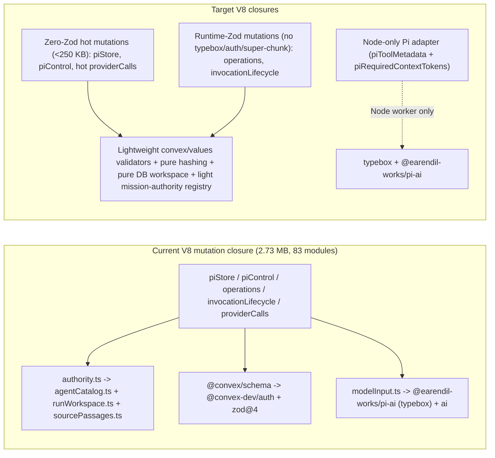
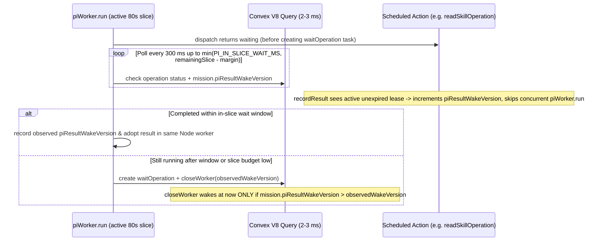
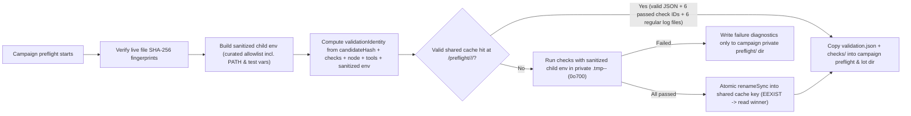

# Technical Design: Qualification Latency Optimization

## System Design

### Hot-path V8 mutation modules stay isolated from Node-only, auth, and schema-wide closures

In `convex-local-backend`, V8 queries reuse warm isolates (`2–3 ms`), whereas every `ctx.runMutation` and V8 `ctx.runAction` evaluates its full transitive V8 module closure in a fresh isolate (`~20 ms` Node-bridge + SQLite base plus `~220 ms` to load 2.73 MB / 83 modules). Today, `convex/execution/piStore.ts`, `piControl.ts`, `invocationLifecycle.ts`, `operations.ts`, and `providerCalls.ts` all pull `@earendil-works/pi-ai` (`typebox@1.3.27`, 691 KB), `@convex-dev/auth` + `jose` (229 KB), `zod@4.4.3` + 179 locales (425 KB), `ai`, and a 703 KB merged super-chunk (`KJDNI7HG.js`) through `authority.ts` (`agentCatalog.ts`, `runWorkspace.ts`, `sourcePassages.ts`), `@convex/schema`, `modelInput.ts`, `conversations.ts`, and `administrationAuthority.ts`.



The architecture splits V8 hot-path modules along two explicit tiers:

- **Tier 1 — Zero-Zod hot-path mutations (`piStore`, `piControl`, hot-path `providerCalls`, target `<250 KB`):**
  - Extract pure hashing and canonicalization (`sha256Hex`, `stableStringify`) out of `convex/domain/sourcePassages.ts` into a zero-dependency module so hot modules do not pull `sourceRetrievalPolicy.ts` (`zod`).
  - Extract shared table/document validators (`convex/values` only) imported by both `convex/schema.ts` and execution modules, eliminating `@convex/schema` imports (and thus `@convex-dev/auth` + `zod`) from hot-path `returns:` declarations.
  - Split pure DB workspace/qualification helpers out of `convex/runWorkspace.ts` (away from `@convex-dev/auth/server` and `qualificationCampaigns.ts`), and split admin queries/mutations out of `convex/providerCalls.ts` (away from `administrationAuthority.ts` and `documentaryAccess.ts`).
  - Decouple `authority.ts`, `piStore.ts`, and `piControl.ts` from full `agentCatalog.ts` by introducing a lightweight mission-authority registry (`executionScope`, `completionTransport`, `nativeConversation`, `scopeValidator`, `stateValidator`, `requireAuthority` — pure `convex/values`, zero `zod`) and decoupling `piControl.ts` from `conversations.ts`.
  - Move `piToolMetadata` (`Type.Unsafe`) and `piRequiredContextTokens` (`@earendil-works/pi-ai/utils/estimate`) out of V8-shared `modelInput.ts` into a dedicated V8-compatible adapter (`piModelAdapter.ts`, imported only by `piMission.ts` and `conversations.ts`, keeping it out of Tier 1 and Tier 2), read `PI_AI_VERSION` from `@earendil-works/pi-ai/package.json`, and route `piStore.inputSnapshot`'s legacy `session.observationSequence === undefined` fallback through `ctx.runQuery(internal.execution.context.build, ...)` instead of importing `buildMissionContext` statically.
- **Tier 2 — Runtime-Zod execution mutations (`operations.ts`, `invocationLifecycle.ts`):**
  - Because `operations.ts` executes `operation.resultValidator.safeParse` (`zod`) at runtime and `invocationLifecycle.ts` runs `agentToolSetKey` (`ai` + `zod` JSON schema serialization), these two modules retain their runtime Zod contracts without rewriting all domain operation schemas in this slice, while dropping `typebox`, `@convex-dev/auth`, `@convex/schema`, and the merged 703 KB super-chunk. `operations.ts` retains its legacy `@convex/workflow` edge for v3 `waitEventId` notifications.
- **Static enforcement:** `scripts/check-execution-boundaries.ts` enforces that Tier 1 modules never transitively import `typebox`, `@earendil-works/pi-ai`, `@convex-dev/auth`, `ai`, `zod`, or `@convex/schema`, and that Tier 2 modules never transitively import `typebox`, `@earendil-works/pi-ai`, `@convex-dev/auth`, or `@convex/schema`. Exact post-isolation bundle sizes are verified empirically against the compiled Convex bundle output.

### Turn-loop RPCs are deduplicated and pure-DB local operations execute in a single atomic mutation

Today, a single `sched=False` turn executes ~25–35 sequential Convex RPCs because `piMission.ts` repeats `settleRetainedOperations`, `syncInputs`, and `context.build` across `afterTools()`, `section.render()`, and `request()`, commits `root.configure` even when the tool set has not changed, calls `piStore.renew` inline before every operation and model call despite the 90 s lease and 25 s heartbeat, runs three sequential queries inside `invokeControlledGeneration`, and routes pure local DB operations through `ctx.runAction(operations.dispatch)` (5 hops: 1 V8 action, 2 mutations, 2 queries).

```mermaid
sequenceDiagram
    participant Worker as piWorker.run (Node)
    participant LocalM as operations.executeLocal (1 Mutation, pure-DB ops)
    participant Begin as invocations.begin (1 Mutation + piLease fence)
    participant PreCall as invokeAgentModel pre-call (1 Query)

    Worker->>LocalM: claim + DB read/write + validateOutcome + recordResult
    LocalM-->>Worker: OperationOutcome
    Note over Worker: afterTools: settle + sync + refreshTools (single context.build)
    Note over Worker: skip root.configure when full modelToolSetKey is unchanged
    Note over Worker: section.render consumes single-use turn snapshot; request() skips duplicate settle/sync
    Worker->>Begin: authoritative DB fence (hashes + observationSequence + piLease writer/epoch)
    Worker->>PreCall: combined invocation + modelConfiguration + fragment 0 (+ loop if fragmentCount > 1)
```

The consolidated turn flow preserves every safety and fencing invariant:

- **Single-use turn snapshot with strict invalidation:** `afterTools()` performs `settleRetainedOperations`, `syncInputs`, and `refreshTools` (one `context.build`) and stores a single-use context snapshot consumed and cleared by the immediately following `section.render()`. Any `onYield()`, `changedPreparation()`, or retry path immediately invalidates the snapshot so `section.render()` never renders stale context. On worker startup/recovery (no `afterTools` snapshot), `request()` runs `settleRetainedOperations` and `syncInputs` once. `invocations.begin` remains the authoritative DB fence on `preparedInputHash`, `preparedToolSetKey`, `preparedInstructionsHash`, and `preparedObservationSequence`.
- **Full wire-level `modelToolSetKey` comparison for `root.configure`:** `piMission.ts` skips `root.configure` only when the full `modelToolSetKey` (including tool descriptions and parameter JSON schemas, not just tool names) matches the active configured key, seeded from replayed conversation state on worker restart.
- **Same-generation writer-epoch fencing without redundant `piStore.renew` RPCs:** Inline `storage.renewLease()` calls in `dispatchRetainedOperation`, `submit_completion`, and `beforeDispatch` are dropped in favor of the 25 s heartbeat against `PI_SESSION_LEASE_MS` (90 s). Because `invocations.begin`, `retainRequest`, `recordAttempt`, `authorizeDispatch`, and `operations.claim` previously checked only `expectedGeneration`, all four paid/mutating boundaries now accept and verify `piLease` (`sessionId`, `writer`, `epoch`, `leaseUntil > now`) atomically with zero extra RPCs (while reply/cost retention stays generation-only so already-dispatched calls are never lost).
- **Batched pre-call read in `invokeControlledGeneration`:** `forExecution`, `modelConfiguration.forMission`, and fragment `0` of `executionInputFragment` collapse into a single warm V8 query while preserving the early-return ordering for `execution.kind === "blocked"` and `simulated === true`, and looping over `index = 1..fragmentCount - 1` when `fragmentCount > 1`.
- **Atomic local mutation strictly for `ctx.db`-only operations:** `operations.executeLocal` (`internalMutation`) handles only operations that exclusively touch `ctx.db` (`consult_mission_state`, `consult_conversation`, `consult_run_state`, `adjust_framing`), performing generation-fenced `claim`, local DB execution, `validateOperationExecutionResult`, `MAX_OPERATION_RESULT_BYTES` enforcement, and `recordResult` in one transaction. Pure DB reads catch and settle unexpected failures atomically inside `executeLocal` (preserving `operation_execution_incident` and typed refusal/unavailable outcomes); `adjust_framing` performs all validation before `saveFraming` so unexpected post-write errors roll back cleanly and settle via `settleDispatchFailure`. Operations requiring `ctx.storage.get` or `"use node"` actions (`search_available_material`, `read_in_context`) and external/scheduled operations remain on an Action path.

### The Node worker waits briefly in-slice for fast background operations before yielding

Today, every scheduled background operation — including `readSkillOperation` (`read`, median 3.10 s), `acquire_document`, `discover_sources_for_need`, `submit_documentary_qualification`, and `request_documentary_check` — immediately triggers `pi_slice_complete`, closing the Node worker (`piWorker.run`) and forcing a cold restart (3.90 MB bundle load plus full `piStore.scan` log replay) when the operation finishes.



The bounded in-slice wait uses a monotonic watermark to eliminate duplicate worker spawns and lost-wakeup races:

- **Canonical policy owner:** `convex/resourcePolicy.ts` defines `PI_IN_SLICE_WAIT_MS` (default `8_000` ms) and `PI_IN_SLICE_POLL_INTERVAL_MS` (default `300` ms), kept in sync via `scripts/check-resource-policy.ts` / `scripts/sync-resource-policy.ts`. Wait duration is bounded by `min(PI_IN_SLICE_WAIT_MS, remainingSliceBudget - safetyMargin)` and abortable via `toolContext.abortSignal` / worker `abort.signal`. This is a yield-threshold optimization, never a failure or mission timeout.
- **Placement before `waitOperation`:** In `execute()`, the bounded wait runs *before* calling `api.createTask(waitOperation)` (saving 2 Pi commits when a fast `read` completes in-slice), and also runs in `drainRetainedOperations` on recovery.
- **Race-free `piResultWakeVersion` + `adoptedWakeCount` coordination:** In `operations.recordResult`, if an active worker holds an unexpired lease (`mission.piActiveWriter && session?.writer === mission.piActiveWriter && session.leaseUntil > Date.now()`), `recordResult` increments a monotonic `mission.piResultWakeVersion` watermark **without** scheduling a doomed concurrent 3.90 MB `piWorker.run` at `Date.now()` (the active worker's 90 s recovery wake remains intact if it crashes). `piControl.prepare` snapshots `piPreparedWakeVersion`, and `closeWorker` accepts `adoptedWakeCount` (incremented only after Pi adopts a result that transitioned from `waiting` in this slice): `closeWorker` sets `piResultWakePending: true` and wakes at `Date.now()` **only** if `mission.piResultWakeVersion > piPreparedWakeVersion + adoptedWakeCount`, avoiding spin-wakes, `unchangedScheduledWait` 30 s defers, and lost wakeups with zero extra mutations on an in-slice hit.
- **Unchanged durable fallback:** Long background operations (`acquire_document`, `discover_sources_for_need`, `request_documentary_check`, `submit_documentary_qualification`) exceed the 8 s window and yield cleanly via `pi_slice_complete`.

### Preflight validation cache is shared across campaigns using a sanitized child environment and atomic publication

Today, `verifyQualificationCandidate` in `scripts/evaluations/workbench-browser/protocol.ts` already reuses a passing `validation.json` when `validationIdentity` matches, but two campaigns on the same commit still re-run the full 245-test Vitest `domain-tests` battery (~2m 52s each) because `campaign.ts` stores preflight output under each campaign's private directory (`<campaign-root>/preflight/<candidateHash>`) and `protocol.ts` hashes the entire `process.env` object into `validationIdentity`.



The shared preflight cache guarantees equivalence, concurrency safety, and archive self-containment:

- **Sanitized child environment equals hashed environment:** `protocol.ts` constructs an explicit sanitized environment object (including `PATH`, `HOME`, `TMPDIR`, `NODE_ENV`, `NODE_OPTIONS`, `TZ`, `LC_ALL`, `LANG`, `CI`, `VITEST_*`, and test-read workbench variables) and both **passes that exact sanitized env to `spawn("pnpm", ...)`** and **hashes that exact object** into `validationIdentity`. No unhashed ambient variable can silently influence check outcomes.
- **Atomic shared-cache publication under a user-private root:** The shared cache lives under a user-private `0o700` directory (e.g., `$XDG_CACHE_HOME/workbench-evaluations/preflight` or `~/.cache/workbench-evaluations/preflight`, never world-writable `/tmp`). Checks execute in a private staging directory (`.tmp-<pid>-<uuid>`, `0o700`) and publish via atomic `renameSync` into `<cache-root>/<candidateHash>/<validationIdentity>` only after all 6 checks pass (on `EEXIST`/`ENOTEMPTY`, clean up temp dir and read from the winner). `"running"` or `"failed"` states are never written into the shared cache key; failures are persisted only in the campaign's private `preflight/` directory.
- **Hardened cache-hit verification and local copy:** Before accepting a cache hit, `verifyQualificationCandidate` unconditionally verifies live SHA-256 fingerprints of all candidate files, treats corrupt JSON as a cache miss, verifies `candidateHash`, `fingerprintsSha256`, `validationIdentity`, and the exact set of 6 `check.id` entries all `"passed"`, and checks via `lstatSync` that `validation.json` and all 6 `checks/<id>.log` files are regular non-symlink files. Passing artifacts are copied into the campaign's `preflight/` and `lots/lot-1/` directories so every campaign archive remains self-contained.

## Program Design

### Hot-path V8 modules split along pure `convex/values` validators, versioned authority ownership, and a dedicated mission-model receipt module

To isolate Tier 1 hot-path mutations (`piStore`, `piControl`, `providerCallReceipts`) under `<250 KB` with zero `zod`/`typebox`/`@convex-dev/auth`/`ai` while preserving `api.providerCalls.retryBilling` and clearing Tier 2 (`operations`, `invocationLifecycle`) of `typebox`, `@earendil-works/pi-ai`, `@convex-dev/auth`, and `@convex/schema`, imports split across existing owners plus focused zero-dependency modules:

```diff
 convex/
 ├── domain/
+│   ├── hashing.ts                  # pure sha256Hex + stableStringify (re-exported by sourcePassages.ts)
 │   └── browserFixtureAccess.ts     # adds runMatchesWorkspace (already owns workspaceForVisitor)
 ├── execution/
+│   ├── tableValidators.ts          # pure convex/values doc/field validators (zero zod; imported by schema.ts & Tier 1)
+│   ├── agentAuthorityCatalog.ts    # single source of truth keyed by (definitionId, version): executionScope, nativeConversation, completionTransport, hasConversationReply, scopeValidator, stateValidator, requireAuthority (pure DB helpers, zero zod); agentCatalog.ts imports & asserts structural equality
 │   ├── authority.ts                # imports hashing.ts, browserFixtureAccess.ts, agentAuthorityCatalog.ts
 │   ├── piStore.ts                  # Tier 1 (<250 KB, zero zod); imports tableValidators.ts; legacy inputSnapshot calls ctx.runQuery(context.build)
 │   ├── piControl.ts                # Tier 1 (<250 KB, zero zod); reads analystTurnDeliveries directly; suspendInterruptedResearch via ctx.runMutation; successfulAuxiliaryResponse from zero-Zod constants
+│   ├── providerCallReceipts.ts     # Tier 1 (<250 KB, zero zod); hot mission-model receipt path (recordMissionModelAttempt, observeGeneration, requestBilling)
 │   ├── operations.ts               # Tier 2 (zero typebox/auth/schema); uses pure-DB framing/conversation/approval helpers; retains runtime Zod resultValidator
 │   └── invocationLifecycle.ts      # Tier 2 (zero typebox/auth/schema); uses pure-DB modelConfiguration/conversation helpers; retains runtime agentToolSetKey
 ├── integrations/
 │   ├── modelRouting.ts             # reads PI_AI_VERSION from @earendil-works/pi-ai/package.json (no @earendil-works/pi-ai/utils/version)
 │   ├── modelInput.ts               # drops @earendil-works/pi-ai (Type.Unsafe + estimateContextTokens)
+│   └── piModelAdapter.ts           # V8-compatible (no "use node"): piToolMetadata + piRequiredContextTokens (imported only by piMission.ts and conversations.ts)
 └── providerCalls.ts                # retains api.providerCalls.retryBilling and framing/acquisition/preparation/admin branches
```

Static boundary enforcement in `scripts/check-execution-boundaries.ts` walks transitive value imports from two explicit module lists:

```ts
const TIER1_ZERO_ZOD_MODULES = [
    "convex/execution/piStore.ts",
    "convex/execution/piControl.ts",
    "convex/execution/providerCallReceipts.ts",
] as const;

const TIER2_NO_HEAVY_CLOSURE_MODULES = [
    "convex/execution/operations.ts",
    "convex/execution/invocationLifecycle.ts",
] as const;

// Tier 1 forbids: typebox, @earendil-works/pi-ai, @convex-dev/auth, ai, zod, convex-helpers/server/zod4, @convex/schema
// Tier 2 forbids: typebox, @earendil-works/pi-ai, @convex-dev/auth, @convex/schema
```

### Turn preparation deduplicates round-trips, fences all four paid/mutating boundaries with `piLease`, and handles `pi-durable` queueing and compaction safely

`piLease` carries `sessionId` explicitly (independent of `args.piSessionId` used in `taskKey`) and is enforced across all four paid/mutating boundaries whenever `mission.executionRuntime === "pi-durable"`: (1) `invocations.begin`, (2) `invocationLifecycle.retainRequest` + `providerCallReceipts.recordMissionModelAttempt` / `providerCalls.recordAttempt` + `invocationLifecycle.authorizeDispatch`, and (3) `operations.claim` / `operations.executeLocal`. Reply/cost retention mutations (`retainOutput`, `recordModelReply`, `observeGeneration`) remain generation-fenced only so already-dispatched calls are never lost if a lease expires mid-stream.

```diff
 // convex/execution/invocationLifecycle.ts (+ providerCallReceipts.ts + operations.ts)
 const piLeaseValidator = v.object({
+    sessionId: v.id("piSessions"),
+    writer: v.string(),
+    epoch: v.number(),
 });
 // Enforced independently of args.piSessionId (taskKey unchanged):
 // session.missionId === mission._id && session.generation === args.expectedGeneration
 // && session.writer === piLease.writer && session.epoch === piLease.epoch && session.leaseUntil > Date.now()
 // else throw executionError("pi_writer_fenced")

 // convex/execution/invokeAgentModel.ts
-  const { mission, invocation, ... } = await ctx.runQuery(forExecution, args);
-  const configuredModel = simulated ? null : await ctx.runQuery(modelConfiguration.forMission, ...);
-  const first = await ctx.runQuery(executionInputFragment, { ...args, inputHash, index: 0 });
+  const { mission, invocation, configuredModel, firstFragment, ... } =
+      await ctx.runQuery(forExecutionBundle, args);
+  // forExecutionBundle skips missionModel when simulated === true, wraps admittedInputFragment(0)
+  // in { kind: "ready", fragment } | { kind: "error", code } so blocked / !route / !OPENROUTER_API_KEY
+  // early returns never throw on missing fragments, retains forExecution (line 286) & executionInputFragment (index >= 1).
```

In `convex/integrations/piMission.ts`, turn-loop state accounts for `@earendil-works/pi-durable@1.4.0` semantics (`afterTools()` runs while the conversation is still busy before `applyBoundary(..., "postTools")`, and blocking compaction re-enters `section.render()` without calling `request()`):

```ts
let pendingTurnContext: BuiltMissionContext | null = null;
let afterToolsPrepared = false;
let afterToolsHadQueuedInputs = false;
// Seeded from await root.agent(context) (AgentDoc.modelTools + model/thinking/instructions), NOT transcript getCurrentTools:
let activeAgentConfig = await root.agent(context);

// Startup: guard initial root.configure({ model, thinkingLevel, instructions }) against activeAgentConfig;
//   never populate pendingTurnContext during startup refreshTools().
// afterTools():
//   await settleRetainedOperations();
//   const syncResult = await syncInputs(); // synchronize / synchronizeObservations return { hadQueued: boolean }
//   const ctx = await refreshTools();      // calls root.configure ONLY when modelTools list differs from activeAgentConfig
//   pendingTurnContext = ctx; afterToolsPrepared = true; afterToolsHadQueuedInputs = syncResult.hadQueued;
// section.render():
//   const ctx = pendingTurnContext ?? await buildContext();
//   if (pendingTurnContext === null) { afterToolsPrepared = false; afterToolsHadQueuedInputs = false; }
//   pendingTurnContext = null;
// onYield() / changedPreparation() / retry:
//   pendingTurnContext = null; afterToolsPrepared = false; afterToolsHadQueuedInputs = false;
// request():
//   const skipSettle = afterToolsPrepared;
//   const skipSync = afterToolsPrepared && !afterToolsHadQueuedInputs;
//   afterToolsPrepared = false; afterToolsHadQueuedInputs = false; // reset before auxiliary branch
//   if (!skipSettle) await settleRetainedOperations();
//   if (!skipSync) await syncInputs();
```

### Pure-DB local operations run in a single `operations.executeLocal` mutation with clean rollback settlement

`AgentOperationDefinition` in `convex/execution/executionProtocol.ts` gains an optional `executeInTransaction?: (ctx: MutationCtx, args: ExecuteOperationArgs) => Promise<unknown>` implemented by `consult_mission_state` (preserving its internal `ctx.runQuery(internal.execution.context.build)` call rather than importing `context.ts` into `operations.ts`), `consult_conversation`, `consult_run_state`, and `adjust_framing` (using pure-DB `applyFromWorkbenchInTx`). `operations.executeLocal` (`internalMutation`) passes `atomicLocal: true` to `claimOperationInTx` (skipping redundant `expiryJobId` / `waitEventId` scheduling+cancellation inside the same transaction), enforces `piLease`, preserves `observeOperationOutcome` wrapping, validates via `validateOperationExecutionResult`, and commits via `recordOperationResultInTx`.

```ts
export const executeLocal = internalMutation({
    args: {
        requestId: v.id("agentOperationRequests"),
        expectedGeneration: v.number(),
        piLease: v.optional(piLeaseValidator),
    },
    returns: operationOutcomeValidator,
    handler: async (ctx, args): Promise<Outcome> => {
        const claimed = await claimOperationInTx(ctx, { ...args, atomicLocal: true });
        if (claimed.kind === "outcome") return claimed.outcome;
        if (claimed.kind === "adopt") return recordOperationResultInTx(ctx, args, claimed.outcome);
        // Pure reads catch & settle failures atomically via settleDispatchFailureInTx.
        // adjust_framing scopes recoverableWorkbenchRefusal strictly before saveFraming's first DB write
        // and pre-validates receipt size/schema before writing; any post-write throw propagates to roll back
        // the mutation cleanly, and piMission settles via authorized operations.settleLocalRollback
        // (handles request.status === "pending" without calling internal-only settleDispatchFailure).
    },
});
```

`piMission.ts` calls `operations.executeLocal` when `operation.executeInTransaction` is present and keeps `search_available_material`, `read_in_context`, and external/scheduled operations on `operations.dispatch`.

### `piResultWakeVersion` and `adoptedWakeCount` coordinate in-slice waits without concurrent spawns, lost wakeups, or breaking `prepare`

`agentMissions` adds two optional numeric fields: `piResultWakeVersion` (incremented on every `waiting` -> `completed` `recordResult`) and `piPreparedWakeVersion` (snapshotted inside `piControl.prepare`, preserving `prepare`'s existing `v.boolean()` return type). `convex/resourcePolicy.ts` defines `PI_IN_SLICE_WAIT_MS = 8_000` and `PI_IN_SLICE_POLL_INTERVAL_MS = 300` (synced via `scripts/sync-resource-policy.ts` / `check-resource-policy.ts`).

```diff
 // convex/execution/operations.ts (recordResult)
 if (mission?.executionRuntime === "pi-durable" && request.status === "waiting" && !request.outcome) {
-    await ctx.db.patch(mission._id, { piResultWakePending: true });
-    await schedulePiMission(ctx, mission._id, args.expectedGeneration);
+    const nextWakeVersion = (mission.piResultWakeVersion ?? 0) + 1;
+    const activeSession = mission.piActiveWriter ? await sessionForMission(ctx, mission) : null;
+    const workerLeaseActive =
+        activeSession?.writer === mission.piActiveWriter && activeSession.leaseUntil > Date.now();
+    await ctx.db.patch(mission._id, {
+        piResultWakeVersion: nextWakeVersion,
+        ...(!workerLeaseActive ? { piResultWakePending: true } : {}),
+    });
+    if (!workerLeaseActive) await schedulePiMission(ctx, mission._id, args.expectedGeneration);
 }

 // convex/execution/piControl.ts (prepare persists piPreparedWakeVersion: mission.piResultWakeVersion ?? 0, returns v.boolean())
 // closeWorker accepts adoptedWakeCount: v.optional(v.number()) (defaults to 0 when omitted)
-const nextAt = mission.piResultWakePending ? Date.now() : args.at;
+const expectedVersion = (mission.piPreparedWakeVersion ?? 0) + (args.adoptedWakeCount ?? 0);
+const hasUnobservedWake =
+    mission.piResultWakePending === true ||
+    (mission.piResultWakeVersion ?? 0) > expectedVersion;
+if (hasUnobservedWake) await ctx.db.patch(mission._id, { piResultWakePending: true });
+const nextAt = hasUnobservedWake ? Date.now() : args.at;
```

In `convex/integrations/piMission.ts`, `waitBrieflyInSlice(requestId, abortSignal)` runs *before* `api.createTask(waitOperation)` (and in `drainRetainedOperations`), polling a Tier 1 warm query `piControl.operationWakeStatus` (`2–3 ms`) every `PI_IN_SLICE_POLL_INTERVAL_MS` up to `min(PI_IN_SLICE_WAIT_MS, sliceDeadlineAt - Date.now() - SLICE_YIELD_SAFETY_MS)`. `adoptedWakeCount` is **never** incremented during a `waiting` poll or before adoption — it increments by `+1` *only after* Pi receives/adopts the terminal result of an operation that transitioned from `waiting` during this slice (including an immediate hit inside `waitOperation`). Setting `piResultWakePending: true` on `hasUnobservedWake` in `closeWorker` ensures `unchangedScheduledWait` never defers the fresh worker by 30 s when another operation is still `waiting`. If the worker crashes hard while `workerLeaseActive === true`, `prepare`'s existing lease-expiry recovery wake chain guarantees recovery within `<= PI_SESSION_LEASE_MS` (90 s) of the last renewal.

### `verifyQualificationCandidate` runs checks under a sanitized env and publishes atomically to a shared user-private cache

`scripts/evaluations/workbench-browser/protocol.ts` exposes the sanitized child environment builder, default cache root, and atomic shared-cache lookup/publication while preserving the hardened local `root/validation.json` check first and keeping `CheckExecutor` backwards-compatible:

```ts
export const PREFLIGHT_ENV_ALLOWLIST = [
    "PATH", "HOME", "TMPDIR", "TMP", "TEMP", "USER", "SHELL",
    "XDG_CACHE_HOME", "XDG_DATA_HOME", "XDG_STATE_HOME", "XDG_CONFIG_HOME",
    "NODE_ENV", "NODE_OPTIONS", "TZ", "LC_ALL", "LANG", "CI",
    "SOURCES_PREPARATION_WINDOW_MINUTES", "SOURCES_MISSION_ENABLED",
    "SOURCES_REPLAY_INPUT", "SOURCES_REPLAY_METRICS",
    "WORKBENCH_REVIEW_REASONING", "PI_CODING_AGENT_DIR",
] as const; // plus prefixes "VITEST_", "PNPM_", and "npm_config_"

export function buildPreflightChildEnv(source: NodeJS.ProcessEnv = process.env): Record<string, string>;
export function defaultPreflightCacheRoot(env = process.env): string;
// -> join(env.XDG_CACHE_HOME?.trim() || join(homedir(), ".cache"), "workbench-evaluations", "preflight")

export type CheckExecutor = (
    binary: string,
    args: readonly string[],
    signal: AbortSignal,
    env?: Record<string, string>, // 4th optional arg preserves existing 3-arg test stubs
) => Promise<CheckResult>;

export async function verifyQualificationCandidate(
    root: string,
    fingerprints: Record<string, string>,
    execute: CheckExecutor = executeCheck,
    options?: { sharedCacheRoot?: string | null },
)
```

Execution flow:

```text
verifyQualificationCandidate(root, fingerprints, execute, { sharedCacheRoot })
  1. verify() live SHA-256 of every fingerprinted file
  2. childEnv = buildPreflightChildEnv(process.env)
     fingerprintsSha256 = sha256(readFileSync(join(root, "fingerprints.json")))
     validationIdentity = sha256({ candidateHash, fingerprintsSha256, checks, node, executable, tools, environment: childEnv })
  3. check hardened local cache hit in root/validation.json first (existing lot-copy & local-only callers)
  4. if sharedCacheRoot:
       candidateDir = join(sharedCacheRoot, candidateHash)
       cacheDir = join(candidateDir, validationIdentity)
       if readVerifiedCacheHit(cacheDir, expected) succeeds
         (lstatSync non-symlink dir on candidateDir, cacheDir, checks/; lstatSync regular non-symlink files on
          validation.json + all 6 checks/<id>.log; try/catch JSON; matching candidateHash, fingerprintsSha256,
          validationIdentity, and exact 6 passed check.ids)
         -> copy validation.json + checks/*.log into root (0o600) and return cached record
  5. on miss:
       mkdirSync(candidateDir, { recursive: true, mode: 0o700 })
       stagingDir = join(candidateDir, `.tmp-${process.pid}-${randomUUID()}`) // same parent & filesystem (no ENOENT/EXDEV)
       run all 6 checks with execute("pnpm", check.args, controller.signal, childEnv)
       - on failure: write logs + status "failed" ONLY to campaign's private root, remove stagingDir, throw
       - on success + final verify(): write status "passed" (0o600) in stagingDir,
           try renameSync(stagingDir, cacheDir);
           on EEXIST/ENOTEMPTY/ENOTDIR: verify winner with readVerifiedCacheHit(cacheDir, expected) BEFORE removing stagingDir;
             if winner is valid, copy winner to root and remove stagingDir; else copy stagingDir to root and remove stagingDir.
           on rename success: copy validation.json + checks/*.log into root (0o600).
```

`scripts/evaluations/workbench-browser/campaign.ts` passes `{ sharedCacheRoot: defaultPreflightCacheRoot() }` at line 2127 so back-to-back lots on the same commit reuse the verified preflight while keeping each campaign archive self-contained.

### Deterministic verification strategy

1. **Static boundaries & policy sync:** `scripts/check-execution-boundaries.ts` (Tier 1 & Tier 2 transitive import rules + `FUNCTION_OWNERS`), `scripts/check-resource-policy.ts`, `pnpm convex:check`, and `pnpm check:types`.
2. **Behavioral & invariant regressions (zero paid calls):** `pi-mission.test.ts` (RPC count, `afterTools` queued-input `adjust_framing` & steering, blocking compaction invalidation, `piLease` epoch fencing across all 4 boundaries, conditional `root.configure` from `root.agent`), `dispatch.test.ts` & `operation-conformance.test.ts` (`executeLocal` atomic reads, `adjust_framing` pre-write refusal & post-write rollback via `settleLocalRollback`, `forExecutionBundle` blocked/simulated early returns), `pi-deferred-wake.test.ts` (`piResultWakeVersion` + `adoptedWakeCount` in-slice hit without concurrent worker spawn, 2 parallel ops, abort-before-adopt, `unchangedScheduledWait` after `closeWorker`, hard worker crash recovery within `PI_SESSION_LEASE_MS`), and `workbench-protocol.test.mjs` (cross-campaign cache hit, sanitized child env, corrupt JSON miss, parent/file symlink rejection, concurrent `EEXIST`/`ENOTEMPTY` atomic publish, `fingerprintsSha256` isolation).
3. **Empirical local-backend measurement:** inspect compiled V8 module closure sizes in `.convex/local/default/convex_local_storage/modules/` for Tier 1 and Tier 2 modules and run an isolated `convex-local-backend` timing probe before vs. after.

## Patterns to Follow

- **Execution boundary guardrails:** `scripts/check-execution-boundaries.ts` and `scripts/check-imports.ts` enforce static import boundaries across Convex modules.
- **Canonical resource policy:** `convex/resourcePolicy.ts` owns all execution leases, slice budgets, and wait intervals (`PI_SESSION_LEASE_MS`, `PI_LEASE_RENEW_INTERVAL_MS`, `PI_WORKER_SLICE_MS`, `PI_OPERATION_WAIT_POLL_MS`).
- **Generation fencing and persist-before-adopt:** `convex/execution/invocationLifecycle.ts` (`begin`, `retainOutput`, `adopt`) and `convex/execution/operations.ts` (`claim`, `recordResult`) enforce active generation authority and atomic effect adoption.
- **Deterministic harness tests:** `src/__tests__/convex/execution/pi-mission.test.ts`, `pi-deferred-wake.test.ts`, `dispatch.test.ts`, `operation-conformance.test.ts`, and `src/__tests__/config/workbench-protocol.test.mjs`.

## Scope

- **In scope:** Convex V8 hot-path bundle isolation, turn-loop RPC consolidation, atomic local operation mutation, bounded in-slice wait for fast scheduled operations, and shared cross-campaign preflight cache.
- **Out of scope:** Changing LLM models or prompts, adding a frozen capture-to-examiner mid-workflow fixture entry point (deferred to a separate slice), weakening authorization, generation fencing, persist-before-adopt guarantees, evidence provenance, or skipping preflight validation checks on unverified commits.
