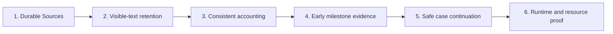

# Implementation Outline: Sources execution and evaluation integrity

Implement the [approved technical design](04-tdd-sources-evaluator.md) through the existing operation lifecycle, invocation journal and campaign runner. The [research](03-research-sources-evaluator.md) establishes the failure mechanisms; the [performance review](05-performance-review.md) adds resource acceptance conditions. All six implementation phases are delivered. The user requested continuous implementation on November 19. [The phase-one record](07-implementation-sources-scheduled.md) preserves its original evidence and limits; [the consolidated implementation record](09-implementation-complete.md) tracks final checks, independent code review, runtime/resource evidence and remaining qualification boundaries. New paid qualification has not been run.

## Desired End State

Sources discovery, acquisition, documentary submission and targeted checks yield a retained waiting reference, release the Pi worker, and deliver their result through the existing executor. Interrupted structured calls preserve their received visible prefix as protected diagnostics. Evaluation accounting agrees across preparation, authorization and relay; each milestone survives later failure; safe independent cases continue while the original failure remains recorded.

The historical 45,867-token generation remains unexplained. This work supplies execution and capture mechanisms for future diagnosis; it cannot recover missing historical text or establish model quality. OpenRouter logging and Arize were enabled by the user; actual reception and correlation remain unverified.

## Implementation Overview

- [x] Phase 1: Sources completes through durable scheduled operations.
- [x] Phase 2: Interrupted structured calls retain visible text safely.
- [x] Phase 3: Campaign accounting agrees and preserves uncertainty.
- [x] Phase 4: Evaluation captures each milestone when it occurs.
- [x] Phase 5: Settled failures allow safe independent continuation.
- [x] Phase 6: Runtime and resource evidence qualify the combined path.



This is the execution order, keeping each change reviewable in the shared checkout. Phase 3 can be understood independently of phases 1–2; phase 5 depends on its accounting and phase 4's retained evidence. Performance measurements start with the affected phase, then phase 6 consolidates them and resolves the conditional Pi hydration optimization.

For each functional change, use the project's integration-boundary RED → GREEN → REFACTOR procedure: add the smallest regression through real collaborators, record its intended failure, implement that behavior, and keep the focused suite green. Test paths below already exist; extend those suites rather than adding pass-through tests. Add a new test file only when the existing boundary cannot express the regression coherently. Preserve unrelated checkout changes.

## Phase 1: Sources completes through durable scheduled operations

Deliver one complete scheduled-operation path for all four Sources I/O families. This removes the requirement for the parent dispatcher to remain alive while the Sources Node action works.

### Change Outline

| Owner | Change |
| --- | --- |
| `convex/execution/executionProtocol.ts` | Make `execute` and static trusted `scheduledAction` mutually exclusive within durable-effect definitions. Preserve existing inline operations. |
| `convex/execution/schema.ts`, `operations.ts` | Atomically authorize, schedule the actual action and retain waiting/job ownership. Add one-time `beginScheduledExecution`; count running and waiting effects as engaged. Repeated dispatch returns the existing reference. |
| `convex/domain/sourcesAgent.ts` | Declare the same scheduled target in the common factory for all four I/O operations. Keep pinning and result contracts here. |
| `convex/sourcesMissionActions.ts`, `sourcesMission.ts` | Claim scheduled execution before reservation/I/O, run the existing body directly and record its terminal outcome. Accept owned, started waiting requests without weakening generation, preparation or reservation checks. |
| Existing result wake, expiry and cleanup owners | Preserve completion-before-wait delivery, cancellation, late accounting and explicit unknown outcomes; never re-enqueue uncertain external work. |

```text
dispatch -> claim transaction -> schedule actual Sources action + retain waiting
Pi -> checkpoint native wait -> release worker
Sources action -> begin once -> reserve -> existing I/O -> recordResult -> wake Pi
Pi continuation -> consult retained outcome
```

The first RED should dispatch a real registered Sources operation against deferred external I/O and require a retained waiting result before that I/O finishes. Assert the eventual domain result and persisted request state. Add distinct regressions for duplicate worker delivery, scheduling rollback, another effect while waiting, completion before Pi checkpoints, cancellation/stale adoption and worker loss. Exercise all four families through their actual registered definitions. Update existing synchronous test drivers to settle the scheduled work explicitly without hiding the waiting transition.

### Validation

#### Automated Verification

- [x] `pnpm exec vitest run src/__tests__/convex/execution/operations.test.ts src/__tests__/convex/execution/deferred-operations.test.ts src/__tests__/convex/execution/pi-deferred-wake.test.ts src/__tests__/convex/sources/sources-mission.test.ts src/__tests__/convex/sources/documentary-control-integration.test.ts` — included in the passing 141-test focused battery; Sources/conformance were rechecked after the lifecycle refactor.
- [x] Keep the existing cancellation and operation-result contract regressions green when changing shared settlement branches; both ran in that focused battery. Component diagnostics and their verification limits remain explicit in the implementation record.

#### Manual Verification

Review a retained execution trace for one operation of each family: one scheduled job, one successful start claim, one work reservation and one terminal observation. A duplicate or late invocation must not create another external attempt. The actual worker-release check is completed in phase 6; `convex-test` alone does not prove the Convex runtime connection behavior.

## Phase 2: Interrupted structured calls retain visible text safely

Deliver capture from the real preparation consumer through the installed SDK to persisted invocation diagnostics. Keep storage and transport changes in one phase so an unused append helper cannot be mistaken for working retention.

### Change Outline

| Owner | Change |
| --- | --- |
| `convex/execution/retainedText.ts`, `schema.ts` | Add open/sealed append storage alongside immutable manifest staging. Separate append sequence from fragment index; maintain bounded tail/counters/incremental hash state, then construct the sealed manifest once. |
| `convex/execution/invocationLifecycle.ts`, `journal.ts` | Bind `appendVisibleOutput({ invocationId, sequence, text })` to the invocation/receipt; retain capture state and terminal cause. Make last-append retry and sealing idempotent; reject changed duplicates and sequence gaps. |
| `convex/integrations/modelTransport.ts`, `convex/sources/preparationModel.ts` | Use native structured streaming for shared one-shot calls. Capture native visible deltas in routed-model middleware before enrichment, pass the bound writer from preparation, and settle receipts through existing lifecycle code. |
| SDK pre-output transform at the existing transport boundary | Pack visible deltas before partial-object parsing using existing fragment capacity. Preserve channel boundaries, usage, errors and finish metadata; handle rejected completion promises explicitly. |
| `convex/adminOperations.ts`, existing campaign export and `convex/dossierPurge.ts` | Include diagnostic references in protected inspection/export and account for their cleanup ownership. Preserve intentional shared-storage retention; prevent accidental orphaning. |

```text
native visible delta -> bound append writer -> protected diagnostic prefix
                    -> text packing -> SDK structured parsing -> complete reply
complete reply + receipt -> existing schema/domain checks -> current-authority adoption
```

Use one append in flight with backpressure. Keep hidden reasoning and secrets out of the diagnostic. A partial or malformed prefix never becomes model history, replay input, analyst-visible evidence or an adopted contribution. The complete canonical reply keeps its current role. Drain, seal and receipt settlement share the existing ten-second settlement grace; record explicit capture incompleteness when the final suffix cannot be committed.

The first RED should emit a real SDK-visible prefix and then interrupt the injected external stream through the preparation consumer; require its exact persisted text, incomplete status, receipt identity and absence of adoption. Extend coverage for complete normalization, invalid JSON/schema, unchanged/whitespace suffixes, split Unicode, lost append acknowledgement, persistence failure, cancellation and late billing. Test old immutable records through their existing readers too.

### Validation

#### Automated Verification

- [x] `pnpm exec vitest run src/__tests__/convex/execution/one-shot.test.ts src/__tests__/convex/execution/journal.test.ts src/__tests__/convex/integrations/documentary-control-transport.test.ts src/__tests__/convex/integrations/source-qualification-transport.test.ts src/__tests__/convex/sources/documentary-control-integration.test.ts` — real consumers, SDK transport, journal and adoption.
- [x] Run affected protected-reader/export/purge tests after locating their current ownership; assert that diagnostic text remains inaccessible through analyst and agent projections.
- [x] Replay the same retained real response under slow and bursty delivery. Record CPU, peak heap, native/enriched events, append mutations, packed fragments, header/tail bytes, capture latency and cancellation-to-receipt time. Use the task-local probe described in phase 6; collect before/after evidence while editing this phase.

#### Manual Verification

Inspect complete and interrupted exports: text agrees with delivered visible bytes, capture completeness is explicit, and the canonical reply remains distinguishable. Resource acceptance requires packed storage across delivery cadences, bounded append metadata and preservation of known receipts within existing settlement authority. Remaining SDK buffering must be quantified; batching alone is insufficient evidence.

## Phase 3: Campaign accounting agrees and preserves uncertainty

Deliver one explicit policy from draft preparation through application grant and relay, including correct settlement when the relay proves it refused before upstream dispatch.

### Change Outline

| Owner | Change |
| --- | --- |
| `convex/qualificationCampaignPolicy.ts` | Normalize omitted new-draft policy to `known_final_v1` before hashing/authorization. Keep historical manifest parsing readable. |
| `scripts/evaluations/workbench-browser/campaign.ts`, `qualify.ts`, existing protocol validation | Serialize the normalized pin through both producers; execution consumes it rather than adding another default. |
| `convex/execution/fixtures.ts`, `convex/qualificationUsage.ts` | Require matching granted policy, expose it through the protected route, and expose unresolved billing conflicts through the existing usage row. |
| `scripts/evaluations/workbench-browser/relay.mjs` | Verify protocol/route/grant agreement; preserve equal-cost idempotency and explicit contradictory-cost state in runtime and ledger replay. Retain correlated local non-dispatch evidence before acknowledging it. |
| `convex/integrations/piMission.ts`, existing transport and `convex/providerCalls.ts` | Bind fixture-only loopback correlation to invocation/generation/exact outgoing wire hash; validate the acknowledgement through receipt settlement. Release money only for proven non-dispatch, preserving the application attempt. |

```text
draft -> canonical normalization -> prepared manifest hash -> grant -> relay policy pin
local refusal -> retained correlated observation -> validated acknowledgement
              -> failed/not_dispatched receipt -> financial reservation released
unknown or conflicting observation -> reservation retained -> further dispatch blocked
```

Refuse redirects on the correlated loopback hop. Strip private metadata before upstream forwarding and strip reserved acknowledgement markers from upstream responses. Provider HTTP errors, malformed/forged acknowledgements, lost acknowledgements and faults after upstream dispatch remain conservative. Old inconsistent active protocols cannot gain dispatch authority through new defaults; retain inspection, reconciliation and cleanup access without rewriting historical evidence.

The first RED prepares an omitted-policy draft through the real campaign producer and requires an explicit matching pin in execution material. Subsequent regressions cover grant/protocol mismatch, standalone producer, final-cost replacement/restart, equal repeated charges, conflicting costs and the complete local-refusal-to-usage transition. A provider-shaped HTTP 400 must not prove non-dispatch.

### Validation

#### Automated Verification

- [x] `node --experimental-strip-types --test src/__tests__/config/qualification-campaign.test.mjs src/__tests__/config/workbench-protocol.test.mjs src/__tests__/config/workbench-relay.test.mjs` — preparation, wire protocol and real deterministic relay/ledger behavior.
- [x] `pnpm exec vitest run src/__tests__/convex/execution/qualification-campaign.test.ts src/__tests__/convex/execution/accounting.test.ts src/__tests__/convex/execution/pi-native-transport.test.ts` — application grant, usage, receipt settlement and actual loopback transport integration.

#### Manual Verification

Inspect one prepared mandate, grant, protocol and reconstructed ledger for agreement. Compare application attempts, physical upstream dispatches, reservations and confirmed charges as separate quantities. Confirm the refusal releases only its financial reservation and a conflicted ledger cannot appear safe merely because a conservative dollar total fits.

## Phase 4: Evaluation captures each milestone when it occurs

Deliver saved-program and actual-Sources-input artifacts before waiting for completed preparation. A later failure must retain earlier observations with their own verdicts.

### Change Outline

| Owner | Change |
| --- | --- |
| `convex/execution/fixtures.ts` | Project first real non-compaction Sources invocation identity, dispatch state and retained request hash, bound to dossier/fixed revision/preset/preparation/mission/receipt. Keep request bodies and fragment scans outside polling snapshots. |
| `scripts/evaluations/workbench-browser/scenarios.ts` | Observe milestones before terminal/block checks; capture saved framing immediately and hydrate actual request bytes once per invocation/hash through existing readers. Preserve the latest snapshot on failure. |
| `scripts/evaluations/workbench-browser/campaign-review.ts`, existing artifact export | Judge saved framing, actual first input and `sources_prepared` separately; retain the original complete-preparation predicate. |

The first RED drives the real runner with a saved program and dispatched first Sources input followed by a blocked preparation. Require both earlier artifacts to survive, preparation to fail and the failed case to remain failed. Add undispatched/unknown input, compaction-first, changed revision/preset, absent retained bytes and repeated-poll cases. Prepared input alone stays inconclusive about receipt by Sources.

### Validation

#### Automated Verification

- [x] `node --experimental-strip-types --test src/__tests__/config/qualification-v2.test.mjs src/__tests__/config/qualification-campaign.test.mjs` — shared runner, artifact retention and review.
- [x] `pnpm exec vitest run src/__tests__/convex/execution/qualification-v2.test.ts src/__tests__/convex/execution/qualification-campaign.test.ts` — protected milestone identity and dispatch evidence.
- [x] Measure repeated snapshot payload bytes, fragment reads and output artifact count using identical retained request data; require metadata-only polling and one hydration per immutable identity.

#### Manual Verification

Read one failure report as an evaluator: it must distinguish what Workbench saved, what Sources actually received and whether preparation completed. Compare archived request bytes with the journal hash rather than reconstructing an ideal request from current domain state.

## Phase 5: Settled failures allow safe independent continuation

Deliver the selected default for both backend and browser execution: preserve a settled case failure and run the next independent case only when shared state is safe. This follows the accounting and milestone phases so continuation cannot hide uncertainty or erase earlier evidence.

### Change Outline

Extend the existing scenario failure branch to record failure and release its gates/publication hold, then use one continuation assessment for both transports. Consume native settlement/publication state, the transactionally maintained usage conflict state, indexed active/unknown-effect existence checks, relay quiescence and remaining grant authority. Fold the relay ledger at case boundaries/restart rather than on every poll. Keep the policy in the existing runner/accounting owners; add no independent runner or guessed per-case budget.

```text
case fails -> retain failure -> release owned controls -> assess shared safety
  safe + remaining authority -> next unexecuted independent case
  active / unknown / conflict / exhausted / unsafe -> retain stop reason; rest unrun
final lot verdict remains failed; existing campaign cleanup always runs
```

The first RED runs two independent backend cases through the real runner: the first fails with settled execution/costs; the second must execute and the lot must still fail. Run the same boundary for browser mode. Distinct regressions cover detached waiting effects despite an idle Pi writer, pending/unknown/conflicting billing, overrun/exhaustion, held controls, cancelled grants, interruption and cleanup failure. Never reset the allowance or replay executed cases to obtain continuation.

### Validation

#### Automated Verification

- [x] `node --experimental-strip-types --test src/__tests__/config/qualification-v2.test.mjs src/__tests__/config/workbench-relay.test.mjs src/__tests__/config/qualification-campaign.test.mjs` — shared continuation, ledger uncertainty, failure retention and cleanup.
- [x] `pnpm exec vitest run src/__tests__/convex/execution/qualification-v2.test.ts src/__tests__/convex/execution/accounting.test.ts src/__tests__/convex/execution/deferred-operations.test.ts` — indexed engaged effects and usage projections used by continuation.

#### Manual Verification

Inspect a two-case report and a blocked-continuation report: original failure intact, next case executed only in the safe report, later cases explicitly unrun in the unsafe report, and cleanup evidence present in both. Passing later cases cannot change the aggregate failure.

## Phase 6: Runtime and resource evidence qualify the combined path

Close the gaps deterministic integration tests cannot establish: actual Convex scheduling/worker release, measured capture costs, polling traffic and the need for a Pi pre-hydration readiness check. This phase integrates the results rather than launching another paid evaluation campaign.

### Change Outline

Add task-local reproducible probes beside this outline, following the existing `response-retention-probe.mjs` pattern and importing real modules through the installed tooling. Use `sources-resource-replay.mjs` for retained response/log replay and `sources-runtime-verification.mjs` for the actual loopback runtime. They must fail if required retained data or loopback prerequisites are absent, never silently substitute synthetic success. Record input hashes, installed versions, workload sizes, commands, before/after measurements and limitations in a dated verification artifact. These are new probe files to create during implementation, not existing commands that have already passed.

Use an isolated fixture-owned dossier and deterministic external endpoint on the intended local backend. Hold actual Sources I/O open, prove dispatch returns waiting and the original Pi worker releases, then finish the I/O and prove continuation consumes the one retained result. Cover a cancellation or generation change with late receipt settlement and no adoption. Reuse the archived five-minute synchronous failure as before evidence; sustained execution beyond that former failure point must remain possible within the admitted envelope. Observe the existing development watcher's successful push after backend edits; if an explicit manual sync is needed, verify the project/instance identity and use the prescribed sync owner.

Measure fallback wake hydration with actual retained Pi logs and a valid admitted-large fixture. If repeated hydration is material, add the approved readiness check in `convex/execution/piControl.ts` before storage opens: skip only an owned scheduled wait with no result/input/steering/authority/terminal work to process. Uncertain readiness takes the normal path. Preserve leases, generations, immediate result wakes and fallback timing. Write the race/transition RED before this conditional change; otherwise retain the measurements and explicitly omit the optimization. Do not derive a new production cutoff from the review's illustrative estimates.

### Validation

#### Automated Verification

- [x] After creating the probes, `node .agents/artifacts/sources-workflow-no-legacy/sources-resource-replay.mjs` — retained real input replay, delivery-cadence comparison, SDK/storage measurements, Pi log hydration and polling traffic. Require the caller to select protected input paths without copying raw sensitive data into tracked fixtures.
- [x] After creating the probe and verifying its local target, `node .agents/artifacts/sources-workflow-no-legacy/sources-runtime-verification.mjs` — actual scheduler/Pi wait/resume and cancellation evidence with deterministic external I/O. Teardown removes owned fixture authority and restores temporary flags without stopping the shared backend.
- [x] If readiness changes, `pnpm exec vitest run src/__tests__/convex/execution/pi-deferred-wake.test.ts src/__tests__/convex/execution/pi-steering.test.ts src/__tests__/convex/execution/pi-recovery.test.ts` — readiness races and normal recovery remain correct.
- [x] Once behavior stabilizes, format and lint changed files once. Run `pnpm convex:check` because shared backend contracts/schema changed, and `node --experimental-strip-types scripts/check-imports.ts`, `node --experimental-strip-types scripts/check-execution-boundaries.ts`, `pnpm resource-policy:check`, and `pnpm docs:check` for their affected cross-cutting contracts. Rerun only tests invalidated by later changes.

#### Manual Verification

Accept the implementation only after the runtime trace proves worker release/result delivery and the resource report addresses all four performance findings. Report measured CPU/heap, storage write amplification, fragment packing, capture latency, settlement grace, hydration cost and polling transfer; keep unmeasured claims explicit. Missing local prerequisites leave this acceptance pending rather than turning deterministic tests into runtime proof.

Update the affected passages in `context/TECH.md` and delivery state in `docs/ROADMAP.md` when implementation is verified. Search references and historical designs for the superseded synchronous/capture/accounting behavior; preserve historical evidence and add dated supersession pointers where needed. Keep these local outline/probe paths out of tracked reference links. Run the documentation check and review ownership, duplication and contradictory status text. Document design approval, implementation evidence and live qualification separately.

Actual provider streaming compatibility, OpenRouter/Arize correlation and analytical usefulness require a later authorized live qualification. Do not spend that qualification budget, change provider logging, infer recovery of historical text, or claim those results from local probes. GitHub browser CI remains pending until a successful run on an authorized published revision; the outline authorizes no publication.

## Open Questions

No design or scope decision blocks implementation. The Pi readiness optimization depends on measured replay cost, as already approved. The historical generation's contents/cause, provider streaming behavior and delivery to external logging remain evidence gaps, not prerequisites for correcting the demonstrated shared defects.

## Outline Verification

Authoring checks passed on November 19: the six phase titles match the implementation checklist; each phase has change, automated and manual verification sections; all three artifact links and named test paths resolve. The design-to-phase review covers the four Sources operations, capture/storage/security/cleanup, policy/refusal/conflict accounting, milestone identity, both execution surfaces and all four performance findings. `pnpm docs:check` passed for 43 Markdown files and 291 local links with zero errors; because that command excludes this artifact directory, the outline received the separate link/structure check. Implementation tests, probes and measurements listed above are planned checks, not completed evidence. No second specialist review ran for this outline.


## Implementation Closeout — November 19

All six implementation phases are complete with local execution/resource verification and independent code-reviewer approval. The consolidated record distinguishes passed automated checks, examined local traces, failed probes and unrun live/browser qualification. The user has not separately recorded manual acceptance of the finished implementation; the explicit request to implement all phases authorized completing this scope without phase pauses. Provider usefulness and external logging correlation remain outside this implementation's accepted evidence.
