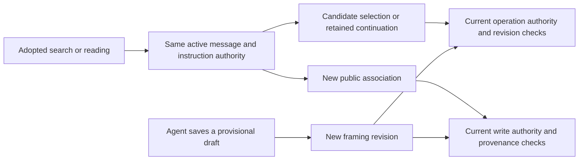
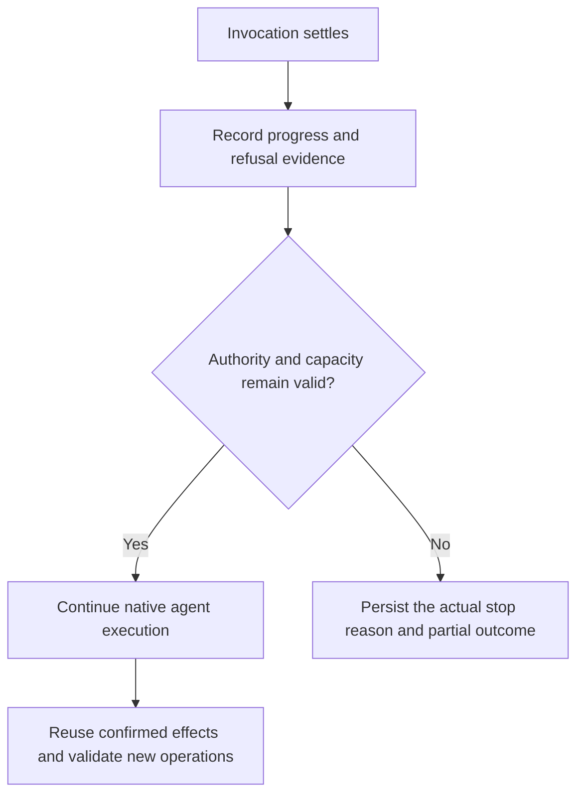

# Framing contracts and documentary continuity

This technical design develops the [request](10-request-framing-harness-corrections.md) from the verified [research](12-research-framing-harness-corrections.md). The sixteen researched source files matched their recorded hashes at design entry. System design and program design, including the pinned-conversation compatibility choice, were separately approved on 2026-11-20. No implementation is authorized by this document.

## System Design

### Retained observations survive an agent's provisional saves within the same authority

Accepted during system design: reading and new public associations remain authorized across an agent's provisional saves within unchanged authority. Today, saving a draft changes the framing revision and makes earlier search candidates, read continuations and newly cited readings fail freshness checks. Existing saved associations have a separate inheritance path.

Observation lifetime follows the authority that admitted it: same dossier, mission, active message and instruction version, successful adopted observation, and valid current execution. An agent's own provisional save does not invalidate that observation. Its candidates remain selectable, its retained text remains continuable, and its passages remain eligible for a new public association. Eligibility establishes provenance, not relevance or entailment.

Every new operation still binds to the current revision and checks freshness at execution and adoption. Draft writes still enforce current revision, original-message edit authority, protected analyst edits and all applicable provenance/date requirements. Analyst edits, steering, new turns, cancellation and foreign references retain their independent authority checks. Historical display and unchanged saved-association inheritance keep their existing contracts.

When access is genuinely refused, typed feedback distinguishes a reference that was never observed or adopted from an observation whose authority no longer matches, and from an invalid candidate or continuation. Expose only distinctions supported by current authorized state; the agent receives the actionable reason without gaining access to foreign records. A provisional save under unchanged authority must not be reported as an unobserved reference.



The reading-only alternative was not selected: requiring another revision-specific validation before citation would leave the end-to-end sequence dependent on an additional mechanism solely because a draft was saved.

### The existing framing operation exposes the requirement known from current state

Accepted during system design after the isolated live comparison: keep `adjust_framing` as the operation that creates and revises the proposed program. Its model-facing projection makes `activityExcerpt` required in an explicit open basis when no scope is established. Populated drafts retain legitimate inheritance and unchanged-scope forms. The model chooses the quoted activity; the harness does not invent an anchor or substitute a generic scope.

An [isolated live comparison](framing-tool-probe/report.md) exercised twelve model responses with equivalent state-specific schemas: six of six single-operation responses and five of six separate-tool responses passed the existing write owner. One separate-tool update introduced an invalid analyst condition attribution. This small naming comparison supports retaining the simpler interface, but does not establish model superiority or qualify the full runtime. The [archive receipt](framing-tool-probe-archive-receipt.json) records verified local preservation of 52 selected files; it does not establish full runtime reproducibility or off-machine backup.

The business owner still checks relationships that depend on the submitted values: exact quotation, inclusion in scope, changed-scope authority, condition provenance and protected analyst edits. A diagnostic names the precise missing field or failed relationship. An initial missing-anchor correction requests `eventBasis.activityExcerpt` explicitly, without directing an unrelated scope-only repair.

The existing projection and offline preparation mechanisms receive the same finite state variants; the actual serialized schemas and state transitions are verified together. The static schema remains a structural contract, not a substitute for stateful authorization or semantic judgment.

| Viable approach | Benefit | Trade-off |
| --- | --- | --- |
| Refine the existing operation's state-dependent projection | Uses the existing write owner, normalization and native tool preparation; keeps one model-facing operation. Recommended. | Requires complete variant calibration and tests for initial writes, subsequent writes and retained versions. |
| Separate initial creation from later revision into two tools | Makes the lifecycle distinction visible through separate operation names. | Adds another tool contract and routing surface while both operations still need the same domain validation and persistence. Technically possible, not required by the observed failure. |

### Non-progress remains observable without automatically stopping after three invocations

Accepted during system design: remove the shared automatic transition to `blocked / repetition_stop` when three settled invocations report no new progress. Continue recording the existing progress and refusal evidence without introducing a replacement numerical threshold or speculative loop detector. Apply this consistently to the shared invocation settlement path used by Workbench and Sources; unrelated preparation-stall detection retains its distinct purpose.

Before another generation or operation, existing cumulative capacity, deadline, cancellation, current execution authority and stale-result checks remain authoritative. Confirmed external effects retain their existing reuse behavior. Removing this early stop permits another correction or inspection within the granted envelope; it does not guarantee useful progress and can consume more of that envelope. Exhaustion remains an explicit partial or blocked outcome and must never be converted into successful completion.

Historical `repetition_stop` records remain readable and retain their recorded meaning. This change neither resumes stopped missions automatically nor enlarges previous grants. The program design must cover both continued work past the former threshold and enforcement of independent stop conditions through the real shared execution boundary.



## Program Design

### Derive the initial schema from the canonical framing contract

Keep the existing production modules and operation name. In `convex/domain/framingContracts.ts`, derive the required-anchor open variant from `provisionalOpenEvent` using its existing field definitions, replacing only the optional `activityExcerpt` with the required field. Compose the initial directed event-basis union from the same existing branches; do not copy condition structures into the model projection. Add a small domain state classifier for an empty versus established scope and use it in both projection and the corresponding business-validation branch. A scope containing only whitespace is initial; the number of questions alone does not determine anchor inheritance.

In `convex/domain/workbenchContracts.ts`, derive the initial directed framing input from the canonical operation input, requiring explicit `eventBasis`. The broad persisted operation validator retains valid historical and inherited forms. `framingProvenance.ts` continues enforcing exact quotation, scope inclusion, changed-scope authorization, condition associations and protected analyst edits. Schema acceptance never substitutes for these checks.

```ts
// Proposed domain and projection shapes; existing owners, no new service.
type FramingWriteState = "initial" | "established";
function framingWriteState(content: FramingContent): FramingWriteState;

type WorkbenchToolAvailability = {
    framing: false | FramingWriteState;
    // Existing message, approval and documentary availability fields remain.
};
```

Replace the existing `framing: boolean` in the private projection context with `false | "initial" | "established"`, rather than adding independent booleans that permit contradictory combinations. `modelOperation` derives this from the current authorized snapshot; `nativeToolSets` enumerates the same finite variants. Both call the existing `projectWorkbenchOperation` and `nativeWorkbenchOperation`. Mechanical revision/message binding remains in `normalizeOperationInput` and cannot manufacture a missing activity excerpt.

```text
Current authorized framing snapshot
  → framingWriteState
  → projectWorkbenchOperation
  → nativeWorkbenchOperation selects the canonical initial or established input
  → actual Pi serializer and prepared input-profile identity
  → model response
  → offered-schema validation
  → normalization binds message/revision
  → canonical operation validation
  → framing business validation and persistence
```

The initial variant must appear in actual serialized provider input before generation. After a successful save, subsequent prepared input must use the established variant and current revision. Profile preparation in `piModelProfiles.ts` consumes the enumerated variants through its existing mechanism; no separate schema registry, serializer or fallback profile is introduced. Missing preparation remains an explicit refusal.

### Preserve pinned model contracts while correcting shared behavior

Accepted compatibility choice: register the next available Workbench definition version (9 at this checkout; version 8 is the retained-method control) and make it the default for new conversations. Retain versions 4–8 and their model-facing schemas, instructions and method packages. The new version reuses version 7's on-demand skill package and existing operation objects, adding state-dependent schema projection without duplicating operations. Extend the existing capability predicates in `workbenchContracts.ts`; do not scatter new version checks among callers. The catalogue remains the single source for default selection and registered profile variants.

Existing conversations are not silently upgraded. They retain their offered schema, including its historical optional anchor, while benefiting from the corrected precise business feedback and applicable shared execution/observation fixes. New conversations exercise the strengthened schema. This is an explicit rollout limitation, not a claim that all pinned schemas have been repaired. Tests must cover this split, including the qualification-only retained-method definition without widening its admission authority. No new qualification control arm or historical mandate is activated.

### Keep field feedback aligned with the enforcing validator

`framingProvenance.ts` reports a missing `eventBasis.activityExcerpt` as a missing field. A separate scope-inclusion failure identifies `content.scope`; a condition attribution failure retains its exact condition path. In `workbenchAgent.ts` and the existing outcome-rendering boundary, preserve this specific validation feedback instead of appending a contradictory catalogue of alternative event bases. Retain generic guidance only where no more specific validation is available. Verify the actual serialized tool result, not just the thrown error. Do not add a prompt-only repair loop or phrase classifier.

### Reuse one observation-authority rule across access and citation

Add the shared authority predicate alongside the existing adopted-observation readers in `convex/domain/workbenchContracts.ts`. It takes retained request records and the current operation's already-verified mission/message/instruction authority, using generated Convex types. It checks dossier and mission membership, message/instruction identity, completed successful adoption and absence of adoption refusal. It does not compare the retained observation's framing revision with the latest draft. Its result distinguishes unavailable/unobserved observations from changed authority without exposing foreign data.

Both candidate selection and continuation in `workbenchPublicContext.ts`, and fresh citation validation in `framingProvenance.ts`, consume this same rule. Existing readers continue validating result shapes, passage content and observation identity. Candidate index validation and exact continuation-target matching remain in their respective consumers; they are different responsibilities and must not be folded into a generic validation framework. Historical display and unchanged saved-association inheritance remain separate paths.

```text
New read or write request
  → verify current generation, instruction authority and current revision pin
  → load retained observation
  → verify shared observation authority and successful adoption
  → validate candidate index / continuation target / cited passage
  → execute or reuse the observation
  → recheck current authority before adoption or write
```

Update domain diagnostics at the existing operation-outcome boundary to distinguish an unobserved reference, changed observation authority and invalid selection/continuation. Select closed error codes and structured paths within the existing error/result conventions; preserve historical codes and receipts. Do not remove the current request pin, adopt foreign observations, reread a document silently, or introduce a separate observation store or lifetime token. Legacy verification observations use the same authority principle where their existing version contract permits citation.

### Remove both automatic-stop branches and keep settlement idempotent

Change `invocationProgressSettlement` in `convex/execution/invocationLifecycle.ts` to return diagnostic progress/recovery observations without `stopped`. Remove the threshold comparison, the counter clamping that existed to spare the first completion refusal, and the now-unused `MAX_NO_PROGRESS_TURNS` constant in `resourcePolicy.ts`. Keep the established diagnostic accounting semantics and successful context/restoration observations; none may grant additional resource authority.

Update both consumers: settled operation invocations become ready once all requests have settled, and rejected completions retain `completion_correction_required` with actionable feedback. Neither creates a new `repetition_stop`. Repeated settlement must not increment counters twice or duplicate events. Independent admission, completion-validity and provider-accounting checks retain their authority.

```diff
 invocationProgressSettlement(...)
-  return { noProgressTurns, recoveryRead, stopped }
+  return { noProgressTurns, recoveryRead }

 settle operation results
-  stopped ? blocked(repetition_stop) : ready
+  ready after existing authority and settlement checks

 reject invalid completion
-  stopped ? repetition_stop : completion_correction_required
+  completion_correction_required with retained validation feedback
```

Search all `repetition_stop` consumers during implementation. Preserve historical schema values, renderers and stop summaries; remove only obsolete production emission and threshold-dependent branches. Do not alter `native_preparation_stalled`, effect reuse, cumulative resource grants, cancellation or deadline mechanisms as collateral cleanup.

### Verify complete transitions through the real registered boundaries

Implementation follows RED → GREEN → REFACTOR with retained production imports. Start each changed contract at the existing Convex operation/native-loop integration boundary, mocking external provider I/O only. Narrow tests are appropriate for state/union permutations, but must be accompanied by the consuming integration path.

| Contract | Required executable evidence |
| --- | --- |
| Schema and binding | Actual serialized initial versus established schemas; missing initial anchor rejected with exact feedback; valid repair persisted; unchanged-scope inheritance remains valid; changed scope without authority refused; schema/profile refresh after save; message selection and pinned versions preserved. |
| Documentary continuity | Search two candidates, read one, save a provisional draft, then read the second, continue the first and add a new citation from the retained passage. Assert persisted outcomes and no unintended reacquisition. |
| Documentary boundaries | Analyst edit/instruction change, foreign or unadopted observation, invalid candidate, mismatched continuation, cancellation and stale adoption still refuse with the correct outcome. Historical display and existing-association inheritance remain valid. |
| Non-progress continuation | More than three settled non-progress invocations followed by a useful operation and successful completion; multiple completion refusals followed by correction; applicable Workbench and Sources registered paths; settlement replay does not double-count. |
| Independent limits | Exhausted capacity, cancellation, deadline and stale-generation enforcement still prevent unauthorized calls/adoption; confirmed effects are reused; unknown dispatch is not retried blindly. |
| Compatibility | New default and retained definitions resolve, all emitted schemas have prepared identities, retained stop records remain readable, and no stopped mission or previous grant is silently reopened. |

Extend the existing suites for framing receipts/native interface, bounded refusal recovery, framing completion, input capacity/profile identity and registry operation conformance. Reuse the archived continuity reproduction as a regression input, not as copied production logic. Replace obsolete tests asserting the three-invocation stop with continuation and genuine-limit assertions; do not merely delete coverage. Prune duplicate micro-tests once the complete boundary proves the same behavior.

After focused behavior stabilizes, run applicable execution-boundary/conformance checks, backend/application type checks for affected imports and tests, and documentation checks. Use the repository's profile-preparation owner rather than manually editing generated profiles; any required paid preparation remains a separately identified external action. A local runtime verification must use the existing watcher and prove successful publication before exercising changed behavior. No paid qualification, deployment or backend publication is authorized by this design approval.

### Update current owners and preserve historical evidence

Implementation updates the applicable capability, version and execution contracts in `context/TECH.md` and delivery status in `docs/ROADMAP.md`. Search historical descriptions for supersession notes where they would otherwise imply the old stop or revision-bound observation behavior remains current. Keep raw qualification and probe evidence immutable. Do not modify `PRODUCT.md`, runtime skill content, UI, dependencies or unrelated evaluation transport as part of this correction batch.

## Patterns to Follow

- Extend canonical framing validators and existing tool projection/preparation in `convex/domain/framingContracts.ts`, `convex/domain/workbenchAgent.ts` and `convex/integrations/piModelProfiles.ts`; keep state-dependent requirements localized instead of copying them into prompts.
- Keep documentary access and write provenance in their current owners, `convex/workbenchPublicContext.ts` and `convex/domain/framingProvenance.ts`; reuse current mission, instruction and adoption evidence.
- Change shared invocation settlement at `convex/execution/invocationLifecycle.ts`; preserve Pi's native continuation and existing provider accounting, cancellation and effect-reuse owners.
- Verify complete outcomes through real operation enqueue/dispatch, native continuation and persisted framing. Mock external providers only; use the retained diagnostic drafts and the research reproduction as evidence inputs.

## Scope

The approved bounded design covers framing schema/diagnostic coherence, removal of the automatic three-invocation non-progress stop, and documentary continuity after provisional saves. Existing historical `repetition_stop` records remain interpretable. System design, program design and the compatibility choice are approved; implementation remains a separate next step. Live judgment improvement and Sources usefulness remain separate qualification questions.

## Implementation follow-up — November 20, 2026

After the separate implementation authorization, the approved correction batch was implemented and locally verified. See [the implementation record](14-implementation-framing-harness-corrections.md) for RED/GREEN evidence and remaining qualification boundaries. The original design approval and authorization statements above describe the design stage and are preserved.
