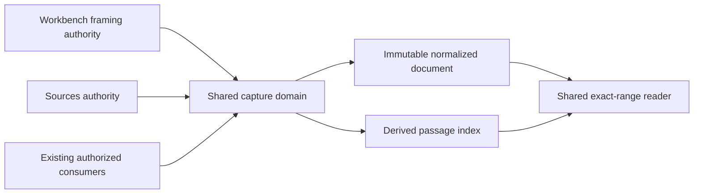
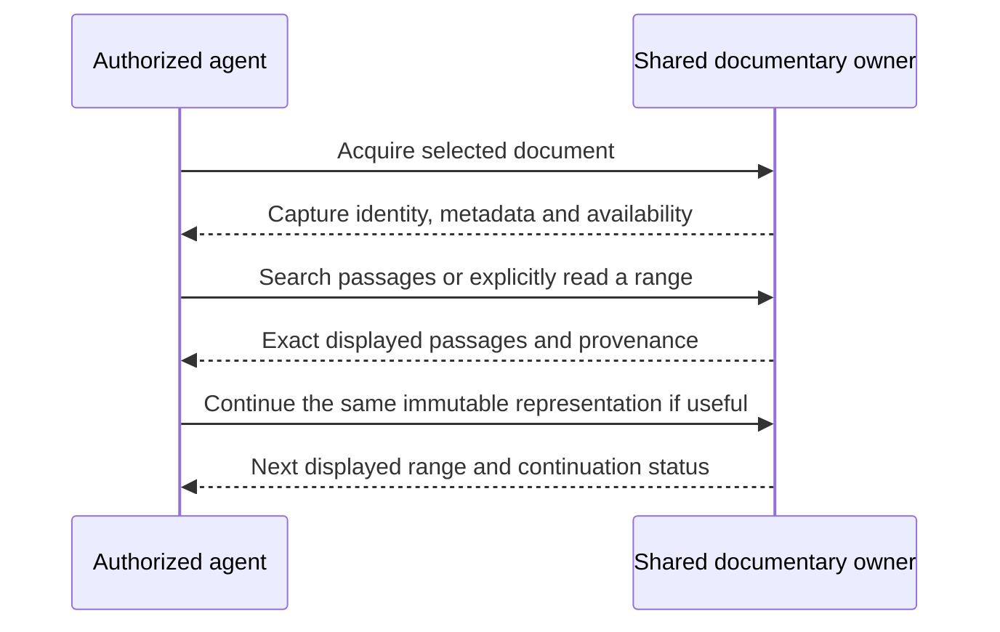

# Technical Design: Documentary Engine Unification

This document develops the design requested in [15-request-documentary-engine-unification.md](15-request-documentary-engine-unification.md), using the verified implementation and validation findings in [17-research-documentary-engine-unification.md](17-research-documentary-engine-unification.md). The user approved both System Design and the final revised Program Design, including the short reference-based reading interface and forward continuation from a match. The [initial Oracle review](19-review-documentary-engine-unification.md) and its [targeted recheck](20-recheck-documentary-engine-unification.md) preserve their findings and the final bounded corrections. Those last corrections were approved by the user without a third Oracle review. This approval completes the TDD; it does not authorize implementation.

## System Design

### Framing and Sources use the existing capture domain as their common documentary representation

The user selected extending the existing capture representation to framing. Immutable normalized bytes, document identity, the derived passage index and reading behavior have one documentary owner across framing, Sources and existing consumers. The alternative of permanently retaining two storage representations behind common processing was considered but not selected: it would preserve separate identity and cleanup lifecycles.

Today capture creation requires a Sources preparation, whereas public framing reads retain full acquired text as operation observations. The target separates capture identity and storage from the phase-specific authority that permits acquisition or reading. Framing acquisition must not require fabricating a Sources preparation or approval. Program Design below specifies the stored metadata, authority pins and caller changes.



Capturing a document before Start does not start Sources, qualify its documentary contribution or expand permission to use it. Phase-specific authorization remains enforced by the server. Subsequent decisions must define the acquisition result, agent-facing access, reuse across Start, compatibility, provenance and cleanup without introducing a second documentary engine.

### Acquisition returns document metadata; text enters through explicit search or reading

Historical inspection, recorded in the research, establishes that `read_public_context` was designed as a selected reading: acquisition returned its first passage, and subsequent calls continued the same immutable text without reacquisition. Each returned extent had an adopted read identity usable by framing provenance. Retained text avoided requiring a Sources preparation before Start. No separate justification for the relevance of the opening page was found in the inspected plan, execution record or introducing commits.

Acquisition returns immutable capture identity, recorded documentary metadata, representation completeness and access/index availability, without an opening page or automatically generated documentary summary. A successful capture with indexing unavailable remains distinguishable from unavailable acquisition. Program Design specifies result construction and recovery.

The agent explicitly chooses targeted search or reading. Reading from the beginning and continuing through the complete captured representation remains supported without requiring a successful keyword match. Reading is bounded by the shared response policy, with explicit range, completeness and continuation; this is pagination, not an independent mission allowance. A short document can still be returned completely when an explicit reading requests it and it fits the response envelope.

Captured bytes, returned metadata and actually displayed passages remain distinct. Acquisition alone establishes no observed passage for a new framing citation. Shared search and reading results must carry enough immutable identity, exact offsets and adopted observation identity to validate any returned passage used as provenance. Neither an unseen indexed passage nor a guessed locator is read evidence.



### Shared agent tools retain lexical retrieval for this unification

The user selected preserving the lexical retrieval currently used by Sources and shared saved-material tools. Framing receives that same mechanism through the common documentary owner. This design does not activate semantic retrieval or new embedding calls for those tools, and does not claim that lexical ranking is superior.

Existing hybrid preparation/comparison consumers remain supported through their current retrieval policy and provider controls, sharing canonical document bytes and indexing behavior where applicable. They must not become an independent parsing or reading implementation. Any later proposal to activate hybrid retrieval in the common agent tools requires separate relevance evidence and the corresponding execution authorization; it is not a prerequisite for this unification.

### Contextual reading is available in both citation modes and required only when configured

The context-reading obligation is configurable and disabled by default. A single canonical citation policy is enforced by the shared server-side provenance owner at the framing-write boundary. Its effective turn snapshot is exposed as structured authoritative tool-contract data, not enforced by prompts. Documentary skills teach reading and judgment, not server permission. Callers must not carry independent defaults or eligibility rules. The protected backend setting applies to the next Workbench turn and remains fixed during the active turn; no new administration interface is required.

With the obligation disabled, an exact excerpt actually returned by an adopted search or reading may support a new framing citation, subject to the same authority, immutable capture identity, passage location, documentary date and use restrictions. With the obligation enabled, a new framing citation requires an adopted contextual reading; search excerpts alone are insufficient. Acquisition receipts, metadata-only results, unseen indexed passages and guessed locators are insufficient in both modes. Switching this obligation does not disable the contextual reader.

The shared contextual reader returns the exact displayed text, capture identity and hash, character offsets, documentary date provenance, completeness and continuation where applicable. Search results identify their exact returned passages for validation when the obligation is disabled. Framing provenance resolves eligible adopted observations under the effective policy and rejects stale authority and mismatched identities. Beginning and match references use the same reader; a match can continue forward to the capture end through explicit next-reference calls.

The model cannot satisfy the obligation by claiming it read context, supplying a flag, or passing an acquisition or search ID. When enabled, the server must resolve the proposed citation to the exact displayed passage in a successfully adopted contextual-reading operation under the required authority. An attempted write supported only by a search result is refused without changing the framing revision, regardless of the model's instructions or output. With the obligation disabled, the owner may accept an eligible exact search excerpt; mandatory identity, authority, dates and documentary-use checks remain enforced.

Neither mode proves semantic entailment or general context sufficiency. Sources qualification and documentary-use restrictions remain separate from framing inspection/citation permission. Valid historical associations retain their recorded provenance. Integration regressions must attempt a real write that bypasses model guidance: reject search-only support when enabled, accept eligible search support when disabled, accept contextual reading in both modes, and preserve the existing revision on refusal. Model-input checks cannot substitute for those server-write regressions.

### Start makes every dossier capture available under Sources authority without selecting it

The user selected making all dossier captures available to Sources after explicit Start, including captures not cited in the fixed framing. The captured bytes and document identity remain reusable; Start does not require reacquiring them merely because the phase changed. A new acquisition remains possible under the existing external-I/O policy when actual freshness or representation needs require it. Newly acquired content never silently replaces the immutable representation referenced by a prior reading.

Availability does not create a qualified contribution, retained membership, claim or analyst approval. Sources decides relevance and qualifies documentary use under its own mandate. The material inventory must distinguish these states. Availability also does not require injecting the document text or the entire inventory into every model request; its concrete projection is a program-design concern.

Authority is rechecked for each new operation under the current phase, mission, generation and instructions. A framing continuation is not a transferable Sources grant. An agent's provisional save preserves continuation and new citations while mission, active message and instructions remain unchanged; analyst edits, steering, cancellation and Start retain their existing authority boundaries. Captured bytes may persist after those boundaries change, but an old observation or continuation cannot authorize a new use by itself.

The current launch already creates an active draft corpus, and source identities belong to the dossier. Reuse those facts without manufacturing preparation or corpus approval. Capture/index identity and phase-specific access are disentangled at their current owners as specified below.

### Historical public text enters the common engine on first reuse

The user selected conversion on first reuse instead of a mandatory whole-dataset migration before activation. Reusing an old retained public document imports its exact verified bytes and metadata into the shared capture domain. Import is idempotent and binds the original observation/document hash to the resulting capture. It performs no provider call and does not reinterpret capture time as publication or event time. Missing text, hash mismatch, unsupported representation or lost authority produces an explicit unavailable/refused result rather than reacquisition or a partial import presented as complete.

Historical operation results, read IDs, quotations and framing associations remain immutable. The compatibility path translates existing identities and wire shapes to the shared owner; it does not maintain an independent parser, search index or continuation engine. Supported pinned definitions retain their observable contracts and are not silently repinned. Newly introduced acquisition/reading contracts apply through the registered version mechanism. The exact binding/version transition is part of program design.

New acquisitions store complete normalized bytes only through the capture owner. Execution observations retain receipts and returned extents rather than creating a second full document store. Existing historical retained bytes may coexist with imported capture bytes while historical references still require them; cleanup must establish reachability before releasing either representation. Conversion is not permission to delete historical evidence or run a deployed migration.

### Acquisition, indexing and displayed reading have distinct outcomes

The target lifecycle preserves the existing capture reservation, upload, commit and reconciliation mechanisms, generalized to the calling authority. Before external I/O, the existing executor admits the operation and its provider work; the documentary owner validates the selected target and binds acquisition identity. Cancellation or stale generation can settle known provider facts without adopting new documentary state or initiating another call.

The immutable capture is authoritative for normalized bytes, hash, retrieval/normalizer versions, requested/resolved URL and representation completeness. The index is derived and versioned; building or rebuilding it reuses verified bytes and the existing parser rather than reacquiring the URL. A successful capture can be distinguished from an unavailable or incomplete index. Search must report explicit index/parser limitations; an empty result is not proof that the document lacks relevant information. Reading a known range must not require a keyword match.

Result contracts distinguish the following cases. Precise validators and typed codes will be specified in program design using existing outcome conventions:

- Acquisition: available immutable document with metadata, partial representation where known, unavailable acquisition, refused authority or target, and uncertain external dispatch.
- Search: exact returned matches with verified locators, no matches, more results, index unavailable or explicitly limited, and refused/stale continuation.
- Contextual reading: exact displayed extent with capture identity and continuation, completed requested range, missing/corrupt representation, and invalid or unauthorized range/continuation.

Response pagination, acquired representation completeness and indexed coverage remain separate. Reuse the canonical resource policy and its actual units; do not add a new document-count, token or mission-duration cutoff for this integration. Correct the inaccurate indexed-search limits identified in `context/TECH.md` when the approved contract is implemented, without reinstating obsolete bounds.

### Pi retains conversation ownership while the documentary owner retains document bytes

Search and reading return bounded exact text through native operation results. Acquisition returns no document body. Current authoritative state exposes availability, effective citation requirements and compact observation references without copying complete captures. Existing framing excerpts may remain where needed to represent the saved decision; this is not a second summary store or a promise of zero repeated text.

Pi remains responsible for transcript persistence, generation and native compaction. There is no application-managed replacement history or automatic document summary. Native serialization verification must inspect the actual provider request after acquisition, search, reading, provisional save and continuation; an intermediate context object alone is insufficient evidence. No paid call is required to verify those mechanics with the existing controlled transport.

### Shared document cleanup includes historical observation storage

Dossier purge must enumerate its captures, derived indexes and historical public-operation retained text through the existing lifecycle owners. Release a blob only when no capture, source version or upload lease still references it. Preserve purge pagination, idempotency and reconciliation; do not duplicate deletion logic in an agent definition or import caller.

The missing explicit operation-observation cleanup found during research is in scope for this documentary ownership correction. The shared embedding cache has no dossier key and is not the same ownership problem: preserve the existing profile/text-hash cache unless a concrete retention requirement requires a separate decision. No global cache eviction framework or retrospective deployed orphan cleanup is implied.

### Acceptance verifies the combined pre-Start workflow and its authority failures

The primary deterministic integration path is acquisition without returned text, targeted search, contextual reading when requested or required, successful agent provisional save, continued reading of the same capture and a new citation in the same pre-Start mission. It must use real operation admission, dispatch, adoption and framing persistence without fabricating Sources approval. Repeat the relevant citation-write assertions with the context-reading obligation enabled and disabled.

Additional coverage must verify direct reading from the beginning without a search hit; Sources reuse after Start without implicit qualification or repeated acquisition; stale/foreign/cancelled access; invalid continuation and changed capture identity; retained-text import, corruption and idempotency; shared-blob purge safety; and existing retained/hybrid consumers. Use narrow pure tests only for combinatorial parser/range logic, and integration tests for authority, persistence and workflow effects. Exact test placement and RED checkpoints belong to program design. Hosted relevance, live model judgment and a paid qualification are separate evidence and authorization steps.

## Program Design

The approved target code shape extends the existing capture lifecycle (`convex/sourceCaptures.ts`), acquisition (`convex/sourceCaptureActions.ts`), retrieval (`convex/sourceRetrieval.ts`, `convex/sourceRetrievalActions.ts`) and shared operation contracts (`convex/domain/savedMaterialOperations.ts`, `convex/domain/savedMaterialAgentOperations.ts`). It specifies future implementation contracts; no target production behavior has been implemented by this design task.

### Workbench and Sources expose one acquisition operation

The user selected a shared `acquire_document` operation for new Workbench and Sources definitions, with applicable acquisition targets projected by the harness for the current phase. Both use the same capture owner and metadata-only acquisition result. Existing selected-candidate, analyst-supplied and Sources identity checks remain enforced before external I/O. Exact model-facing target parameters are not yet finalized.

### The model follows one reading reference instead of assembling range parameters

The user selected `read_in_context({reference})` after comparing it with the more complex capture/target/range/continuation input. Acquisition emits a reference for reading from the beginning, each search result emits a reference for contextual reading, and each reading result emits a next reference when more of the requested extent remains. The model copies that value; it does not reconstruct capture identity or combine cursor and range arguments.

Resolve the reference within the existing saved-material operation owner, reusing observed-result identity and continuation mechanisms rather than adding a generic reference registry. Internally, the resolved request binds the immutable capture/hash, exact range or focal passage, current authorized scope and continuation position. A reference is data, never authority: verify that it was actually offered by the corresponding adopted observation or authorized current-material projection, then recheck current access. Foreign, fabricated or stale references are refused; they never trigger another document acquisition.

The shared reader retains its internal exact-range API for existing consumers. The new agent tool offers reading locations supplied by acquisition, search and continuation; it does not expose arbitrary range construction. This refines the approved system design's reading interface without removing full reading from the beginning or contextual passage access. Encoding, result fields and compatibility projections are specified below.

The [interactive reading-contract comparison](diagram-reading-contracts.html) illustrates both alternatives for opening the beginning, opening a search match and continuing a range. Handle values are illustrative; the acquisition input is not specified by that diagram.

### The effective citation policy is captured once per Workbench turn

The user selected applying configuration changes to the next Workbench turn, without redeployment. Add the policy validator and the one default to the existing framing contracts:

```ts
// convex/domain/framingContracts.ts — proposed contract
const framingCitationPolicy = v.object({
    revision: v.number(),
    requireContextRead: v.boolean(),
});
const DEFAULT_FRAMING_CITATION_POLICY = {
    revision: 0,
    requireContextRead: false,
} as const;
```

Add `framingCitationSettings` in `convex/schema.ts`, with one `global` row, policy revision and update time. A concrete `convex/framingCitationPolicy.ts` module owns reading defaults and protected administrative get/set operations; setters require the existing administrator authority and compare `expectedRevision` before incrementing the policy revision. This is a specific configuration owner, not a generic settings framework or a model tool. No administration UI is added.

Add optional `framingCitationPolicy` to `agentConversationTurns` in `convex/execution/schema.ts`. `claimTurn` snapshots it when creating a new turn, following the existing response-control snapshot pattern without sharing that unrelated policy. Resume, provisional save and steering within the same turn do not reload the global setting. New-version turns must have the snapshot; a missing snapshot on that path is an explicit contract failure, not a live-settings fallback. Historical turns lacking it retain their pinned definition's existing citation contract.

`readWorkbenchFacts` exposes the effective snapshot as structured tool-contract data in the authoritative current-state section. The tool description can statically identify that field; do not construct a new root instruction or duplicate the boolean rule in descriptions. The framing provenance owner reads the same stored snapshot when validating a write. Raw policy configuration remains outside analyst UI projections. An administrator's later change cannot retroactively invalidate a saved framing association.

Project that policy field only for bindings supporting the new citation contract; a historical binding must not be told that default-false settings override its own retained input/reading rules. The pin's causing instruction version must equal the authoritative request/turn version, rather than becoming a second editable version source.

Update both the `analystConversationTurn` validator and `conversationTurnForAnalyst` in `execution/conversations.ts` to omit the new raw policy field, following their existing exclusion of `responseControl`. Apply the same projection to direct conversation/Workbench query callers; merely adding the field to a persisted turn would otherwise expose it. Protected administration and execution diagnostics may inspect the effective snapshot.

### New tools use supplied references and keep capture selectors internal

The following is the proposed model-facing input surface. These are target contracts, not manually maintained DTOs for Convex data; implementation types must derive from canonical validators and generated records.

```ts
acquire_document({ reference: string })
search_available_material({
    reference: string,
    query: string,
    continuation?: string,
})
read_in_context({ reference: string })
```

For acquisition, discovery results and Sources inventory supply acquisition references. The active analyst's exact public HTTPS URL is also admissible before Start only when its causing message is unambiguous. Otherwise the authoritative message projection supplies an explicitly message-bound URL reference, and the model selects it without an additional bookkeeping parameter. The server resolves the candidate/source and applicable phase from observed state; the model supplies no mission, preparation, generation, provider or effect-kind flag. Unobserved candidates, other messages' URLs and wrong-phase targets are refused before DNS or provider admission.

Search also takes an issued document reference instead of a bare capture ID. This keeps the selected short schema while retaining the causing-message context required for multi-message Workbench turns. Both the acquisition result and the current authorized inventory offer the applicable document reference. A returned match reference can be resolved back to its document for another search, retaining that verified cause. Search continuation must remain bound to the same reference authority, capture/hash and query.

An acquired document result includes source/capture identity, content hash, recorded document dates and metadata, representation completeness, acquisition time, index availability and a `readingReference` for the beginning. It contains no automatic opening text. A search match carries an exact quotation, heading and a `reference` identifying the displayed match. The same match reference can open a contextual reading. A contextual reading returns its displayed text, verified extent and `reference`, with `nextReference` when the selected extent continues. Continuation references select future reading; they do not establish that future text was displayed.

References identify specific items in existing adopted operation observations, or an available document in the authoritative material projection. Extend the existing private continuation representation with a version and issuing-observation/item selector; retain capture/hash, range and scope resolution internally. Resolve selectors against the actual issuer result and immutable capture rather than trusting client-supplied decoded fields. No new handle table, generic reference service, signature-as-authorization scheme or extra model call is needed. Use one encoder/resolver in the existing saved-material owner; do not copy token parsing into agent definitions, UI or provenance validation.

Use validated serialized JSON, as the existing continuation mechanism does. The target private discriminated union is shown below; it is not exposed as the model's input schema. Indices select items in the exact immutable returned array, never unreturned database matches. A reading's single displayed extent is item zero. A `next` selection resolves its extent from the issuing reading's recorded range/end rather than accepting a client offset.

```ts
type DocumentaryReference =
  | {
      version: 2;
      issuer: "operation";
      operationId: Id<"agentOperationRequests">;
      item: "candidate" | "document" | "passage" | "next";
      index?: number;
    }
  | {
      version: 2;
      issuer: "source";
      sourceId: Id<"sources">;
      conversationCause?: ConversationCause;
    }
  | {
      version: 2;
      issuer: "capture";
      captureId: Id<"sourceCaptures">;
      conversationCause?: ConversationCause;
    }
  | {
      version: 2;
      issuer: "analyst_url";
      messageId: Id<"agentMessageDeliveries">;
      url: string;
    }
  | {
      version: 2;
      issuer: "retained_document";
      rootOperationId: Id<"agentOperationRequests">;
      conversationCause?: ConversationCause;
    };
// ConversationCause derives from the canonical validator below.
```

The canonical validator narrows which item requires an integer index and rejects unknown or mixed fields. Source/capture references are resolved against the current authorized inventory; operation references require an adopted issuer with the expected result kind and eligible authority. `resolveDisplayedPassage` accepts only a displayed `passage` reference for citation. `candidate`, `document`, `next`, source and capture references cannot become citations by themselves. The read resolver accepts document/capture beginnings, offered match contexts and recorded continuation extents as applicable. The acquisition resolver accepts an observed candidate or source target, or the authorized analyst URL. All three are concrete interpretations in the same owner, not a generic resolver plug-in system.

`conversationCause` is required for Workbench inventory references before and after Start, and absent for Sources/inspection references. The server checks it against the actual active instruction/message projection rather than trusting the encoded value. Operation references inherit their cause from their verified issuer. An `analyst_url` reference must match a URL in that exact active message and is an acquisition target only before Start. Bare URL ambiguity is a refusal with the applicable issued references, never an inferred first message.

A `retained_document` inventory reference identifies the bytes of an adopted historical public document, not permission to reuse its old reading as current citation evidence. Resolve the root/hash from its immutable observation and retained manifest under current dossier access. It permits lazy local import during the new authorized operation; subsequent displayed text receives the new operation's own cause/provenance. Include such unimported roots as metadata-only inventory entries where needed, without duplicating every continuation page or injecting retained text.

The resolver exposes a query-safe displayed-passage result for citation validation, derived from the adopted immutable operation result and pinned capture metadata. It does not require an action, storage download or index build during the framing mutation. Exact stored bytes are verified by acquisition/search/reading before adoption; provenance validates that trusted displayed result rather than repeating external or storage I/O in the writer.

For current-state inventory references, eligibility derives from current dossier capture access. For operation-issued references, eligibility derives from both successful adoption and current access. Provisional saves preserve eligible framing observations under unchanged mission/message/instruction authority. Start or a new authority context can reuse capture bytes through freshly authorized inventory references; it cannot reuse an old operation token as a grant.

### Documentary pins retain both the exact capture and the causing authority

The current shared material pin records only capture/hash, while `framingObservationRefusal` expects a framing pin and `input.messageId`. Introduce one closed documentary pin for new operations; retain the old variants for supported requests. The server constructs it after resolving the reference and rechecking authority:

```ts
// Proposed private pin; canonical Convex validators own the types.
type ConversationCause = {
  messageId: Id<"agentMessageDeliveries">;
  instructionVersion: number;
};
type DocumentaryScope =
  | { kind: "framing"; cause: ConversationCause;
      revisionId: Id<"framingRevisions"> }
  | { kind: "workbench_read"; cause: ConversationCause;
      corpusRevisionId: Id<"corpusRevisions">;
      preparationId?: Id<"sourceSelectionProposalRebuilds"> }
  | { kind: "sources"; preparationId: Id<"sourceSelectionProposalRebuilds">;
      needsRevision: number }
  | { kind: "inspection"; corpusRevisionId: Id<"corpusRevisions"> };
type DocumentaryPin = {
  kind: "documentary_v1";
  scope: DocumentaryScope;
  target:
    | { kind: "acquisition";
        canonicalUrl: string; requestInputHash: string }
    | { kind: "capture"; sourceId: Id<"sources">;
        captureId: Id<"sourceCaptures">; contentHash: string }
    | { kind: "retained_document";
        rootOperationId: Id<"agentOperationRequests">;
        canonicalUrl: string; contentHash: string };
};
```

Run, mission and execution generation remain in the existing request envelope. Extend the single framing observation-authority resolver to interpret either the historical framing pin/input or this documentary pin. Do not copy that compatibility switch into each reader or remove its message/instruction checks. Pre-Start acquisition/search/read requests pin the current framing revision for their own admission/adoption; post-Start Workbench reads use the separate conversation/material scope below. Previously adopted framing readings remain usable across an agent save under unchanged cause; the saved revision on an old reading does not have to equal the new current revision. Analyst changes and steering still invalidate old cause where existing authority does so.

Workbench inventory references are emitted per active-message context, and operation-issued references retain their issuer's cause. In a multi-message turn the model must select the corresponding offered reference; there is no first-message default. The normalizer may pass the reference unchanged, with server resolution performed by `pin`; it need not decode authority inside agent-specific synchronous input normalization. The stored verified pin is sufficient for query-safe provenance and provider admission without exposing bookkeeping fields in the model schema.

Pinning is query-safe and never uploads or imports bytes. If a historical document lacks a capture, pin its verified retained root/hash through the third target variant. The durable operation then performs the local import and reading/indexing. Outcome validation resolves the root/hash capture key and checks that the returned capture belongs to that import before adoption; do not mutate an admitted pin into another identity. Existing historical public-read pins remain supported by their adapter. Query-safe citation resolution reads the adopted result only after that import has completed.

### The first acquisition pins a target before creating its source row

A new discovery candidate or analyst-supplied URL need not have a `sources` row. The acquisition pin therefore binds the verified canonical URL, target provenance/cause and deterministic acquisition input identity, without requiring `sourceId`. Derive that input hash from the observed target, stable company/SEC identity where applicable and actual retrieval/normalization policy; do not include a not-yet-created source ID or enrich the reconstructed pin from a source row created later.

After operation admission, the existing authorized capture-reservation mutation creates or reuses the dossier source by its run/URL identity, verifies its consistency with the admitted target, and reserves the capture transactionally. Concurrent admissions for the same unregistered target must converge on the source identity through that transaction. Record the resulting source/capture association in the existing reservation/effect receipt; it is not an amendment to the admitted pin. Execution reconstructs the same target pin before and after insertion, as required by `operations.ts`.

Outcome validation checks the returned source's dossier/URL and capture acquisition identity against the immutable target and the retained reservation binding. A pre-existing source reference is also verified, but source creation must never become a pre-admission side effect. Historical source-ID-based acquisition hashes remain supported through their pinned contract; new canonical target hashes are independent of source-row creation. Regressions must start with no matching source row for both discovery and analyst-supplied URL paths, then verify stable re-pinning, the persisted binding and exact provider target.

### Capture storage changes minimally; preparation becomes acquisition provenance

Keep `sources`, `sourceCaptures`, the storage blob and existing derived search tables. Source rows already belong to the dossier and can exist before Sources starts. Keep capture source/run identity and the originating draft corpus as recorded provenance; index identity and current read permission must not require that originating corpus to be the current approved one.

Make capture `preparationId` optional for pre-Start acquisitions and imports. Use the existing operation request identity/capture key to bind framing acquisitions and historical import roots. Record the originating operation where needed to resolve provenance, while retaining the existing execution generation, URLs, versions, hashes, status and completeness fields. Existing preparation rows retain their fields and meaning. Never treat an absent preparation as an authorization bypass.

New capture records explicitly identify the canonical capture protocol. Store an immutable documentary metadata snapshot using `sourceDocumentMetadataValidator` and existing structured date validators, including conflicting/unknown date evidence. Extend representation completeness to `complete | partial | unknown`, and keep it separate from a qualification's selected-reading completeness. Capture availability must not convert `unknown` into `full`; extend the domain projection and existing presentation mapping with an honest completeness-unknown state, preserving the current layout. Newly imported or acquired canonical captures require explicit completeness; absence on legacy rows is handled only by their documented compatibility path.

Historical import preserves known acquisition time, publication/filing/event evidence, content hash and offsets. Missing original retrieval/normalizer provenance stays explicitly unknown. An identity-preservation import protocol identifies the conversion itself; it must not be presented as the original normalizer version. Import creation time is an operational timestamp and never fills missing acquisition or documentary dates. The stored metadata snapshot is authoritative for subsequent readings; a mutable source row cannot silently replace historical date evidence.

Generalize the existing capture reservation/attach/finalize/reconciliation functions to resolve one of the actual supported authorities: active framing operation, Sources preparation, or authorized retained-material access for local import/indexing. The external caller supplies its existing identity, not a trusted precomputed grant. Persist only after rechecking that identity. The existing `captureKey` uniqueness and committed-capture reuse remain the idempotency mechanisms; no second acquisition ledger is introduced.

Use `${runId}:document:${SOURCE_RETRIEVAL_VERSION}` as the canonical search namespace, with the existing capture/hash keys and explicit per-capture filters. Define its construction once in `domain/sourceRetrievalPolicy.ts`. This removes corpus revision from derived index identity while leaving corpus approval in access policy. Update query/index publishers, `readCaptureIndexState`, embedding-scope composition and vector filters, `SourceReviewReads`, the Sources reader, retrieval evaluation fixtures and the purge prefix owner together. Existing index rows can remain until rebuilt or purged; they are derived data, not a second maintained indexing implementation.

### One access owner removes shared authorization from the inspection definition

Extract the genuinely shared access behavior currently housed in `domain/savedMaterialInspection.ts` into a focused `convex/domain/documentaryAccess.ts` module. It owns framing, post-Start Workbench reading, Sources and retained-inspection access, exact capture ownership and active authority. This extraction is justified by real callers with different phase prerequisites; it must not become a pass-through service chain.

```text
savedMaterialAgentOperations.pin / shared acquisition pin
  → documentaryAccess resolves the current supported authority and capture

sourceCaptures reservation / finalize
  → documentaryAccess rechecks acquisition authority

sourceRetrieval capture / search / range queries
  → documentaryAccess checks access to the exact capture

savedMaterialInspectionDefinition.requireAuthority
  → the same owner, preserving inspection's approved-corpus prerequisite
```

The existing Workbench public-target owner still resolves selected discovery candidates and exact analyst-supplied URLs; Sources still owns preparation/contribution prerequisites. The access module combines those existing facts at the capture boundary instead of duplicating target validation or Sources qualification. `requireMissionAuthority` remains the execution owner; a document helper does not replace it. Scope variants are closed and derived from registered definitions, without a configurable provider/agent registry.

Post-Start conversation reads use `workbench_read`, not a framing or Sources progression grant. Validate the active Workbench turn, selected message/instruction cause and mission generation through the existing conversation authority. Its corpus/preparation fields identify the material view: under the current Sources protocol they must match the dossier's current preparation and available-capture ledger/restrictions; under retained workflows the approved-corpus prerequisite remains. A missing optional preparation never bypasses the applicable protocol check.

This scope permits authorized search, contextual reading and local reuse/import during research pause or settlement without requiring Sources to be running. It cannot acquire external material, create acquisition work, qualify contributions, change corpus membership or advance research. The tool projection hides acquisition after Start, and the server rejects an acquisition target under `workbench_read` even if called manually. A Workbench local import does not update Sources progression state; later Sources use must perform any availability registration under its own active authority through the shared ledger-update path, without redundant network acquisition.

Expose dossier capture metadata from the same access/query owner, with a run-scoped capture index where needed, rather than independently mapping only the latest capture per source in each agent. Remove the relevant hardcoded 60/61-source projection behavior in Workbench, Sources and `sourceRetrieval.availableCaptureMetadataForMission`, including its internal source-ID count rejection. It must neither truncate the promised inventory nor masquerade as documentary permission or measured model capacity. Enumerate multiple authorized captures for a source. Keep the projection compact, omit document bodies, and use native input estimation for actual fit. A real platform/context-capacity failure remains explicit; no new inventory tool, arbitrary source cutoff or generic pagination framework is justified by the current evidence. Verify authorized capture availability beyond the old projection count and preserve actual input-capacity enforcement.

### Start registers reusable captures in the existing Sources availability ledger

Dossier inventory visibility alone does not satisfy Sources eligibility. During the existing Start transition, initialize the new preparation's `sourcesMission.captureIds` with the authorized committed dossier captures, including uncited framing captures. This is the available-capture ledger, not retained corpus membership. The write must be part of the authorized preparation creation/Start transition, without scheduling acquisition work, creating a provider receipt or inventing qualification/control records.

New successful acquisitions extend that ledger exactly once through `sourcesMission.retainCapture`, generalized from its current `make_source_consultable`-only input check to the verified common acquisition pin. This preserves current `admittedDocumentaryReading`, qualification reservation, coverage and materialization membership checks instead of bypassing them. Capture reuse cannot require a redundant acquisition call merely to register a document that was already available at Start.

For a Sources `acquire_document` request, generalize `sourcesMission.reserve` to resolve the observed Sources target and validate its source against the immutable acquisition target/reservation binding, then reserve the existing acquisition-work category and allowance with the same idempotency and settlement checks. It does not require a source ID inside the shared pin. Do not create another work counter or let the new operation name bypass existing accounting. Retained `make_source_consultable` calls use the same reservation/registration body. Beginning availability at Start creates no acquisition work; successful cached reuse makes no external dispatch.

Only authorized committed representations enter the ledger. Capture commit checks the current owning operation/generation and records its origin; an expired framing attempt cannot finalize or append after Start. A capture legitimately committed while its owner was authorized remains a dossier document even if a later operation-observation adoption fails. Its availability under a new Sources grant does not make that unadopted observation citable. Keep domain capture facts, retained observations and citation adoption distinct, preserving the supported historical capture rules. Subsequent Sources imports/acquisitions recheck the active preparation before ledger registration.

When the first Sources search/read lazily imports a retained document, register the resulting committed capture through the same private ledger-update logic under that operation's verified Sources pin. This local path has no acquisition provider grant or external acquisition work; it validates active preparation, import root/hash and current operation ownership. The acquisition-work adapter still checks its own reserved work before calling that logic. Both adapters perform real authority checks and share the actual append/idempotency rule. Inspection cannot use this path to acquire qualification authority.

### Acquisition and reading extend existing deep owners rather than adding forwarding layers

`sourceCaptureActions.ts` becomes the shared acquisition orchestration owner. Move public document acquisition branches from `workbenchPublicContextActions.ts` into it while preserving the existing Exa, SEC and pinned-public-URL integrations. Discovery stays in its existing phase-specific owners. For new acquisitions, use the existing protocol-specific normalized text followed by `normalizeQualificationText` from `integrations/evidenceNormalization.ts`; store that function's complete returned text/hash/bytes and the actual composed protocol/normalizer identity. This preserves the current capture byte-normalization sequence while removing the unrelated qualification selection from capture creation. Do not introduce another normalizer or call the whole `prepareQualificationInput` workflow merely to store a framing document.

Qualification consumers still call `prepareQualificationInput` under their preparation's protocol and explicitly selected policy. For canonical captures, derive selection behavior from that preparation, never from absent historical `qualificationInputPolicy` fields; compute qualification-specific reading completeness/omissions in the consumer. Existing legacy capture fields retain their semantics for pinned retained consumers. Test byte/hash equivalence for the unchanged normalization sequence and qualification-policy selection for new captures. Historical imports preserve exact old bytes without applying this sequence again; their preservation identity and unknown original provenance remain distinct.

Extend `providerCalls.ts` at its existing preparation and Workbench admission paths to accept the resolved canonical acquisition identity. It remains the one receipt/accounting owner. A Workbench acquisition cannot spend a Sources preparation grant, reserve an unrelated URL or start another discovery. Preserve existing retry, cancellation, unknown-dispatch and acknowledgement-loss handling; do not add a documentary retry loop. Reuse `executeScheduledOperation` and the operation lifecycle for acquisition rather than creating a second scheduler.

Keep the two existing grant envelopes explicit when mapping the common target: Workbench provider receipts remain operation/message-authorized and do not acquire `sourceId`/`preparationId` as preparation-grant fields merely because a capture now has a source row. Preparation receipts retain their existing preparation/source/generation scope. Both derive the exact authorized URL and input hash from the verified documentary pin, and recheck before dispatch/adoption. Cached capture reuse creates no provider reservation or receipt.

`sourceRetrievalActions.ts` retains verified blob loading and structured index creation. Generalize its preparation-bound entry points to accept the resolved supported capture authority. Only search or passage-based context needs the structured index; direct reading from the beginning uses verified bytes even if indexing is unavailable. Preserve actual parser-overflow outcomes and lexical/hybrid separation. Internal exact-range readers keep Unicode-safe pagination and quotation verification.

### A match opens a forward-readable extent, with each next page requested explicitly

The user selected continuing from an opened match through the remaining document. For a new search-match reading reference, the engine sets the extent start to the focal passage start minus the existing context-neighbor policy, bounded at zero, and the extent end to the verified capture character count. The first page must contain the focal quotation and is bounded by the shared context-page policy. `nextReference` carries the next displayed offset within that same extent, so an agent save does not prevent continuing beyond the initial context. Nothing automatically reads those later pages.

The current neighbor/page values are literals in the reader rather than named policies. Put those existing response bounds, with unchanged values and UTF-16-character units, in `resourcePolicy.ts` and consume them from the shared reader. Document their purpose as response pagination/context selection, not mission completion. This localizes an existing policy; it introduces no new count, timeout or provider-capacity substitute.

New beginning references select `[0, captureCharacters)`. In either case the final page has no next reference, and unavailable acquisition/index coverage remains separate from the fact that the selected retained extent ended. Reuse the existing Unicode-safe range implementation and named response policy; do not copy its literals into the reference resolver. Historical pinned focal-context calls keep their old quotation-plus-neighbors extent, which may fit in one page and legitimately have no continuation. That is a result adapter difference, not a second reader.

Displayed references for new pages identify the text actually returned on that page. Do not present the original focal quote as newly surrounded context when subsequent pages have moved elsewhere. Sources indexed evidence is exposed only for verified quotations wholly displayed by that result. The combined regression chooses a match far enough from the end to exercise a genuine second page after save; it does not substitute continuation of an unrelated beginning read.

At the existing reading boundary, resolve a request into capture identity plus a closed operation such as search, focal-context or exact-range. The model never supplies this internal union:

```ts
// Proposed internal request handled in sourceRetrievalActions.ts.
type CaptureRead =
  | { kind: "search"; query: string; cursor?: string }
  | { kind: "context"; passageOrder: number; range?: Range; offset?: number }
  | { kind: "range"; startOffset: number; endOffset: number; offset: number };
// Range is derived from the canonical range validator, not a second DTO.
```

Both old and new Convex entry points invoke the same implementation body in that owner. Preserve old callable exports only where persisted workflow handles or supported public endpoints require them; document that compatibility reason rather than creating a general forwarding layer. The exact-range branch loads verified text and validates integer/Unicode bounds without first constructing a keyword index. The context/search branches reuse the existing structured index and packing policies.

`domain/savedMaterial.ts` continues to own agent search/reading result construction, reference resolution and continuation. Its common canonical path serves both new reference inputs and translated supported historical inputs. `domain/framingProvenance.ts` consumes validated displayed-passage references from that owner; it does not parse tokens or reconstruct capture search results independently.

```text
acquire_document
  existing executor admission / scheduling
    → sourceCaptureActions
      → sourceCaptures + documentaryAccess + existing providerCalls
      → existing acquisition integrations and normalization
      → committed capture + metadata-only operation result

search_available_material / read_in_context
  existing executor admission
    → savedMaterial: resolve observed reference / pinned capture
      → sourceRetrievalActions: verified bytes / shared index / exact range
      → sourceRetrieval + documentaryAccess
    → adopted displayed result and next reference

adjust_framing
  existing framing write authority
    → framingProvenance + stored turn citation policy
      → shared displayed-passage resolution
    → persist revision only if eligible
```

### Framing citations refer to displayed passages rather than acquisition IDs

Introduce a new-definition public-basis input using `references: string[]`, reusing the exact references returned for displayed search matches or readings. Apply the same shape to public conditions. Keep existing stored lookup/index and `readIds` variants readable and preserve their definition-specific input projections.

```ts
// Proposed new-definition basis; canonical validators own the real type.
{ kind: "public", label: string, references: string[] }
// Conditional public basis:
{ kind: "public", references: string[] }
```

The shared resolver produces the exact capture/hash, displayed quote/range, documentary metadata, issuing operation and observation kind. `framingProvenance.ts` first applies current mission/message/instruction membership and existing date/use checks. It then applies the one effective context-reading requirement: an eligible search excerpt is sufficient only when the obligation is disabled; an adopted contextual reading is eligible in either mode. Metadata, an acquisition's beginning reference and an unconsumed next reference are never eligible. Persist the canonical exact associations and observation references; historical rehydration uses those immutable records without requiring current read authority or reacquiring content.

Refusals identify the invalid reference and the unmet requirement using the existing recoverable framing feedback path. A failed write changes neither the framing revision nor its prior provenance. No regular-expression interpretation of model prose or self-reported reading flag enforces this contract.

### Registered definitions retain one canonical operation object per name

The current catalogue rejects two distinct descriptor objects under the same operation name, even across supported definition versions. Preserve that invariant. `acquire_document` is one new shared descriptor. Extend the existing search/read descriptor objects and canonical validators to admit supported old and new input representations; definition-owned model projections expose only the applicable short shape. Admission rejects mixed or wrong-definition inputs rather than silently choosing a branch.

Keep the acquisition descriptor separate from the shared read-operation collection: only new Workbench and Sources bindings include it. Retained inspection remains read-only and does not gain acquisition merely because it imports shared reading operations. New bindings omit the superseded acquisition aliases from their offered/admissible operation sets; historical bindings retain them. Preserve existing descriptor versions where retained requests depend on them, selecting new wire variants through the pinned definition rather than globally invalidating old requests. The common acquisition is a dossier-capable durable operation; its Sources pin/reservation still requires active preparation/research acquisition authority, and its Workbench pin requires active pre-Start framing authority. Inspection, paused/stale Sources and post-Start framing cannot acquire through the common name.

The closed request branches are explicit:

| Operation | Supported historical branch | New reference branch |
| --- | --- | --- |
| Search | `{sourceId, query, continuation?}` | `{reference, query, continuation?}` |
| Context read | `{sourceId, passageOrder, range?, continuation?}` | `{reference}` |
| Acquisition | Historical `read_public_context` / `make_source_consultable` entry contracts remain pinned | `acquire_document({reference})` |

Canonical stored operation validators use closed object variants; reject extra/mixed fields before dispatch. The descriptor API currently requires `VObject`, so its shared declaration can contain the finite compatibility superset, but the admitted branch is validated against the exact definition-appropriate closed object. A single domain-owned contract selector supplies both native projection and admission validation; no agent-specific copied switch. New agents never see historical optional fields in their tool schema.

Successful outcomes need the same explicit treatment: the current `modelOperation` projection changes inputs, not `valueJson`. The operation owner therefore selects the old or new closed result constructor from the admitted pinned definition/contract, before recording the outcome. Historical results retain exact old fields, result kinds and continuation meaning. New results expose the issued references and current displayed extents. The canonical result validator admits only those closed shapes, and identity validation checks the actual selected variant. A historical already-admitted invocation replays its recorded result without rebuilding a new-shape result or rewriting its preparation fingerprint.

Prepared result-contract fingerprints also require a focused extension to the existing projection: allow `AgentDefinition.modelOperation` to return an optional selected closed `resultValidator` alongside its input validator. `agentToolSchemas` derives `resultContractKey` from that selected validator, falling back to the canonical descriptor validator for unchanged operations. Emit only the existing schema fields and derived key, not the validator object itself. The shared domain contract selector supplies the matching input/result pair for each supported binding, while server outcome validation still checks the exact admitted branch.

```ts
// Focused change in the existing agentToolSchemas path.
const selectedResult = projected.resultValidator ?? operation.resultValidator;
return {
  description: projected.description,
  inputValidator: projected.inputValidator,
  resultContractKey: operationResultKey(selectedResult),
};
```

Preserve the historical closed result validators, including nested wire validators, instead of widening them in place when new metadata is added. New variants compose the new metadata contract. Verify unchanged old result keys/prepared fingerprints against a retained admitted invocation, and generate distinct new profiles through the native profile owner. The compatibility boundary may report an explicit unsupported outcome if an old shape cannot truthfully represent new uncertainty; it must not label unknown facts complete merely to fit an old enum. This adds result selection to the existing projection mechanism, not another result renderer or registry.

Apply the same input/result selector to `nativeToolSets`, including all Workbench phase/message/material variants. `prepareNativeProfiles` passes those explicit variants to `agentToolSchemas`, bypassing `modelOperation`; therefore an affected variant must already contain its selected closed result validator. Extend the existing internal projection shape/variant parameter to carry that selection on both routes, then strip the validator when emitting the final `AgentGenerationInput` schema. The fallback to the canonical descriptor is reserved for unchanged operations, never a way for a changed variant to hash the widened union. There is one selector and one final key calculation, not an offline profile-specific schema implementation.

For each supported retained/new binding, compare the runtime projection for a reachable snapshot with its matching prepared tool-set variant: operation names, input schema and result-contract key must agree. Include already-admitted old invocation replay and every registered profile variant, rather than checking only the default runtime path. Keep generation/fixture profile publication through the existing owner.

This keeps `read_in_context({reference})` simple for new agents without adding version selection or legacy fields to the model schema. Pin the exact capture/hash through the existing operation pin mechanism. Generalize result validation so multiple displayed ranges and new framing references are checked against the actual pinned representation, not merely a matching source ID.

Register new Workbench, Sources and saved-material inspection bindings through the existing static catalogue; retain supported pins and leave historical replay formats intact. Use the next available versions at implementation time, expected to be Workbench 10, Sources 7 and inspection 3 at this design's baseline; Sources 6 is already occupied by the retained-method control. Regenerate native input profiles through their existing owner. Update the Workbench/Sources skills and examples to use the actual new acquisition and reading contracts, preserving native Pi loading. Skill text teaches the documentary method; it does not enforce citation eligibility. No automatic live qualification or deployed profile publication is part of those offline changes.

Update the existing registered conformance fixtures and saved-material/public/Sources simulations to select those same closed wire constructors and supply real scope/observed-reference identities. Discover new bindings through the current conformance enumerator; do not add a checker exception or per-agent copy of the conformance suite. Simulations replace external transport, not the capture authority or operation-adoption rules being verified.

### Existing consumers change at the shared boundary

| Consumer | Program change |
| --- | --- |
| Workbench framing | New acquisition and short reading schemas; captured-material projection before Start; turn policy and displayed-passage framing references. |
| Workbench after Start | `workbench_read` conversation scope; preserve saved-material consultation during research pause/settlement, active-turn fences and documentary restrictions; no acquisition, qualification or progression grant. |
| Sources | Same acquisition descriptor and reading owner; dossier captures available under Sources authority; retain qualification, contribution and membership operations. |
| Retained inspection | Same capture/index/range engine, preserving its stronger approved-corpus prerequisite and supported pinned formats. |
| Sources reader UI backend | Use the shared indexed-passage selection and verified identity; preserve current cited-neighbor/opening presentation without a UI redesign. |
| Retained preparation, hybrid comparison, evidence materialization | Call the generalized capture/index APIs with their existing authority and retrieval mode. Preserve selected analytical versions separately from full document capture. |
| Historical public reads | Import on reuse, translate old range/continuation/results, preserve read IDs; remove independent retained-text paging once the adapter uses the shared range reader. |

The source workspace's cited-neighbor selection is presentation behavior, not an agent-tool wrapper requirement. Reuse the document/index owner directly rather than routing UI reads through a native model operation. Do not change claim materialization or the hybrid ranking algorithm merely because their function signatures need the generalized authority.

Sources evidence selection currently uses `readRequestId` plus an indexed `passageOrder`, with persisted indexed quotations consumed by controls/materialization. Preserve that analytical contract in this lot. Update its existing admitted-reading resolver to consume the common displayed-passage resolution rather than independently interpreting new operation inputs. Search and focal-context readings retain their verified indexed locators. A raw range page may additionally expose indexed passages only when those quotations are wholly displayed and verified; never fabricate an order for an arbitrary range. A page readable without an index can support framing under its policy but cannot become a qualified Sources quotation until an eligible indexed passage has been obtained. Report that distinction explicitly. This avoids silently redesigning persisted analytical evidence while still sharing bytes, indexing, search, reading and authority checks.

### Import and purge reuse existing idempotency and storage lifecycles

Place historical import with capture acquisition in `sourceCaptureActions.ts`, with capture mutations in `sourceCaptures.ts`. Derive its key from the original retained document root and content hash; verify complete fragmented text before committing. The current same-key reservation behavior provides cleanup, not recovery, so add explicit local-import recovery transitions within that existing owner. Source insertion/reuse belongs to the existing dossier source boundary. Once committed, all future parsing/search/reading uses the capture owner. Importing stored text consumes no external provider allowance and does not authorize a new network fallback.

Keep one capture identity per import root/hash. Its local attempt owner records the current authorized operation/generation and an atomically advanced attempt revision; attach/finalize compare that identity so an old worker cannot publish over a newer attempt. This is a field on the existing capture, not another import ledger. A concurrent live owner yields an explicit in-progress result. A committed matching capture is returned unchanged, including after lost commit acknowledgement.

| Existing import state | Authorized recovery |
| --- | --- |
| `committed` with verified identity | Reuse the same capture; no upload, re-normalization or provider call. |
| `uploaded` / attached orphan with matching verified bytes and no active prior owner | Claim the next local attempt, verify the attached blob and finalize idempotently. |
| Abandoned `reserved`, or `reconciled`/unavailable storage | Reclaim the same import identity under a new exclusive attempt; reread and verify the original retained bytes, then upload/attach/finalize locally. |
| Active different attempt | Return in-progress; do not race its attachment or create a second capture key. |
| Missing/corrupt original text or mismatched committed identity | Explicit refusal/unavailability; no network fallback and no overwrite of historical evidence. |

Reconciliation must recheck the current attempt owner, expected attachment and active operation/generation before deleting an imported/new operation-owned capture's blob. It cannot reclaim storage that a newer live attempt attached after the scan. Reuse existing activity/deadline and cleanup policies, not a new timeout. Detached abandoned blobs remain reclaimable through the existing storage scan and reference checks. Test upload, attachment and commit acknowledgement loss separately; these deterministic local transitions do not loosen external-provider unknown-dispatch retry rules.

Extend `dossierPurge.ts` so operation-observation retained text is deleted in bounded batches before its owning operation request is dropped. Reuse `deleteRetainedTextBatch`; preserve shared manifests referenced elsewhere. Include new optional capture links/configuration metadata in schema/purge checks as appropriate, without deleting the global citation setting when a dossier is purged. Existing `releaseStorage` protects shared capture/source-version/upload-lease blobs. Do not introduce a new garbage collector or global embedding-cache purge.

### The regression battery verifies workflow effects and actual serialized input

Use these integration boundaries and executable checks when implementation is separately authorized. Start each distinct production regression with a minimal failing assertion, run it and record the intended RED before modifying its owner. These are planned checks; the 53 tests in the research are prior baseline evidence and have not validated this design's unimplemented behavior.

| Surface | Distinct regression outcome |
| --- | --- |
| `src/__tests__/convex/execution/workbench-documentary-continuity.test.ts` | Pre-Start capture, targeted search, context read, successful provisional save, next-reference reading and new citation in one authorized mission; no invented preparation or approval. |
| `src/__tests__/convex/execution/workbench-framing-receipts.test.ts` | Enabled mode rejects search-only citations without saving; disabled mode accepts eligible search excerpts; acquisition/future/foreign references remain refused in both; historical associations preserved. |
| `src/__tests__/convex/execution/saved-material-progress.test.ts` | Beginning/context/continuation references, exact quotes and hashes, Unicode boundaries, invalid references, corrupt capture, cold/warm index and explicit index failure. |
| `src/__tests__/convex/execution/workbench-native-interface.test.ts` and `native-state-observations.test.ts` | Actual short native tool schemas, metadata-only acquisition wire result, returned text only where requested, effective policy snapshot, and rereading/recovery through native Pi. |
| New focused framing-policy integration coverage | Administrator-only revisioned configuration, default false, conflict refusal, next-turn application, and unchanged active-turn snapshot through save/resume. |
| Existing Sources workflow tests | Start exposes all dossier captures without qualification/membership; canonical acquisition reuse does not dispatch another provider; contribution/checkpoint behavior preserved. |
| `src/__tests__/convex/sources/source-retrieval.test.ts`, `approved-source-search.test.ts` | Capture-scoped index publication/search, retained approval boundaries, idempotent index reuse and preserved optional hybrid behavior. |
| `src/__tests__/convex/evidence/inspected-source-materialization.test.ts` | Shared capture bytes and analytical materialization preserve required cited spans and failure behavior. |
| `src/__tests__/convex/access/dossier-purge.test.ts` | Public retained-text fragments are removed, shared blobs survive until their final reference is removed, and repeated/batched purge remains safe. |

The following assertions are required additions to those real integration boundaries, not separate pass-through helper suites:

- **Causing authority:** Two active Workbench messages have distinct document references. Acquisition/search/read retain the selected cause, an agent save permits valid continuation, and steering/mixed causes refuse without a framing write. Ambiguous bare URLs do not select the first message. Verify the persisted documentary pin, not a mocked resolver call.
- **First acquisition:** Start without any matching source row for an observed discovery candidate and, separately, an analyst-supplied URL. Admission produces a target-only pin, reservation transactionally inserts/reuses the source, execution re-pins to the identical retained identity, and result validation binds the correct source/capture. Cover concurrent first reservations without creating a pre-admission write or a second source for the same dossier target.
- **Post-Start Workbench:** During research pause and settlement, an active conversation can search/read an authorized saved capture under `workbench_read`. Assert unchanged research status, acquisition work/receipts, qualifications and membership. A manual acquisition attempt and stale conversation reference are refused. Later Sources use still requires its own ledger/qualification authority.
- **Start and qualification:** Acquire two documents before Start, cite only one, then Start through the real transition. Both eligible captures are in the new preparation's available ledger, with no qualification, membership or acquisition work created. Read and qualify the uncited capture through real Sources operations, then materialize its evidence; assert no provider acquisition or receipt was added merely for registration/reuse.
- **External admission:** Invalid or foreign targets refuse before DNS and provider reservation. Workbench receipts use their original operation grant despite the new capture source ID; a Sources acquisition still consumes only its preparation's allowed acquisition work. Cached reuse creates no provider reservation or receipt.
- **Scheduled settlement:** Exercise the registered scheduled acquisition action through `executeScheduledOperation`, including cancellation after dispatch, unknown dispatch, provider acknowledgement loss and settlement acknowledgement loss. Preserve known costs/outcomes while refusing stale adoption and another external call. A direct invocation of the acquisition helper alone is insufficient coverage.
- **Local import recovery:** Concurrent callers and interruptions before upload, after upload, after attachment and after commit keep one root/hash capture identity. Reclaim under a new verified attempt when allowed; refuse the stale worker's attachment/finalization; protect a new live attachment from reconciliation; preserve original operation results and reclaim abandoned storage without network fallback.
- **Historical uncertainty:** Import unknown-completeness and conflicting/metadata-only-date cases. Preserve exact bytes/hash/offsets and the known metadata, report unknown original provenance honestly, and never label the representation complete. Cover the existing Sources presentation mapping and ensure analyst copy does not expose raw internal state. Apply the frontend workflow to the actual changed presentation surface during implementation; no layout redesign is part of this contract.
- **Normalization and qualification:** New captures have the same bytes/hash as the existing protocol-normalization-plus-`normalizeQualificationText` sequence, without invoking qualification selection during capture. Retained qualification explicitly selects its preparation policy for new captures; historical capture policy semantics remain stable. Raw range pages without verified indexed quotations remain ineligible as Sources evidence.
- **Closed compatibility:** New and retained input branches reject mixed/wrong-definition forms before dispatch. Replay an already-admitted old invocation with its exact old result/continuation, not merely a new mission pinned to the old definition. New results expose only their declared reference contract. Registry and native profile checks cover all supported bindings, matching runtime input/result contract keys to every corresponding explicit `nativeToolSets` preparation variant.
- **Policy and provenance:** Contextual reading is accepted in both settings, search-only citations are refused when enabled, and eligible search excerpts work when disabled, for both public events and conditional questions. Historical missing snapshots retain their supported contract; new-version missing snapshots refuse. Unchanged associations survive later policy changes, active-turn snapshots stay stable, and analyst conversation projections omit the raw policy.
- **Namespace and inventory:** Cross-check canonical index state, lexical search, hybrid vector scope, Sources reader and materialization against one namespace owner. Multiple captures of one source and more than 60 eligible captures remain discoverable through the new path, including its internal metadata query, while actual native/platform capacity checks still fail explicitly when required.

Use the already captured long NVIDIA annual text through the preserved local probe/archive to measure before/after actual serialized requests, rather than introducing a default CI dependency on ignored captures. Retain request-byte and occurrence measurements as such; do not label bytes as tokens or costs. A stable deterministic long-document fixture may prove late-passage behavior in the default suite without duplicating production parsing logic.

After focused RED/GREEN cycles stabilize, run changed-file formatting/lint, frontend/backend type checks as applicable, the shared operation-conformance suite, execution ownership checker and native input-profile checks. Run documentation checks after updating the approved reference owners. This touches shared operation registration and capture authority across definitions, so the conformance/ownership checks are required even if one workflow passes. The only required analyst-presentation extension is honest unknown-completeness rendering; verify that specific surface under the frontend workflow if changed. Do not run local browser E2E or paid providers by default; hosted relevance remains unqualified. Record exact commands, outcomes and unrun checks at execution handoff.

## Patterns to Follow

- Extend the existing capture, structured passage index and exact-range reader in `convex/sourceCaptures.ts`, `convex/sourceRetrieval.ts`, `convex/sourceRetrievalActions.ts` and `convex/domain/sourcePassages.ts`; avoid an agent-specific second engine.
- Reuse shared operation declarations in `convex/domain/savedMaterialAgentOperations.ts` and execution authority checks. Preserve the distinction between an immutable document identity and permission to use it in a particular mission.
- Keep conversation history and compaction in native Pi integration, with compact authoritative state references through `convex/execution/context.ts` and `convex/execution/journal.ts`.
- Exercise real operation admission, dispatch and adoption through the existing fixtures in `src/__tests__/convex/execution/workbench-documentary-continuity.test.ts` and capture reading tests identified in the regression matrix above.

The existing turn-creation pattern in `convex/execution/conversations.ts` snapshots response-control policy when a turn is inserted. Apply that lifecycle pattern to the separate framing citation policy; do not share its business fields or reload settings during each generation:

```ts
// Existing lifecycle pattern; use the analogous new field for citations.
responseControl: { policy: await readResponseControlPolicy(ctx), checks: [] }
```

The existing `convex/execution/agentCatalog.ts` registry enforces `existing !== operation` as an operation-definition conflict. Reuse canonical descriptor objects and narrow only the native projection, following the established `nativeWorkbenchOperation` pattern in `convex/domain/workbenchAgent.ts`. Do not register two implementations under `read_in_context` or copy descriptor logic per agent.

The saved-material tests import production operations and exercise actual capture storage/index behavior with only provider boundaries substituted. Preserve that test seam: an expected contextual-reading refusal must assert the unchanged persisted framing revision, not merely a helper boolean or mocked call count.

## Scope

One owner serves documentary acquisition results, parsing, indexing, search and contextual reading across framing, Sources and existing consumers. Preserve provenance, phase-specific authority, continuation after an agent's provisional save, native model-input behavior and lifecycle cleanup. Extend existing capture storage, use explicit reading after metadata-only acquisition, retain lexical agent retrieval and existing hybrid consumers, provide a server-enforced optional contextual-reading requirement disabled by default, make eligible dossier captures available after Start without automatic qualification, and import historical text on first reuse. Both design sections are approved. Implementation, paid application-provider calls, live qualification, deployed migration, a new administration interface and unrelated main-thread harness fixes are outside this completed design task.
