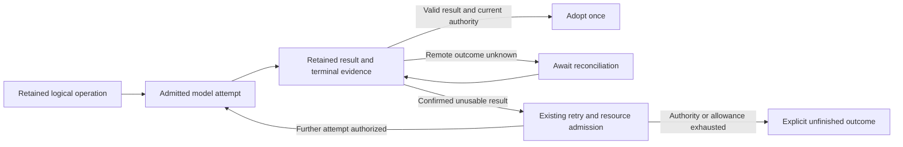

# Recovery from Nonproductive Model Generation

The [request](24-request-generation-resilience.md) defines the outcome and constraints. The [research](26-research-generation-resilience.md) establishes current behavior and executable evidence. This document is under discussion; no implementation is authorized by its creation.

## System Design

### The harness continues the retained logical operation

Today, a known invalid first response can be retried inside the running action. An interrupted documentary control remains unavailable after later cancellation/billing confirmation: settlement does not wake the operation, and its scheduled-start and work-reservation guards prohibit re-entry. Separately, EOF without terminal proof can currently be misclassified as a retryable invalid response.

Selected by the user: keep the original logical operation while the existing harness owns any further authorized model attempt. Each attempt has its own receipt and accounting. A retry requires confirmed external termination, no previously adopted result for that work, current authority and remaining attempt/resource allowance. It must not recreate the preparation, clear start markers or replay prior documentary effects. An uncertain connection closure waits for terminal evidence rather than triggering another generation.

The existing operation lifecycle will own durable continuation, with the existing attempt admission and provider receipts. This extends the current one-start contract; it does not globally enable SDK retries. The native agent receives the operation's eventual outcome or explicit unresolved/exhausted state without needing a model turn solely to request a technical retry.

### A confirmed terminal attempt can retain its financial reservation during recovery

Selected by the user: confirmed external termination and final financial settlement remain separate facts. When final cost is missing, retain the earlier attempt's full financial reservation and allow a further authorized attempt only if existing cumulative admission covers both reservations. Final billing subsequently settles the original receipt through the existing accounting owner. A missing cost never becomes zero, the old reservation is not released to fund the new attempt, and the grant is not enlarged. Unknown remote outcome and cost conflicts remain separate blockers. Existing attempt, deadline and authority checks still apply independently of available funds.

### Early stagnation detection targets whitespace without content progression

Selected by the user: a narrow detector for a visible response that has begun and then receives only JSON whitespace without content progression. It must distinguish legitimate whitespace inside string values, unfinished values and initial reasoning. Observation must precede the application's current text packing, while the native SDK remains responsible for interpreting partial JSON. An unchanged partial object alone is insufficient to interrupt a generation. This scope does not claim to detect arbitrary repetition or semantic unproductiveness.

No inactivity duration is selected. The retained historical traces do not supply the timing evidence needed to calibrate an early-stop policy. Local fixture deadlines prove mechanics only.

### Delivery before inactivity calibration remains open

The candidate delivery approach separates safe terminal-evidence/recovery behavior from activating the early-stop policy. The complete design includes both. Under this approach, initial delivery records relevant progress timings without interrupting on the new detector; existing action deadlines remain effective. Early interruption activates only after a duration and its false-stop behavior are supported by measurements and accepted. This stage cannot be described as a delivered early-stagnation repair.

The alternative is to require calibration before delivering the entire correction. The choice affects delivery sequencing, not the required final behavior. Any provider measurements needing paid inference remain subject to a separately prepared authorization; this design does not reopen closed mandates.

Subsequent decisions remain open: terminal-evidence representation, progress observation before packing, a justified inactivity policy, durable wake/adoption behavior, and compatibility with retained bindings. The two section approvals will be recorded separately.

## Program Design

Pending System Design approval.

## Patterns to Follow

- [Shared operations](../../../convex/execution/operations.ts): atomic admission and scheduling, retained outcomes and generation-fenced adoption. Extend their lifecycle rather than adding a retry scheduler.
- [Model transport](../../../convex/integrations/modelTransport.ts): native SDK parsing, exact visible-output capture and transport-owned cancellation. Native partial values remain diagnostic and cannot be adopted as final results.
- [Attempt authority](../../../convex/domain/sourcePreparationAuthority.ts), [provider receipts](../../../convex/providerCalls.ts) and [campaign accounting](../../../convex/qualificationUsage.ts): existing lifetime attempts, external observations and conservative financial reservations.
- [Sources integration tests](../../../src/__tests__/convex/sources/documentary-control-integration.test.ts): real dispatch, persistence and domain adoption, replacing external I/O only. The research probes characterize defects; future correction tests must assert the intended behavior instead.

## Scope

Generation interruption and safe recovery under the current shared harness. Preserve native Pi generation/compaction, Convex authority, evidence integrity and OpenRouter's default routing with its existing price guards. No new inactivity duration or expanded resource allowance is selected. Sources state/history efficiency remains the separate request in document 22. Paid mandates remain closed.
