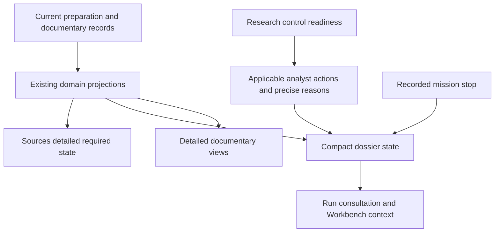
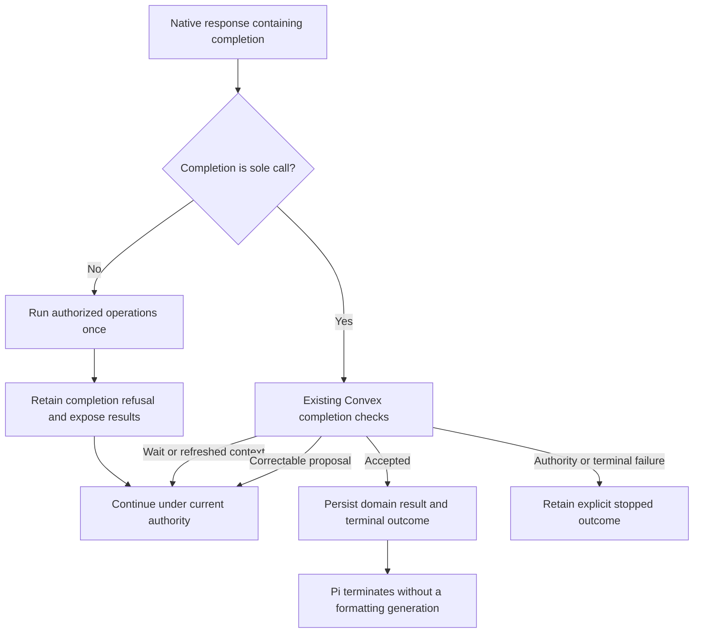

# Sources State, History, Completion and Progressive Text Storage

This design follows [the request](22-request-sources-harness-efficiency.md) and [the initial research](28-research-sources-harness-efficiency.md). The November 21 design for shared progress, native completion and history pagination was approved and subsequently implemented. The [current implementation review](42-review-current-sources-implementation.md), [capacity and purge research](43-research-conversation-capacity-and-purge.md), and [storage audit](validation/storage-choice-audit/audit.md) establish remaining functional defects and a retained-data measurement gap. The [pre-revision document](validation/tdd-storage-revision/29-before-storage-decision.md) preserves the earlier approval and design wording.

The current accepted direction is one progressive retained-text representation for conversation messages, immutable-content validation in an internal Convex action followed by atomic adoption, and replacement of whole-body transaction APIs throughout the shared storage consumers. The user's latest decision requires a one-time migration of existing messages, verification that existing functionality works with the migrated data, and only then removal of the obsolete copies and Convex Agent. This supersedes both earlier deletion/reset proposals. Temporary source and destination copies are necessary for verified migration; the final application has one authoritative body representation and no legacy reader. Preserve exact messages, application identities, references and domain behavior.

The user confirmed this revised TDD as validated when requesting the update of implementation outline 31. That confirmation approves the current system and program design; it does not imply an independent review or executed verification of the new implementation. This revision executes no migration, data deletion, dependency change or backend publication. Baseline sections describe the original approved implementation; current corrections take precedence where stated.

## System Design

### Expose current preparation separately from final membership

Today Sources receives detailed current work in its native required state, while `consult_run_state` exposes only final retained document membership. A running preparation can therefore report no retained documents despite existing captures, readings and controlled contributions. Some unavailable analyst actions also report `human_prerequisite_required` when the mission has no human blocker. Research reproduced both behaviors through the registered Sources 7 path.

The accepted contract extends the existing shared dossier projection with a compact account of current preparation, derived from the same documentary records and rules used by detailed material views. It keeps capture availability, recorded readings, qualification, effective use restrictions and final membership distinct. Pending handoff must be explicit; an empty final list cannot describe the absence of current material. Detailed evidence stays in existing authorized material views and Sources' required working state. The exact summary fields and retrieval cost belong to program design.



The user selected the compact shared projection with access to existing detailed consultations. Dossier consultation will not embed the whole working inventory merely to establish that preparation has produced material. This keeps the shared view small without introducing another persisted state store.

An unavailable action describes that action's applicability. It must not imply a mission block. Actual approval requirements, pauses, capacity refusals and recorded execution stops retain their enforcement. Current projection changes participate in the existing observation pin; retained receipts remain immutable.

### Submit structured completion through a native tool

The current text-only path parses the entire assistant answer as JSON. A valid proposal surrounded by prose is refused before the domain can examine it. Native operation arguments already have tool schemas, but the final proposal does not use that channel.

The accepted direction exposes a completion tool through the existing Pi integration, deriving its arguments from the pinned definition's completion schema. The tool submits a proposal to existing completion validation; invoking it does not itself finish the mission. Convex retains authority, admitted-snapshot accounting, freshness, effect adoption and terminal persistence. Domain feedback or newly engaged work can require further native continuation. Successful adoption can use Pi's existing termination mechanism, subject to the mixed-round behavior below. Ordinary Workbench text replies retain their existing interface.

```text
Native completion proposal
  -> validate original arguments and authority
  -> existing definition-owned completion checks
     -> correction / refreshed state -> continue through Pi
     -> accepted persisted result -> finish through Pi
```

The user selected native completion submission instead of a separate structured finalization generation. This reuses the agent's current loop and avoids requiring a second generation solely to encode its final proposal.

The installed Pi implementation runs `afterTools` before honoring termination and requires every call in the round to have a completed task requesting termination. The contracts below cover mixed rounds and failed or stale proposals; their implementation must be verified through the real consuming boundary, including duplicate finalization and late cancellation. Native schemas improve the submission interface; they do not establish documentary correctness or guarantee provider compliance. Strict-sampling configuration and historical bindings remain program-design questions.

### Fill useful history pages within response capacity

The user accepted explicit historical retrieval through the existing operation: an event reference selects known evidence, an omitted reference browses the immutable journal, and an issued cursor continues the same frozen traversal. Current required state remains supplied by Pi; the operation description must explain that its state field identifies that supplied state rather than promising another complete working inventory.

The current history-result ceiling is 48 × 1,024 = 49,152 serialized UTF-8 bytes, including metadata, content and cursor. This is a buffered tool-result limit, not an LLM response-token allowance or an SSE wire cap. Its technical justification remains part of the limit audit. Size only the requested content: completing a targeted event ends that read even when capacity remains.

Remove the fixed 4,000-UTF-16-unit mission fragment as an independent page boundary. Size returned content against the serialized response envelope and the legitimate read policy, accounting for UTF-8 encoding, JSON escaping, cursor metadata and complete Unicode boundaries. Return a full requested event when it fits; otherwise return the largest admissible prefix with its exact continuation. Multiple short events can share a page. Do not silently read the entire journal or introduce another summary or memory system.

Already-issued mission-history cursors and adopted receipts remain usable under their original authority and frozen frontier for retained data. The one-time migration preserves conversation delivery identities, exact bodies and issued cursor positions; migration must not invalidate a cursor merely because the physical body store changed. The current inline offset check depends on the old fragment width, so changing the literal alone is insufficient. Program design must specify how the server authenticates old and new positions without accepting fabricated, overlapping or foreign continuations. Exact content and provenance, cancellation and generation/instruction fences remain required.

Audit the conversation-reading sibling in the same pass: its separate 8,192-unit fragment must have a concrete justification or use the corrected sizing mechanism where the contracts match. Storage fragmentation is a different boundary and must not dictate model-facing page size. Verify the purposes of the existing response and row-read limits instead of treating their current values as new product requirements.

The intended benefit is fewer consultations caused by page fragmentation. Measure it by replaying retained traversal payloads and comparing restored content, response bytes and storage work before and after implementation. The model retains the choice to inspect history; this design does not claim that all historical consultations were unnecessary.

### Completion must be the only call in its native round

A completion proposal is admissible only in a round containing that single call. When a model mixes completion with operational calls, retain the proposal and return a recoverable completion refusal; authorized operational calls follow their normal admission and execution path exactly once. Their results and fresh required state become available before the model submits a new completion proposal. Multiple completion proposals in one round are likewise not an unambiguous final result. This rule governs submission, not whether documentary work may continue or how many corrections are allowed.

The user selected a new completion submission after the operational results, rather than automatic later adoption of the original mixed-round proposal. Pi's native all-calls termination condition can therefore be satisfied by a single accepted completion call.

A standalone proposal still cannot bypass engaged work from another invocation, new analyst instructions, changed needs, missing evidence or stale authority. Existing domain checks decide whether to wait, refresh, correct, block or persist the final result. Program design must keep the raw mixed response and all individual outcomes inspectable without creating a second executor or replaying confirmed effects.

### Version the changed interface and preserve retained execution

The proposed rollout adds versioned native-completion definitions for Sources, documentary inspection and the two structured validation agents through the existing catalogue. Historical definitions retain their text-completion decoding and recorded identity; new missions use the new defaults. The shared completion mechanism derives its schema and validation from the definition instead of branching on agent identity. Workbench keeps its text-reply completion. Exact version numbers and native input/profile changes belong to program design.

For the new structured-completion interface, surrounding prose neither corrupts valid tool arguments nor authorizes a final result. A text-only answer cannot complete the mission; it remains observable and receives the existing structured correction treatment. Raw original arguments remain authoritative for validation. No prose-to-JSON repair call or second completion schema owner is introduced.

Shared state and history corrections reach applicable existing callers where their contracts remain compatible. Persisted non-conversation receipts, authority pins, historical validators and mission-history cursors remain readable without being silently rewritten. Conversation messages and deliveries remain within this continuity contract: only verified obsolete physical copies are removed after migration. Any changed result shape must have an explicit version/read-compatibility strategy before implementation; widening the current validator alone is insufficient evidence of compatibility. No mission is silently rebound to another agent definition.

### Corrections use existing authority; domain acceptance ends the mission

Correctable submission or domain failures retain feedback and continue through Pi within existing cumulative authority, deadlines and cancellation/generation fences. Known effects are not executed again, and correction does not reset accounting. New work or instructions require the existing wait or refreshed-context path. A cancelled or stale response may be retained for audit and billing without adoption. Domain completion can yield a controlled partial or no-material result; schema acceptance alone never establishes documentary success.

The previous explicit decision to remove automatic non-progress stopping remains applicable. Correct TECH's stale “one bounded continuation correction” sentence to match its Loop Prevention contract; do not add a new completion-count limit or restore `repetition_stop`. This does not alter the separately bounded Workbench advisory response-control correction. Preparation mismatch detection remains a separate contract.



### Store conversation messages through one progressive representation

Every conversation message uses the existing Convex `retainedTexts` and `retainedTextFragments` storage, including analyst messages, assistant replies and deterministic confirmations. The application delivery remains the stable logical message; it references a complete immutable text rather than Convex Agent message IDs or inline canonical body alternatives. Pi continues to own generation, context and technical replay, with Convex owning persistence and publication. One representation does not merge distinct raw provider output, technical transcript and final analyst-visible artifacts or expose one as another. Replaceable previews remain explicitly incomplete presentation state, not an alternative published message store.

Prepare text under its owning request identity without exposing a delivery. Stage bounded fragments in separate transactions where needed, validate their order, hashes and final byte/character totals, then publish the complete reference atomically with delivery, turn and mission adoption. An already bounded single-fragment write may complete in one transaction through the same primitive; there is no full-body helper loop as a shortcut. Immediately before publication, recheck dossier authority, generation, active instructions, final result identity and outstanding work. Failure or steering cannot publish a stale prepared answer. Replay reuses the same preparation/publication without another provider call or duplicate effect.

```text
Admitted producer -> invisible retained-text preparation -> verified complete manifest
                                                         |
                             Convex authority/freshness checks
                                                         |
                             atomic delivery/result reference
                                                         |
                  authorized history metadata + bounded body ranges
```

Both public history readers and the agent's conversation consultation read bounded body ranges before sizing their envelopes. Loading a small output page must not first hydrate a whole message. Preserve message identity, chronological order, frozen publication frontiers, exact text and continuation; do not present a prefix as the complete response. The UI assembles ranges within the same logical message, with explicit loading and retry state, and retains Convex as its data owner. No new transcript store, arbitrary generation-size cap or second compaction mechanism is introduced.

### Migrate existing messages once and verify functionality before removing old storage

Copy every existing logical conversation message into the retained-text store through bounded staging, without deleting or recreating its application delivery. Preserve conversation/delivery/turn IDs, request keys, roles, status, timestamps, exact text, publication revisions and all incoming references. Sources requests still resolve their original wording; approvals, decisions, evidence, provider receipts and mission journals retain their existing behavior. Remove the proposed deleted-original marker and unavailable-message projection: neither belongs to this migration.

```text
inventory and fence old writes
  -> copy exact message bodies in resumable bounded transactions
  -> verify every source/destination body and reference
  -> switch existing readers and writers to retained text
  -> verify existing journeys, new messages and native recovery
  -> delete only verified obsolete component copies
  -> remove Convex Agent and temporary migration code
```

Source data remains intact until both data equality and functional verification have passed on the selected deployment. A missing fragment, mismatched body, broken reference or failed journey stops retirement; it cannot be treated as an empty message, skipped silently or repaired by regenerating an answer. Temporary old/new copies support verification and recovery, not a permanent dual-write or legacy-read feature. Once cutover is complete, normal readers use only retained text and failures remain explicit.

Fence old writers without cancelling valid research or discarding queued/active requests. Reuse existing lease and scheduling controls, adding the missing conversation-write fence at its owner. The migration is not a dossier or execution-graph purge. Identify the deployment and inventory before execution; design approval alone does not execute the migration or remove data.

### All retained-text consumers use bounded transactions

The correction includes existing uses of `retainCompleteText`, `readRetainedText` and `sealRetainedText` in `journal`, `missionData`, `piStore` and `invocationLifecycle`, plus fixtures and every additional caller found by a repository-wide reference search. A conversation-only change is insufficient. Remove the three APIs after replacing their callers; do not leave aliases, size-conditioned whole-body fallback or relocated equivalent loops.

An action or native transport may reconstruct exact content through authorized bounded calls when its real consumer needs the whole value. It must respect that consumer's memory and provider capacity, cancellation and lease renewal. Database functions exchange manifests, references or bounded ranges and compact validated domain data; they must not receive the reassembled large value again as one argument or return it as one result. The user selected immutable-content validation in an internal Convex action, followed by atomic adoption in a mutation. Both are server-side boundaries. The action validates exact retained content and prepares a bound result; the mutation independently enforces current authority, instructions, domain dependencies and effect adoption. A browser/model-supplied hash or a prior preparation alone never authorizes publication.

### Purge completeness and retained-data measurements remain required

The storage decision does not close the review's other findings. Correct all seven parent-window purge steps identified in the research, including both levels of revision/proposal traversal. A drained first parent window is not exhaustion of the owner set. Remove children before parents, preserve restart safety and cross-dossier isolation, and ensure prepared-but-unpublished texts are reachable by cleanup as well as published references. Migration retirement deletes only verified obsolete component bodies; routine dossier purge retains its separate domain ownership and quota rules. Do not introduce a generic cleanup framework to conflate them.

Retained-preparation projection and legacy mission-cursor ancestry costs remain open acceptance obligations. Synthetic capacity probes and the 18 MiB storage audit do not replace them. Migrating messages does not close the retained mission-history measurement. Archive reproducible data and measurements before any cutover that would otherwise destroy the required evidence; missing source records remain an explicit evidence gap, never a synthetic substitute labelled real.

### Acceptance separates execution integrity from model usefulness

Program design must provide real-boundary regressions for running material versus final membership; inapplicable actions versus actual human blockers; old and new cursor continuity with independently derived encoding boundaries; serialized native completion schema and raw arguments; mixed rounds, duplicate completion, changed work, cancellation and retained replay. Historical definitions and Workbench text completion remain covered. Page-efficiency measurements restore the exact retained payloads and compare consultations, response bytes and storage work. Qualifying model choices or documentary usefulness requires separately authorized live work; this design establishes no numerical savings or semantic acceptance.

The user approved the initial system design and subsequently validated the revised system and program design, including migration before retirement. The already accepted native completion and non-progress-stop decisions remain in force.

## Program Design

### Extend the existing staged text owner and remove whole-body transaction APIs

`retainedText.ts` remains the single owner of fragment layout, hashes, byte/character totals, ordered idempotent writes, manifest completion, range reads and bounded deletion. Build on `stageRetainedText`, `completeRetainedText`, `retainedTextRange` and `deleteRetainedTextBatch`, following the existing `piStorage` action-to-`piStore.stageCommit`/`publishCommit` sequence. Reuse the mechanism, not a Pi writer lease as authorization for unrelated conversation work. Each caller retains its own dossier, invocation and effect authority.

For streaming append, maintain fragment hashes, end offsets and the full-content checkpoint incrementally as packed fragments become durable. Finalization validates the recorded totals, appends only any bounded tail and marks completion; it never scans the complete body to reconstruct the manifest. Ordered append acknowledgement and partial/complete diagnostic status remain distinct. Test retries before and after finalization and preserve full-hash verification. Account for manifest size and growing metadata against actual document/transaction limits rather than claiming unbounded storage or adding an invented total-text ceiling. Changes must preserve the installed Pi storage conformance and immutable journal contracts.

The target changes the data flow, not just function names:

```text
producer action: stage exact fragments using existing execution identity
                 -> complete manifest -> owning atomic adoption
query: authorize owning record -> manifest -> requested verified range
consumer needing complete bytes: bounded calls outside a database transaction
```

| Current caller | Required replacement and preserved contract |
| --- | --- |
| `journal.ts`: response/raw-output retention, response recovery, event/context projection | Prepare immutable payloads before linking them to invocation/event records; preserve received/adopted identity and original bytes. Expose references and ranges to recovery and history; reconstruct JSON only at an appropriate nontransactional consumer. Keep event-time identity so later payloads cannot change earlier observations. |
| `missionData.ts`: `missionResultPatch` and `missionResult` | Stage the domain-approved result under its mission/result identity; completion adopts verified references and compact domain metadata atomically. Audit every result consumer, including settlement, to eliminate hidden full hydration. Structured result validation must remain bound to the exact staged content and current authority. |
| `piStore.ts`: context-observation reads | Return bounded observation metadata/ranges with the existing frozen sequence and writer checks. The native adapter reads and verifies the complete required observation through separate calls before acknowledging its sequence; partial reads cannot advance the acknowledgement. |
| `invocationLifecycle.ts`: visible-output sealing and retention/finalization callers | Finalize incremental manifests without rereading all fragments; preserve incomplete output and terminal reason. Received output, domain completion, publication and terminal replay must pass references through the entire chain rather than rebuilding a giant mutation argument. |
| `fixtures.ts` and test/administration consumers | Use the same authorized paged contract. Regenerate fixtures for the single representation; no test-only legacy adapter or copied storage implementation. |

### Prepare immutable content in an internal action; adopt against current state

The accepted split extends the existing invocation lifecycle and definition-owned completion contract. The internal action loads the admitted input and original response by bounded authorized reads, verifies their full hashes, and validates original arguments with the pinned completion validator. It does not accept repaired SDK arguments or an externally supplied projection. Database-backed identity checks remain in the mutation. Content-derived preparation is retryable without provider I/O; the action observes cancellation, writer authority and actual runtime memory capacity while reading.

Keep the prepared record on the owning invocation, bound to its mission, generation, definition/version, instruction version, admitted-input hash, original-response hash and complete retained-text references. Include the exact dependency identity for content checks or rendering based on dossier facts. Only the internal preparation path writes it; no public API or model tool can submit an authoritative prepared record. Retrying the same identity reuses preparation, while a changed identity cannot overwrite an accepted result. This records a real intermediate state in the existing owner, not a second completion table or executor.

```text
existing native response handling
  -> retain original response through separate staged writes
  -> internal completion preparation
       read immutable input/response by ranges; verify and validate
       prepare content facts and exact rendered text under dependency identity
  -> invocationLifecycle.finish(prepared invocation identity)
       compare prepared references/hashes and pinned definition
       recheck authority, current instructions and domain dependencies
       apply existing domain completion once
       publish verified final text reference and mission outcome atomically
  -> Pi acknowledges retained completion; no second generation
```

The final mutation compares the stored preparation with complete immutable manifests and current dependencies. It must not rehydrate the large JSON, receive it as an argument or trust a caller-provided `validated` flag. A different facts revision, instruction version, result identity or outstanding work yields the existing correction, refresh or wait outcome before adoption. Pure preparation can be repeated for new facts; domain effects cannot be performed speculatively in the action. Crashes after adoption recover the accepted result instead of rerunning completion.

| Definition/consumer | Preparation and atomic adoption |
| --- | --- |
| Workbench and conversation validation | Validate nonblank text and prepare exact prose outside the transaction. Keep text as a retained reference in the mission outcome and reuse that reference for the published delivery, rather than storing another JSON copy of its body. Workbench's existing response-control owner keeps draft identity, fact identity, correction eligibility and advisory results. Content-dependent checks/rendering run against a frozen fact projection; the mutation recomputes its current dependency identity and refuses a mismatch. Deterministic confirmations remain included in the exact published text. |
| Sources | Preserve `completeSources` as the atomic owner of current captures, control restrictions, needs/work accounting and prepared material. Its existing domain artifact capacity remains enforced; fragment storage does not enlarge it. Pass validated bounded proposal fields to that owner, validate IDs with database context and compare admitted preparation/revision/work identity. Do not move documentary acceptance or write speculative handoff artifacts in the action. |
| Inspection and execution validation | Preserve existing capture ownership, obligations, uniqueness, membership and numeric checks in the mutation. These bounded reference/numeric outcomes do not need a new large-artifact representation. |
| Journal, native state and terminal replay | Return references and bounded ranges. Native/action consumers may reconstruct exact required bytes outside a database transaction. `publicationState` returns completion identity and the adopted text reference; settlement does not rerender the entire mission result. Acknowledgements advance only after the intended content has been verified. |

Derive transport and persisted field types from the existing domain validators and retained-text contract; do not add a generic streaming JSON parser or duplicate validation rules. Every admitted prepared projection must fit actual argument/document limits. A proposal exceeding a domain owner's supported structural capacity remains an explicit refusal, not a reason to silently truncate it or introduce a whole-body mutation fallback. Preserve the distinction between stored-byte capacity, action memory, native context and domain artifact capacity.

Acceptance must exercise false or swapped references, wrong definition/instruction/input identity, stale facts after preparation, outstanding work, interrupted preparation, duplicate finalization and failure after atomic adoption. Verify the full registered path with a large text, including response control, deterministic confirmations, delivery and settlement; a successful standalone storage probe is insufficient. Measure action memory and transaction reads/writes rather than claiming arbitrary-size support.

### Replace the conversation storage boundary and all consumers together

Replace `agentMessageDeliveries.storageMessageRef` with the typed retained-text reference and remove `agentConversations.storageRef` after migration and functional verification. Transitional migration fields are removed during retirement; the final schema has no old/new body union. Preserve delivery IDs, request keys, content identity, turn/publication revisions and control metadata for existing and new messages. The existing conversation owner handles admission and final visibility; storage metadata cannot authorize a message by itself.

The public history/list APIs return bounded message metadata and body ranges, with a continuation bound to delivery identity and immutable text hash. Delivery pagination and continuation within a message are distinct positions: advancing the delivery page must not lose an unfinished body. Fit serialized envelopes and database work before loading additional fragments; the operation-result capacity remains applicable to model-facing consultation, not a new global UI body ceiling. The UI keeps one message per delivery and explicitly distinguishes partial loading from completed text. Selection, copy and retry must preserve exact text without duplicating messages. Existing user/control instruction readers use the same owner while preserving their complete authorized instruction semantics; they cannot silently take a display prefix.

Update both public readers, `consult_conversation`, `readTurnInstructions`, context/instruction validation, control replay, native inputs, publication and `piControl.publicationState` together. A terminal acknowledgement should carry identity/status or bounded result access rather than require the whole published text in one query. Verify crashes during staging, after manifest completion, after domain adoption, after publication and before native settlement; recovery must neither regenerate nor re-execute accepted effects. Prepared content changed by domain rendering or advisory correction receives the exact final identity before publication. Identical internal artifacts may reuse verified ownership-compatible bytes, but raw output is never assumed to equal final public prose.

### Copy, verify, switch and retire through a one-time migration

Use a resumable internal migration procedure with an explicit deployment and conversation inventory, plus per-delivery checkpoints keyed by the existing delivery ID and frozen source reference. It owns copying and retirement only; application conversation admission, authority and publication stay in their existing modules. Record progress durably so loss of the operator process cannot strand untracked partial text. Reuse retained-text idempotent staging; a rerun resumes or verifies the same destination rather than creating another delivery or publication event.

1. **Establish the stable source.** Inventory all application deliveries, their ordered component references and owning threads, including user messages, assistant replies and control/approval confirmations. Inventory component-only records separately; unknown ownership blocks their deletion. Fence legacy message creation/publication and prevent another old writer from appearing between inventory and switch. The existing Pi worker hold alone is insufficient for public message writes. Drain or suspend at existing durable boundaries without losing queued messages, replay state, accounting or independent Sources work; do not bump research generation or revoke approvals to simplify migration.
2. **Copy with bounded reads and writes.** The current `storageMessageRef` is either one component ID or an ordered JSON array. Interpret that historical encoding only in the migration reader. Read component records individually or in byte-bounded groups through separate queries, verify thread/role membership and reproduce the current text extraction exactly: string content directly; text parts joined with newlines within a record; records concatenated without an extra separator. Stage complete logical bodies progressively and retain source fragment identity/order and target manifests. Do not call the aggregate `readConversationMessages` helper or any of the three retired whole-body APIs. Unpublished staging stays out of normal history.
3. **Verify every copied message before switching.** Independently traverse source and destination through bounded reads and compare exact UTF-8 content, full hashes, byte and character counts, ordering and membership. Preserve every application identity and metadata value. Do not assume delivery `contentHash` always hashes the body: control exchanges may use request identity hashes. Derive the migration body hash from exact source content and leave application idempotency hashes unchanged. A partially missing source remains a reported migration failure; do not substitute its component search-text field or regenerate it. Validate incoming references from turns, instructions, approvals, operation/event receipts and issued history cursors.
4. **Switch under the fence.** Attach verified retained-text references to existing deliveries in bounded idempotent mutations, comparing the source reference with the frozen inventory before each change. Keep the application unavailable to mixed-format writes/readers during this bounded switch; no per-message automatic fallback is needed. Update both public readers, instruction/context consumers, native consultation and publication together. Verify the complete inventory uses the new representation before releasing the fence. A migration checkpoint must distinguish copied, verified, switched and retired state; success cannot be inferred from a nonempty destination table.
5. **Verify functioning on migrated data.** Execute the acceptance matrix below against the selected deployment while old component copies are retained. Exercise old history and new messages, queued/steered turns, Sources original-message lookup, approvals and native recovery, including acknowledgement loss without duplicate provider/effect execution. Use controlled fixtures for state-changing checks and authorized existing records for read checks. Resume normal work only after its relevant read/write checks pass. If a later check fails, keep the old copies and stop retirement; never silently route a failed new read to the old store. Once new messages exist, rolling back to old-only code would lose access to them, so recovery must preserve the new authoritative bodies and repair or use a migration-aware rollback plan.
6. **Retire verified obsolete data and code.** Check each old thread has no remaining application storage dependency, then delete its obsolete component data through bounded component deletion while those APIs are still installed. Repeat safely after interruption. Remove old fields, migration-only readers/checkpoints when no longer needed, component adapters, `components.agent`, registration in `convex.config.ts`, `@convex-dev/agent/test` registrations and the package through the established dependency workflow. Regenerate Convex declarations through their owner. Re-run focused consumers with the component absent; final search and schema checks must find no runtime fallback, dual-write or obsolete dependency.

The migration does not delete conversation deliveries, turns, instructions, approvals, mission results, provider billing records or Pi sessions. Storage conversion alone does not justify resetting a native session or re-executing an adopted effect. Preserve native transcript/session continuity and recover it against the same application identities. Legacy body-format knowledge is confined to the temporary migration reader; preserving an issued application cursor is ordinary history continuity, not a legacy message-store reader.

Update `context/TECH.md` with the actual migrated representation, progressive publication/range-reading contract and component retirement after the corresponding checks run. Update roadmap state only with executed evidence. Preserve historical decisions and raw evidence with dated supersession links. The implementation outline must keep copying, functional verification and destructive retirement as separate steps with explicit exit evidence. No migration, dependency update or code generation runs during this design edit.

### Reuse the common operation-result capacity

`convex/resourcePolicy.ts` defines `MAX_HISTORY_RESULT_BYTES = 48 * 1024` and `MAX_OPERATION_RESULT_BYTES = 64 * 1024`. `history.ts` checks the first against `pageJson(...)`; `operations.ts` checks the second against the successful outcome's `valueJson`. Both measure serialized UTF-8 bytes of the same result representation. No separate technical requirement for the smaller history ceiling was found in the inspected owners.

The accepted code change removes the redundant history ceiling and uses the existing common operation-result capacity. This changes the history page's maximum from 49,152 to 65,536 bytes without changing the common operation policy, mission budget or model context capacity. Fit the complete page, not just its content string. Small results remain small. Query-work bounds and retained-text storage fragmentation remain separate concerns.

```diff
- pageJsonBytes <= MAX_HISTORY_RESULT_BYTES
+ pageJsonBytes <= MAX_OPERATION_RESULT_BYTES
```

The user accepted this capacity owner and value during program design. The 20-source mission-page bound limits query work per read; it does not limit the number of pages or mission completion. Conversation scanning likewise retains its distinct database row/byte bounds. Move its inline 512 KiB database-scan value into the existing policy owner with its unit and refusal behavior; it is not a content-fragment limit. Remove the separate 8,192-unit conversation split along with the 4,000-unit mission split. Retained-text storage sizing remains unchanged.

### Carry the complete rendered result through Pi

The common 65,536-byte capacity governs the canonical operation `valueJson`. Pi receives the rendered success envelope, not that value alone. Installed Pi Durable defaults to 51,200 bytes per tool output and bounds even an explicit returned `output`; leaving this default would truncate an accepted page and possibly its cursor after the application recorded successful delivery.

Set `outputLimits` at the shared `piToolMetadata` owner for application operation tools, including both history operations. Derive its byte allowance from the common result capacity plus the rendering envelope's exact encoded overhead, rather than introducing a tunable transport ceiling. The current compact success wrapper adds 27 bytes, so a maximal canonical value requires 65,563 bytes. Derive the overhead from the renderer's representation; do not duplicate a magic 27 in callers. Keep success values canonical and verify the rendered byte count at the shared result boundary; historical noncanonical JSON must be normalized and checked explicitly rather than assumed to have the same size after parsing. Refusal feedback and completion acknowledgements use the same declared rendering contract and must also fit without silent truncation. The renderer emits one JSON text line; embedded newlines are escaped, so Pi's separate line limit must not truncate accepted JSON.

The same metadata factory serves runtime and offline serialization checks. Inspect every application tool registration and after-tool renderer on this path so none silently reinstates Pi's smaller default. Pi still owns output retention and context compaction. Do not patch its package, substitute another output buffer, or weaken the application's successful-result capacity. Before admitting the result as delivered, the consuming-boundary tests must establish that retained outcome, native tool transcript and cursor contain identical content. A 64 KiB Pi allowance alone is insufficient because it omits the success wrapper.

### Derive compact progress from existing documentary facts

Extend `sources.ts` with a cohesive preparation-progress projection that reuses `captureAvailability`, `projectSourceDocumentState`, controlled contribution rules and admitted reading references. Pass one transaction-local `SourceReviewReads` and loaded preparation facts through composition. Extend `sourcesTaskObservations` to accept that reader instead of always constructing a new one. In `workbenchContext`, load preparation, capture states and controlled contributions once and supply those facts to both the compact projection and detailed material projection; `readResearchState` must not independently repeat their traversal. Sources context likewise builds its detailed observations and compact progress from the same loaded set. Standalone consultation creates one reader and uses the same owner. A small explicit loaded-facts argument carries these existing records; no cross-transaction cache, service layer or new persistence is introduced. Do not call the full Sources workspace query or hydrate passages merely to build a summary. Capture completeness and successful consultation remain separate facts.

Add one versioned, optional `progress` section under `ResearchState.sources`. Optionality exists for historical observations; current successful projections always supply it. Absence means an older observation without this detail, never zero work. Illustrative field shape, implemented with Convex validators and inferred types:

```ts
progress: {
    version: 1,
    handoff: "pending" | "settled",
    captures: { full: number, partial: number, unknown: number,
                capturing: number, unavailable: number, notCaptured: number },
    qualifications: { recordedSources: number,
                      effectiveUses: DocumentaryContributionTally["effectiveUses"] },
    readings: { visibleReferenceCount: number, referencesComplete: boolean }
}
```

Capture counts describe distinct preparation source identities using the current capture-state owner. Qualification counts use the latest qualification matching the current capture identity/hash; effective permissions come from the existing control and analyst-restriction rules. Use `tallyDocumentaryContributions(...).effectiveUses` and its existing validator: `documentary`, `attributed_argument_only`, `context_only` and `blocked` all remain distinct. Do not maintain another mapping or omit attributed-only material. These counts are not truth scores. Reading counts describe the existing admitted-reference window, not an invented total: `referencesComplete: false` explicitly preserves incomplete coverage. Final `retainedDocuments` still comes only from the accepted handoff. Missing or corrupt dependencies produce the existing explicit failure, never zero-valued success.

`readResearchState` owns composition; Sources required state, Workbench context and consultation consume the same progress projection. The existing consultation pin hashes the returned projection, so changed summary facts invalidate reuse. Changes only to unreported detail need not invalidate the compact summary; the detailed reader retains its own freshness contract. Current and historical result validators accept the optional versioned section without copying the full old research-state schema. Advance `consult_run_state` from operation version 2 to 3. Dispatch already permits completed common consultations from an older operation version to return their retained outcome after authority checks; use that existing path instead of recomputing a new progress-aware pin for an old successful receipt. Pending version-2 requests return `operation_version_conflict` and require a freshly admitted version-3 read; never rewrite or silently re-pin them. Retain old result validation and byte-identical completed receipts. Test completed old requests, pending old requests and fresh admission separately, including revoked authority. An additive validator alone does not preserve the old pin identity.

`readResearchControlReadiness` distinguishes an action that is not applicable from an actual human prerequisite at its owning branch. `continueSourcesPreparationAvailability` preserves a real readiness block before deciding whether renewal is the applicable transition. Keep the external `actor/applicable/reason` shape, use a precise action-inapplicable reason for ordinary running states, and keep true review/time-limit decisions and all execution checks. UI and Workbench summaries consume that same outcome; no client-side reinterpretation grants authority.

### Authenticate history positions by issued receipts, not a fragment width

Keep the current opaque `history:<requestId>` cursor and receipt structure. `resolvePosition` already requires a completed, successful, adopted read with matching run, mission, generation and instructions. Extend the shared cursor-resolution code for use during admission and reading: a new continuation pin carries the resolved original frontier and optional target reference, using the existing pin fields. A resolved chronological pin also carries its frontier, distinguishing it from an old unresolved cursor pin. Use the validated next position as the only nonzero read offset; initial reads begin at zero. Inline and fragmented journal payloads then accept that authorized range without recomputing a chain of 4,000-character boundaries. No offset parameter is added to the model-facing tool.

For already-issued cursor chains whose intermediate pins contain only `source`, follow the retained predecessor cursor links to a pin with an authoritative frontier and target-or-chronological identity. Verify each predecessor's completed/adopted success, run/mission/source, generation, instructions and frozen frontier; reject cycles or contradictory ancestry. Persist the resolved identity only on the newly admitted request. Do not mutate earlier receipts, infer a target from a colliding mission sequence, or treat a missing reference as permission to switch to chronological browsing. Validate legacy fragments against that selected source where required to detect an already-diverged chain; corruption remains explicit rather than being retroactively labelled a correct read. This compatibility lookup costs indexed predecessor reads proportional to the unresolved legacy chain and happens once before a new resolved pin shortens later lookup. Measure retained chain depths and read work; no guessed depth cutoff or silent restart is introduced. Actual database-capacity failure must remain explicit, not become unrelated content.

Preserve receipt/frontier, reference membership and fragment-hash checks. Strengthen receipt consistency where needed to verify that the returned final fragment and next position agree: a partial event resumes at `offset + content.length`, while a completed event advances at offset zero or ends. Existing and new conversation continuations retain their issued delivery position and frozen publication frontier. Migration preserves delivery rows and exact text so offsets keep their meaning; verify pre-migration cursors through the new range reader, without interpreting them against different messages. Do not reconstruct an alternative position when a receipt is invalid. Existing version-1 receipts remain valid; no new receipt field or migration is needed for variable fragment widths.

`journal.ts` remains the immutable range reader. Load at most a candidate range bounded by the common response capacity in UTF-16 units, then fit the serialized page in `history.ts`; this is a safe upper bound on the number of units that can fit in those UTF-8 bytes, not a new cutoff. Reuse the loaded candidate while sizing so trial prefixes do not repeat database reads. Large retained texts continue to read only intersecting storage fragments. Inline historical payloads remain inline; the change does not rewrite archived storage.

```text
readHistoryPage(request)
  authorize and resolve issued position + frozen frontier
  read candidate range from immutable source
  try complete requested event/message with its actual envelope
  if it does not fit:
    find largest complete-character prefix whose pageJson fits
    issue exact next offset
  persist ordinary fragment identities and read receipt
```

Test the full-event fit first: a terminal page uses `continueCursor: null`, which has different overhead from a nonterminal page. For a partial page, fit prefixes using the actual serialized envelope, clipping only at complete Unicode boundaries. If even one complete character cannot fit, return the existing explicit capacity outcome. During unreferenced mission browsing, append further events while byte and source-read policies permit; a referenced read stops at its selected event. Conversation reads may keep one message per page while removing its arbitrary character split. This preserves their existing selection semantics without speculative retrieval indexing.

### Register completion as an executor-owned native tool

Add an explicit `completionTransport?: "native_tool"` capability to `AgentDefinition`; absence retains current behavior. Reject a definition combining it with `textCompletion`. Extend the existing `agentToolSchemas` projection with the reserved `submit_completion` declaration for enabled definitions, using `completionValidator` directly, including its existing `kind: "complete"` literal. The catalogue rejects operation-name collisions. The schema is not copied into a Sources-specific tool or represented as an `AgentOperationDefinition` with artificial business effects.

```ts
// Agent definition: existing validator remains authoritative.
completionTransport: "native_tool",
completionValidator: sourcesCompletionProposalValidator,
```

`modelInput.ts` builds runtime metadata and offline serialized profiles from the same projected tools. `piMission.ts` installs the completion tool beside the operational tools and keeps it during tool refresh. Required context and the root mission instruction describe tool submission for enabled definitions; retained definitions keep their historical JSON/text contract. Include the completion declaration in admitted tool fingerprints and serializer calibration. Keep the current native tool sampling policy and local raw-argument validation; this design does not silently require provider strict sampling or relax the existing model compatibility checks.

### Retain submission identity and reuse the existing finish mutation

Extend the shared invocation response protocol with a native-completion submission envelope. Keep call identity and original argument JSON through validation; `call: null` represents a text-only response where the enabled interface required a completion call. The raw assistant text remains in its existing retained output, not a second field here.

```ts
// Added transport response variant, not a second domain completion schema.
{ kind: "completion_submission",
  call: null | { callId: string; inputJson: string } }
```

`invokeAgentModel.ts` selects this variant only for enabled definitions and non-auxiliary generations. One sole `submit_completion` call becomes a submission; a text-only reply becomes a missing-call submission. Mixed or duplicate completion calls stay in the ordered operations response. In `invocationLifecycle.finish`, those reserved calls become ordinary retained invalid-request refusals with a completion-must-be-alone reason, while other calls use existing admission exactly once. The reserved tool callback resolves these mixed-round invalid requests through the existing operation correlation/dispatch path and returns their refusals without termination; it uses the retained completion disposition only for a sole submission. An unknown reserved name on a retained definition never activates the new interface.

For a sole submission, `finish` checks provider receipt, authority and original call correlation, parses original arguments, validates the pinned definition schema, then invokes the existing completion owner with the immutable admitted input. A missing call, malformed original JSON or schema-invalid arguments use the existing `correctCompletion` path. Apply the existing call-ID validity rules to this response variant too. Missing original wire arguments remain an explicit transport-integrity failure; never substitute SDK-repaired arguments. Keep transport success distinct from domain refusal: successful receipt is not rewritten as a failed provider call merely because a proposal is invalid. Outstanding operations, changed context, domain feedback, publication and final result persistence keep their existing semantics. Preserve the submitted envelope for output-conflict detection; update idempotent replay classification to recognize an accepted native submission as completed.

```text
Pi response -> retain original response and call arguments
  -> invocationLifecycle.finish
       operations response -> admit operational requests / retain mixed-call refusals
       completion submission -> existing definition.complete
  -> Pi tool result reads the retained disposition
       accepted -> control.terminate = true
       correction -> feedback; no termination
       pending -> existing durable wait/resume
```

The completion tool callback does not call the domain completion a second time. Extend `piControl` to resolve the retained disposition for the exact mission/session, generation, invocation and call. Compare raw retained identity and require dossier access; never find a completion by call ID alone. Existing invocation status, block/correction and final mission result own the disposition, avoiding a duplicate completion table. Returning a terminal acknowledgement permits native settlement only, not another business effect or generation.

### Finish the native tail after a committed domain result

`afterTools` currently settles operations and rebuilds context before Pi checks termination. For an accepted sole completion, read the retained terminal disposition and finish the native tail without rebuilding active tools/state. For refusals, retain normal synchronization and refreshed state. A stale or cancelled mission cannot be mistaken for an accepted completion.

Use the same session-scoped task identity for admission and recovery on enabled structured missions: pass `piSessionId` from `runPiMission` to `invocations.begin` even without `nativeConversation`, so the stored task key uses the same session prefix that `nativeInvocation` resolves. Keep historical non-conversation definitions on their retained identity path; do not enable analyst-conversation delivery merely to obtain this key. Extend `needsNativeSettlement`, terminal-worker eligibility, terminal replay lookup and the success/error branches of `closeWorker` together. Successful native close records `settledSequence` and clears settlement-attempt state for the enabled mission session. Failed close uses the existing bounded native-settlement retry/failure policy; a structured mission records its settlement failure without attempting to patch a nonexistent analyst conversation. Queue pausing and `pumpWorkbench` remain conversation-specific. A restart after Convex completion but before the Pi tool acknowledgement must recover the original native response and terminal disposition without model I/O or domain re-execution. Fence this by the original session/task identity and writer lease. A later cancellation or revoked dossier access keeps its existing authority consequences. Preserve the existing `piStore.writer` fence for cancelled non-conversation sessions: broader settlement eligibility must not grant conversation privileges or record successful settlement after a fenced write. Exercise this explicit refusal/failure outcome alongside the crash cases. Exercise close/reopen at generation return, completion-tool execution, tool acknowledgement and worker close, including a stale writer and revoked dossier access. Verify both eventual settlement and explicit exhausted/permanent settlement failure; the domain result and provider accounting must not be duplicated.

### Bind new definitions and verify the real consumers

The original approved rollout introduced Sources 8, documentary inspection 4, conversation validation 3 and execution validation 3. These versions now exist; this storage revision does not reserve them again or rebind surviving missions. Preserve supported historical bindings in the current catalogue unless a separately approved retirement applies. Historical qualification-only definitions remain historical; no Workbench completion version change is needed. New defaults use the shared capability, while retained missions resolve their stored definitions. Update capability-based documentary bindings where they currently enumerate versions so the new definitions retain the same authorized documentary operations.

Regenerate `piInputProfiles.json` through its existing offline serializer test (`UPDATE_PI_INPUT_PROFILES=1 pnpm exec vitest run src/__tests__/convex/execution/pi-input-capacity.test.ts --maxWorkers=1`), then rerun it without the update flag. Before regeneration, preserve the baseline profile artifact and enumerate the keys used by retained/admitted inputs and configured routes. The current generator replaces its map, and changing the common result contract changes keys even for retained definitions. Extend that same generator to retain baseline keys required for those unchanged historical serialized inputs alongside newly measured keys; never use an old key or estimate for a changed schema. This carry-forward is valid only for the identical installed SDK version tuple; a dependency mismatch must fail explicitly and follow the dependency workflow rather than copying unqualified estimates. Test old-key lookup after regeneration, new schema/capability keys, and existing model-configuration behavior with both changed and unchanged catalogue revisions. Additive preservation intentionally leaves the catalogue revision unchanged, and configured routes read stored database profiles rather than only the generated JSON artifact. Verify explicit missing-profile behavior and the existing configuration refresh path in that additive case as well: newly prepared requests use the current profile or report the existing not-prepared state, while already admitted historical requests retain their pins. Do not silently change model selection or enlarge existing grants. Check registered definitions through the existing conformance suite and execution ownership checker. The original completion/profile work required no dependency change or live model preparation. The November 24 storage revision explicitly adds removal of Convex Agent through the dependency workflow; it still authorizes no live model preparation.

| Boundary | Required representative proof |
| --- | --- |
| Shared state and actions | Running captured/read/qualified work with pending handoff; genuine human pause; unavailable action without mission stop; actual stop; partial/no-material handoff; latest capture/qualification and all four effective-use categories with a restriction changing category; incomplete reading window; historical progress absence and pin/reuse changes. |
| History | Old issued inline and fragmented cursors resumed under new sizing; exact hash restoration; foreign/stale/corrupt cursor refusal; targeted versus chronological selection; UTF-8/UTF-16/escaping distinction; independently derived exact fit and one-character overflow including cursor overhead; full native model-visible messages above 50 KiB and at 64 KiB plus wrapper; at least three pages of a targeted dossier context observation with a colliding mission sequence and old intermediate pins; sibling conversation path; no material skipped or repeated. |
| Native completion | Serialized declared schema and original malformed arguments; text-only response; valid sole call with prose; domain refusal and successful correction; mixed call before/after operational calls and duplicate completion; post-admission work; pending durable operation; stale instructions and cancellation. |
| Replay and integrity | Duplicate finalization; lost acknowledgement; crashes on each side of native terminal acknowledgement; one retained domain result, unchanged provider/effect accounting and no paid redispatch; completed/pending old consultation versions and fresh admission; historical/new profile lookup and configuration refresh; representative retained definitions and Workbench text completion. |
| Progressive text and publication | Separate transactions stage a body exceeding a transaction read budget; publication reads only verified metadata; bounded Unicode-safe ranges restore exact content; interrupted/repeated stage and finalization preserve identity; false hash, missing fragment, stale authority and changed instructions refuse adoption; all four named consumers and fixtures exercise their real boundaries; no whole-body helper or equivalent call loop remains. |
| Migration integrity | Every inventoried message preserves exact text, body hash, UTF-8/UTF-16 lengths, order, delivery/conversation/turn identity, request hashes and incoming references; single/multipart and Unicode/control messages; interrupted/repeated copying and switching; missing/foreign fragments block retirement; no duplicate deliveries or publication events. |
| Functionality before retirement | Both public readers and old cursors; new messages, queue, steering and deterministic confirmations; Sources original wording, interpretation, treatment and result; pending/decided approvals; native restart and acknowledgement recovery; unchanged quotas, receipts and effects. Execute on migrated data with old copies still retained, then focused checks with the component absent. |
| Retirement | No old copy deleted before data and functional checks pass; failed verification leaves source intact; bounded cleanup resumes; unknown component ownership blocks deletion; final runtime/schema/dependency search proves one body representation and no fallback or dual-write. |
| Purge ownership | Every affected parent traversal reaches later batches; empty/populated prefixes, exact and overflowing child batches, nested revision/proposal parents, prepared-but-unpublished text, failure after partial deletion, repeated completion and cross-dossier isolation; quota/audit idempotence remains separate from storage migration. |
| Resource use | Before/after immutable real-payload traversal measurements plus the existing synthetic fixture, exact content equality, total consultations, serialized response bytes and logical storage reads; legacy cursor-ancestry cost; before/after actual rows/bytes for Sources context, Workbench context and standalone run consultation using retained preparation data; explicit capacity failures; no claim that compact output is cheap or that all inspection turns were waste. |

Implementation uses test-first checks at the existing Convex/native boundaries, including a native-provider fixture that exposes the missing completion declaration or rejected reserved call before the integration is added. These are corrections to existing execution and completion contracts; record each intended RED failure before production edits. Run focused tests while changing behavior, then applicable conformance, ownership, serializer, type and documentation checks. Local synthetic provider responses establish execution behavior only. Further live qualification requires its own mandate.

### Documentation and design-quality review

Update the owning passages of `context/TECH.md` for completion transport, corrections, current-state presentation and history capacity; update `docs/ROADMAP.md` only after verified delivery. Preserve historical decisions and dated evidence with supersession notes where necessary. No new normative document or production state store is introduced. The new response variant records a real transport distinction; the definition capability represents existing historical and new interfaces. Existing domain rules, native generation, persistence, budgeting and effect adoption each keep one owner.

The [Oracle report and disposition](30-review-sources-harness-efficiency.md) preserve the original BLOCK verdict and reviewed snapshot. The independent recheck returned WATCH with no remaining architectural blocker; native settlement, actual projection read costs and profile refresh remain implementation acceptance checks. Its final cancellation and profile-refresh refinements are included above. The user approved that program design on 2026-11-21, including its three explicit implementation verification obligations. The November 24 review/research supersede its broad acceptance claims: aggregate conversation capacity and incomplete purge are reproduced defects, and retained-data projection/ancestry measurements remain open. The user subsequently approved the revised single-storage/migration program design and requested its updated implementation outline. No independent review of these expanded details or new runtime verification is claimed. Design-phase changes are limited to ignored task documents and supporting evidence; documentation checks do not establish implementation correctness.

## Patterns to Follow

- [Research state](../../../convex/domain/researchState.ts), [documentary state](../../../convex/domain/sources.ts) and [Workbench context](../../../convex/domain/workbenchContext.ts) already own projections. Extend their shared rules instead of copying state interpretation into prompts or adding a parallel persisted summary.
- [Research control readiness](../../../convex/execution/researchControl.ts) and [approval actions](../../../convex/execution/approvalCatalog.ts) own applicability and transition enforcement. Preserve transaction-time rechecks.
- [Common operations](../../../convex/execution/commonOperations.ts), [history](../../../convex/execution/history.ts) and [journal](../../../convex/execution/journal.ts) own authorized reads, immutable receipts and continuation membership. Pi retains transcript replay and compaction.
- [Agent definitions](../../../convex/execution/agentDefinition.ts), [invocation lifecycle](../../../convex/execution/invocationLifecycle.ts) and [Pi integration](../../../convex/integrations/piMission.ts) own completion and adoption. Sources retains its domain accounting and freshness checks; shared mechanics must not branch on the agent's name.
- [Retained text](../../../convex/execution/retainedText.ts) owns immutable fragments; [Pi storage](../../../convex/integrations/piStorage.ts) demonstrates separate staging transactions and publication through [piStore](../../../convex/execution/piStore.ts). Extend these existing mechanisms; do not wrap the retired whole-body APIs or add a parallel fragment framework.
- Reuse the real consuming boundaries and retained fixtures identified in the research. Implementation must demonstrate the defect before fixing it and measure history restoration on the retained payloads. Fewer pages do not by themselves establish better model judgment.

## Scope

This document covers truthful state presentation, history access, completion, progressive retained-text storage across its consumers, complete owned-data purge and the accepted one-time migration and verified retirement of Convex Agent. It preserves evidence restrictions, analyst authority, cumulative accounting, cancellation and stale-generation fences. Migration preserves conversation history and functionality; retirement removes only verified obsolete physical copies. It does not authorize dossier/evidence deletion, loss of documentary requests or decisions, a permanent legacy reader or a new storage service. It does not redesign documentary acquisition, repeat delivered SSE or billing fixes, or select a remedy for unexplained upstream generation failures. Documents 24–27 retain their separate generation-resilience scope. Reference updates belong to the approved design's existing owner, `context/TECH.md`; this working document adds no normative owner.
