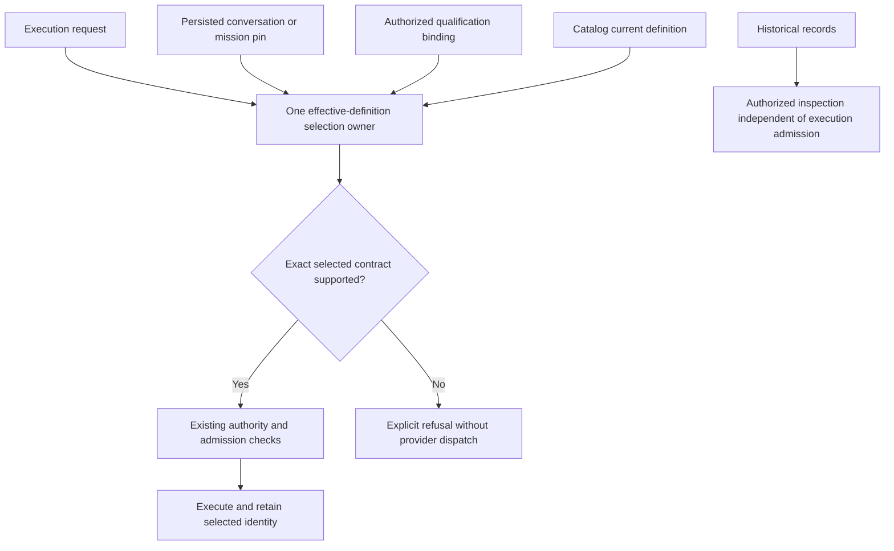
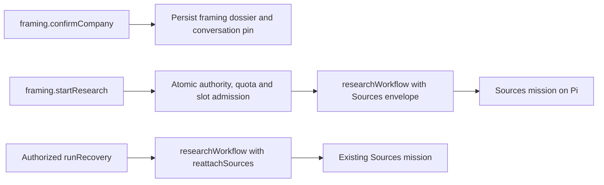

# Technical Design: Legacy Retirement and Agent Version Resolution

This design develops the [request](33-request-legacy-retirement-version-resolution.md) using the [research](35-research-legacy-retirement-version-resolution.md). The requested outcome is one authoritative owner for effective agent-definition selection and removal of obsolete executable paths. System Design and the complete amended Program Design are approved by the user, including both amendments from the second Oracle review. Design decisions do not authorize implementation.

## System Design

### Preserve continuing uses while retiring obsolete executors

The current [technical contract](/home/abdwhb/projects/decoding-discontinuity/agentic-resilience-workbench-proto/context/TECH.md:127) promises continued execution of Workflow-era and direct AI SDK/Convex Agent missions. Exact definition lookup already belongs to [agentCatalog](/home/abdwhb/projects/decoding-discontinuity/agentic-resilience-workbench-proto/convex/execution/agentCatalog.ts:231), but callers independently choose between persisted pins, authorized comparison versions, and current defaults. This design narrows the compatibility promise and centralizes that choice.

**Approved policy:** preserve historical inspection and identified continuing uses, while permitting retirement of obsolete executors after deployment-specific dependency checks. Preserve existing conversation pins and qualification comparisons. Do not migrate or purge records. Unknown versions and retired execution must refuse before new execution work or provider spending, without silently selecting a newer definition. Keep cancellation and inspection available. The implementation must replace the historical-execution promise in `context/TECH.md` and corresponding capability statements in `docs/ROADMAP.md`; those references still describe the deployed baseline during design.



The diagram describes responsibilities, not transaction order. The selection contract below specifies precedence for new conversations, pinned turns, mission replay, child missions and resume. Operation versions, execution protocol, backend/runtime, skills and input profiles retain their distinct identities.

Retain the two historically inventoried Workbench 4 research conversations unchanged, preserve the blocked Sources 4 contract until its recoverability and intended treatment are established, and keep the Workbench 8/Sources 6 and Workbench 7/Sources 5 comparisons. These are dated inventory findings, not a refreshed deployment allowlist. Do not prune definitions in this first retirement scope.

Current AI SDK documentary checks, Convex Agent conversation storage, shared Sources preparation primitives, and Workflow-based research orchestration remain current dependencies. Sources reattachment must continue without a new Sources envelope. Removing old execution does not imply deleting these shared owners or dependencies.

The research could not inventory the stopped local deployment. Removing deployed function targets or resumability requires checking pending scheduled calls, Workflow instances, unfinished operations and continuing missions in the deployment being changed. This constrains activation; it does not prevent preparing the design and a later reviewable implementation.

### Select once at admission and preserve the selected identity

**Approved contract:** extend the existing catalog to own effective agent-definition selection and return the resolved definition. Callers persist its identity through their existing transactions and consume that identity thereafter. Qualification authorization stays with its existing owner; the selector must not turn an arbitrary supplied number into permission to use a comparison binding.

| Situation | Effective definition |
| --- | --- |
| Continue an existing conversation or execute/resume an admitted mission | Its exact persisted pin; never the latest default |
| Create a new conversation or mission with authorized comparison settings | The comparison binding, unless a governing conversation already supplies a pin |
| Create ordinary new work with no governing pin or comparison | The catalog's explicitly named current definition for that agent ID |
| Admit a child mission | Resolve for the child's agent ID and authorized comparison context; do not copy the parent's agent-definition version |
| Replay an existing mission request | Preserve the retained mission and its pin under existing authority and identity guards; do not rewrite it using a new default |
| Missing required pin, unavailable definition, or incompatible/retired backend | Explicit refusal; no silent upgrade or downgrade |

Updating the named current catalog binding changes the default for future work in one place. Registered retained definitions do not become current merely because their version number is higher. Updating the default does not alter existing conversations, missions, operation receipts or authorized comparison bindings.

```text
For work that needs a definition:
  governing persisted pin → resolve exactly
  otherwise authorized comparison → resolve that binding
  otherwise → resolve the catalog's named current binding
  validate execution support → existing admission transaction

After admission:
  execution, recovery and derived contracts → retained identity
```

This replaces the distributed selection rules and the maximum-compatible-version default. Retained versions remain available for supported pins and comparisons. Operation, skill, profile and protocol versions keep their existing owners and are not replaced with the selected agent version.

Current mission creation validates today's candidate before looking for an existing request. This can refuse a retry despite its retained mission having a supported pin. The [Oracle review](37-oracle-review-legacy-retirement-system-design.md) identified the conflict between preserving that behavior and making defaults affect only future work. The approved replay policy below resolves that choice explicitly.

**Approved replay policy:** request-key replay and objective reuse validate an identified mission against its retained definition, never today's default. A default change alone cannot invalidate a supported retained mission. Preserve dossier/run access, withdrawal restrictions, expected generation, scope and request-identity validation, applicable active-turn checks, and comparison authority. Keep objective reuse's blocked-mission refusal. Do not mutate pins, re-reserve resources or dispatch work merely to return an existing mission ID.

Calls through mission start or resume that identify a retired backend refuse explicitly, including replay; authorized history queries and cancellation remain available through their own boundaries. Returning an ID for a supported mission does not authorize continuation: continuation must separately satisfy the existing mission-access, generation, active-turn, resource and cancellation checks. A saved comparison pin is not permanent campaign authority.

This intentionally changes candidate-dependent replay refusals for supported retained missions. Preserve identity/security guards, not dependence on a changed default. Objective reuse must identify the same logical objective without letting a current-definition change create duplicate work; Program Design must establish that mapping from the existing objective-key owner and retained scope before choosing query placement. Missing required pins remain explicit refusals. A legacy storage-only conversation is not automatically an executable conversation with a missing pin; required-pin validation follows the admitted conversation contract.

### Remove obsolete entry points and branches within their existing owners

**Approved retirement scope:** delete obsolete interfaces rather than retain redirects or introduce a compatibility adapter. Preserve records and the contracts needed by continuing Pi conversations and comparisons. Execute later implementation in bounded batches with their own regression checks.

| Batch | Remove or simplify | Preserve and verify |
| --- | --- | --- |
| Obsolete launch | Delete public `researchLaunch.confirmAndStart`, including historical reservation replay; rename its internal creator for framing-only creation and remove `framingOnly`; delete `workflowControls.startReserved` after queued-target checks | `framing.confirmCompany` and `framing.startResearch`, their current idempotent replay, preflight/manual-reference ownership, quota, withdrawal and concurrent-start controls; move type consumers to the current public contract |
| Completed local backfill | Delete `classifyRunPurpose`, `previewRunPurposes`, `migrateRunPurposes` and exclusive helpers; replace manufactured pre-schema test rows with explicit purposes where testing current behavior | Required `purpose`, `RunPurpose`, its validator, technical-workspace isolation and human quota accounting; no record rewrite |
| Old mission execution | Delete non-Pi mission dispatch, old `missionWorkflow` drivers, obsolete mission-generation backend implementations and automatic compatible-version fallback; reject retired mission backends before admission | Pi execution/recovery, controlled generation shared with Pi, current AI SDK one-shot calls and their accounting, Convex Agent conversation storage, historical journal identities |
| Corpus-review orchestration | Delete review-preparation starts, old rebuild/recovery and direct-discovery fallback, `sourcePreparationWorkflow`, and the old no-envelope corpus-review loop | Current Sources claim/intake/instructions, preparation qualification and persistence, pause/resume, time-limit settlement/renewal, and authorized `reattachSources` recovery |

Deleting the old public launch API intentionally ends its historical reservation-replay service. Fresh calls already fail today, so this is an interface retirement, not a fix to new-launch behavior. Existing dossiers remain accessible through current dossier queries. The old endpoint will not redirect to company confirmation.

No registered definition pruning, conversation migration, dossier deletion, comparison retirement, dependency removal or archive cleanup is included. These exclusions keep historical contract support distinct from executable-driver removal. Remove code only after tracing its current callers; module names containing “legacy” do not establish that their whole contents are obsolete.

Before activating a batch that removes deployed targets, inspect that deployment's scheduled calls, Workflow state, unfinished operations and resumable missions. An unresolved dependency defers activation of the affected batch; it does not authorize cancellation, migration or deletion of the work. Validate retained history readers and supported continuation paths against the candidate. Preserve explicit refusals for retired paths that still reach a shared public boundary.

The activation condition is zero remaining execution, retry, completion or cancellation dependency on each removed target. Include suspended Workflow instances and outstanding completion callbacks. Prevent old producers from adding dependencies between inventory and activation using an authorized deployment procedure and existing controls; if that cannot be established, defer that batch. A snapshot of running missions alone is insufficient.

The deletion closure includes `sourcePreparationEvaluation.start`, which launches the retired preparation workflow and registers its completion callback, plus legacy instruction-delivery and manual-candidate review branches. Preserve required study inspection; do not confuse this old preparation-study launcher with the retained agent-method comparisons. Validate supported `researchWorkflow` entry shapes before company revalidation or other external work, while keeping authorized `reattachSources` as a separate supported entry.

### Keep Convex admission, persistence and recovery authoritative

The selector is an in-process catalog function, not a service, endpoint or new persistence layer. Existing Convex mutations remain responsible for authorization, identity validation, atomic state changes, quota and execution-slot claims. Definition selection supplies a contract; it does not grant execution authority. No new schema, version registry table, queue or configuration service is required. Existing numeric identity fields remain readable for historical rows.



Current public confirmation and Start contracts remain unchanged. New conversation and mission creation use the shared selection rule; later execution resolves their persisted identities. Mission recovery preserves its existing generation, resource, cancellation and operation-settlement checks. Retired execution fails before new execution work or provider spending. Read-only history and cancellation must not depend on admitting a retired executor. One-shot documentary checks retain their existing authorization, receipt identity and billing lifecycle outside agent-default selection.

### Verify selection at its consumers and retirement against retained behavior

The implementation must establish these outcomes through the existing real-module integration boundaries:

| Contract | Required evidence |
| --- | --- |
| Shared version selection | New ordinary work uses the named current binding; authorized comparisons use their binding; pinned continuation remains unchanged; child missions select for their own agent ID; missing/unsupported pins refuse without substitution |
| Replay and authority | Existing mission identity survives replay; mismatched identities and invalid comparison authority refuse; admission cannot bypass generation, scope, quota or slot guards |
| Current launch | Confirmation creates framing without research spending; Start is idempotent and charges once; missing configuration, withdrawal and concurrent starts preserve the existing refusal/rollback behavior; preflight and manual-reference ownership remain enforced |
| Shared execution and history | Pi recovery, old/new operation acknowledgements, retained receipt replay, one-shot accounting, Sources reattachment and time-limit controls remain correct; authorized historical inspection and cancellation remain available |
| Retired surfaces | Removed public/internal entry points are absent; surviving boundaries reject retired execution before dispatch; no executable caller depends on a removed target; purpose isolation and human quota accounting survive migration-tool deletion |

Characterization precedes behavior-preserving centralization. Intentional admission/refusal changes require failing regressions before implementation. Existing historical fixtures remain explicit; tests of current behavior obtain the actually selected identity. Generated input profiles are verified through their owner, preserving profiles required by retained pins. These checks are planned, not run for this design; the research records the existing 171-test baseline and its limits.

Program Design must include cases that distinguish named current selection from choosing the largest registered version, saved-pin precedence over comparison selection, and child selection for its own agent identity. Exercise the agreed replay policy with changed defaults, invalid authority and retired backends. Refusal assertions must cover relevant persisted effects: no new mission or turn ownership, scheduled dispatch, reservation or provider receipt, and no mutation of the retained identity. Cancellation checks must establish late-work fencing, outstanding-request settlement and release of active ownership.

Oracle's original BLOCK concerned the replay-policy ambiguity, now resolved by the explicit user decision above. The original report remains unchanged; Oracle has not re-reviewed this revision. Its three medium findings are incorporated as explicit deletion-closure, activation and verification requirements; implementation evidence remains pending. The user approved the complete System Design after this correction. Deployment inventories remain an activation prerequisite.

## Program Design

### The catalog selects from authoritative facts without database access

**Approved code shape:** add `resolveAgentDefinition` in `convex/execution/agentCatalog.ts`. It accepts selection context, owns pin precedence and missing-pin refusal, and returns the bound `AgentDefinition`. Keep `getAgentDefinition` for exact lookup in execution, history and tooling; implement selection through that existing lookup. Do not replace already-correct exact lookups with another pass-through method.

```ts
type AgentDefinitionSelection =
    | {
          kind: "new";
          definitionId: AgentDefinition["id"];
          comparisonVersion?: number;
      }
    | {
          kind: "conversation";
          definitionId: AgentDefinition["id"];
          conversation: Doc<"agentConversations">;
          comparisonVersion?: number;
      }
    | {
          kind: "mission";
          mission: Doc<"agentMissions">;
      };

export function resolveAgentDefinition(
    selection: AgentDefinitionSelection,
): AgentDefinition;
```

These are function inputs derived from existing generated document types, not new persisted records or public API arguments. The alternatives distinguish absent prior work from an existing record with a missing pin. Callers must not turn a missing persisted version into a numeric fallback before calling the selector. The conversation branch owns matching definition identity, required-pin handling and the existing storage-only distinction; mission resolution uses its exact retained ID/version. A conversation pin cannot be replaced by a comparison version.

`comparisonVersion` is an internal result of `taskMethodDefinitionVersion`, never a caller-controlled public argument. That existing function keeps campaign/lot/visitor authorization and comparison-version mappings. Calling it where comparison admission is relevant remains required even when a saved pin wins selection; the pin does not waive campaign authority. Existing definition-specific authority checks continue at execution. The selector performs no I/O and cannot grant access by returning a definition.

```text
Conversation creation / turn admission / new mission admission
  load authoritative records and check access
  qualificationAgentMethods.taskMethodDefinitionVersion
  agentCatalog.resolveAgentDefinition(context and authorized comparison result)
  validate execution support and remaining admission requirements
  persist the returned identity in the existing mutation

Request replay / objective reuse
  identify retained mission and validate request authority/identity
  agentCatalog.resolveAgentDefinition({ kind: "mission", mission })
  validate retained backend and applicable authority
  return existing identity without dispatch

Execution / recovery / operation and profile consumers
  agentCatalog.getAgentDefinition(retainedId, retainedVersion)
  existing execution-authority and contract-specific checks
```

Keep the named current bindings in `definitions()` and delete `defaultDefinitionVersionForBackend`; do not introduce a second version-number map. Ordinary callers no longer compute `version ?? current`, `version ?? 1`, or a maximum registered version. Historical contract tables, qualification arm mappings and explicit historical test cases remain with their existing owners because they describe different rules.

The pure selector localizes the duplicated choice while keeping the existing authorization boundary explicit. It adds no database dependency, service, adapter or selection cache.

### Resolve retained mission identity before selecting a default

**Approved code shape:** move objective-key construction from the five domain definitions' `initialState` results into the existing `execution/missionData.ts` owner. This makes the identity lookup independent of whichever version is current. Keep the existing `by_run_and_request_key` and `by_run_and_objective_key` indexes and every persisted key format; no scan, schema migration or compatibility registry is needed.

```ts
// convex/execution/missionData.ts
export function missionObjectiveKey(
    scope: AgentScope,
    conversationTurnId?: Id<"agentConversationTurns">,
): string;

// AgentDefinition: state initialization no longer chooses identity.
initialState(scope: AgentScope): {
    state: AgentState;
    obligations: string[];
};
```

| Scope kind | Existing base key to preserve exactly |
| --- | --- |
| `workbench_v1` | `workbench` |
| `conversation_validation_v1` | `conversation` |
| `sources_v1` | `sources:${preparationId}` |
| `saved_material_inspection_v1` | `saved-material:${corpusRevisionId}` |
| `execution_validation_v1` | `validation:${JSON.stringify(values)}` |

Append `:${conversationTurnId}` when a turn is supplied, matching current admission. Validation value ordering and serialization remain unchanged. Remove `sourcesMissionKey` from `domain/sources.ts` and update its mission lookup and fixture callers to use `missionObjectiveKey` with a Sources scope; update the matching literal in `sourcesMission.start` as well. Preserve the resulting Sources request/event-name strings. Do not retain a second constructor or pass-through alias. This avoids making `missionData` import the runtime Sources module. Domain-specific initial-state validation and obligations remain in the definitions.

```text
missions.start (one Convex mutation)
  validate arguments, request key and normalized scope
  require dossier access; load and correlate any conversation/turn
  find mission by run + request key
  if absent, derive stable objective key and find by run + objective
  if retained mission exists
    check requested identity, scope, generation and owner
    refuse retired backend; resolve exact retained definition
    validate pinned scope and applicable run/turn/comparison authority
    retain objective-reuse blocked-status refusal
    return retained ID without initialization, writes or dispatch
  otherwise
    validate qualification context and resolve new/conversation definition
    validate supported backend, scope, run/turn authority and capacity
    initialize state, insert mission and retain selected identity
    run existing mission-authority check and journal admission atomically
```

Request-key replay retains its exact checks for definition ID, scope, generation, turn, completion event and an explicitly supplied backend. Objective reuse allows a different request key, but must match the logical scope/agent/turn and generation; it must not silently adopt an incompatible explicit backend or change completion ownership. Keep the existing child handoff's checks on whether another request owns unfinished work. Returning an existing mission does not attach a new completion callback or transfer ownership; callers requiring such changes use their existing explicit recovery boundary.

Do not call full `requireMissionAuthority` merely to return an existing ID: its terminal-status and deadline checks authorize progression and would prohibit supported completed-result reuse. Preserve replay's access, scope, generation and active-turn requirements; revalidate applicable comparison permission through its existing owner. Full progression checks still run for new missions and before resume. Resume must reject a retired backend before recovery patches, model pinning, workflow cancellation or scheduling.

This is an intentional change to lookup ordering, covered by the approved replay contract. Characterize current key bytes and reuse behavior before extraction; add failing consuming-boundary cases for replay after a default change and refusal effects before modifying admission. A key match is not itself proof of authorization or equivalent scope.

Keeping keys inside versioned `initialState` is possible, but would require selecting a version to find the version already selected. Extracting the existing identity rule removes that dependency and leaves state initialization with the domain owner.

### Change selection callers without changing downstream version dimensions

| Existing owner | Target change |
| --- | --- |
| `execution/conversations.ts` | Use the selector for framed conversation creation, turn admission and queue-pump eligibility. Pass the existing conversation instead of interpreting missing versions locally. Resolve before claiming a turn. Preserve supported storage-only fixture conversations and explicit refusal for native conversations with missing or mismatched pins. Keep exact mission-based context lookups. |
| `execution/missions.ts` | Apply the admission sequence above. Insert only the resolved ID/version. Reject retired or unsupported backend identities on new admission, request replay, objective reuse and resume. Do not initialize or write a new mission on reuse. |
| `sourcesMission.start` | Route its existing-completion-event shortcut through `missions.start` with the retained event ID and requested scope/generation before returning. Reuse the validated mission ID and event; create no new event and do not resume successful replay. Keep `reattach` as the explicit completion-rebinding boundary. |
| `execution/handoffs.ts` | Keep the parent definition's operation grant and child ownership/return-limit checks. Pass the child definition ID and scope into mission admission; never copy the parent's version. Remove executable historical-backend fallback after enforcing supported parent execution. |
| `execution/missionData.ts` and five domain definitions | Own stable objective-key construction in `missionData`; reduce `initialState` to state and obligations. Update Sources lookup, admission and fixture callers together. |
| `qualificationAgentMethods.ts` | Retain authority and explicit arm bindings; selection callers consume its validated result. Existing retained-control checks still enforce campaign ownership. |
| Model/skill/operation consumers | Keep exact mission pins and each contract's version owner. Profile generation enumerates retained registrations; remove no retained profile merely because its executor is being retired. |

For backend checks, extend `executionProtocol.ts`, the existing backend-identity owner, with a focused `requireSupportedMissionBackend` assertion used at mission admission and resume. New work may use `DEFAULT_AGENT_BACKEND` when omitted. Existing work must establish its stored Pi identity/runtime; absent historical fields must not be interpreted as Pi. Preserve numeric/string schema representations needed for journals. Use the existing typed failure vocabulary, including `generation_backend_unknown`, rather than introducing an adapter or a new backend registry.

### Delete obsolete execution while keeping shared generation and inspection

| Owner | Concrete treatment |
| --- | --- |
| `researchLaunch.ts`, `framing.ts` | Replace the internal creator with `createFramingDossier`; remove the public old action and `framingOnly`. Keep the creator in its current module. Reject reservation-key collisions with non-framed dossiers rather than treating them as current confirmation replay. Update `CoveragePreset` and test-helper types to `framing.confirmCompany`'s generated arguments. |
| `workflowControls.ts`, `adminOperations.ts`, `domain/runPurpose.ts` | Remove `startReserved`, local purpose migration endpoints and exclusive classifier/guards. Preserve retry/cancellation controls, required purpose validation and workspace isolation. |
| `execution/missionWorkflow.ts`, `integrations/agentBackends.ts` | Remove obsolete drivers and backend implementations once all executable callers and deployment dependencies are accounted for. Update any execution-boundary tooling that names deleted owners. Do not remove the Convex Agent component. |
| `execution/invokeAgentModel.ts` | Keep `invokeControlledGeneration`; make its Pi-supplied backend argument required and remove the obsolete `invoke` action and fallback resolution. Remove legacy-only generation/decoding branches only after tracing their remaining consumers. Preserve Pi auxiliary work, observations, billing and retained response handling. |
| `execution/invocationLifecycle.ts`, `integrations/modelTransport.ts`, `integrations/agentStorage.ts` | Keep one-shot invocation lifecycle and current conversation storage. Rename `LEGACY_AGENT_BACKEND` to `AI_SDK_BACKEND` while keeping stored `{ id: "ai-sdk", version: 1 }` unchanged. Remove `invokeDeferredAgentTurn` and old invocation-storage preparation only if their exclusive old-executor callers are gone; do not remove shared `invokeOneShot` or streaming machinery. |
| `sourcePreparation.ts`, `sourceSelectionProposalActions.ts`, `sourcePreparationWorkflow.ts` | Delete review start/orchestration and exclusive rebuild/recovery/discovery branches. Keep current Sources claim, persistence and qualification primitives in their existing owners. |
| `sources.ts`, `workbench.ts`, `researchWorkflow.ts` | Delete old review delivery/intake branches while preserving current Sources paths. Reject unsupported workflow entry shapes before company revalidation or other external work. Keep authorized reattachment and current research orchestration. |
| `sourcePreparationEvaluation.ts`, `scripts/evaluations/source-selection/preparation-study.ts` | Retire the study-start endpoint and CLI execution path that launches the deleted workflow. Refuse retired CLI execution before catalog/provider access, seeding or copying; remove its generated function references. Keep historical inspection and offline analysis of existing study artifacts. Remove exclusive creation helpers only after consumer inspection; never redirect this study to a different experiment. |

Generated Convex references must reflect the final export surface through their established generator, not manual edits. No invocation of a deleted endpoint should survive in active code or tooling. Frozen captures, archived code and dated reports remain historical evidence and are excluded from that executable-caller check. Tests solely requiring a retired executor are removed; tests of still-current shared behavior move to its real current boundary before the old setup disappears.

### Prove the selection and refusal effects through real callers

Use `convex-test` with the existing schema, real modules and project component adapters. Extend the existing suites where they own the behavior; place the cross-entry admission matrix in `src/__tests__/convex/execution/agent-definition-selection.test.ts`. Do not mock the catalog, qualification authority or mission admission. External provider boundaries remain controlled; no paid evaluations are required for this refactor.

| Verification group | Concrete cases and evidence |
| --- | --- |
| Keys and selection | Characterize all five objective formats and turn suffixes before extraction. Exercise confirmation, turn admission, direct mission admission and child handoff; assert stored identities and scope. Cover saved-pin precedence, missing/mismatched pins, and invalid qualification authority. |
| Named current versus largest version | Temporarily select an existing lower Workbench definition as the named current while leaving the higher registration present, run real admission tests, then restore the source. Assert the admitted version agrees with the explicit current binding. Temporarily restore maximum-version selection and observe the same test fail. Keep the source-edit rehearsal and restoration evidence; add no production test override or internal mock. |
| Replay and objective reuse | Seed a supported retained mission differing from the current default; replay by request key and reuse by logical objective. Assert the same ID/pin and unchanged persisted state, no new scheduling or reservations. Additionally, temporarily narrow only the current definition's scope validator so it rejects a scope still accepted by the retained definition. Both request replay and objective reuse must succeed; temporarily restoring candidate-first validation must fail those same tests. Restore source changes afterward. Cover request-identity conflict, stale generation, invalid campaign authority, objective reuse of a blocked mission, completed-result reuse and retired-backend refusal. |
| Sources start replay | Exercise `sourcesMission.start` with an existing completion event: supported replay returns the same mission/event; a retired backend and stale retained generation refuse. Assert unchanged event/mission ownership, no new scheduling or reservations, and no implicit resume. |
| Refusal and cancellation | Inspect mission, turn ownership, scheduled functions, quota and provider-receipt state as applicable. Verify unknown definitions and retired backend start/resume cause no new effects. Preserve cancellation fencing, outstanding-request settlement and ownership release. |
| Current launch and purpose | Extend `research-launch.test.ts`, `framing.test.ts`, and `run-workspace-separation.test.ts`; move withdrawal protection from `startReserved` to current Start/resume. Preserve confirmation/Start idempotency, rollback, concurrency, manual references and preflight ownership. |
| Retained execution | Run `workbench-continuity`, `retained-workbench-control`, `qualification-method-comparison`, `operation-conformance`, `workbench-operation-effects`, `pi-recovery`, `one-shot` and `sources-reopen` suites. Extend the relevant suite when an uncovered contract is affected. Preserve old/new framing acknowledgement and receipt-adoption identities. |
| Retirement closure | Verify active generated APIs and source callers no longer expose retired targets; test refusal at surviving shared boundaries before external work. Preserve current primitive coverage from old workflow/study tests. Exercise history readers on retained records without dispatching retired execution. |

Use characterization-first for pure extraction and RED → GREEN for intentional replay/refusal changes. Existing assertions that require fresh execution of retired backends are superseded by explicit refusal tests; keep assertions protecting shared storage, settlement, authorization and accounting. For resource calculations touched by necessary edits, retain independently derived boundary cases. No new numeric policy is introduced.

Run all temporary source rehearsals in a checkout that cannot publish them. Keep the retained and current definition objects independent during the validator rehearsal; changing a shared validator would invalidate the experiment. Record the expected pass/fail evidence, restore every temporary edit and verify restoration before final checks. Different version numbers alone do not prove retained-first replay: the old candidate-first implementation can already preserve an existing mission after a compatible candidate passes.

Run the smallest affected tests during each batch. After behavior stabilizes, format task files once and run focused lint, import/execution-boundary checks and frontend/backend typechecks. Because executor deletion crosses generated APIs, workflow callers, tooling and frontend types, run the repository's `pnpm check` aggregate once after the complete implementation stabilizes. Verify profiles through the existing input-profile generator/check path; preserve required retained profiles and restore no stale generated copies by hand. Later edits rerun only invalidated checks.

Local publication and live verification are separate from those checks. Before a watcher can publish target deletions, establish the deployment dependency condition described in System Design. Do not let an active development watcher publish intermediate retirement edits before that gate. If publication cannot be controlled within existing authority, prepare deletion batches in a non-watched checkout and report the activation boundary. Use the repository's established watcher or explicitly intended local synchronization procedure; never start a duplicate backend. This design grants no remote deployment, service shutdown or data-cancellation authority.

### Keep current references accurate without rewriting history

During implementation, replace the affected compatibility passage in `context/TECH.md` and capability statements in `docs/ROADMAP.md` with the approved retained-use policy and actual verification limits. Keep product behavior unchanged. Search current references and historical designs for obsolete execution descriptions; add dated supersession notes where needed while preserving the original evidence. Never link tracked documentation to these local artifacts.

The final implementation handoff must identify removed targets, retained contracts, checks actually run, the deployment dependency evidence and any deferred activation. Design approval is not implementation, commit or deployment approval. No implementation tests or profile regeneration ran while writing this Program Design.

### Independent review disposition

The [second Oracle review](38-oracle-review-legacy-retirement-program-design.md) returned WATCH and explicitly resolved the earlier replay-policy BLOCK. It found the selector, objective ownership, reuse/authority separation and retained dependencies suitable for approval. Its two medium amendments are incorporated above: the proposed Sources existing-event shortcut passes through central replay validation, and the verification plan includes an incompatible-current/valid-retained replay rehearsal. These are design corrections; they are not implemented or independently rechecked. The user approved the complete amended Program Design. Deployment dependency evidence and blocked Sources 4 recoverability remain unverified activation conditions.

## Patterns to Follow

- Resolve exact retained definitions through [agentCatalog](/home/abdwhb/projects/decoding-discontinuity/agentic-resilience-workbench-proto/convex/execution/agentCatalog.ts:231), for example `getAgentDefinition(mission.definitionId, mission.definitionVersion)`. Missing support must remain explicit.
- Keep campaign authority in [qualificationAgentMethods](/home/abdwhb/projects/decoding-discontinuity/agentic-resilience-workbench-proto/convex/qualificationAgentMethods.ts:21). A version number alone does not authorize an experimental binding.
- Preserve operation receipt semantics at [framing](/home/abdwhb/projects/decoding-discontinuity/agentic-resilience-workbench-proto/convex/framing.ts:366); operation version determines acknowledgement shape, independently of the current agent default.
- Characterize consuming boundaries before refactoring. Extend the existing real-module integration coverage identified in the research; verify selected persisted identities, returned effects, replay and refusal before dispatch. The research's 171 passing tests are prior evidence, not validation of this unimplemented design.

## Scope

This artifact covers technical design only. The accepted scope centralizes effective agent-definition selection and retires obsolete launch, local backfill, mission-executor and corpus-review paths while preserving identified continuing uses. Program Design specifies the implementation shape. Production code, records and normative references remain unchanged by this design phase.

## Handoff

The technical-design phase is complete. The recommended next phase is an implementation outline with testable batches, or the user may explicitly request direct implementation from this approved design. Recheck the code baseline and watcher state before editing production code. Preserve the deployment gates and distinguish structural checks from live runtime verification. The two Oracle reports remain immutable review evidence; the amended design is the accepted target.
