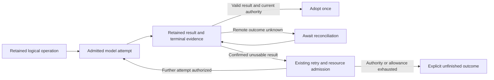

# Documentary Examination and Recovery from Nonproductive Generation

The [original request](24-request-generation-resilience.md) defines the recovery outcome and constraints. The [research](26-research-generation-resilience.md) and [Pi/AI SDK investigation](pi-whitespace-investigation/report.md) establish the baseline and transport evidence. The user approved the architecture and detailed design, including targeted objections, same-operation recovery, the 4,096-character counter and removal of replaced code. Oracle and Architect then blocked the [original candidate](generation-resilience-design-review/tdd-reviewed.md) on lifecycle and transition gaps. The user requested verification and correction of those findings; this revision incorporates the [source and executable verification](generation-resilience-design-review/verification/verification.md). The architecture remains approved. The corrections are specified here but have not received another independent review or implementation verification. No production change, migration or paid qualification is authorized by this document.

## System Design

### Keep submission-time examination and improve its documentary contract

Accepted direction: Sources continues to submit documentary contributions through the existing operation. The server validates exact evidence and authority, a separate model examination evaluates the submitted material, and the domain owner determines effective use. Preserve the current AI SDK structured-examination path and native Pi mission execution; switching transport libraries is not part of this correction. The user explicitly excluded a study of the second call's incremental benefit from this prototype work. Functional verification of the corrected contract remains required.

The examination distinguishes fidelity of a contribution, its permitted documentary use and applicability to each declared need. Faithful attribution does not establish the attributed claim as an observed outcome. Conversely, failure to establish an economic answer must not by itself erase a faithfully represented vendor position. A contribution can remain usable under attribution or context restrictions while an unsupported association with another need is refused. A contribution that overstates its evidence is not silently rewritten or made admissible through a weaker label.

Accepted coherence change: replace the required global boolean with objections attached to identifiable contributions or uses. The examination cannot issue an unscoped veto over independent material. The server validates submitted identities, versions and use restrictions. A useful contextual association does not establish the economic answer, exhaustive coverage or work that was not performed. A complete Sources handoff records accountable preparation under its mandate, rather than a judgment that each economic question is answered. The exact closed output representation and one-time transition belong to Program Design.

### Preserve one submitted artifact and adopt only a complete examination

Accepted cycle: retain the submitted contributions, evidence, need associations and their observed versions as the original logical operation's work. Technical attempts must not create new contribution identities, request another reading from Sources or recreate the preparation. Each attempt retains its own provider receipt, observed termination and resource consumption. Reuse an already valid examination only through the existing exact-identity rules; no semantic-equivalence model or second deduplication engine is introduced.

A complete examination must cover the submitted identities, express only permitted dispositions, and pass current evidence, version and authority checks before adoption. Diagnostic prefixes and partially parsed findings are never adopted as successful controls. Adoption is idempotent and cannot overwrite later contributions or analyst changes. Unaffected valid contributions survive targeted restrictions after a complete control; this is distinct from adopting fragments of an interrupted response.

### The harness continues the retained logical operation

Today, a known invalid first response can be retried inside the running action. An interrupted documentary control remains unavailable after later cancellation/billing confirmation: settlement does not wake the operation, and its scheduled-start and work-reservation guards prohibit re-entry. Separately, EOF without terminal proof can currently be misclassified as a retryable invalid response.

Selected by the user: keep the original logical operation while the existing harness owns any further authorized model attempt. Each attempt has its own receipt and accounting. A retry requires confirmed external termination, no previously adopted result for that work, current authority and remaining attempt/resource allowance. It must not recreate the preparation, clear start markers or replay prior documentary effects. An uncertain connection closure waits for terminal evidence rather than triggering another generation.

The existing operation lifecycle will own durable continuation, with the existing attempt admission and provider receipts. This extends the current one-start contract; it does not globally enable SDK retries. The native agent receives the operation's eventual outcome or explicit unresolved/exhausted state without needing a model turn solely to request a technical retry.

Continuation observes retained facts through the existing operation scheduler and authority owner. A settlement update can make the operation eligible for recovery; it cannot itself authorize dispatch. Each replacement attempt must recheck the active mission/generation, workflow and instruction versions, evidence freshness, pause/cancellation state, execution slot, deadline and cumulative admission. A duplicate wake observes retained work. An expired or cancelled operation cannot gain another call from late billing, and an already adopted result cannot be regenerated. Exhausted recovery remains explicit unfinished work.



### A confirmed terminal attempt can retain its financial reservation during recovery

Selected by the user: confirmed external termination and final financial settlement remain separate facts. When final cost is missing, retain the earlier attempt's full financial reservation and allow a further authorized attempt only if existing cumulative admission covers both reservations. Final billing subsequently settles the original receipt through the existing accounting owner. A missing cost never becomes zero, the old reservation is not released to fund the new attempt, and the grant is not enlarged. Unknown remote outcome and cost conflicts remain separate blockers. Existing attempt, deadline and authority checks still apply independently of available funds.

Terminal evidence must come from an explicit provider terminal event or an identity-matching provider cancellation confirmation. Local abort, socket closure, a generation ID, a known charge or an SDK-inferred finish value cannot independently prove remote termination. Preserve the original outcome and evidence source rather than converting every failure into retryable invalid output. The provider metadata reader must be able to retain verified cancellation separately from a valid final cost. The existing retry selector remains responsible for deciding which confirmed failures are recoverable; no unconditional retry of all terminal failures is introduced.

### Early detection counts consecutive JSON whitespace outside strings

Selected by the user on November 26: use the number of consecutive JSON whitespace characters outside string values as the primary detector for now. This refines the earlier whitespace-without-progression direction and replaces a new duration-without-progress threshold as the preferred criterion. Count only space, tab, line feed and carriage return in a visible response that has begun. Preserve the count across provider fragments; a non-whitespace character ends the sequence. String contents, escaped quotes and initial reasoning must not be mistaken for an outside-string sequence. This is a narrow generation safeguard, not an aggregate response-size, SSE-wire-byte or semantic-repetition limit.

Observation must precede the application's current text packing, while the native SDK remains responsible for decoding and schema validation. An unchanged partial object alone is insufficient: an executed native-parser probe returns the same partial object for an open string key and an outside-string incomplete value. The public partial-output API does not expose lexical string state. The counter therefore needs only a private lexical observation of quotes and escapes across fragments; it must not construct values, repair JSON or replace the native parser. Existing execution deadlines and the selected terminal-evidence/recovery rules remain effective.

Accepted initial threshold: interrupt when the run reaches 4,096 consecutive outside-string JSON whitespace characters. This is an explicit prototype safety policy, not a JSON grammar limit, model capability or claim that every interrupted output is invalid. Retained-data measurements found 158 consecutive outside-string JSON whitespace characters in one successful response and 1,131,782 in an interrupted historical response. The two inspected qualification archives and the later two diagnostic successes supply only three successful one-shot documentary responses, so they cannot establish a general false-stop rate. Legitimate JSON can contain more insignificant whitespace and may be interrupted under this selected policy. Keep the named value in the existing resource-policy owner, with purpose, unit and policy identity retained for the invocation; do not copy literals into callers.

The detector targets eligible shared structured one-shot calls, including documentary examination and its existing qualification/comparison siblings. It is not automatically applied to free-form Pi text or all native tool arguments. Capture the received diagnostic text without converting its whitespace into evidence. A detector interruption is a distinct technical outcome and follows the accepted remote-termination/recovery cycle; hitting the counter is not proof of remote cancellation. No additional progress-duration threshold, provider pin or automatic SDK retry is selected.

The [Pi/AI SDK investigation](pi-whitespace-investigation/report.md) establishes that excessive whitespace was already present in the OpenRouter-origin trace and that both installed transports preserve identical replayed whitespace. Neither switching SDKs nor the counting policy is a demonstrated repair of upstream generation.

### One current contract, verification and delivery boundary

Accepted constraint: after a verified transition, the affected runtime uses one current examination contract, detector policy and scheduling representation. Remove the replaced validators, instructions, executable definitions and version-dispatch branches; do not retain them as a compatibility mode. Version identities remain useful for audit without keeping their executors alive. Preserve historical evidence, receipts, decisions and original findings. An old global control cannot become a new per-need approval by conversion. Program Design specifies a bounded transition and retirement within the existing owners, without a second engine, generic migration framework, data reset or automatic model re-examination.

Required verification uses the real shared and domain boundaries, replacing only external nondeterministic I/O. Cover faithful attributed material versus overstated outcomes; different applicability across needs; targeted coherence restrictions with independent material preserved; complete/invalid/unknown control outcomes; and stale evidence or authority. Counter cases include the exact 4,095/4,096 boundary, fragment splits, mixed JSON whitespace, non-whitespace resets, escaped quotes/backslashes, open keys, long valid strings and initial reasoning. A syntactically complete object followed by a long outside-string whitespace sequence remains subject to the selected counter, but the interruption must not be falsely reported as a JSON syntax error or silently adopted as a normally finished response.

Recovery verification must exercise actual scheduled-operation continuation across action lifetimes, including separate terminal and cost evidence, both reservations, retained attempt limits, lost acknowledgements, duplicate wakes, pause/cancellation, deadline exhaustion and one-time adoption. Cover applicable structured one-shot siblings through the shared owner. Local retained-data replays establish mechanics, not general provider reliability. Any final paid qualification requires a separately authorized targeted mandate; no architectural benefit study or broad comparison campaign belongs to this correction.

Accepted delivery boundary: implement and verify the corrected documentary contract, detector and durable recovery as one coherent correction batch. This replaces the earlier unaccepted alternatives that depended on calibrating a new inactivity duration. The detector threshold's accepted false-stop risk remains explicit; no recovery-only delivery can be described as complete early detection.

## Program Design

The user approved this design direction and requested the bounded post-review corrections below. Names identify additions to existing owners, not another engine or framework. Review findings are tracked in the verification record; specifying a correction is not evidence of implemented behavior.

### Versioned examination result and deterministic use calculation

Keep the current single-request input `{ contributions, evidence, needs }` in `sources/examineContributions.ts`. The server continues reconstructing exact quotations and neighbouring context from immutable captures before dispatch. Do not introduce documentary pagination, additional retrieval, semantic deduplication or an input-format redesign in this correction. Recovery uses the retained original examination input; Sources does not resubmit it.

Replace the current result in `domain/sourcesContracts.ts` with v2, with the matching Zod schema owned by `integrations/documentaryControl.ts` as today. Replace the old validator and examiner instructions rather than retaining a v1 execution path. The new model result has `findings` keyed by each submitted contribution identity and `objections`; it has no global `coherence` boolean. Each finding retains `conclusion`, `permittedUse` and `diagnostic`, with `conclusion` explicitly judging fidelity for the stated documentary use. Add `needs`, keyed by that contribution's exact declared need IDs, with the permitted-use enum as each value. Explanations of restricted associations belong to targeted objections rather than duplicating long diagnostics in every need entry. Do not ask whether the economic question has been answered.

For example, a correctly attributed vendor argument can return:

```json
{
  "findings": {
    "contribution-1": {
      "conclusion": "supported",
      "permittedUse": "attributed_argument_only",
      "diagnostic": "Faithfully reports the issuer's position.",
      "needs": {
        "review-authority": "attributed_argument_only",
        "customer-outcomes": "blocked"
      }
    }
  },
  "objections": [{
    "targets": [{
      "contributionId": "contribution-1",
      "needId": "customer-outcomes"
    }],
    "maximumUse": "blocked",
    "diagnostic": "Provides no independent evidence of customer outcomes."
  }]
}
```

The IDs above are illustrative; production keys are the submitted identities. Every expected finding and declared need must appear once. Unknown or missing keys, illegal uses or malformed targeted objections invalidate the complete result; no partial finding is adopted. Retain the existing closed conclusions and permitted-use vocabulary and current diagnostic capacity rather than inventing another confidence scale.

An objection contains `targets: [{ contributionId, needId: string | null }]`, `maximumUse` and `diagnostic`. A null need targets the contribution; a specific need targets only that association. Targets must exist in the submitted artifact, and each objection has at least one target. Group targets sharing the same contribution and restriction into one objection, combining their explanation rather than repeating the same target. The existing three restrictive uses determine the available groups; no unrelated fixed objection-count limit is introduced. `maximumUse` is a restrictive existing use (`attributed_argument_only`, `context_only` or `blocked`), never an additional factual permission. Every need use narrower than its contribution must have an explaining targeted objection. The server intersects the declared use with the objection restriction; inconsistent or unsupported widening never becomes additional authority.

Extend `domain/sourceSelectionPolicy.ts`'s existing `controlledDocumentaryUse` to consume the current control and an optional need identity. Contribution-level evaluation uses the root finding and contribution-targeted objections. Need-specific evaluation additionally intersects the need finding and applicable need-targeted objections. Missing support, an illegal contribution-kind use, an explicit block or incompatible restrictions remain blocked. Reuse the existing restriction calculation; do not reinterpret the use labels as a numerical ranking. A need finding cannot broaden the contribution's permission. Historical examinations remain audit evidence, not an alternate calculation branch or invented per-need approval.

`domain/sources.ts` remains the shared projection and handoff owner. `controlledSourcesContributions` exposes actual contribution-level and per-need effective uses. `completeSources` associates a contribution only with needs for which its effective use is admissible; it can retain independent useful documentary material even when another association is blocked. A missing need association is not an answered question or established gap. Later `request_documentary_check` restrictions carry the same optional need scope and cannot loosen earlier restrictions. Retention, handoff, consultation, workspace inspection and advisory review consume this shared calculation.

Keep use permission separate from preparation completion. A context-only contribution can be useful to an outcomes question without establishing observed outcomes; it can also fully serve a need whose purpose is contextual. `completeSources` continues validating actual work references, controlled material, examined gaps and explicit unfinished work. Its `complete` outcome and the workspace's `prepared` state mean usable preparation is available under those declared limits; neither means the economic answer or exhaustive coverage is established. Do not introduce a deterministic economic-sufficiency predicate based on a use enum or natural-language need text. Test contextual material with declared unfinished outcomes work as partial, and completed contextual preparation as complete. Faithfulness of the model's declared coverage remains a semantic qualification concern, not a new server guarantee.

Persist v2 with a server-stamped control version and `schemaVersion: documentary-control-v2` in the existing `aiTaskResults` output. The model does not select its contract version. Exact-control reuse includes the control contract version, immutable contributions/evidence/needs and existing rule/restriction identity. A new control is never substituted for a historical result merely because its prose seems equivalent.

Separate the model's strict `DocumentaryControlV2` from its normalized stored availability in `domain/sourcesContracts.ts`. The current `documentary_control` task output retains preparation/evidence/input identity and stores one closed `examination` union. Do not repurpose the existing `documentaryAssessment` author/verification metadata:

```ts
type DocumentaryExaminationState =
    | { state: "examined"; contractVersion: 2; control: DocumentaryControlV2 }
    | {
          state: "not_examined";
          originalReference: Id<"agentExecutionEvents">;
          recordedUses: Array<{
              contributionId: string;
              version: number;
              permittedUse: DocumentaryControlV2["findings"][string]["permittedUse"];
          }>;
      };
```

New successful examination retention creates only `examined`; the model cannot request the other state. One-time conversion creates `not_examined` when the current per-need assessment was never performed. Its reference points to the existing immutable context observation containing the original result; if absent, import that exact result once through `recordContextObservation` with a stable task identity, an explicit import origin and original metadata where known. Do not pretend the import happened at the original examination time. Existing paged history reads the recorded body; no old executable control validator is needed. The shared Sources projection exposes absence of current assessment consistently to workspace, consultation and advisory facts.

Preserve completed handoff membership, original recorded permissions, decisions and completion identity as historical outcomes. Existing handoff references do not store effective use, so conversion must materialize `recordedUses` once through the original policy before retiring it; these are contribution-level historical dispositions, never new per-need findings. Their inspection must not recalculate history as a fresh rejection or approval. New qualification/handoff adoption requires an examined current control; absent current assessment is inspection-only for new use. Current exclusions and adverse restrictions still constrain current reuse and its labels. Conversion makes no model call and does not retrospectively revoke or replay a completed handoff. Readers distinguish the frozen outcome from current examination availability through the shared projection, without old-version branches.

Keep the v2 operation receipt compact: `taskId`, `controlVersion`, the existing context-event `reference`, effective contribution/need uses and objection count. Do not return both the full control and duplicated full diagnostics in the tool result. `retainControl` already records `contributions_qualified` with the control through `recordContextObservation`; expose that immutable event ID so `consult_mission_state({ reference })` can read full details using its existing paging and authorization. Recover the same reference after acknowledgement loss through the existing run/context-key identity. Current projections use bounded diagnostic previews with explicit completeness rather than repeating the complete need-by-contribution matrix everywhere. Retain complete diagnostics in the authoritative control/journal; do not silently trim them into successful findings.

Validate the actual complete control and prepared handoff against the existing domain-storage and operation-capacity owners before committing domain effects. A real capacity failure remains an explicit technical incomplete outcome with the original model response retained through the existing fragmented journal. Do not lower permissions, drop objections or recreate the recently removed aggregate generated-response rejection to fit a receipt. The compact receipt and existing paged history are the normal v2 path, not a second documentary reader.

### Counter, policy snapshot and native terminal evidence

Add one named resource-policy constant for the accepted 4,096-character run and one versioned `structuredOutputPolicy` snapshot. The snapshot contains its supported policy version and effective run threshold; it is fixed for admitted work and retained in invocation/receipt metadata. It is not a new budget or analyst-facing configuration. The current binding pins it when creating the preparation; retries inherit the original snapshot. Required metadata must be present before current work can dispatch; there is no missing-snapshot fallback to the old behavior. The transition below must resolve earlier active preparations without rewriting engaged policy pins. The existing authority deadline and resource-policy contract remain independently authoritative.

Inside `integrations/modelTransport.ts`, add a private lexical counter to the existing raw model-stream middleware before text packing. Its state is only `inString`, `escaped`, `visibleResponseStarted` and the current outside-string whitespace run. It observes text deltas; initial reasoning is not response text. Quotes, backslashes and the run survive fragment boundaries. Inside a string, even a very long space sequence never advances the counter. Outside a string, count exactly SP, TAB, LF and CR; every other character resets the run. This observer neither parses values nor repairs or validates JSON. The installed public SDK partial-output interface does not expose lexical string state, so using it alone is unsafe for open keys.

At exactly 4,096, abort through the existing generation cancellation signal with a typed `structured_output_whitespace` diagnostic. Retain the received raw diagnostic through the current visible-output writer, recording the counter policy and observed boundary. Do not delete or rewrite received characters, suppress usage, impose an SSE byte bound or report the guard as a syntax error. The existing settlement grace bounds capture finalization after interruption. The counter applies through the shared one-shot path for documentary examination, qualification and comparison whenever the pinned policy is present. It does not add separate implementations to each caller or change native Pi free-text/tool generation.

Use native terminal metadata rather than a second SSE parser. The installed AI SDK exposes `rawFinishReason`; its OpenRouter adapter preserves an actual `choice.finish_reason` as the raw reason, while EOF has no raw reason. A November 26 offline native-API probe returned `rawFinishReason=stop` for an explicit finish and null for EOF with otherwise valid JSON. Capture this at the existing provider-stream boundary and include it in the structured receipt. Add an optional `termination` union to `providerCalls.providerObservation`: `{ kind: finished, source: stream, rawFinishReason, observedAt }` or `{ kind: cancelled, source: generation_lookup, generationId, observedAt }`. A stream observation belongs to its admitted invocation/provider-call receipt; lookup cancellation additionally requires the exact external generation ID. Convert earlier cancellation observations once only where their retained identity and provenance establish this evidence; otherwise leave termination unknown. Remove the replaced cancellation interpretation after verification, retaining the original receipt for audit. Keep local abort reason separate. Recognized provider finishes establish termination, while the existing attempt policy decides whether that outcome is recoverable. Normalized `other`, local cancellation, a charge and an ID alone do not establish it.

### Reconciliation and conservative attempt admission

Extend `providerCalls.requestBilling`, `claimBilling`, the existing reconciliation action and settlement transaction to reconcile two independent facts: provider termination and cost. Neither request nor claim eligibility may skip an unresolved terminal outcome solely because a cost is already present. `integrations/openRouterGeneration.ts` validates the returned generation ID, can retain `cancelled: true` even when cost is missing/invalid, and validates any cost separately. `settleBilling` preserves terminal evidence and its source independently of the billing state; conflicts remain visible. Do not release an unknown-cost reservation just because cancellation is known.

`domain/sourcePreparationAuthority.ts` remains the single classification owner consumed by retry selection, preparation accounting and qualification accounting. Under the new policy, a confirmed provider-ended unusable response or a detector interruption with verified remote cancellation can be considered for the existing bounded recovery allowance. A terminal technical observation is not automatically an unrecoverable business failure. Analyst cancellation, stale authority, genuine resource exhaustion and disallowed failures remain ineligible. EOF without explicit terminal evidence remains unknown, including when a complete JSON object happens to be present. Preserve original failure diagnostics and receipts.

`providerCalls.nextPreparationAttemptForInput` and `recordAttempt` continue enforcing the same input's lifetime attempts, deadline, cooldown and cumulative budget atomically. Same-operation automatic recovery consumes the selector's existing same-preparation allowance: currently attempts one and two. `explicit_recovery_required` after the second is an explicit unfinished outcome, not permission for an automatic third attempt. The separate existing third-lifetime-attempt path requires explicit recovery and a linked successor preparation; this correction neither invokes that path from the retained operation nor creates a replacement preparation or increases its ceiling. Respect returned `retryAt` through the existing scheduler. `qualificationUsage.ts` retains the prior full financial reservation until eligible final settlement. Confirmed termination clears execution uncertainty without declaring missing cost zero; the next attempt requires both reservations and all other charges to fit. Accounting-only administration creates no grant or inference authority.

### Worker recovery precedes authorization expiry and closes the abandoned receipt

Do not use `providerCalls.leaseExpiresAt` as the worker-recovery trigger: it is the logical authority deadline plus settlement grace and can be too late for another attempt. At action entry retain the worker's existing platform execution boundary, derived by `resourcePolicy.ts` from the action start and `CONVEX_NODE_ACTION_TIMEOUT_MS`, separately from the transport cutoff returned by `nodeActionGenerationDeadline`, the unchanged logical deadline and financial reservations. The operation owner atomically arms one recovery wake for that worker boundary when it admits the epoch. Normal return with a pending descriptor can advance the same owned wake immediately; a terminal scheduled job can also be inspected without waiting for the receipt's financial fence. No new inactivity duration or arbitrary polling cadence is introduced.

The recovery mutation inspects the owned scheduled job, epoch and retained facts. It cannot replace a still-owned worker merely because its socket is silent. A terminal job or elapsed platform execution boundary permits fencing the abandoned worker; remote uncertainty still prohibits replacement inference until matching terminal evidence arrives. If logical authorization has already expired, retain an explicit unfinished outcome and accounting evidence rather than renewing it. Retain generation identity and eligible reconciliation scheduling atomically when first observed, so a crash before `finishOneShot` cannot leave an identified call without an owned recovery path. Absence of an identity is not proof of non-dispatch.

Extend `execution/invocationLifecycle.ts` with one structured-attempt closure transition, reached by the operation recovery owner after worker fencing. It verifies the original invocation/provider-call/input and operation epoch identity, first reuses an already retained complete validated result, otherwise records an explicit technical `structured_result_unavailable` failure only after remote termination is proven. Close the original `started` receipt through the existing receipt-settlement transaction and `patchQualificationReceipt`, preserving raw diagnostics, lifetime attempt consumption and unknown-cost reservation. A complete capture flag or parseable prefix alone is not a validated retained result. Only after local closure and projection updates may the operation request continuation. Billing supplies factual evidence; it does not declare domain adoption or independently authorize a call. Late original-worker output remains factual and cannot overwrite the fenced result or repeat an effect.

While the new recoverable operation remains authorized and nonfinal, a temporarily unavailable lookup (including the observed generation-not-found response) schedules its next eligible reconciliation using the billing owner's recorded `retryAt` and attempt fence. The same owner prevents duplicate jobs and honors lookup timeout, existing cooldown and the logical operation deadline. This is bounded metadata recovery, not another generation or an indefinite watcher. A repeated missing result cannot become cancellation proof. After the recovery window ends, existing late-accounting/manual-reconciliation behavior remains separate and cannot revive inference.

Recover loss of the reconciliation worker as well as a returned unavailable response. `providerCalls.claimBilling` owns the pending/checking claim and atomically schedules its expiry wake at the existing `retryAt`. That wake can reclaim an expired checking claim under a new attempt fence; an older worker's late settlement cannot change the newer claim. Settlement and its acknowledgement are idempotent: a completed factual update is read before scheduling another lookup or continuation. During authorized recovery the owner can advance the next eligible lookup; after expiry/closure only existing late-accounting authority applies. Missing generation data never becomes cancellation proof, and duplicate claim/wake delivery cannot create overlapping ownership or another inference.

### Rebase materialized accounting before changing its classifier

The new EOF/termination classification changes both run preparation buckets and qualification unknown counters. Recompute `researchRuns.sourcePreparationBudget` and affected context/run `qualificationUsage` rows from their authoritative receipts under the final classifier before ordinary delta updates resume. Extend the existing projection owners; do not introduce another ledger. Advance the preparation budget's version to 2 and add `projectionVersion: 2` to qualification usage, so admission and `patchQualificationReceipt` reject an unconverted baseline rather than subtracting an unrecorded reservation. The final runtime accepts only these current projections; migration-only old validators are removed after cutover. Projection versioning does not change grant amounts or the existing cost-finality policy.

Fence model/lookup admission and drain already claimed receipt writers before recording the conversion frontier; preserve pending accounting jobs for replay after release. Rebase each run/context projection atomically with its current-version marker, using existing indexes and normal Convex conflict handling. Resume across independently completed projection scopes with a task-scoped cursor; never expose a partially recalculated scope to ordinary receipt deltas. Inventory actual cohort sizes against transaction capacity; if a scope cannot be converted atomically, keep the fence and report the specific conversion blocker rather than publishing partial totals or inventing a generic migration engine. Only release the fence when every related run and context projection is current.

Preserve lifetime dispatch counts, recorded charges and their finality policy, full unsettled financial reservations, conflicts and conservative unexplained consumption. Classification may change a work/incident/reserved bucket or unknown counter but does not create unused authority, reset an attempt count, clamp a negative discrepancy or convert unknown cost to zero. Verify conversion twice, receipt-derived totals, cost-only and termination-only updates, and late settlement of closed work. The deliberately stale-baseline probe demonstrates why this step is necessary; it is not evidence that negative counters occurred in production.

### One scheduled operation with fenced continuation epochs

Extend the existing scheduled durable-operation contract with the concrete opt-in `scheduledRecovery: structured_model_v1`. Only eligible current operation definitions declare it; other durable operations retain their one-start behavior. The driver checks that declaration and receipt ownership, never the agent name. Replace `scheduledJobId` and `scheduledStartedAt` with one optional `scheduledExecution` record in `execution/schema.ts`: epoch, dispatch generation, phase (`queued`, `running`, `waiting_provider` or `finished`), owned job/wake references, and the running worker's start/platform deadline. Structured recovery also retains its pinned policy, active call and first structured invocation identity. Validate phase-specific required fields instead of allowing an arbitrary bag of temporary values. The parent native invocation is not the examination invocation. Convert old scheduling facts once, preserving start evidence; non-recoverable operations admit only their initial epoch.

`execution/operations.ts` owns initial claim, `beginScheduledExecution`, continuation scheduling and final `recordResult`. Pass the admitted epoch and dispatch generation through the scheduled action. Claiming a newer epoch fences the previous worker without changing the logical request, original invocation pins or input. The same `(request, epoch, dispatch generation, provider call)` identity must be checked at provider admission, Sources reservation, domain retention, `recordResult` and `settleDispatchFailure`, not just at worker start. Scheduled callers cannot omit the epoch; nonscheduled operations keep their existing authority contract. Late obsolete-epoch results or failures may update their own factual receipt but cannot terminate, overwrite or advance the current epoch. Cancellation and start observation consume this one representation; there is no second scheduler or retry daemon.

An eligible incomplete examination returns an existing `waiting` outcome while recoverable technical work remains. Do not commit a terminal unavailable outcome and later mutate it into success. Settlement of the associated provider call can request a fenced continuation wake. The scheduling mutation validates the call-to-operation link, current policy, nonfinal operation and generation before adding a job. The worker rechecks active authority, execution slot, pause, versions, attempts and budget before actual I/O. Duplicate acknowledgements or settlement events observe the current epoch rather than admit another worker. Existing deadlines still bound the logical operation; a new action does not renew mission authority.

`sourcesMission.reserve` distinguishes initial work reservation from authorized continuation of that exact request. The initial path retains its work/control consumption. The continuation path reuses it, verifies the retained input hash and versions, and bypasses neither source rejection nor current evidence checks. The immutable first examination input is already retained through its linked structured invocation; reuse that journal body and hash instead of adding another bulky work store. A resume must not use `request.invocationId`, which names the proposing agent's invocation, as if it named this separate structured call.

`sources/preparationModel.ts` returns a pending descriptor only for a validated operation whose definition declares structured recovery. `sourcesMissionActions.execute` and `sources/examineContributions.ts` route it to the scheduler with the original call/input identity. Qualification/comparison callers in `sourcePreparationActions.ts` have no such operation request: they consume the same detector and terminal classifier, retain their existing result/reason-code contract, and return explicit unfinished work when durable continuation is unavailable. Presence of an operation request ID alone does not grant recovery. Cover both caller forms; no undeclared scheduler lifecycle or extra Sources generation is introduced.

Separate new-epoch dispatch authority from the existing `adoptionGeneration` rebind. While paused, reconciliation may retain evidence and a waiting state but cannot dispatch. After the real resume path reclaims the visitor slot and restores mission authority, the operation owner can admit a new epoch with the current dispatch generation, rechecking termination, pinned input/policy, attempts, budget and deadlines. Keep the request's original generation as admission history and old invocation pins unchanged. Extend the existing operation authority owner so `sourcesMission.reserve` and `providerCalls.recordAttempt` validate the current admitted epoch's dispatch generation, not a copied exception or the request's obsolete original generation. Setting adoptionGeneration by itself never grants this authority.

Recovery checks retained work before dispatch: first restore an existing final operation result; otherwise recover any already committed qualification/control; otherwise recover a complete retained one-shot result for domain adoption; only then consider another admitted model attempt. `sourcesMission.retainControl` must make control and qualification retention idempotent by the existing run/type/input-hash identity and provider-call ownership. Lost acknowledgement after domain retention cannot insert another qualification or repeat a model call. A later changed head/authority refuses stale adoption without overwriting the retained evidence. Original failure, response, control and operation outcome remain distinct records.

Reach that ordering through `executeScheduledOperation` and `settleDispatchFailure` before the generic uncertain-effect path blocks the mission. For the structured-recovery opt-in, an exception after an actual commit must inspect existing operation outcome, committed control/qualification and complete one-shot result; an eligible retained wait keeps its owned recovery wake. Do not demand an already running/unblocked mission merely to inspect these factual records. Current authority remains mandatory for new domain adoption or dispatch. Truly unresolved effects keep explicit uncertainty and cannot replay. Existing final-operation-outcome recovery already works and must remain unchanged; the missing cases are earlier one-shot and control commits whose acknowledgements were lost.

```text
scheduled worker fails or loses an acknowledgement
  validate its epoch; retain its factual receipt
  operation outcome exists -> recover it
  committed control exists -> recover its receipt and context reference
  complete validated one-shot result exists -> adopt only with current authority
  provider outcome unknown -> retain waiting state and owned reconciliation wake
  provider ended, worker fenced, no result -> close abandoned attempt once
  current dispatch authority and existing allowance -> admit next epoch
  otherwise -> explicit waiting or unfinished outcome; no new inference
```

### A verified transition removes the replaced contracts

Introduce Sources v9 for the submission/check result contracts (operation version 3), carrying forward its native completion behavior, plus Workbench v13 and saved-material inspection v5 for their affected typed results. These replace the executable definitions that require the old documentary representation; they are not additional permanent catalogue variants. Keep the catalogue static and the current selector authoritative. Historical definition IDs, versions and invocation hashes remain audit identities, not aliases that silently resolve to different code.

Before cutover, inventory affected stored controls, projections, bindings, prepared profiles, queued jobs, resumable invocations, Pi checkpoints and unsettled calls. Fence admission and verify that old workers, claims, response settlement and pending tool continuations have drained. Unknown external work that could still resume blocks removal; closed/expired work retains uncertain receipts and conservative accounting without its old executor. Do not clear start markers, change invocation pins, cancel analyst work or issue inference to force cutover. Apply the following one-time mapping through `execution/conversations.ts`, `execution/missions.ts`, `execution/piStore.ts` and `execution/piControl.ts`:

| Retained owner | Required boundary and conversion | Facts preserved |
| --- | --- | --- |
| Idle Workbench conversation | No active turn, engaged request or live Pi writer; settle the previous native tail through its original lifecycle before removal. Set the conversation's future-turn binding to current Workbench. The next turn creates a current mission and reuses its settled append-only conversation session. Queued analyst messages keep order and are admitted only after release. | Transcript/commit hashes, deliveries, published turn/mission records, analyst instructions, framing and queue. No old invocation is rebound as a current response. |
| Quiescent paused Sources mission | Keep the same mission, objective, preparation and completion event. Require no old running invocation, unresolved operation or pending native tool/generation checkpoint needing the removed schema. At a verified native generation boundary, move only the mission's future definition selection and policy snapshot to current Sources, fence its old writer through the existing generation/epoch mechanism and retain native history. Keep the dossier paused; only normal analyst-authorized resume can reclaim its slot and schedule work. | Evidence, contribution identities, work reservations, progress, counters, limits, deadlines and completion ownership. Old invocation versions/hashes remain immutable and cannot acquire current adoption authority. |
| Completed/cancelled historical work | Finish any required native terminal-tail settlement before removing its executor. Keep the mission/turn definition identity and result as historical records; current inspection reads normalized data and audit references without resolving an old executable definition. | Outcomes, decisions, original schema/hash identity, completed handoff membership and financial evidence. No replay or new model call. |

A paused native checkpoint that cannot reach this boundary without old-contract execution is a concrete cutover blocker. Do not replace the mission, delete its checkpoint, reinterpret an unfinished native task under the new schema or keep a permanent fallback. Enumerate the checkpoint boundary and test it on retained/native fixtures before conversion is declared supported; actual stored cohort feasibility remains an implementation preflight check. Perform all cohort conversions and projection rebases idempotently under the fence, then verify current native/runtime tool profiles before removing old definitions and releasing admission.

Use a task-scoped, resumable conversion in the existing persistence owners. Preserve original control bytes, quotations, identifiers, decisions, receipts and hashes through the existing journal/retained-text storage. Convert structural facts only; an old global verdict does not supply missing per-need findings. The current inspection contract must represent an assessment as unavailable when it has not been performed, with the original examination available through its audit reference. Preserve already completed handoffs and decisions as historical outcomes without replaying them or presenting them as newly examined. Reuse of material that requires a current examination follows normal admission; conversion itself triggers no model call. Completed historical observations use the existing history reader as recorded data rather than the old executable validator.

Update the single input/result selector used by runtime `modelOperation`, existing `nativeToolSets` variants, prepared model profiles and schema hashing together. Verify prepared/runtime contract-key equality for the current definitions. Update `domain/sourcesContracts.ts`, `domain/sources.ts`, `sourcesMission.ts`, `sourcesWorkspace.ts`, `domain/savedMaterialOperations.ts`, `domain/workbenchAgentOperations.ts` and `responseControl.ts` at their actual consumer boundaries. Shared documentary summaries expose scoped objections and effective uses, or explicit absence of a current assessment. Reader composition stays intact. Current runtime dispatch rejects unmigrated or inconsistent records explicitly instead of choosing an old schema or treating absent metadata as success.

Verify conversion completeness, preserved content hashes, settled/active work, current bindings and all consumer outcomes before removing transitional code. Then delete the converter, temporary widened validators, replaced definition/profile variants, old examiner instructions, old cancellation/scheduling fields and their fallback branches from the active build. Preserve evidence in data and version control. Removal is limited to contracts superseded by this correction; it does not authorize unrelated cleanup or deletion of historical data. Keep the Sources method package unless its content actually requires a change; update the semantic examiner's instructions in place. No rule depends on phrase matching or a model announcing that it has fixed itself.

### Required implementation verification and bounded delivery

Use test-first changes through the existing transport and Convex integration boundaries. Production tests import real owners and replace only provider HTTP and other nondeterministic external I/O. Add no parallel implementations or pass-through-only tests. Retained examples establish expected documentary use at the domain boundary, without requiring another architecture comparison campaign.

| Boundary | Required representative checks |
| --- | --- |
| Examination and domain disposition | Faithful attributed claim retained while an independent-outcome association is blocked; actual overstatement refused; one objection restricts only targeted material; illegal/missing/foreign identities reject the whole control; later restrictions cannot broaden use. |
| Transition and projections | Convert idle conversation, paused mission at an actual safe native boundary, completed handoff and unfinished preparation independently; preserve bytes/hashes, objective/completion identity, decisions, queue, counters and deadlines. Prove useful resume after deleting old executable definitions and refusal of old-response adoption. Missing current examination has the one canonical availability shape; original observations remain readable and no model call occurs. Unsafe pending checkpoint/unknown resumable work blocks cutover. Current prepared/native/runtime profile keys agree; all replaced fields, validators, definitions and converters are absent from the final build. |
| Projection rebase | Seed old EOF classifications with old persisted buckets and qualification unknown/pending counters; convert twice, then apply cost-only and matching termination updates, including closed work. Receipt-derived and stored totals agree, remain nonnegative, preserve lifetime dispatches and full unresolved financial reservation. Ordinary deltas cannot operate on a stale projection version. |
| Streaming counter | 4,095 continues and 4,096 interrupts; mixed JSON whitespace across fragments; non-whitespace reset; long valid strings and open string keys; escaped quotes and split backslashes; initial reasoning; received bytes retained; complete JSON followed by excessive whitespace is an interruption, not a syntax verdict. |
| Terminal evidence and reconciliation | Explicit finish versus EOF with the same valid body; local detector abort versus verified remote cancellation; cost-only remains unknown and cancellation without cost preserves reservation. Not-found then confirmation uses owned wakes. Lose the lookup worker after claim and lose acknowledgement after settlement: expired checking claim can be recovered, obsolete settlement cannot win, one effective continuation occurs. Wrong identity, conflicts and expiry cannot enable inference. |
| Financial admission | Independently derived fractional-budget boundary, including both attempt reservations at equality and just below the required allowance; no released old reservation, lost charge or reset call count. |
| Durable recovery | Lose the generation worker after identity retention but before finishOneShot with time remaining; drive the actual scheduled worker-deadline wake, prove remote cancellation without cost, close the original started receipt, reserve both attempts, replace once and adopt once before the unchanged logical deadline. Separately exercise positive reuse of an already retained validated result, lost acknowledgements after one-shot/control/final-operation commits and duplicate wakes. No manual mission unblocking or direct recovery-mutation shortcut substitutes for these paths. |
| Epoch and resume authority | Delay old-epoch success and failure until a successor is running; neither can settle/adopt for it. Reconcile while paused, then use actual analyst resume and atomic slot claim to admit a new epoch/current-generation receipt for the same input and preparation. Pause/cancel, expiry, stale instructions/evidence and lost slot block dispatch while factual accounting can settle. Adoption rebind alone cannot authorize another attempt. |
| Existing allowance and shared callers | First recoverable failure permits the second automatic attempt; explicit_recovery_required then stays unfinished and does not create another preparation or automatic third/fourth dispatch. Cooldown schedules rather than spins. Qualification/comparison callers without recovery operations use the same counter/classifier but return their existing explicit unfinished contract. Unrelated durable operations and Pi loops retain their behavior. |
| Preparation meaning | Retain context-only useful material and its restricted associations. Declared unfinished outcomes research yields partial handoff without a fabricated gap; legitimately completed contextual preparation remains complete. No state or copy claims an economic answer or exhaustive coverage from the presence of a contribution. |

Replay the captured whitespace through the real transport after the counter change and compare retained bytes and interruption outcome. This measures mechanics on real retained text with synthetic chunk timing, not upstream repair or historical latency. Exercise the final scheduled recovery and Sources handoff on the matching local backend after successful publication during implementation. Run focused tests first, then affected conformance, execution-ownership, type and documentation checks; run broader checks only when the changed boundaries require them. The final separately authorized qualification targets these corrected operations and honest partial outcomes, without a benefit study of the second model call.

Design verification executed after the two reviews: eight existing focused cases passed; five temporary characterization probes exercised real Convex collaborators and registered action handlers with only provider HTTP replaced and acknowledgement loss injected after real commits. They confirmed blocking after one-shot/control acknowledgement loss, existing successful final-operation acknowledgement recovery, inability to reclaim an abandoned lookup through ordinary claim, and negative counters from a deliberately stale baseline. The lookup probe's first run had a missing fixture generation observation; the corrected run retained the same behavioral assertions. All temporary test additions were removed after preserving their source and results; the original integration test was restored byte-for-byte. These checks establish the current defects and transition requirements, not the unimplemented corrections or a fresh independent approval.

Keep delivery as one coherent correction batch: stage the required schema changes, complete and verify the one-time transition, retire the replaced code and activate the current definitions and policy snapshots under the admission fence. Temporary conversion support is a delivery step, not a supported runtime mode or remaining completion item. Retained active work is not reset to make the new path runnable. Update current technical references only when the accepted contract is implemented and verified, preserving the historical failed qualifications. Program Design approval authorizes neither implementation, data migration nor paid execution.

## Patterns to Follow

- [Shared operations](../../../convex/execution/operations.ts): atomic admission and scheduling, retained outcomes and generation-fenced adoption. Extend their lifecycle rather than adding a retry scheduler.
- [Model transport](../../../convex/integrations/modelTransport.ts): native SDK parsing, exact visible-output capture and transport-owned cancellation. Native partial values remain diagnostic and cannot be adopted as final results.
- [Attempt authority](../../../convex/domain/sourcePreparationAuthority.ts), [provider receipts](../../../convex/providerCalls.ts) and [campaign accounting](../../../convex/qualificationUsage.ts): existing lifetime attempts, external observations and conservative financial reservations.
- [Sources integration tests](../../../src/__tests__/convex/sources/documentary-control-integration.test.ts): real dispatch, persistence and domain adoption, replacing external I/O only. The research probes characterize defects; future correction tests must assert the intended behavior instead.

## Scope

Improve submission-time documentary examination, scoped restrictions, generation interruption and safe recovery under the current shared harness. Preserve native Pi generation/compaction, Convex authority, evidence integrity and OpenRouter's default routing with its existing price guards. The accepted initial detector threshold is 4,096 consecutive outside-string JSON whitespace characters. Retire the replaced code after a verified one-time transition; no maintained legacy execution or compatibility mode is selected. No new inactivity duration, transport migration or expanded resource allowance is selected. Measuring the second examination call's incremental benefit is outside this prototype correction. Sources state/history efficiency remains the separate request in document 22. Paid mandates remain closed.
