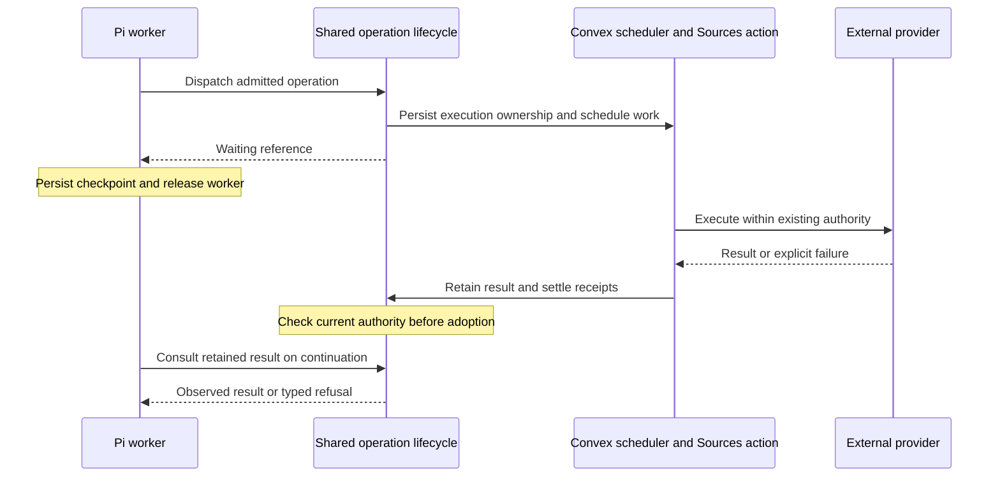
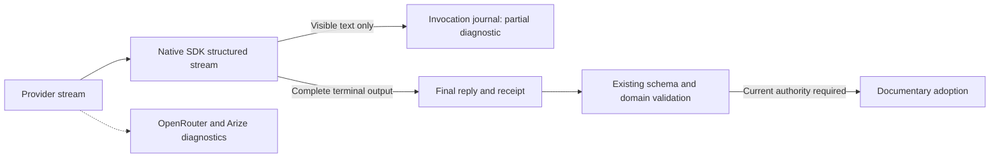

# Technical Design: Sources execution and evaluation integrity

Inputs: [request](/home/abdwhb/projects/decoding-discontinuity/agentic-resilience-workbench-proto/.agents/artifacts/sources-workflow-no-legacy/01-request-sources-evaluator.md) and [research](/home/abdwhb/projects/decoding-discontinuity/agentic-resilience-workbench-proto/.agents/artifacts/sources-workflow-no-legacy/03-research-sources-evaluator.md). The user approved System Design in full and selected scheduled-action declarations in the shared operation contract on November 19. Program Design is ready for its separate review and is not yet approved. Approval of either section is separate from implementation authorization.

## System Design

### All four Sources I/O operations use durable waiting

All four Sources operations that discover, acquire or control material share the same [operation factory](/home/abdwhb/projects/decoding-discontinuity/agentic-resilience-workbench-proto/convex/domain/sourcesAgent.ts:64). Today that factory awaits a child Node action synchronously. The observed failure involved documentary qualification, but discovery and acquisition use the same parent-child waiting structure. Saved-material queries have their own registered behavior and are outside this decision.

The user selected durable waiting for discovery, acquisition, qualification submission and targeted documentary checks through their common entry. The interaction reuses the existing operation request, Convex scheduler, result recording and Pi waiting task. The concrete scheduling/claim transaction and recovery code will be specified after system design approval. The result must remain deliverable after the original Pi worker exits, without scheduling another provider attempt for the same engaged work. All current authorization, cancellation, accounting, identity and adoption checks remain requirements of the selected path.



This gives the existing Sources factory one execution contract and requires regressions for discovery and acquisition as well as both documentary controls. A narrower first correction limited to documentary controls was considered; it would leave the same synchronous parent-child structure in discovery and acquisition. The selected scope does not make every registered `durable_effect` in the application asynchronous. Shared operation mechanics remain in the existing executor; Sources-specific reservation, retrieval, semantic validation and evidence adoption remain in their current owners. Sequential tool execution is preserved; no provider concurrency or authority is added.

Scheduling and ownership must be committed together before returning the waiting reference. A running or waiting operation remains engaged for admission and concurrency checks; yielding the Pi worker does not free authority for another effect in the same sequential mission. Polling or recovering that reference consults existing work, never schedules another copy. Cancellation or a changed generation prevents new I/O and adoption, while a late receipt can still settle accounting. A scheduled worker that dies without an established outcome remains explicitly unknown under the existing recovery contract; durable scheduling is not a promise of exactly-once external delivery or permission for blind retries.

### External observability is configured by the user

On November 19, the user reported enabling OpenRouter input/output logging and connecting Arize. No fresh event has yet verified receipt or correlation. This existing external setup supplies complementary diagnostic evidence. The application retains ownership of execution identity, authority, receipts and adopted evidence; external logging availability cannot authorize or invalidate a domain result. A future authorized qualification checks correlation using the retained generation identity, without adding another external integration in this task.

### Native SDK streaming feeds partial visible output to the existing invocation journal

The user selected native SDK streaming and local retention of visible partial output, with OpenRouter/Arize as complementary diagnostics. The current non-streamed `generateText` path can leave generation identity and cost observations without assistant text. The installed AI SDK supports `streamText` with `Output.object` and visible text chunks. Reuse that structured streaming capability; do not create a separate JSON streaming parser. Hidden reasoning, authentication headers and secrets are excluded from local content retention.



The change applies to the shared structured one-shot transport used by preparation controls, with its existing attempt and capacity policy. Partial text remains an explicitly incomplete protected diagnostic, not a validated result or agent-readable source of documentary truth. Persist the complete terminal reply and receipt before normal adoption. On interruption, retain the last persisted visible prefix and an explicit terminal reason, then use the existing receipt/billing reconciliation. Persisting a partial diagnostic never permits replay of an uncertain call. Persistence failure stops further consumption/dispatch through existing failure handling; it must not silently become success.

This changes the transport mode and requires focused verification of buffering, cancellation, journal persistence and admitted provider compatibility. It cannot capture text never delivered to the client or guarantee every last in-flight chunk survives a process crash. Exact text staging and checkpoint boundaries belong to program design and consume existing resource policies rather than introducing arbitrary limits. Retaining current non-streamed calls and depending on external logs for interrupted text was considered but not selected.

### Evaluation accounting uses one resolved policy before authorization

The research established that the same omitted field selects different policies in Convex and the relay. New campaign preparation resolves the accounting policy in its existing canonical policy owner and pins it explicitly in the prepared manifest. The application execution grant and relay protocol consume that resolved value. Both reject an absent, unsupported or conflicting execution policy before provider I/O instead of interpreting omission independently. Current configurable qualification uses the existing `known_final_v1` contract: reserve the admitted envelope, replace it only with confirmed final cost, and retain uncertainty and conflicts explicitly.

The common rules must cover live calls, refusal before upstream dispatch, incomplete responses, missing or conflicting charges and ledger reconstruction after restart. A relay refusal needs retained evidence that no upstream dispatch occurred; application settlement must consume that evidence through the existing receipt owner rather than treating a response from the relay alone as proof of a provider execution. The precise binding and validation of this evidence belong to program design.

Do not rewrite retained campaigns, ledgers or receipts. Existing authority cannot grow when defaults change. A legacy active protocol with inconsistent or unestablished accounting authority is closed/reconciled or explicitly refused; it is not silently reinterpreted to release budget and dispatch more work. These corrections affect shared campaign, protocol and accounting owners, not one scenario or a larger qualification allowance.

### Each evaluation milestone records its own evidence as soon as it exists

The shared runner distinguishes a persisted Workbench program, the actual first Sources input and completed documentary preparation. Retain evidence for each milestone when observable, even if a subsequent stage fails. The first Sources input proves receipt only for its bound run, program revision, preset and invocation; reaching `sources_prepared` remains a separate outcome. Capturing milestones does not require another model call. A complete-path qualification still tests their combined behavior. Semantic usefulness, execution integrity and controlled partial outcomes remain separately judged.

### Independent evaluation cases continue only after shared state is safe

The user selected continuation of remaining independent cases within the admitted envelope after a settled case failure. The backend runner currently stops on its first failed case; browser execution already checks safety before continuing. Reuse one shared continuation assessment so the two transports cannot disagree about independence merely because one is a backend runner.

Before another case starts, verify that prior work is settled, accounting has no unknown/pending/conflicting or overrun state, shared controls and publication holds are released, no worker/effect remains active, and the grant still admits the next case. Each case retains its own dossier and outcome; configuration and the shared ledger are assessed as shared state. The original failure remains immutable. Continuing consumes remaining authorized resources rather than creating a new allowance.

An exhausted allowance, active work, unresolved provider outcome, conflicting cost or unsafe shared state stops dispatch and leaves the rest explicitly unrun. A continued case cannot turn the failed case or aggregate lot into a pass, replenish authority or replay previously executed cases. Stop-first was considered but not selected because it leaves independent authorized observations uncollected even when shared state is safe. Campaign-level cleanup still revokes dispatch, exports evidence and restores its owned temporary configuration; cleanup is not an instruction to resume failed scenarios.

### Acceptance separates delivery, evidence retention and analytical quality

| Boundary | Required observable result | Failure condition that remains explicit |
| --- | --- | --- |
| Durable Sources operation | Original worker can exit before completion; continuation observes one retained result for the same request. | Unknown worker outcome cannot trigger another external attempt without existing authority and reconciliation. |
| Sequential admission | A waiting effect remains engaged; consultation and duplicate delivery do not create another effect. | Concurrent, cancelled or stale work cannot bypass the generation and ownership fences. |
| Visible-output retention | Persisted visible prefixes survive stream interruption; complete output and receipts precede adoption. | Partial, malformed, cancelled or unpersistable output cannot become an admissible contribution. |
| External observability | A later authorized live check locates the corresponding OpenRouter/Arize record using retained identity. | Missing external logs remain a diagnostic limit; they do not change execution authority or justify a repeat. |
| Accounting | New prepared grants and relay protocols agree on their explicit policy; final charges replace reservations exactly once and survive restart. | Unknown or conflicting cost stays reserved; a proven pre-provider refusal is distinguished from an executed uncertain attempt. |
| Evaluation milestones | Saved program, actual Sources input and documentary preparation have separately bound evidence and verdicts. | A later failure cannot erase an earlier observation or qualify an unobserved later milestone. |
| Case continuation | A settled failure is preserved while a safe independent next case runs under the original remaining grant. | Unsafe state stops the lot, leaving remaining cases unrun and preserving cleanup evidence. |

Implementation uses RED–GREEN–REFACTOR at these real integration boundaries. Deterministic Convex/SDK/relay regressions establish state, authority and accounting effects. A bounded loopback execution check establishes that the actual asynchronous path returns to Pi before its long-running work completes; the archived synchronous timeout remains the before evidence. No new paid run is implied. Streamed provider behavior, OpenRouter/Arize delivery and semantic usefulness remain pending their separately authorized live qualification. In particular, these changes do not establish a cause or a cure for the historical 45,867-token generation.

## Program Design

### The shared operation contract declares its scheduled Node action

The user selected a static scheduled-action alternative in the shared durable operation definition. The current callback-based path remains for other operations. This is a concrete variation already needed by the four Sources operations; it is not a general-purpose task registry.

The Sources factory declares the existing Sources Node action as its execution target. The shared operation claim mutation resolves this declaration from the registered operation, authorizes the request, schedules the action and records waiting ownership in one transaction. Ordinary inline operations and delegation keep their existing paths. The declared target is server-owned metadata, never a tool argument or user-selected function reference. Add a mutually exclusive union of inline `execute` and `scheduledAction` within `AgentOperationDefinition`'s `durable_effect` branch; do not infer execution mode from an agent name or a callback's duration.

```ts
// Proposed declaration shape in sourcesAgent.ts, shared by the four I/O operations.
{
  effectKind: "durable_effect",
  scheduledAction: internal.sourcesMissionActions.execute,
  // Existing input/result contracts, pinning, identity and validation remain here.
}
```

```text
operations.dispatch
  operations.claim                     [one mutation]
    authorize registered operation
    scheduler.runAfter -> sourcesMissionActions.execute
    persist waiting reference + job ownership
    return waiting
  return waiting to Pi

sourcesMissionActions.execute           [the scheduled Node action]
  reserve Sources work once
  perform existing discovery/acquisition/control body
  operations.recordResult
```

The alternative Sources-owned scheduling mutation was technically possible but not selected because it would divide lifecycle ownership. Do not schedule a generic wrapper that synchronously calls `ctx.runAction` on the long-running Sources action; that recreates the failed parent-child wait.

### A waiting request owns one scheduled execution and one result

Extend the existing `agentOperationRequests` record with optional scheduled-job ownership and a one-time execution-start marker. Existing records without these fields retain their current meaning. No additional job or attempt table is needed.

```text
pending
  claim mutation: authorize + schedule + persist ownership
waiting (job owned, not started)
  scheduled worker: atomically claim its first execution
waiting (job owned, started)
  existing recordResult: observe, validate, fence adoption
observed / completed / typed refusal

Worker failure with no established result -> existing unknown/expiry handling
```

`operations.claim` returns the retained waiting reference for scheduled work on repeated dispatch or Pi polling. The scheduled worker calls a shared `beginScheduledExecution` mutation before any reservation or external I/O. It verifies the registered scheduled mode, request/generation and current authority; only its first successful claim may proceed. A duplicate worker returns without writing a competing unavailable result. Running and waiting effects both participate in the existing sequential-admission check. Reads retain their existing capabilities.

`sourcesMissionActions.execute` remains the actual Node worker and computes its generation deadline at its own action entry. It performs the existing work body directly, then records the terminal outcome using `operations.recordResult`; known dispatch failures use the existing classifier and `settleDispatchFailure`. It does not call another Sources action merely to obtain the same result. `sourcesMission.workContext` accepts the scheduled waiting state only when job ownership and the execution-start marker are present, as well as preserving the existing inline running path for already engaged records. Existing reservation checks still reject a second work entry for the same request.

The shared result owner wakes the retained Pi wait task after result observation. If that result arrives before Pi has checkpointed its wait, consultation finds the already retained result; it does not require another worker or model generation. Pending scheduled jobs can be cancelled through existing cleanup. An already engaged external call may still produce a late receipt; generation fencing prevents its adoption. A failed or cancelled worker with an unestablished effect is not automatically re-enqueued. Historical unknown requests are not repaired by redispatch.

### The invocation journal appends visible text and seals a diagnostic prefix

Extend `retainedText.ts` and its existing tables with an explicitly open/sealed append mode. Preserve the current known-manifest staging path for immutable snapshots. Open streams cannot pass `completeRetainedText`; sealed streams carry a verified manifest. Existing records without the append-mode marker continue through the current immutable path.

The invocation lifecycle exposes one atomic append boundary. The shape below is proposed application code, not a new provider API:

```ts
appendVisibleOutput({ invocationId, sequence, text })
finishOneShot({ invocationId, attempt, outputJson, observableReplyJson })
```

`appendVisibleOutput` owns stream creation, invocation/receipt binding, ordered append and counters. It infers the run and generation from the existing invocation rather than accepting them as caller assertions. Identical repeated sequence/content is idempotent; a changed duplicate or sequence gap fails explicitly. The retained-text owner computes hashes and fragment boundaries, preserving split Unicode characters. Invocation metadata references the stream and records capture progress/terminal state separately from validated output. The append path can retain a correctly bound late diagnostic without granting execution or adoption authority; its return value tells the live producer when current authority no longer permits continued I/O.

On normal completion or interruption, the lifecycle seals the last retained prefix with its terminal cause and marks whether capture is complete. Finalization is idempotent. The existing final reply remains a separate canonical response envelope for schema validation and replay; the prefix is transport evidence, never replay input. This deliberate distinction preserves current final-reply consumers rather than creating a second conversation/history system. Protected inspection and campaign export include the referenced prefix and its completeness; model-visible history and analyst UI do not receive the partial diagnostic or hidden reasoning. Existing purge/retained-text cleanup must include the new invocation reference so diagnostic fragments cannot become orphaned.

The writer coalesces chunks that arrive while a journal mutation is in flight and permits only one append in flight. It splits writes at the existing fragment capacity and applies backpressure under the owning transport/journal capacities. It flushes pending visible text on normal termination and controlled interruption. It introduces no guessed time interval, token cutoff or independent retry allowance. Implementation measures actual mutation count, bytes and latency on retained response replays before claiming acceptable resource cost; a process crash can still lose the currently uncommitted suffix.

### One-shot generation uses the SDK's stream and complete structured result

Change `invokeOneShot` to use the installed SDK's `streamText` with `Output.object`. Extend the existing routed-model middleware for streaming so effective capacity, exact serialized request capture and provider header observation remain shared with non-streamed/native adapters. Qualification, comparison and documentary control consume this same owner; their domain schemas and result normalizers remain unchanged.

```text
executePreparationModel
  beginOneShot
  invokeOneShot
    resolve existing authority/capacity/settings
    streamText(output: Output.object(schema), maxRetries: 0)
    consume native fullStream once
      text-delta -> invocation append writer
      error/abort -> preserve cause and cancel consumption
      reasoning/raw parts -> exclude from local diagnostic content
    drain and seal visible prefix
    await complete SDK output and final receipt
  finishOneShot
  existing domain normalization / current-authority adoption
```

Handle rejected output promises and error stream parts explicitly; the SDK's stream errors are not assumed to throw automatically. A terminal stream does not imply a schema-valid object. Preserve the raw visible text when complete output fails parsing/validation, while returning the current typed failure. Persistence failure aborts generation and enters receipt reconciliation rather than becoming an empty success. Provider cost and identity can settle after cancellation even when domain output is unusable. No callback parses JSON fragments or writes hidden reasoning/provider envelopes into the journal.

### Preparation pins accounting policy and execution only consumes the pin

Normalize a missing draft accounting policy to the currently supported `known_final_v1` inside `campaignPreparationSchema`, before mandate hashing, presentation or authorization. Keep historical manifest parsing available for inspection, but require an explicit supported value on newly prepared execution material. `campaign.ts` serializes the normalized value; `authorizeWorkbenchQualification` checks and consumes it instead of independently assigning a fallback. Reauthorization compares the admitted policy with the same pin.

Return the granted policy through the existing protected `qualificationRoute` projection. The relay verifies protocol, route and grant policy agreement before upstream I/O. Update the older standalone `qualify.ts` producer through the same policy owner so it does not create a second default. An old active lot with an incompatible or absent execution pin is refused for further dispatch and remains available for cleanup/reconciliation. Its historical manifest, ledger and outcome are preserved.

For confirmed calls, the existing receipt and qualification usage owners replace reservations monotonically. The relay records conflicting finite charge observations explicitly instead of keeping only the last amount; equal repeated observations remain idempotent. Ledger replay retains that conflict and its reservation. The existing qualification usage/continuation projections expose billing conflict as unresolved state, so a conservatively retained dollar amount cannot accidentally make a conflicted lot eligible to continue.

### A relay refusal releases money only when it proves no upstream dispatch

HTTP status alone cannot distinguish a local relay refusal from a provider refusal. Bind the outgoing fixture-only loopback hop to the existing invocation and generation and to the exact outgoing body hash. The relay already checks the active fixture route and dossier; extend its pre-dispatch ledger entry with this request identity before emitting a typed non-dispatch observation. The relay forwards neither correlation metadata nor a reserved observation marker to the provider and strips such markers from all upstream responses.

```text
Pi transport -> admitted loopback relay
  invocation identity + exact outgoing wire hash
Relay before upstream dispatch
  retain correlated refusal observation
  return matching typed acknowledgement
Pi transport
  verify active fixture hop + identity + wire hash
  existing receipt settlement -> failed / not_dispatched
Qualification usage
  retain failed application attempt, release its financial reservation
```

Only that validated observation can settle the attempt as not dispatched with no provider charge. A provider HTTP 400, an injected refusal after dispatch, a mismatched/malformed observation or lost acknowledgement leaves normal conservative accounting in place. Existing application attempt counting is preserved; physical upstream dispatch counts come from the relay ledger. No new token, public endpoint, account or retrospective ledger-import service is needed. Computing the wire hash at the actual loopback fetch avoids confusing it with mission-state or preparation hashes. Redirects are refused on that hop.

### The existing scenario observer captures milestones before terminal waits

Extend `runCampaignScenarios` at its current snapshot observation boundary, before blocked-turn checks, and retain the latest observable snapshot on failure. Record a Workbench-origin saved program as soon as it appears. Its program revision remains separate from final-turn completion.

Extend the protected qualification fixture projection for the first actual Sources input. Resolve the Sources mission from its preparation, then the first real non-compaction invocation and its retained request/receipt. Bind the dossier, fixed revision, preset, preparation, mission, invocation, provider receipt and request hash together. Prepared request bytes alone do not prove dispatch: missing or unknown transport evidence remains explicitly inconclusive. Reuse existing request fragment readers and the installed serialized input shape; do not reconstruct an ideal request from current state.

```text
snapshot observation
  saved framing -> retained program milestone
  first dispatched Sources input -> retained handoff-input milestone
existing sources_prepared predicate
  terminal documentary preparation -> separate preparation milestone
final review
  execution integrity + per-milestone evidence + semantic judgments
```

`campaign-review.ts` consumes these distinct observations without passing an unobserved downstream stage. Existing campaign snapshots, artifacts and archive ownership remain authoritative; no second evaluation framework or result journal is added.

### Backend and browser failures share one continuation assessment

In the shared scenario failure branch, record the failed case first, release its gates and publication hold, then assess continuation through one code path for both transports. Reuse publication/native-settlement projections and extend the existing protected fixture state with lot-wide pending/unknown/conflicting costs, active or unknown external operations and current grant status. The relay supplies quiescence and unresolved-dispatch state through its ledger owner. Separate dossier IDs or no active Pi writer do not alone establish that detached effects are idle.

Continue only with the next unexecuted case when all shared fences permit it. Otherwise retain the reason and mark later cases unrun. The assessment does not guess the next request's price or reserve a synthetic share; the existing atomic per-call allowance check remains decisive. Final lot failure and campaign cleanup retain their current owners.

### Focused regressions verify effects rather than forwarding calls

| Owner | Required regression boundary |
| --- | --- |
| Shared operation contract and Sources | Real registered operations and `convex-test`: scheduling/claim atomicity, one worker claim, waiting counted as engaged, result-before-wait race, duplicate delivery, worker failure, cancelled/stale adoption, all four Sources operation families. |
| Streaming invocation lifecycle | Real SDK adapter and journal with injected external streams: prefix retained before interruption, complete reply normalization, invalid JSON/schema, persistence failure, Unicode boundaries, duplicate append/acknowledgement, hidden reasoning excluded, late receipt without adoption. |
| Accounting preparation/relay/application | Real preparation-to-protocol-to-grant chain and deterministic relay: explicit matching policy, final cost/restart, unknown and contradictory cost, correlated pre-dispatch refusal, forged/mismatched marker and refusal after upstream dispatch. |
| Shared scenario runner | Real runner with fixture observations: early program/input evidence survives later failure, inconclusive dispatch stays inconclusive, both transports continue only after safe settlement, unsafe shared state leaves later cases unrun, failed lot never becomes a pass. |

Use the existing integration/transport/protocol suites and shared harness fixtures. Add tests under `src/__tests__/` at those owners; do not create isolated forwarding tests or duplicate domain validators in tests. Runtime loopback verification covers actual scheduling/worker release; retained real response replay measures capture resource cost. Live provider compatibility and OpenRouter/Arize correlation remain a separately authorized qualification. These are proposed checks, not checks already run for an implementation.

## Patterns to Follow

- [Operation waiting and result recording](/home/abdwhb/projects/decoding-discontinuity/agentic-resilience-workbench-proto/convex/execution/operations.ts:706): reuse retained request identity and the closed waiting/result contract.
- [Pi operation-result task](/home/abdwhb/projects/decoding-discontinuity/agentic-resilience-workbench-proto/convex/integrations/piMission.ts:263): preserve native checkpoints and continuation rather than keeping an HTTP caller alive.
- [Preparation model execution](/home/abdwhb/projects/decoding-discontinuity/agentic-resilience-workbench-proto/convex/sources/preparationModel.ts:29): keep model admission, attempt identity, dispatch authorization, receipts and eligible technical retries together.
- [Generation observation](/home/abdwhb/projects/decoding-discontinuity/agentic-resilience-workbench-proto/convex/execution/invocationLifecycle.ts:115): billing settlement and visible response observations do not grant stale domain adoption.
- [Retained text storage](/home/abdwhb/projects/decoding-discontinuity/agentic-resilience-workbench-proto/convex/execution/retainedText.ts:47): keep fragment sizing, Unicode boundaries, hashes and sequence checks in this owner; append mode must preserve existing immutable staging semantics.
- [Protected invocation readers](/home/abdwhb/projects/decoding-discontinuity/agentic-resilience-workbench-proto/convex/adminOperations.ts:985): apply existing administration authority and paginated reading to diagnostic text; never expose it through analyst projections.
- [Campaign policy preparation](/home/abdwhb/projects/decoding-discontinuity/agentic-resilience-workbench-proto/convex/qualificationCampaignPolicy.ts:832): resolve new draft policy before the immutable mandate is hashed and authorized.
- [Relay ledger accounting](/home/abdwhb/projects/decoding-discontinuity/agentic-resilience-workbench-proto/scripts/evaluations/workbench-browser/relay.mjs:98): reconstruct reservations, final charges and uncertainty from the same durable ledger at runtime and restart.
- [Scenario failure handling](/home/abdwhb/projects/decoding-discontinuity/agentic-resilience-workbench-proto/scripts/evaluations/workbench-browser/scenarios.ts:963): retain failed outcomes and assess shared state before proceeding to the next unrun case.

## Scope

The design covers Sources execution, interrupted-response evidence and the evaluator's accounting and observation boundaries. The cause of the historical excessive generation remains unknown. Workbench framing-write defects and any new paid qualification are outside this phase. No production change has been made.
