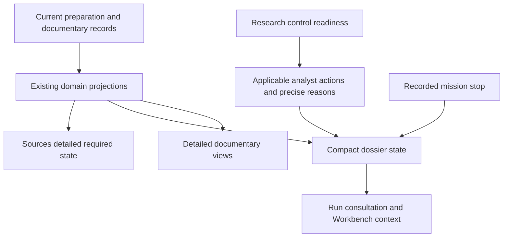
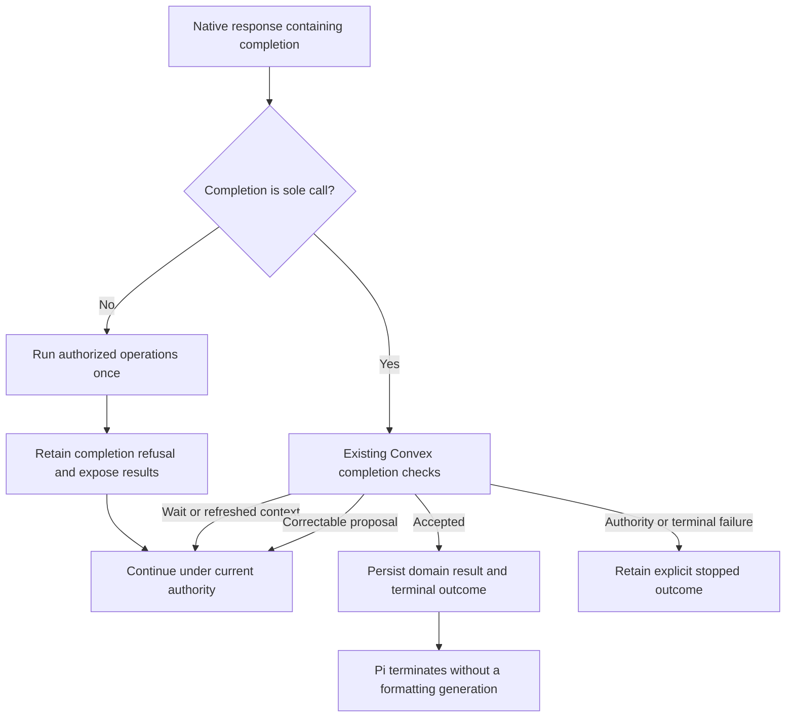

# Sources State, History and Completion

This design follows [the request](22-request-sources-harness-efficiency.md) and [the completed research](28-research-sources-harness-efficiency.md). The shared compact preparation projection, native completion-submission direction, capacity-aware history pagination and separate completion round were accepted during the system-design discussion. The complete system design was approved. Detailed program design is ready for review; implementation is not authorized.

## System Design

### Expose current preparation separately from final membership

Today Sources receives detailed current work in its native required state, while `consult_run_state` exposes only final retained document membership. A running preparation can therefore report no retained documents despite existing captures, readings and controlled contributions. Some unavailable analyst actions also report `human_prerequisite_required` when the mission has no human blocker. Research reproduced both behaviors through the registered Sources 7 path.

The accepted contract extends the existing shared dossier projection with a compact account of current preparation, derived from the same documentary records and rules used by detailed material views. It keeps capture availability, recorded readings, qualification, effective use restrictions and final membership distinct. Pending handoff must be explicit; an empty final list cannot describe the absence of current material. Detailed evidence stays in existing authorized material views and Sources' required working state. The exact summary fields and retrieval cost belong to program design.



The user selected the compact shared projection with access to existing detailed consultations. Dossier consultation will not embed the whole working inventory merely to establish that preparation has produced material. This keeps the shared view small without introducing another persisted state store.

An unavailable action describes that action's applicability. It must not imply a mission block. Actual approval requirements, pauses, capacity refusals and recorded execution stops retain their enforcement. Current projection changes participate in the existing observation pin; retained receipts remain immutable.

### Submit structured completion through a native tool

The current text-only path parses the entire assistant answer as JSON. A valid proposal surrounded by prose is refused before the domain can examine it. Native operation arguments already have tool schemas, but the final proposal does not use that channel.

The accepted direction exposes a completion tool through the existing Pi integration, deriving its arguments from the pinned definition's completion schema. The tool submits a proposal to existing completion validation; invoking it does not itself finish the mission. Convex retains authority, admitted-snapshot accounting, freshness, effect adoption and terminal persistence. Domain feedback or newly engaged work can require further native continuation. Successful adoption can use Pi's existing termination mechanism, subject to the mixed-round behavior below. Ordinary Workbench text replies retain their existing interface.

```text
Native completion proposal
  -> validate original arguments and authority
  -> existing definition-owned completion checks
     -> correction / refreshed state -> continue through Pi
     -> accepted persisted result -> finish through Pi
```

The user selected native completion submission instead of a separate structured finalization generation. This reuses the agent's current loop and avoids requiring a second generation solely to encode its final proposal.

The installed Pi implementation runs `afterTools` before honoring termination and requires every call in the round to have a completed task requesting termination. The contracts below cover mixed rounds and failed or stale proposals; their implementation must be verified through the real consuming boundary, including duplicate finalization and late cancellation. Native schemas improve the submission interface; they do not establish documentary correctness or guarantee provider compliance. Strict-sampling configuration and historical bindings remain program-design questions.

### Fill useful history pages within response capacity

The user accepted explicit historical retrieval through the existing operation: an event reference selects known evidence, an omitted reference browses the immutable journal, and an issued cursor continues the same frozen traversal. Current required state remains supplied by Pi; the operation description must explain that its state field identifies that supplied state rather than promising another complete working inventory.

The current history-result ceiling is 48 × 1,024 = 49,152 serialized UTF-8 bytes, including metadata, content and cursor. This is a buffered tool-result limit, not an LLM response-token allowance or an SSE wire cap. Its technical justification remains part of the limit audit. Size only the requested content: completing a targeted event ends that read even when capacity remains.

Remove the fixed 4,000-UTF-16-unit mission fragment as an independent page boundary. Size returned content against the serialized response envelope and the legitimate read policy, accounting for UTF-8 encoding, JSON escaping, cursor metadata and complete Unicode boundaries. Return a full requested event when it fits; otherwise return the largest admissible prefix with its exact continuation. Multiple short events can share a page. Do not silently read the entire journal or introduce another summary or memory system.

Already-issued cursors and adopted receipts must remain usable under their original authority and frozen frontier. The current inline offset check depends on the old fragment width, so changing the literal alone is insufficient. Program design must specify how the server authenticates old and new positions without accepting fabricated, overlapping or foreign continuations. Exact content and provenance, cancellation and generation/instruction fences remain required.

Audit the conversation-reading sibling in the same pass: its separate 8,192-unit fragment must have a concrete justification or use the corrected sizing mechanism where the contracts match. Storage fragmentation is a different boundary and must not dictate model-facing page size. Verify the purposes of the existing response and row-read limits instead of treating their current values as new product requirements.

The intended benefit is fewer consultations caused by page fragmentation. Measure it by replaying retained traversal payloads and comparing restored content, response bytes and storage work before and after implementation. The model retains the choice to inspect history; this design does not claim that all historical consultations were unnecessary.

### Completion must be the only call in its native round

A completion proposal is admissible only in a round containing that single call. When a model mixes completion with operational calls, retain the proposal and return a recoverable completion refusal; authorized operational calls follow their normal admission and execution path exactly once. Their results and fresh required state become available before the model submits a new completion proposal. Multiple completion proposals in one round are likewise not an unambiguous final result. This rule governs submission, not whether documentary work may continue or how many corrections are allowed.

The user selected a new completion submission after the operational results, rather than automatic later adoption of the original mixed-round proposal. Pi's native all-calls termination condition can therefore be satisfied by a single accepted completion call.

A standalone proposal still cannot bypass engaged work from another invocation, new analyst instructions, changed needs, missing evidence or stale authority. Existing domain checks decide whether to wait, refresh, correct, block or persist the final result. Program design must keep the raw mixed response and all individual outcomes inspectable without creating a second executor or replaying confirmed effects.

### Version the changed interface and preserve retained execution

The proposed rollout adds versioned native-completion definitions for Sources, documentary inspection and the two structured validation agents through the existing catalogue. Historical definitions retain their text-completion decoding and recorded identity; new missions use the new defaults. The shared completion mechanism derives its schema and validation from the definition instead of branching on agent identity. Workbench keeps its text-reply completion. Exact version numbers and native input/profile changes belong to program design.

For the new structured-completion interface, surrounding prose neither corrupts valid tool arguments nor authorizes a final result. A text-only answer cannot complete the mission; it remains observable and receives the existing structured correction treatment. Raw original arguments remain authoritative for validation. No prose-to-JSON repair call or second completion schema owner is introduced.

Shared state and history corrections reach applicable existing callers where their contracts remain compatible. Persisted receipts, authority pins, historical validators and old cursors must remain readable without being silently rewritten. Any changed result shape must have an explicit version/read-compatibility strategy before implementation; widening the current validator alone is insufficient evidence of compatibility. No mission is silently rebound to another agent definition.

### Corrections use existing authority; domain acceptance ends the mission

Correctable submission or domain failures retain feedback and continue through Pi within existing cumulative authority, deadlines and cancellation/generation fences. Known effects are not executed again, and correction does not reset accounting. New work or instructions require the existing wait or refreshed-context path. A cancelled or stale response may be retained for audit and billing without adoption. Domain completion can yield a controlled partial or no-material result; schema acceptance alone never establishes documentary success.

The previous explicit decision to remove automatic non-progress stopping remains applicable. Correct TECH's stale “one bounded continuation correction” sentence to match its Loop Prevention contract; do not add a new completion-count limit or restore `repetition_stop`. This does not alter the separately bounded Workbench advisory response-control correction. Preparation mismatch detection remains a separate contract.



### Acceptance separates execution integrity from model usefulness

Program design must provide real-boundary regressions for running material versus final membership; inapplicable actions versus actual human blockers; old and new cursor continuity with independently derived encoding boundaries; serialized native completion schema and raw arguments; mixed rounds, duplicate completion, changed work, cancellation and retained replay. Historical definitions and Workbench text completion remain covered. Page-efficiency measurements restore the exact retained payloads and compare consultations, response bytes and storage work. Qualifying model choices or documentary usefulness requires separately authorized live work; this design establishes no numerical savings or semantic acceptance.

The user approved this complete system design before program design began.

## Program Design

### Reuse the common operation-result capacity

`convex/resourcePolicy.ts` defines `MAX_HISTORY_RESULT_BYTES = 48 * 1024` and `MAX_OPERATION_RESULT_BYTES = 64 * 1024`. `history.ts` checks the first against `pageJson(...)`; `operations.ts` checks the second against the successful outcome's `valueJson`. Both measure serialized UTF-8 bytes of the same result representation. No separate technical requirement for the smaller history ceiling was found in the inspected owners.

The accepted code change removes the redundant history ceiling and uses the existing common operation-result capacity. This changes the history page's maximum from 49,152 to 65,536 bytes without changing the common operation policy, mission budget or model context capacity. Fit the complete page, not just its content string. Small results remain small. Query-work bounds and retained-text storage fragmentation remain separate concerns.

```diff
- pageJsonBytes <= MAX_HISTORY_RESULT_BYTES
+ pageJsonBytes <= MAX_OPERATION_RESULT_BYTES
```

The user accepted this capacity owner and value during program design. The 20-source mission-page bound limits query work per read; it does not limit the number of pages or mission completion. Conversation scanning likewise retains its distinct database row/byte bounds. Move its inline 512 KiB database-scan value into the existing policy owner with its unit and refusal behavior; it is not a content-fragment limit. Remove the separate 8,192-unit conversation split along with the 4,000-unit mission split. Retained-text storage sizing remains unchanged.

### Derive compact progress from existing documentary facts

Extend `sources.ts` with a cohesive preparation-progress projection that reuses `captureAvailability`, `projectSourceDocumentState`, controlled contribution rules and admitted reading references. Load preparation records once per query, sharing the existing `SourceReviewReads` when a caller already has them. Do not call the full Sources workspace query or hydrate passages merely to build a summary. Capture completeness and successful consultation remain separate facts.

Add one versioned, optional `progress` section under `ResearchState.sources`. Optionality exists for historical observations; current successful projections always supply it. Absence means an older observation without this detail, never zero work. Illustrative field shape, implemented with Convex validators and inferred types:

```ts
progress: {
    version: 1,
    handoff: "pending" | "settled",
    captures: { full: number, partial: number, unknown: number,
                capturing: number, unavailable: number, notCaptured: number },
    qualifications: { recordedSources: number,
                      documentaryContributions: number,
                      contextOnlyContributions: number,
                      blockedContributions: number },
    readings: { visibleReferenceCount: number, referencesComplete: boolean }
}
```

Capture counts describe distinct preparation source identities using the current capture-state owner. Qualification counts use the latest qualification matching the current capture identity/hash; effective permissions come from the existing control and analyst-restriction rules. They are not truth scores. Reading counts describe the existing admitted-reference window, not an invented total: `referencesComplete: false` explicitly preserves incomplete coverage. Final `retainedDocuments` still comes only from the accepted handoff. Missing or corrupt dependencies produce the existing explicit failure, never zero-valued success.

`readResearchState` owns composition; Sources required state, Workbench context and consultation consume the same progress projection. The existing consultation pin hashes the returned projection, so changed summary facts invalidate reuse. Changes only to unreported detail need not invalidate the compact summary; the detailed reader retains its own freshness contract. Current and historical result validators accept the optional versioned section without copying the full old research-state schema. Keep common operation identity unchanged for this additive result extension; old successful receipts replay unchanged. Test an already-admitted read across the change so a new result is never attributed to an incompatible old pin.

`readResearchControlReadiness` distinguishes an action that is not applicable from an actual human prerequisite at its owning branch. `continueSourcesPreparationAvailability` preserves a real readiness block before deciding whether renewal is the applicable transition. Keep the external `actor/applicable/reason` shape, use a precise action-inapplicable reason for ordinary running states, and keep true review/time-limit decisions and all execution checks. UI and Workbench summaries consume that same outcome; no client-side reinterpretation grants authority.

### Authenticate history positions by issued receipts, not a fragment width

Keep the current opaque `history:<requestId>` cursor and receipt structure. `resolvePosition` already requires a completed, successful, adopted read with matching run, mission, generation and instructions. Use its validated position as the only nonzero read offset; initial reads begin at zero. Inline and fragmented journal payloads then accept that authorized range without recomputing a chain of 4,000-character boundaries. No offset parameter is added to the model-facing tool.

Preserve receipt/frontier, reference membership and fragment-hash checks. Strengthen receipt consistency where needed to verify that the returned final fragment and next position agree: a partial event resumes at `offset + content.length`, while a completed event advances at offset zero or ends. Conversation continuations retain their issued database cursor and publication frontier. Do not reconstruct an alternative position when a receipt is invalid. Existing version-1 receipts remain valid; no new receipt field or migration is needed for variable fragment widths.

`journal.ts` remains the immutable range reader. Load at most a candidate range bounded by the common response capacity in UTF-16 units, then fit the serialized page in `history.ts`; this is a safe upper bound on the number of units that can fit in those UTF-8 bytes, not a new cutoff. Reuse the loaded candidate while sizing so trial prefixes do not repeat database reads. Large retained texts continue to read only intersecting storage fragments. Inline historical payloads remain inline; the change does not rewrite archived storage.

```text
readHistoryPage(request)
  authorize and resolve issued position + frozen frontier
  read candidate range from immutable source
  try complete requested event/message with its actual envelope
  if it does not fit:
    find largest complete-character prefix whose pageJson fits
    issue exact next offset
  persist ordinary fragment identities and read receipt
```

Test the full-event fit first: a terminal page uses `continueCursor: null`, which has different overhead from a nonterminal page. For a partial page, fit prefixes using the actual serialized envelope, clipping only at complete Unicode boundaries. If even one complete character cannot fit, return the existing explicit capacity outcome. During unreferenced mission browsing, append further events while byte and source-read policies permit; a referenced read stops at its selected event. Conversation reads may keep one message per page while removing its arbitrary character split. This preserves their existing selection semantics without speculative retrieval indexing.

### Register completion as an executor-owned native tool

Add an explicit `completionTransport?: "native_tool"` capability to `AgentDefinition`; absence retains current behavior. Reject a definition combining it with `textCompletion`. Extend the existing `agentToolSchemas` projection with the reserved `submit_completion` declaration for enabled definitions, using `completionValidator` directly, including its existing `kind: "complete"` literal. The catalogue rejects operation-name collisions. The schema is not copied into a Sources-specific tool or represented as an `AgentOperationDefinition` with artificial business effects.

```ts
// Agent definition: existing validator remains authoritative.
completionTransport: "native_tool",
completionValidator: sourcesCompletionProposalValidator,
```

`modelInput.ts` builds runtime metadata and offline serialized profiles from the same projected tools. `piMission.ts` installs the completion tool beside the operational tools and keeps it during tool refresh. Required context and the root mission instruction describe tool submission for enabled definitions; retained definitions keep their historical JSON/text contract. Include the completion declaration in admitted tool fingerprints and serializer calibration. Keep the current native tool sampling policy and local raw-argument validation; this design does not silently require provider strict sampling or relax the existing model compatibility checks.

### Retain submission identity and reuse the existing finish mutation

Extend the shared invocation response protocol with a native-completion submission envelope. Keep call identity and original argument JSON through validation; `call: null` represents a text-only response where the enabled interface required a completion call. The raw assistant text remains in its existing retained output, not a second field here.

```ts
// Added transport response variant, not a second domain completion schema.
{ kind: "completion_submission",
  call: null | { callId: string; inputJson: string } }
```

`invokeAgentModel.ts` selects this variant only for enabled definitions and non-auxiliary generations. One sole `submit_completion` call becomes a submission; a text-only reply becomes a missing-call submission. Mixed or duplicate completion calls stay in the ordered operations response. In `invocationLifecycle.finish`, those reserved calls become ordinary retained invalid-request refusals with a completion-must-be-alone reason, while other calls use existing admission exactly once. The reserved tool callback resolves these mixed-round invalid requests through the existing operation correlation/dispatch path and returns their refusals without termination; it uses the retained completion disposition only for a sole submission. An unknown reserved name on a retained definition never activates the new interface.

For a sole submission, `finish` checks provider receipt, authority and original call correlation, parses original arguments, validates the pinned definition schema, then invokes the existing completion owner with the immutable admitted input. A missing call, malformed original JSON or schema-invalid arguments use the existing `correctCompletion` path. Apply the existing call-ID validity rules to this response variant too. Missing original wire arguments remain an explicit transport-integrity failure; never substitute SDK-repaired arguments. Keep transport success distinct from domain refusal: successful receipt is not rewritten as a failed provider call merely because a proposal is invalid. Outstanding operations, changed context, domain feedback, publication and final result persistence keep their existing semantics. Preserve the submitted envelope for output-conflict detection; update idempotent replay classification to recognize an accepted native submission as completed.

```text
Pi response -> retain original response and call arguments
  -> invocationLifecycle.finish
       operations response -> admit operational requests / retain mixed-call refusals
       completion submission -> existing definition.complete
  -> Pi tool result reads the retained disposition
       accepted -> control.terminate = true
       correction -> feedback; no termination
       pending -> existing durable wait/resume
```

The completion tool callback does not call the domain completion a second time. Extend `piControl` to resolve the retained disposition for the exact mission/session, generation, invocation and call. Compare raw retained identity and require dossier access; never find a completion by call ID alone. Existing invocation status, block/correction and final mission result own the disposition, avoiding a duplicate completion table. Returning a terminal acknowledgement permits native settlement only, not another business effect or generation.

### Finish the native tail after a committed domain result

`afterTools` currently settles operations and rebuilds context before Pi checks termination. For an accepted sole completion, read the retained terminal disposition and finish the native tail without rebuilding active tools/state. For refusals, retain normal synchronization and refreshed state. A stale or cancelled mission cannot be mistaken for an accepted completion.

Extend existing `nativeInvocation` and `needsNativeSettlement` handling to enabled structured missions, whose current replay lookup is gated by `nativeConversation`. A restart after Convex completion but before the Pi tool acknowledgement must recover the original native response and terminal disposition without model I/O or domain re-execution. Fence this by the original session/task identity and writer lease. A later cancellation or revoked dossier access keeps its existing authority consequences. Test a second crash after the tool acknowledgement and before native session settlement as well.

### Bind new definitions and verify the real consumers

At the inspected baseline, reserve Sources 8, documentary inspection 4, conversation validation 3 and execution validation 3 for the new interface. Recheck availability before implementation and retain Sources 7, inspection 3 and validation 2 explicitly in the existing catalogue. Historical qualification-only definitions remain historical; no Workbench completion version change is needed. New defaults use the shared capability, while retained missions resolve their stored definitions. Update capability-based documentary bindings where they currently enumerate versions so the new definitions retain the same authorized documentary operations.

Regenerate `piInputProfiles.json` through its existing offline serializer test (`UPDATE_PI_INPUT_PROFILES=1 pnpm exec vitest run src/__tests__/convex/execution/pi-input-capacity.test.ts --maxWorkers=1`), then rerun it without the update flag. Preserve historical profile entries needed by pinned configurations. Check registered definitions through the existing conformance suite and execution ownership checker. No dependency change or live model preparation is part of this design.

| Boundary | Required representative proof |
| --- | --- |
| Shared state and actions | Running captured/read/qualified work with pending handoff; genuine human pause; unavailable action without mission stop; actual stop; partial/no-material handoff; latest capture/qualification and restrictions; incomplete reading window; historical progress absence and pin/reuse changes. |
| History | Old issued inline and fragmented cursors resumed under new sizing; exact hash restoration; foreign/stale/corrupt cursor refusal; targeted versus chronological selection; UTF-8/UTF-16/escaping distinction; independently derived exact fit and one-character overflow including cursor overhead; sibling conversation path; no material skipped or repeated. |
| Native completion | Serialized declared schema and original malformed arguments; text-only response; valid sole call with prose; domain refusal and successful correction; mixed call before/after operational calls and duplicate completion; post-admission work; pending durable operation; stale instructions and cancellation. |
| Replay and integrity | Duplicate finalization; lost acknowledgement; crashes on each side of native terminal acknowledgement; one retained domain result, unchanged provider/effect accounting and no paid redispatch; representative retained definitions and Workbench text completion. |
| Resource use | Before/after immutable real-payload traversal measurements plus the existing synthetic fixture, exact content equality, total consultations, serialized response bytes and logical storage reads; no claim that all inspection turns were waste. |

Implementation uses test-first checks at the existing Convex/native boundaries, including a native-provider fixture that exposes the missing completion declaration or rejected reserved call before the integration is added. These are corrections to existing execution and completion contracts; record each intended RED failure before production edits. Run focused tests while changing behavior, then applicable conformance, ownership, serializer, type and documentation checks. Local synthetic provider responses establish execution behavior only. Further live qualification requires its own mandate.

### Documentation and design-quality review

Update the owning passages of `context/TECH.md` for completion transport, corrections, current-state presentation and history capacity; update `docs/ROADMAP.md` only after verified delivery. Preserve historical decisions and dated evidence with supersession notes where necessary. No new normative document or production state store is introduced. The new response variant records a real transport distinction; the definition capability represents existing historical and new interfaces. Existing domain rules, native generation, persistence, budgeting and effect adoption each keep one owner.

Program-design review is pending. Only this ignored TDD was changed during design; repository documentation checks and local link checks do not establish implementation correctness.

## Patterns to Follow

- [Research state](../../../convex/domain/researchState.ts), [documentary state](../../../convex/domain/sources.ts) and [Workbench context](../../../convex/domain/workbenchContext.ts) already own projections. Extend their shared rules instead of copying state interpretation into prompts or adding a parallel persisted summary.
- [Research control readiness](../../../convex/execution/researchControl.ts) and [approval actions](../../../convex/execution/approvalCatalog.ts) own applicability and transition enforcement. Preserve transaction-time rechecks.
- [Common operations](../../../convex/execution/commonOperations.ts), [history](../../../convex/execution/history.ts) and [journal](../../../convex/execution/journal.ts) own authorized reads, immutable receipts and continuation membership. Pi retains transcript replay and compaction.
- [Agent definitions](../../../convex/execution/agentDefinition.ts), [invocation lifecycle](../../../convex/execution/invocationLifecycle.ts) and [Pi integration](../../../convex/integrations/piMission.ts) own completion and adoption. Sources retains its domain accounting and freshness checks; shared mechanics must not branch on the agent's name.
- Reuse the real consuming boundaries and retained fixtures identified in the research. Implementation must demonstrate the defect before fixing it and measure history restoration on the retained payloads. Fewer pages do not by themselves establish better model judgment.

## Scope

This document covers truthful state presentation, history access and completion contracts. It preserves evidence restrictions, analyst authority, cumulative accounting, cancellation and stale-generation fences. It does not redesign documentary acquisition, repeat delivered SSE or billing fixes, or select a remedy for unexplained upstream generation failures. Documents 24–27 retain their separate generation-resilience scope. Reference updates belong to the approved design's existing owner, `context/TECH.md`; this working document adds no normative owner.
