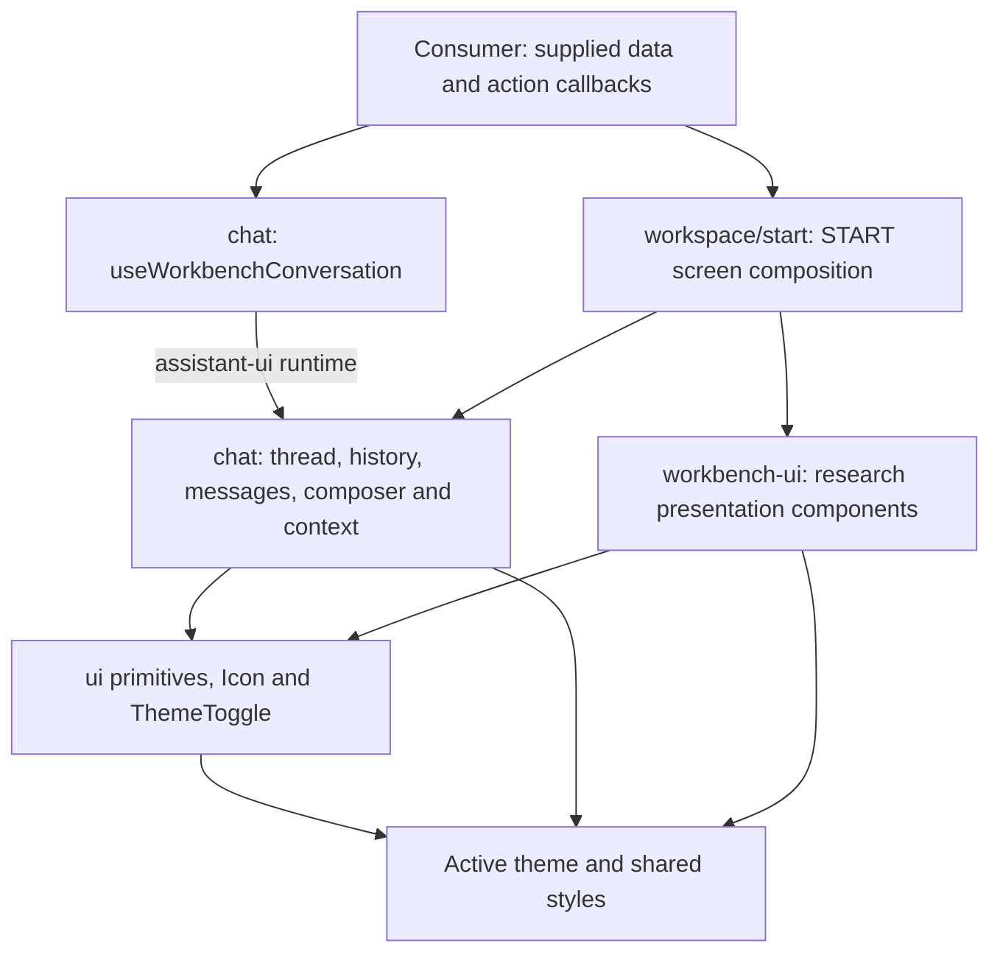

# Component and Primitive Map

This is a source navigation guide for reusing the chat, START screens and question-led Workbench library. It describes existing responsibilities and integration limits; [PRODUCT.md](../../PRODUCT.md), [TECH.md](../../context/TECH.md) and [DESIGN.md](../../DESIGN.md) remain the owners of product, execution and visual contracts. Linked implementations own their current APIs.

## Composition layers

The consumer supplies the same externally owned state to the runtime and presentation. The START gallery supplies illustrative state through its [preview controller](../development/workbench-ui/start-conversation-preview.ts). The [connected dossier consumer](workspace/start/connected-start-workspace.tsx) instead uses Convex projections and authorized framing/conversation operations. Its Workbench model route remains disabled pending qualification; the gallery never supplies production workflow state.

## Chat foundation

| Need | Entry point | Responsibility and reuse boundary |
| --- | --- | --- |
| Adapt supplied conversation state to assistant-ui | [useWorkbenchConversation](chat/workbench-conversation.tsx) | Accepts messages, draft, response state, queue and delivery/stop callbacks. Owns transient sending/failure feedback and composer synchronization; the caller owns saved history and business operations. |
| Lay out a conversation | [ConversationThread, ConversationThreadLog, ConversationThreadDock](chat/conversation-thread.tsx) | Supplies runtime context, scrolling history, reader-controlled following, Jump to latest and a separate measured dock. START screens already compose these pieces. |
| Render chronological history | [ConversationHistory](chat/conversation-history.tsx) | Places supplied messages, turns and missions in one ordered history. Resolves mission references and agent identities without creating execution state. |
| Render a conversational turn | [ConversationTurn](chat/conversation-turn.tsx) | Shows the current operation and an on-demand chronological work reader; folds terminal work before the visible answer. Receives its lifecycle rather than deriving completion from message text. |
| Render independently running work | [ConversationMission](chat/conversation-mission.tsx) | Displays one supplied agent mission, operations and elapsed time independently of response generation. It does not dispatch work. |
| Show an operation or a work group | [ConversationActivity, ConversationActivityGroup](chat/conversation-activity.tsx) | Owns connected operation rows, detail disclosure and terminal grouping. Its shared work mark and status render all six supplied states; running loops pause offscreen or while the document is hidden. Consumes observable outcomes rather than technical reasoning traces. |
| Supply agent identities | [ConversationAgent, ConversationAgents](chat/conversation-agent.ts) | Maps supplied identity keys to display names. An agent identity is distinct from a message role or provider. |
| Render runtime messages | [ConversationMessages](chat/workbench-conversation.tsx) | Reads the supplied runtime messages, resolves agent attribution and renders Markdown, actions and progress notes. Uses the shared Message family. |
| Compose a message directly | [Message family](chat/message.tsx) | Message body, author/time metadata, streaming treatment and icon-only copy feedback. Direct messages can supply accessible attribution without adding a repeated visible author heading. |
| Write, send, queue or steer | [ConversationComposer](chat/workbench-conversation.tsx), [composer actions and queue](composer/conversation-actions.tsx) | One mounted input with delivery controls, recovery and contextual submission. The composer normally composes its queue/actions; their callbacks require real conversation operations in a connected consumer. |
| Share research and chat input composition | [ComposerSurface and ComposerToolbar](composer/composer.tsx), [tools menu](composer/tools-menu.tsx), [model picker](composer/model-picker.tsx), [slash commands](composer/slash-commands.tsx) | One visual owner for field/toolbar materials, one plus menu and shared catalogue presentation. Native assistant-ui owns chat input and slash selection; each connected consumer owns its submission and saved model choice. |
| Show a pending artifact | [ConversationPendingPanel](chat/workbench-conversation.tsx) | Foldable pending content with launch/action footer and composer attachment. A summary-only state accepts a header action when there is no body to inspect. Keeps unfinished content mounted outside the transcript. |
| Show header context and references | [ConversationHeader, ConversationContext, ConversationReference](chat/workbench-conversation.tsx) | Header identity and floating Plan/Outputs/Sources/Work inspection. The consumer supplies content and can control open state across screen changes. |
| Ask for contextual input | [AgentQuestion family](chat/agent-question.tsx) | Choice and written-answer UI, validation and keyboard interaction. Persistence, branching and the consequence of an answer belong to its consumer. |
| Request and confirm an approval decision | [ApprovalCard](chat/approval-card.tsx) | Neutral approval request and receipt card (`role="group"`, disabled-reason descriptions, keyboard Tab order and receipt focus handoff). Contains no action-specific copy or Convex wiring. |
| Connect a Convex approval request | [ConnectedApprovalCard](workspace/approvals/connected-approval-card.tsx) | Queries `api.execution.approvals.get`, submits choices and revokes standing grants for one `Id<"approvalRequests">`, translating request status and block codes through [approvals presentation](../lib/presentation/approvals.ts). |

### State ownership

| State | Owner |
| --- | --- |
| Saved messages, delivery intent, turns and execution authority | Convex conversation/execution records and operations; inspect [conversations.ts](../../convex/execution/conversations.ts). |
| Framing, research start, source selection, evidence and judgments | Their domain owners in Convex, located through TECH.md. Conversation text and UI status are not substitutes for these records. |
| Display projections: ordered entries, identities, turn/mission snapshots | Supplied by the consumer from authorized data. Connected consumers use generated Convex types at the data boundary. |
| Ordinary draft and contextual add/edit drafts | The dossier-level consumer supplies draft changes and submission callbacks. The runtime synchronizes the field; changing screen or composer mode must not create another authoritative transcript. |
| Sending/failure feedback | The conversation adapter around the supplied delivery callback. |
| Disclosure, focus, panel size and reading position | The relevant presentation component or its controlled consumer. These are UI preferences, separate from persisted research progression. |

## START compositions

Most exports below live in [start-screens.tsx](workspace/start/start-screens.tsx). The components receive state and actions; [DESIGN.md](../../DESIGN.md#components) defines their styling ownership.

| Need | Component or module | What the consumer supplies |
| --- | --- | --- |
| Initial research input | [ResearchComposerView and company lookup pieces](workspace/start/research-composer-view.tsx) | Controlled intention, company candidates/selection, reference tools and actions. [StartResearchPage](workspace/start/start-research-page.tsx) owns the connected dossier-creation journey and page composition; the input view does not own page layout. |
| Entry and showcase composition | StartEntryScreen, StartShowcaseCard, StartAngleSuggestions | Composer, example content and selection callbacks. |
| Company confirmation | CompanyMandatePanel | Company identity, mandate, coverage controls, pending/error feedback and confirmation callback. |
| Framing conversation | StartFramingScreen | One supplied runtime, history, identity/context, pending action and composer slots. It places the action/composer dock outside scrolling messages. |
| Context clarification | FramingClarification | Question, proposed choices and submission callback; it composes AgentQuestion rather than owning the research scope. |
| Proposed research program | FramingProposal | Questions, selection, clarification, edit/add requests, composer, launch callback and guarded states. It owns question browsing and presentation, not saved question changes. |
| Post-launch layout | StartResearchScreen | The same conversation runtime/history, context/composer and documentary heading/counts/stages/lanes/gaps. Desktop uses resizable Progress/Conversation panels; mobile opens the mounted conversation in a sheet. |
| Small START presentation pieces | StartRequestMessage, StartSourceCounts, StartSourceStages, StartSourcesHeader, [StartDossierHeading](workspace/start/start-dossier-heading.tsx) | Text, dates, actual progress/counts and navigation callbacks. They do not infer research completion. |

The connected dossier consumer keeps persisted history and its current draft while switching between StartFramingScreen and StartResearchScreen. During question addition or editing, the existing gallery places the same composer inside the program; ordinary conversation uses the attached composer slot. The [gallery consumer](../development/workbench-ui/start-screen-examples.tsx) demonstrates that composition, while its preview controller also contains simulation and sessionStorage migration that are not production workflow logic.

## Sources compositions

[SourcesWorkspaceFrame](workspace/sources/sources-workspace-frame.tsx) supplies the section navigation slot, location trail and heading. [sources-screens.tsx](workspace/sources/sources-screens.tsx) composes SourcesPreparationScreen (documentary needs against questions, with how preparation ran on demand), SourcesMatrixScreen (single-choice filter menus whose first option means no filtering, paged with the shared pagination hook and controls; the consumer orders rows by contribution) and SourcesReaderScreen (a one-viewport workspace with the source list beside the notebook reader, a list opening a drawer below 768px; it keeps the analyst's show/hide notes choice across sources) from supplied presentation figures, rows, documents and callbacks. The [connected Sources section](workspace/sources/connected-sources.tsx) supplies them from the authenticated Sources-mission projection through the [Sources presentation mapping](../lib/presentation/sources.tsx); the [gallery consumer](../development/workbench-ui/sources-screen-examples.tsx) uses illustrative data. Reader follow-ups prefill the Workbench composer and are never sent without the analyst. The former corpus-review owners (LiveSourceReview, SourceContextPanel, SourceBrowserView and related components) are retired to `archive/legacy-source-review/` and are not built.

## Question-led Workbench presentation

[workbench-ui/index.ts](workbench-ui/index.ts) is the library export surface. [WorkbenchUiRoot](workbench-ui/root.tsx) scopes its [materials](../assets/styles/workbench-ui/index.css) and carries the selected theme into supported portals. These components consume supplied presentation data and callbacks; their presence in the library does not establish connected workflow delivery.

| Need | Component | Integration detail |
| --- | --- | --- |
| Shared panel material | [GlassPanel](workbench-ui/glass-panel.tsx) | Existing surface, emphasis, radius and shadow. Consumer geometry can remain local without copying the material. |
| Section or integrity marker | [Chip](workbench-ui/chip.tsx) | Library section, curated, illustrative and live/not-live presentation. General controls and semantic badges remain in ui. |
| Earlier framing composition | [FramingControls](workbench-ui/framing-controls.tsx) | Separate reference composition with angles/options/replies. The current START program uses FramingProposal and the chat composer instead. |
| Documents moving through preparation | [SourcingLane](workbench-ui/sourcing-lane.tsx) | Supplied document cards, counts, state and active emphasis. |
| Preparation handoff | [Handoff](workbench-ui/handoff.tsx) | Owns a cancellable automatic-continuation countdown. Its navigation semantics differ from an explicit-only action. |
| Workspace progress and inquiry | [ProgressTimeline](workbench-ui/progress-timeline.tsx) | Supplied steps and question rows; their meaning comes from the actual workflow. The steps stack vertically when their container is too narrow for five labels. |
| Mission and question overview cards | [WorkCard](workbench-ui/work-card.tsx), [QuestionCard](workbench-ui/question-card.tsx) | Scenario-specific progress/navigation presentation. Inspect supported states before using them for a different mission. |
| Inspect an assertion use | [EvidenceMatrix](workbench-ui/evidence-matrix.tsx), [EvidenceUsePopover](workbench-ui/evidence-use-popover.tsx) | Supplied rows, question uses, passages, restrictions and inspection callbacks. No evidence admission or persistence. |
| Inventory access and modal composition | [InventoryDock](workbench-ui/inventory-dock.tsx), [InventorySheet, InventoryUse](workbench-ui/inventory-sheet.tsx) | Controlled counts, filtering, sorting and content; the sheet uses the existing LinearModal and supports focus restoration. |
| Read supplied documentary content | [SourceReader](workbench-ui/source-reader.tsx), [SourceReaderList](workbench-ui/source-reader-list.tsx) | Supplied pages, passages, contribution descriptions, observed links and actions; it does not retrieve documents. The reader is a notebook: every cited passage (a contribution `target`) gets a numbered marker in reading order across excerpts, and its note lists what it contributes. `noteMode="margin"` sets notes beside passages, `inline` opens them under the passage; notes keep one position per width; one control shows or hides all notes and the citation stepper (also j/k) opens the focused note. Uncited paragraph runs fold (Full text restores them), a question chip jumps to its first citation, and `followUps` render in a header Follow up menu. Supplied `questions` narrow the citations; `focusNeedId` starts on a need's first citation; contributions without a passage stay as unplaced notes. `sourceId` resets the document per source and `arriving` plays the arrival of a newly selected one. SourceReaderList adds a filter, collapsible groups and a Go to conflict link (`onOpenConflict`); the reader's `focusConflict` and Conflicts filter step through conflicting citations, `questionTexts` supplies full question text, and below the margin width an explicit note line replaces the marker as the note control. |
| Map documentary needs to questions | [DocumentaryNeeds, NeedMark](workbench-ui/documentary-needs.tsx) | Supplied needs, the questions each serves and their prepared, gap or unfinished outcome. The need column keeps a reading width and question columns share the rest; a mark's tip shows the question it serves and the outcome, not the need again. [QuestionTag](workbench-ui/question-tag.tsx) explains a Q label's full question on hover, focus or tap. Long needs clamp to two lines with an explicit Show full need control, and the Outcome column lists each need's documents behind a collapsible count (`onOpenSource`); a reason shared by several needs is passed once as `notice`. Selecting a question brings the needs it relies on forward; each mark explains its need, question and outcome on hover or tap. Outcomes stay per need and never become a verdict on the question. |
| Summarize how preparation ran | [PreparationStageCard, PreparationRows, PreparationStageRow, DisclosedLimitation](workbench-ui/source-preparation.tsx), [ReadingBar](workbench-ui/glyphs.tsx) | Supplied stage figures, discovery outcomes and limitations; nothing is inferred about completion or sufficiency. Capture labels describe capture completeness, not agent reading; ReadingBar shows never-captured candidates as their own segment. |
| Compare every source | [SourceMatrix](workbench-ui/source-matrix.tsx), [ReadingGlyph](workbench-ui/glyphs.tsx), [ClassDistributionBar](workbench-ui/class-distribution-bar.tsx) | Supplied identity, reading, contribution, restriction, control and selection per row. Membership, reading, contribution and use stay separate columns; the consumer owns filtering. The source column stays in view while the others scroll, and an optional `footer` closes the frame, typically with pagination. |
| Explain a label or figure on hover, focus or tap | [HelpTip](workbench-ui/help-tip.tsx) | A focusable trigger with its own accessible name and short supplied content. Use it instead of a tooltip wherever touch screens must reach the explanation. |
| Present an appraisal or control result | [AppraisalBlock](workbench-ui/appraisal-block.tsx), [ControlConclusion](workbench-ui/control-conclusion.tsx) | Supplied argument and result presentation. AppraisalBlock still includes fixed classification/control labels; inspect these before connecting real analytical states. |
| Show a hypothesis and its evidence | [HypothesisNode, EvidenceLeaf](workbench-ui/hypothesis-node.tsx) | Supplied hypothesis state, explanation and evidence leaf content. |
| Explain an economic mechanism | [MechanismDiagram](workbench-ui/mechanism-diagram.tsx), [MechanismNode, MechanismRelations](workbench-ui/mechanism-node.tsx) | Supplied actors, relationships, positions and rationale. Relationships are not generated or validated here. |
| Present a brief and its references | [Cover](workbench-ui/cover.tsx), [BriefReference, BriefSection, BriefMarginNote](workbench-ui/brief-reference.tsx) | Brief identity, reading content, references and margin notes. |
| Explain a result or limit | [OutcomeCard](workbench-ui/outcome-card.tsx) | Supplied outcome kind, explanation and next-action content; no analytical judgment or transition occurs inside it. |

### Similar names with different responsibilities

- The library EvidenceMatrix is a supplied presentation. [workspace/EvidenceMatrix](workspace/evidence-matrix.tsx) is the installed reactive evidence reader, and [EvidenceInventory](workspace/evidence-inventory.tsx) provides its connected dock/sheet. Library adoption does not replace those data owners or authorize changing their contracts.
- The library InventoryDock can show a supplied class distribution. The installed EvidenceInventory is the ink action of the [WorkspaceDock](workspace/workspace-dock.tsx) (passed through [WorkspaceNavigation](workspace/workspace-navigation.tsx) `actions`) with the real total and no distribution; the Sources frame has no floating dock slot. The dock owns section icons and the narrow icon-only form, and the gallery stand-in reuses it.

## Administration

| Need | Entry point | Responsibility and reuse boundary |
| --- | --- | --- |
| Compose the protected administration page | [AdminPage](admin/admin-page.tsx) | Role gate and the four sections on `DirectionAwareTabs`. [The route](../routes/workspace/_protected/admin.tsx) binds section, view and open dossier to the URL through [admin navigation](../lib/workspace/admin-navigation.ts). |
| Show what blocks analysts | [AdminOverview](admin/admin-overview.tsx) | Attention list beside the paid work, agent models and recent spend status cards. |
| Read dossiers, reservations and review decisions | [AdminDossiersSection](admin/admin-dossiers-section.tsx), [AdminDossierDetail](admin/admin-dossier-detail.tsx) | List beside its detail on wide screens; the same detail in a side panel on narrow ones. The list purpose is in the address and an open dossier always belongs to it; withdrawal sits in the detail header, gated by the domain `withdrawableRun` rule. |
| Configure models and agents | [AdminModelsSection](admin/admin-models-section.tsx) | A rail of Agent models, Model catalogue and Reply check; the catalogue is one row per model. |
| Follow provider activity and spend | [AdminProviderActivity](admin/admin-provider-activity.tsx) | Spend figures and one attempts table; each attempt opens its record. |
| Decide what needs attention, model state and cost wording | [admin presentation](../lib/presentation/admin.ts) | `adminAttention`, `adminModelStatus`, `providerCostState` and `adminRecentSpend` are the single owners; components never re-derive these rules. |
| Show a dossier's status anywhere | [DossierStatusBadge](dossier-status-badge.tsx) | Renders the single `dossierStatus` owner (label and tone) for admin, the dossier switcher and research progress; the dossier card maps the same tone to its pin through `dossierStatusSurface`. |
| Show any admin state or marker | [admin status badges](admin/admin-status-badge.tsx) | The single owner of the remaining admin badge labels and tones: provider attempts, review decisions and fixed markers. |
| Show a model's state | [AdminModelStatusBadge](admin/admin-model-status-badge.tsx) | One badge that explains its state on hover, focus or tap, used by the catalogue, agent models and the overview. |
| Confirm an audited action | [AdminReasonDialog](admin/admin-reason-dialog.tsx) | Paid work, restoration and withdrawal share one reason-gated dialog using the server's audit reason limits. |
| Bound a long list | [AdminScrollList](admin/admin-scroll-list.tsx), [AdminListFooter](admin/admin-pager.tsx) | Every admin list scrolls inside one shared height; its footer states what is shown out of the real total (`adminOperations.countRuns`, `countRunProviderCalls`, bounded by `ADMIN_COUNT_LIMIT`) beside Load more. |
| Refresh a model's input profiles | [useRefreshModelProfiles](../lib/workspace/use-refresh-model-profiles.ts) | Follows every retained revision through the offline refresh action; the Overview and catalogue share it. |

## Shared primitives and style owners

| Need | Existing owner | Reuse detail |
| --- | --- | --- |
| Buttons and badges | [Button](ui/button.tsx), [Badge](ui/badge.tsx) | Workbench-specific variants/tones are already here. Import these owners rather than creating library copies. |
| Disclosures and their motion | [Collapsible](ui/collapsible.tsx), [Accordion](ui/accordion.tsx), [disclosure-motion](ui/disclosure-motion.tsx) | Animation is enabled by default; the shared owner handles reduced motion. Existing caller exceptions should have a concrete consumer reason. |
| Popup, modal and sheet | [Popover](ui/popover.tsx), [ResponsivePopover](ui/responsive-popover.tsx), [LinearModal](ui/linear-modal.tsx), [Sheet](ui/sheet.tsx) | Choose the existing interaction for the content; inspect portal theme, dismissal and focus APIs. |
| Scrolling and split panes | [ScrollArea](ui/scroll-area.tsx), [Resizable](ui/resizable.tsx) | These handle their local regions. The screen host still supplies the available height and decides document scrolling. |
| Tabs and grouped controls | [Tabs](ui/tabs.tsx), [DiscreteTabs](ui/discrete-tabs.tsx), [ToggleGroup](ui/toggle-group.tsx), [ButtonGroup](ui/button-group.tsx) | Distinguish navigation, selection and adjacent actions before choosing a control. |
| Form fields | [Input](ui/input.tsx), [Textarea](ui/textarea.tsx), [RadioGroup](ui/radio-group.tsx), [Checkbox](ui/checkbox.tsx), [Select](ui/select.tsx), [DatePickerField](ui/date-picker-field.tsx) | Established field composition and interaction; the feature owns validation and submission. |
| Loading, empty and failure feedback | [Skeleton](ui/skeleton.tsx), [Empty](ui/empty.tsx), [LoadErrorAlert](ui/load-error-alert.tsx), [LoadErrorBoundary](load-error-boundary.tsx) | Supplied state, geometry-preserving placeholders and recoverable query subtrees. |
| Icons and theme switching | [Icon](icon.tsx), [Workbench glyphs](workbench-ui/glyphs.tsx), [ThemeToggle](theme-toggle.tsx) | Icon is the rendering boundary. ThemeToggle reports the requested theme; its consumer owns persistence and document scope. |
| Workspace host | [WorkbenchShell](workbench-shell/workbench-shell.tsx), [WorkbenchShellSurface](workbench-shell/workbench-shell-surface.tsx) | Installed navigation/backdrop composition; distinct from WorkbenchUiRoot's library styling scope. |
| Executed styling values | [Active theme](../assets/styles/themes/evidence-workbench.css), [global stylesheet](../styles.css), [responsive hooks](../hooks/use-responsive.tsx) | Tokens and shared composition stay with their runtime owners; component modules own local geometry. |

## START integration boundaries

- **Viewport:** START framing/research expects bounded available height. The gallery supplies its own height chain in [start-screen-preview.css](../development/workbench-ui/start-screen-preview.css). The connected consumer requests a bounded viewport from [WorkbenchShell](workbench-shell/workbench-shell.tsx); screen CSS does not lock document scrolling globally.
- **Entry loading:** [Entry and confirmation screens](workspace/start/start-entry-screens.tsx) preserve the approved composition without importing the dossier conversation bundle.
- **Partial history:** [ConversationHistory](chat/conversation-history.tsx) anchors a turn on its first visible message and supports independent work anchors. Paginated answers remain visible without earlier commentary, and active turns remain visible before their first public message or operation. Historical operation detail subscribes only while its disclosure is open; active work remains live.
- **Lifecycle projection:** The [Workbench presentation projection](../lib/presentation/workbench.ts) distinguishes waiting, pause, blocking, interruption and completion. Sources retains its own state when later analytical work runs or fails, and insufficient public evidence never appears as completed preparation.
- **Command semantics:** [Conversation operations](../../convex/execution/conversations.ts) own queue removal, promotion, response stop and queue continuation. [Research controls](../../convex/execution/researchControl.ts) pause/resume the supported documentary continuation independently; later analytical stages do not inherit unsupported controls. The [framing owner](../../convex/framing.ts) owns versioned drafts and atomic explicit research start. TECH.md owns their contracts.
- **Analytical states:** Some library cards still contain scenario-specific wording. Inspect their source against the first real artifact before treating every displayed label as data-driven.

These are integration boundaries, not a request to introduce a second transcript store, generic workflow framework or replacement shell. The current technical transition and delivery state remain in TECH.md and [the roadmap](../../docs/ROADMAP.md).

## Examples and verification entry points

| Purpose | Entry point |
| --- | --- |
| Connected START and protected persistence | [Dossier consumer](workspace/start/connected-start-workspace.tsx), [component integration tests](../__tests__/components/workspace/connected-start-workspace.test.tsx) and [protected browser journey](../__tests__/e2e/start-workbench.spec.ts). Browser model replies are explicitly simulated; this does not qualify the live model. |
| Current framing/post-launch composition | [START gallery consumer](../development/workbench-ui/start-screen-examples.tsx). Gallery queries include `?layout=start&screen=framing&theme=light` and `?layout=start&screen=launched&theme=dark`. |
| Sources preparation, matrix and reader composition | [Sources gallery consumer](../development/workbench-ui/sources-screen-examples.tsx), e.g. `?layout=sources&screen=matrix&theme=light`, with [browser scenarios](../__tests__/design-system/workbench-ui/browser/sources-screens.spec.ts). The gallery's targeted checks and selection challenges are illustrative; the connected section routes them to the Workbench composer. |
| Isolated research presentation examples | [Library examples](../development/workbench-ui/examples.tsx). |
| Earlier alternative chat studies | [Chat composition mocks](../development/workbench-ui/chat-composition-mocks.tsx). These are exploration scenes, not the current START consumer. |
| Chat contracts and draft/mission/history examples | [Chat component tests](../__tests__/components/chat), [START presentation tests](../__tests__/components/workspace/start-screens.test.tsx). |
| Illustrative state persistence and recovery | [Preview controller tests](../__tests__/design-system/workbench-ui/start-conversation-preview.test.tsx). Their sessionStorage results do not prove Convex persistence. |
| Browser continuity, layout, queue/steering and theme behavior | [Gallery browser scenarios](../__tests__/design-system/workbench-ui/browser), using [the gallery Playwright configuration](../../workbench-ui.playwright.config.ts). Its default reduced-motion setting needs an explicit normal-motion check for animation claims. |
| Durable conversation contracts | [Convex execution tests](../__tests__/convex/execution); these suites verify the connected consumer and define the contracts for additional integrations. |

Run `pnpm workbench-ui:dev` for the standalone gallery and `pnpm workbench-ui:check <spec-file>` for a focused gallery scenario. Select module tests with `pnpm test <test-file>`. Gallery checks establish the exercised presentation; protected persistence and subscriptions require the corresponding admitted local workflow.
